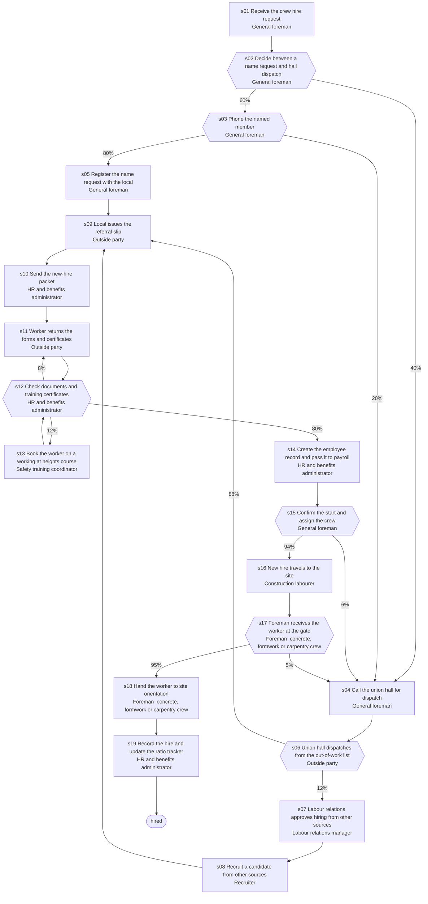

# Hire trades through the union hall

`gc-hr-hire-trades` · construction (non-residential general contracting) · human resources (labour relations) · part of `general-contractor-co`

When a self-perform crew needs another carpenter, finisher or labourer, the general foreman either asks a member he knows by name or calls the union hall, which dispatches the next qualified member from its out-of-work list with a referral slip. HR then collects the tax and banking forms and checks the working at heights and WHMIS certificates before the worker is set up for payroll and sent to site orientation. Hires are fast when the hall has members free, but in the spring ramp-up some trades run short, workers turn up without current training, and some never show, so crews start short-handed.

| | |
|---|---|
| Unit of work | one hourly hire |
| Starts when | The weekly crew plan asks for more workers of a trade on a project. |
| Done when | The worker has a referral slip, verified certificates and an employee record, and is at site orientation; or the request is refilled after a no-show. |
| Organisation | A Canadian national general contractor bound to ICI building trades agreements, hiring about 140 hourly trades a month into self-perform concrete, carpentry and labour crews. (2,800 employees, 2019-2022) |
| Volume | 140 cases a month (range 80 to 260) |

## Where it sits

- Starts with **hire_request** from spe-crew-planning (100% of cases)
- Relies on **collective_agreement** from hr-labour-relations (a standing input; it does not start a case)
- Sends **new_hire** to hse-safety-training (outcome: hired)
- Sends **new_hire** to fin-union-payroll (outcome: hired)
- Sends **hire_request** to unions (outcome: any)

## Flow

## Roles

| Role | Department | Layer | FTE on this process | Loaded cost per hour | Evidence |
|---|---|---|---:|---:|---|
| General foreman | Concrete and formwork crews | supervisor | 1.2 | 72 CAD | C |
| HR and benefits administrator | People and labour relations | individual contributor | 1.5 | 37 CAD | C |
| Labour relations manager | People and labour relations | manager | 0.05 | 95 CAD | C |
| Recruiter | People and labour relations | individual contributor | 0.2 | 50 CAD | C |
| Safety training coordinator | Health, safety and environment | individual contributor | 0.05 | 46 CAD | C |
| Foreman (concrete, formwork or carpentry crew) | Concrete and formwork crews | supervisor | 0.3 | 65 CAD | C |
| Construction labourer | Carpentry and general labour crews | individual contributor | 1 | 50 CAD | C |

## Steps

Hands-on time and the wait before each step show the most common value. Evidence tier A is a sourced number, B a sourced description, C the author's estimate.

| Step | Who | Kind | Hands-on | Wait before | Control | Evidence |
|---|---|---|---:|---:|---|---|
| **s01 Receive the crew hire request.** The general foreman takes the hire request from the weekly crew plan: trade and classification, number of workers, site, start date and any tickets the work needs (working at heights, forklift, swing stage). He writes it on his hiring list for the week. | General foreman | intake | 10 min | 2.0 h |  | C |
| **s02 Decide between a name request and hall dispatch.** The general foreman checks whether he knows a good member of the local who is out of work (from his own phone list or word on site) and whether the agreement's name-request share is still open on this project. Recalls of workers laid off in the last few weeks go through the layoff and recall process instead. | General foreman | judgment | 10 min | 0 min | Collective agreement hiring clause: hire through the Local Union office; a set share of hires may be requested by name (BACU-Guild ICI art. 5.01, 5.03) | B [bacu-ici], [liuna-183] |
| **s03 Phone the named member.** The general foreman calls the member, describes the site, start date and expected length of the job, and checks the member is free and has current working at heights and WHMIS cards. | General foreman | communication | 10 min | 1.0 h |  | C |
| **s04 Call the union hall for dispatch.** The general foreman phones the local's dispatcher with the job location, type of work, classification, agreement, start date and any special skills or tickets, and the dispatcher logs the request. | General foreman | communication | 10 min | 1.0 h |  | B [liuna-183] |
| **s05 Register the name request with the local.** The general foreman, or HR for larger requests, tells the local office which member is being hired by name so the hall can check the member's standing and the project's name-request share and issue the referral slip. | General foreman | communication | 10 min | 1.0 h | Collective agreement and union hiring rules: name hires need a referral or clearance slip before starting work (LIUNA Local 183 Rule 2.12; BACU-Guild ICI art. 5.01) | B [liuna-183], [bacu-ici] |
| **s06 Union hall dispatches from the out-of-work list.** The dispatcher calls members on the out-of-work list in order of registration who have the skills and tickets asked for, between noon and 5 p.m., until one accepts. In the spring ramp-up the list for some trades runs short. | Outside party | external wait | 0 min | 1.0 d |  | B [liuna-183] |
| **s07 Labour relations approves hiring from other sources.** When the local confirms it cannot supply qualified members in time, the labour relations manager checks the agreement and the union's confirmation, and approves hiring a non-member who must apply for probationary membership before starting. | Labour relations manager | approval | 30 min | 1.0 d | Collective agreement: employer may hire from other sources as probationary members when the union cannot supply (BACU-Guild ICI art. 5.05) | B [bacu-ici] |
| **s08 Recruit a candidate from other sources.** The recruiter posts the opening on job boards, calls referrals from foremen and screens candidates by phone for experience and tickets, then sends the chosen candidate to the local to sign up as a probationary member. | Recruiter | analysis | 2.0 h | 2.0 d |  | C |
| **s09 Local issues the referral slip.** The local office checks the member is in good standing (or signs up the probationary member) and issues a referral or clearance slip naming the employer and project, which the worker brings on the first day. | Outside party | external wait | 0 min | 4.0 h |  | B [liuna-183], [bacu-ici] |
| **s10 Send the new-hire packet.** The HR administrator emails the worker the new-hire packet: federal and provincial TD1 forms, direct deposit form, emergency contact, personal information form and the list of certificates to bring. | HR and benefits administrator | communication | 15 min | 2.0 h |  | C |
| **s11 Worker returns the forms and certificates.** The worker fills in the forms and sends photos of the referral slip, working at heights card, WHMIS certificate and any trade certificates, often from a phone, or brings them to the yard office. | Outside party | external wait | 0 min | 12.0 h |  | C |
| **s12 Check documents and training certificates.** The HR administrator checks that the forms are complete, the referral slip names the right project and classification, and the working at heights and WHMIS certificates are current and from approved providers, and records them in the HRIS training record. | HR and benefits administrator | validation | 25 min | 4.0 h | Ontario OHSA and O. Reg. 297/13: workers who use fall protection on construction projects must have approved working at heights training, and employers keep the training record | B [ihsa-start], [liuna-183], [bacu-ici] |
| **s13 Book the worker on a working at heights course.** The safety training coordinator books the worker on the next approved working at heights or WHMIS course, usually a one-day class, and sends the date; the start date moves back until the certificate is in hand. | Safety training coordinator | coordination | 20 min | 3.0 d | Working at heights training before work at heights (O. Reg. 297/13) | B [ihsa-start] |
| **s14 Create the employee record and pass it to payroll.** The HR administrator creates the employee in the HRIS with union local, classification, rate group, province, site and start date, and sends the packet to payroll for set-up before the next timecard batch. | HR and benefits administrator | data entry | 15 min | 4.0 h |  | C |
| **s15 Confirm the start and assign the crew.** The general foreman phones the worker to confirm the start date, time and gate, tells the foreman whose crew he joins, and checks PPE sizes and tools the worker must bring. | General foreman | coordination | 10 min | 2.0 h |  | C |
| **s16 New hire travels to the site.** On the first morning the new worker drives to the project; travel time and kilometres are paid when the site is outside the free travel zone of his local. | Construction labourer | travel | 45 min | 12.0 h |  | B [bacu-ici] |
| **s17 Foreman receives the worker at the gate.** The foreman meets the worker at the site gate, checks the referral slip and PPE, and waits for the owner's or the site's access badge on secured sites such as hospitals before walking him to the site orientation. | Foreman (concrete, formwork or carpentry crew) | intake | 15 min | 30 min | Site entry rules: PPE and site orientation before starting work (OHSA s. 25(2)(a)) | B [ihsa-start] |
| **s18 Hand the worker to site orientation.** The foreman hands the worker to the site safety coordinator for the site-specific orientation, which is recorded under the safety training process, and the worker joins the crew after it. | Foreman (concrete, formwork or carpentry crew) | communication | 5 min | 0 min |  | C |
| **s19 Record the hire and update the ratio tracker.** The HR administrator closes the hire on the hiring list, records whether it was a name request, dispatch or outside hire for the project's name-request ratio, and files the referral slip in the employee file. | HR and benefits administrator | data entry | 8 min | 4.0 h |  | C |

## Exceptions

| Exception | Share of cases | What happens |
|---|---:|---|
| Hall cannot supply | 5% | The local cannot supply qualified members in time and a probationary member is recruited from other sources. |
| Training missing or expired | 12% | The worker is booked on a working at heights or WHMIS course before starting. |
| No-show or drop-out | 10% | The worker takes another job or does not arrive and the hall is called again. |

## Benchmarks

| Metric | Value | Unit | Population | Evidence |
|---|---|---|---|---|
| cycle_time_days | p50 5, p90 12 | calendar days from hire request to the worker at site orientation | ICI union hiring by a large general contractor | C |
| name_request_share_allowed | 0.75 | share of additional hires | BACU-Guild ICI agreement, Ontario, 2022-2025 | A [bacu-ici] |

## Pain points

- In the spring ramp-up the out-of-work list for some trades runs short, so crews start short-handed while the hall searches or the company recruits outside. (steps s06, s07, s08; C)
- Workers arrive without current working at heights or WHMIS certificates and lose days waiting for a course seat. (steps s12, s13; B [ihsa-start], [liuna-183])
- Paper forms collected by phone photo are often incomplete, delaying payroll set-up for the first payday. (steps s11, s12, s14; C)

## Assumptions

- Name requests are 60% of hires, hall dispatch 40%, within the 75% name-request share some agreements allow.
- Recalls within the agreement's recall window are handled in hr-layoff-recall and are not counted here.
- Site-specific orientation is the next process (hse-safety-training) and is not timed here.
- The labourer role stands for any new hire's paid first-day travel.
- The organisation file lists hr-admin, general-foreman and labour-relations-manager; recruiter, safety-trainer and foreman are added because they do steps.
- Loaded costs come from the organisation file.
- The simulated median (about 6 days) is above the 5-day estimate because the triangular waits for dispatch and forms have long tails and 28% of cases loop back (missing training, incomplete forms, no-shows); both are author estimates and the gap is within the expected range.

## Sources

- [bacu-ici] [BACU-Guild Province Wide ICI Collective Agreement (marble, tile, terrazzo, cement masons, resilient floor layers and helpers), 1 April 2022 to 30 April 2025](https://negotech.service.canada.ca/eng/agreements/14/1448404a.pdf) (Brick and Allied Craft Union of Canada and Terrazzo, Tile & Marble Guild of Ontario; filed with Employment and Social Development Canada (Negotech), 2022). Art. 5.01 employer hires from the Local Union office and the union supplies a referral slip; 5.02 recall within 35 days of layoff; 5.03 75% of additional hires may be requested by name; 5.05 hire from other sources as probationary members when the union cannot supply; 7.03 union refers only members with Fall Arrest, WHMIS and Working at Heights training; 18.03 deductions and contributions compiled monthly and remitted with the report form by the 15th of the following month; 18.04 three remittance forms each month; 19.01 5% a month liquidated damages on remittances more than 10 days in arrears; 22.01 timesheets mandatory, paper sheets due by end of business day Monday after the workweek; 22.02 time books closed weekly and Thursday payday within four working days of closing; 22.03 direct deposit by 5 p.m. Thursday; 22.04 pay statement contents; 22.05 two hours' pay per day of late pay; 24.01 normal week of four or five days of 8 to 10 hours.
- [liuna-183] [Hiring Hall and Clearance Rules](https://liunalocal183.ca/hiring-hall-clearance-rules) (Labourers' International Union of North America (LIUNA) Local 183, 2026). All hiring through the union office and every person dispatched holds a referral slip (Rule 2.03); on an employer call the dispatcher records job location, type of work, classification and agreement (2.15); referral in order of registration with calls between 12 and 5 p.m. (2.16-2.17); name hires and recalls per the collective agreement, with a referral or clearance slip before starting (2.12); members certify OHSA, WHMIS and Working at Heights training (2.05, 3.04); penalty for failing to report or quitting within five days (2.21).
- [ihsa-start] [Getting Started](https://www.ihsa.ca/Topics-Hazards/Getting-Started.aspx) (Infrastructure Health and Safety Association (IHSA), 2026). Every construction worker should receive working at heights and WHMIS training; employers must give workers information, instruction and supervision (OHSA s. 25(2)(a)); further training depends on the work and hazards.

Written by claude-opus on 2026-11-24.
