# Complete daily hazard assessments and toolbox talks

`gc-hse-daily-hazard` · construction - non-residential general contracting · health, safety and environment · part of `general-contractor-co`

Before each shift the foreman of every self-perform crew walks the work area, writes a field level hazard assessment (FLHA) listing the day's tasks, hazards and controls, gets any work permits the tasks need, and holds a short toolbox talk where the crew reads and signs the form. During the day the foreman updates the form when the work or the weather changes, and at the end of the shift hands it in on paper or through a tablet app. Site safety coordinators file the forms, spot-check a sample and coach foremen whose forms are copied from the day before or too generic to be useful. The process is slow mostly because paper forms wait in site trailers to be keyed or scanned, and weak because repetitive work tempts foremen to copy yesterday's form.

| | |
|---|---|
| Unit of work | one crew-day hazard assessment |
| Starts when | A self-perform crew arrives at the site at the start of a shift with the day's work plan. |
| Done when | The day's FLHA is signed by the crew, closed out at the end of the shift, filed in the safety system and either spot-checked, reviewed or used to coach the foreman. |
| Organisation | A national Canadian general contractor with about 135 self-perform concrete, finishing and carpentry crews on about 220 active projects, holding COR certification in each province. (2,800 employees, 2019-2022) |
| Volume | 2,900 cases a month (range 2,400 to 3,300) |

## Where it sits

- Starts with **work_plan** from spe-concrete-placement (55% of cases)
- Starts with **work_plan** from spe-general-works (30% of cases)
- Starts with **work_plan** from ops-site-coordination (15% of cases)
- Relies on **site_safety_plan** from hse-site-safety-plan (a standing input; it does not start a case)
- Sends **hazard_report** to hse-site-inspection (outcome: any)
- Sends **hazard_report** to hse-incident-management (outcome: any)

## Flow

```mermaid
flowchart TD
    s01["s01 Review work plan and site safety plan<br/>Foreman  concrete, formwork or carpentry crew"]
    s02["s02 Walk the work area<br/>Foreman  concrete, formwork or carpentry crew"]
    s03{{"s03 Check weather and wind for the day's tasks<br/>Foreman  concrete, formwork or carpentry crew"}}
    s04["s04 Hold work and re-plan tasks for the weather<br/>Foreman  concrete, formwork or carpentry crew"]
    s05["s05 Write the field level hazard assessment<br/>Foreman  concrete, formwork or carpentry crew"]
    s06{{"s06 Decide whether a permit or plan is needed<br/>Foreman  concrete, formwork or carpentry crew"}}
    s07["s07 Issue the work permit<br/>Site superintendent"]
    s08["s08 Set up permit controls<br/>Construction labourer"]
    s09{{"s09 Hold the toolbox talk<br/>Foreman  concrete, formwork or carpentry crew"}}
    s10["s10 Concrete crew discusses and signs the assessment<br/>Carpenter  formwork and general"]
    s11["s11 General crew discusses and signs the assessment<br/>Construction labourer"]
    s12{{"s12 Confirm tickets, PPE and equipment pre-use checks<br/>Foreman  concrete, formwork or carpentry crew"}}
    s13["s13 Orient a new worker or verify training records<br/>Site safety coordinator"]
    s14{{"s14 Monitor work and reassess when conditions change<br/>Foreman  concrete, formwork or carpentry crew"}}
    s15["s15 Update the assessment and re-brief the crew<br/>Foreman  concrete, formwork or carpentry crew"]
    s16{{"s16 Close out the assessment at end of shift<br/>Foreman  concrete, formwork or carpentry crew"}}
    s17["s17 Report a near miss or open hazard<br/>Foreman  concrete, formwork or carpentry crew"]
    s18{{"s18 Hand in the form<br/>Foreman  concrete, formwork or carpentry crew"}}
    s19["s19 Scan and index paper forms<br/>Site safety coordinator"]
    s20{{"s20 Spot-check the form<br/>Site safety coordinator"}}
    s21{{"s21 Review the form against the work done<br/>Site safety coordinator"}}
    s22{{"s22 Coach the foreman<br/>Site safety coordinator"}}
    s23["s23 Escalate a repeat problem<br/>Regional safety manager"]
    s01 --> s02
    s02 --> s03
    s03 -->|"93%"| s05
    s03 -->|"7%"| s04
    s04 --> s05
    s05 --> s06
    s06 -->|"25%"| s07
    s06 -->|"75%"| s09
    s07 --> s08
    s08 --> s09
    s09 -->|"74%"| s10
    s09 -->|"26%"| s11
    s10 --> s12
    s11 --> s12
    s12 -->|"92%"| s14
    s12 -->|"8%"| s13
    s13 --> s14
    s14 -->|"18%"| s15
    s14 -->|"82%"| s16
    s15 --> s16
    s16 -->|"4%"| s17
    s16 -->|"96%"| s18
    s17 --> s18
    s18 -->|"60%"| s19
    s18 -->|"40%"| s20
    s19 --> s20
    s20 -->|"70%"| end0
    s20 -->|"30%"| s21
    s21 -->|"75%"| end1
    s21 -->|"25%"| s22
    s22 -->|"85%"| end2
    s22 -->|"15%"| s23
    s23 --> end3
    end0(["filed"])
    end1(["reviewed"])
    end2(["coached"])
    end3(["escalated"])
```

## Roles

| Role | Department | Layer | FTE on this process | Loaded cost per hour | Evidence |
|---|---|---|---:|---:|---|
| Foreman (concrete, formwork or carpentry crew) | Concrete and formwork crews | supervisor | 27 | 65 CAD | C |
| Carpenter (formwork and general) | Concrete and formwork crews | individual contributor | 21 | 62 CAD | C |
| Construction labourer | Carpentry and general labour crews | individual contributor | 9 | 50 CAD | C |
| Site safety coordinator | Health, safety and environment | individual contributor | 4.8 | 50 CAD | C |
| Site superintendent | Construction operations | supervisor | 1.7 | 75 CAD | C |
| Regional safety manager | Health, safety and environment | manager | 0.1 | 80 CAD | C |

## Steps

Hands-on time and the wait before each step show the most common value. Evidence tier A is a sourced number, B a sourced description, C the author's estimate.

| Step | Who | Kind | Hands-on | Wait before | Control | Evidence |
|---|---|---|---:|---:|---|---|
| **s01 Review work plan and site safety plan.** The foreman reads the day's work plan from the superintendent, the site safety plan and yesterday's FLHA for the same area, and notes which tasks, trades and equipment will be working near the crew. | Foreman (concrete, formwork or carpentry crew) | lookup | 5 min | 5 min |  | C |
| **s02 Walk the work area.** Before the crew starts, the foreman walks the deck, wall or room where the crew will work and looks for open edges, floor openings, overhead loads, energised services, poor footing, weather damage and work by other trades above or below. | Foreman (concrete, formwork or carpentry crew) | physical | 10 min | 5 min | Alberta OHS Code Part 2 s.7(1) and the company COR program: assess the site before work begins | B [ab-code] |
| **s03 Check weather and wind for the day's tasks.** The foreman checks the forecast and the site anemometer or crane wind reading, because high wind, lightning, heavy rain or extreme cold stop crane lifts, work at heights, concrete placement and some formwork tasks. | Foreman (concrete, formwork or carpentry crew) | lookup | 3 min | 2 min |  | C |
| **s04 Hold work and re-plan tasks for the weather.** The foreman stops the affected tasks, keeps the crew in the trailer or moves them to sheltered work, phones the superintendent to agree a revised task list and waits for the wind or rain to drop before writing the assessment. | Foreman (concrete, formwork or carpentry crew) | judgment | 20 min | 2.0 h | Company crane and work-at-heights procedures: wind and lightning limits | C |
| **s05 Write the field level hazard assessment.** The foreman fills in the FLHA card or tablet form: each task, the hazards found on the walk, the controls such as guardrails, harness tie-off points and exclusion zones, the emergency muster point and the PPE required, and signs it. | Foreman (concrete, formwork or carpentry crew) | drafting | 10 min | 5 min | Alberta OHS Code Part 2 s.7(2)-(3): written hazard assessment report with controls and date; COR element on hazard assessment | B [ab-code] |
| **s06 Decide whether a permit or plan is needed.** The foreman checks the tasks against the site safety plan's permit list: hot work, confined space entry, excavation entry, energised equipment, critical crane lifts and work on a swing stage each need a signed permit or plan before starting. | Foreman (concrete, formwork or carpentry crew) | judgment | 3 min | 1 min |  | C |
| **s07 Issue the work permit.** The superintendent or assistant superintendent reads the FLHA and permit request, walks to the location if needed, checks that fire watch, gas testing, shoring or lift plan are in place and signs the permit with its time limit. | Site superintendent | approval | 15 min | 30 min | Site safety plan permit-to-work procedure; O. Reg. 213/91 confined space and excavation provisions; Alberta OHS Code hot work and confined space parts | C |
| **s08 Set up permit controls.** A labourer sets up the controls the permit names: fire extinguisher and fire watch for hot work, barricades and signs for an exclusion zone, gas detector readings for a confined space, or a spotter for equipment near the work. | Construction labourer | physical | 30 min | 5 min | Conditions of the signed work permit | C |
| **s09 Hold the toolbox talk.** The foreman gathers the crew at the work area, reads out the FLHA tasks, hazards and controls, covers any permit conditions, adds a short topic from the safety talks manual and asks each worker about hazards they see. | Foreman (concrete, formwork or carpentry crew) | communication | 10 min | 2 min | Company COR program: pre-shift toolbox talk recorded with attendance | B [ihsa-talks] |
| **s10 Concrete crew discusses and signs the assessment.** Each carpenter or finisher on the concrete crew listens to the talk, raises hazards from their own task, initials the FLHA card or taps sign-off on the tablet and confirms they know the muster point. Minutes are the crew's total person-minutes. | Carpenter (formwork and general) | communication | 1.2 h | 0 min | Alberta OHS Code Part 2 s.8: involve affected workers in hazard assessment and controls | B [ab-code], [ihsa-talks] |
| **s11 General crew discusses and signs the assessment.** Each labourer or carpenter on the general works crew listens to the talk, raises hazards from their own task, initials the FLHA and confirms PPE and the muster point. Minutes are the crew's total person-minutes. | Construction labourer | communication | 55 min | 0 min | Alberta OHS Code Part 2 s.8: involve affected workers in hazard assessment and controls | B [ab-code], [ihsa-talks] |
| **s12 Confirm tickets, PPE and equipment pre-use checks.** The foreman checks that workers doing the day's tasks hold the needed training such as working at heights or elevated work platform cards, have the PPE listed on the FLHA, and that the telehandler and lift operators have done their pre-use inspections. | Foreman (concrete, formwork or carpentry crew) | validation | 5 min | 2 min | O. Reg. 213/91 and Ontario working at heights training requirements; manufacturer pre-use inspection of equipment | C |
| **s13 Orient a new worker or verify training records.** The site safety coordinator gives the new worker the site-specific orientation, or looks up the worker's training records in the safety system and the union's records, and either clears the worker or reassigns them to tasks they are qualified for. | Site safety coordinator | communication | 30 min | 45 min | Site safety plan: site-specific orientation before starting work; COR training element | C |
| **s14 Monitor work and reassess when conditions change.** During the shift the foreman watches the crew's work and checks whether tasks, equipment, other trades or the weather have changed enough that the morning assessment no longer covers the hazards. | Foreman (concrete, formwork or carpentry crew) | judgment | 5 min | 4.0 h |  | B [ab-code] |
| **s15 Update the assessment and re-brief the crew.** The foreman adds the new task or hazard and its controls to the FLHA, stops the crew for a short re-brief and collects initials from the workers affected. | Foreman (concrete, formwork or carpentry crew) | drafting | 15 min | 5 min | Alberta OHS Code Part 2 s.7(4): repeat the assessment when a work process changes | B [ab-code] |
| **s16 Close out the assessment at end of shift.** At the end of the shift the foreman records on the FLHA whether hazards remain open, whether anyone was hurt and any near misses, and signs the close-out section. | Foreman (concrete, formwork or carpentry crew) | data entry | 4 min | 3.0 h |  | C |
| **s17 Report a near miss or open hazard.** The foreman phones or messages the safety coordinator and superintendent, describes the near miss or hazard, and fills in the hazard or near miss report in the safety system so it can be investigated. | Foreman (concrete, formwork or carpentry crew) | communication | 15 min | 10 min | Company incident and near miss reporting procedure | C |
| **s18 Hand in the form.** The foreman drops the paper FLHA in the trailer collection box or syncs the tablet form to the safety system, depending on whether the site has moved to the electronic form. | Foreman (concrete, formwork or carpentry crew) | data entry | 2 min | 5 min |  | C |
| **s19 Scan and index paper forms.** The safety coordinator collects the paper forms from the trailer box, scans them, names each file by date, crew and area and attaches it to the site's record in the safety system. | Site safety coordinator | data entry | 3 min | 1.0 d |  | C |
| **s20 Spot-check the form.** The safety coordinator opens the day's forms for the site, checks each has tasks, hazards, controls and crew signatures, and picks a sample, or any form that looks copied, for a closer review. | Site safety coordinator | review | 2 min | 4.0 h | COR audit: documented review of hazard assessments by supervisors and safety staff | B [acsa-cor] |
| **s21 Review the form against the work done.** The safety coordinator compares the form with what the crew was actually doing that day, from photos, the daily report and a site walk, and checks whether hazards and controls are specific to the task or generic and copied. | Site safety coordinator | validation | 12 min | 4.0 h | COR audit hazard assessment element: quality of field level hazard assessments | C |
| **s22 Coach the foreman.** On the next site visit the safety coordinator sits with the foreman, shows the weak form beside the actual work and agrees what a specific assessment would have said, then notes the coaching in the safety system. | Site safety coordinator | communication | 15 min | 20.0 h |  | C |
| **s23 Escalate a repeat problem.** The regional safety manager reviews the foreman's recent forms and coaching records, meets the general foreman, and decides on retraining, closer supervision or a written warning under the company's safety discipline policy. | Regional safety manager | review | 30 min | 3.0 d | Company safety accountability and progressive discipline policy | C |

## Exceptions

| Exception | Share of cases | What happens |
|---|---:|---|
| Weather hold at shift start | 7% | Wind, lightning or heavy rain stops lifts or work at heights; the crew waits or is re-planned before the assessment is written. |
| Permit-required work | 25% | Hot work, confined space, excavation or critical lifts need a superintendent-signed permit and set-up controls before the talk. |
| New or uncertified worker | 8% | A worker dispatched from the union hall needs orientation or proof of training before starting. |
| Copied or generic form | 7% | A sampled form turns out to be copied from the day before; the foreman is coached and repeat cases go to the safety manager. |

## Benchmarks

| Metric | Value | Unit | Population | Evidence |
|---|---|---|---|---|
| cycle_time_days | p50 2, p90 3.5 | calendar days from crew arrival to the form being filed and checked in the safety system | Self-perform crews of a Canadian general contractor, 2019-2022 | C |
| toolbox_talk_length | 5 | minutes per safety talk | Ontario construction supervisors using the IHSA safety talks manual | A [ihsa-talks] |

## Pain points

- Foremen copy the previous day's FLHA on repetitive deck and wall cycles, so the form misses hazards that changed overnight. (steps s05, s21; C)
- Paper forms sit in trailer boxes for a day or more before scanning, so the office cannot see open hazards or trends until later. (steps s18, s19; C)
- Crews wait at shift start for a superintendent to sign permits, holding the whole crew idle. (steps s07; C)
- Coordinators can review only a sample of about 2,900 forms a month, so most forms are filed without anyone reading them closely. (steps s20, s21; C)

## Assumptions

- Ontario's O. Reg. 213/91 does not use the term field level hazard assessment; the company applies the same COR-based FLHA form in every province, and Alberta's OHS Code Part 2 is cited as the most explicit written requirement.
- Concrete, finishing and formwork crew members are modelled with the carpenter role and carpentry and general crews with the labourer role; finishers are not split out.
- Crew attendance at the talk is recorded as the crew's total person-minutes on one step, so the carpenter and labourer FTEs represent many workers each spending 10 to 15 minutes a day.
- The superintendent signs permits; the organisation file's process entry does not list the superintendent or safety manager as roles.
- Loaded costs come from the organisation file (wage plus about 35 to 45% for benefits, union contributions and overhead as set there).
- The validator's staffing check uses 130 productive hours a month; field roles work closer to 170 hours in season, so stated field FTEs are slightly high relative to headcount.

## Sources

- [ab-code] [Occupational Health and Safety Code, Part 2: Hazard Assessment, Elimination and Control](https://search-ohs-laws.alberta.ca/legislation/occupational-health-and-safety-code/part-2-hazard-assessment-elimination-and-control) (Government of Alberta, 2009). s.7: assess the work site before work begins, prepare a written report with the controls and the date, repeat at reasonably practicable intervals and when work or processes change; s.8: involve affected workers in the assessment and the controls.
- [ihsa-talks] [Safety Talks Manual](https://www.ihsa.ca/IHSA/Products/Items/Safety-Talks-Manual.aspx) (Infrastructure Health and Safety Association, 2026). 168 five-minute safety talks for supervisors and health and safety representatives; separate Safety Talk Report Form log book records subject, attendees and results as documentation that talks were delivered on site.
- [acsa-cor] [COR Process](https://www.youracsa.ca/cor-secor/cor-process/) (Alberta Construction Safety Association, 2026). COR needs an external audit score of at least 80%, is valid three years with annual internal maintenance audits of at least 60%, and audits review documentation, interviews and observations.

Written by claude-opus on 2026-11-24.
