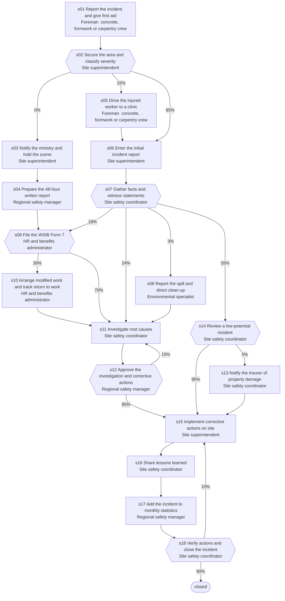

# Report and investigate incidents

`gc-hse-incident-management` · construction - non-residential general contracting · health, safety and environment · part of `general-contractor-co`

When someone is hurt, nearly hurt, equipment is damaged or fuel is spilled on a project, the foreman gives first aid and reports it, the superintendent secures the area and decides how serious it is, and the safety team records and investigates it. Critical injuries must be phoned in to the provincial ministry at once with a written report within 48 hours, and injuries needing health care or time off go to the workers' compensation board within three business days, while HR arranges modified work. Investigations look for root causes, the safety manager approves corrective actions, and the coordinator closes the case once they are in place. The process is slow when investigations wait for the safety manager's sign-off and when corrective actions need materials or other trades, and error-prone when incidents are reported late or witness statements are thin.

| | |
|---|---|
| Unit of work | one incident |
| Starts when | A worker, foreman or subcontractor reports an injury, near miss, property damage or spill on a company project. |
| Done when | The incident is recorded, required regulator and workers' compensation reports are filed, the investigation is approved and its corrective actions are verified and closed. |
| Organisation | A national Canadian general contractor acting as constructor on about 220 active projects, covering incidents to its own workers and to subcontractor workers on its sites. (2,800 employees, 2019-2022) |
| Volume | 90 cases a month (range 60 to 130) |

## Where it sits

- Starts with **incident_report** from ops-site-coordination (85% of cases)
- Starts with **hazard_report** from hse-daily-hazard (15% of cases)
- Sends **injury_report** to wcb (outcome: any)
- Sends **injury_report** to ministry-labour (outcome: any)
- Sends **incident_report** to legal-insurance-claims (outcome: any)
- Sends **incident_report** to exec-operational-review (outcome: any)
- Sends **incident_report** to environment-regulator (outcome: any)

## Flow

## Roles

| Role | Department | Layer | FTE on this process | Loaded cost per hour | Evidence |
|---|---|---|---:|---:|---|
| Foreman (concrete, formwork or carpentry crew) | Concrete and formwork crews | supervisor | 0.4 | 65 CAD | C |
| Site superintendent | Construction operations | supervisor | 1.6 | 75 CAD | C |
| Site safety coordinator | Health, safety and environment | individual contributor | 3.3 | 50 CAD | C |
| Regional safety manager | Health, safety and environment | manager | 0.45 | 80 CAD | C |
| HR and benefits administrator | People and labour relations | individual contributor | 0.2 | 37 CAD | C |
| Environmental specialist | Health, safety and environment | senior specialist | 0.05 | 55 CAD | C |

## Steps

Hands-on time and the wait before each step show the most common value. Evidence tier A is a sourced number, B a sourced description, C the author's estimate.

| Step | Who | Kind | Hands-on | Wait before | Control | Evidence |
|---|---|---|---:|---:|---|---|
| **s01 Report the incident and give first aid.** The injured worker or a witness tells the foreman, who gives first aid or calls the site first aider, makes the area safe and phones the superintendent; for a near miss the foreman reports what nearly happened. | Foreman (concrete, formwork or carpentry crew) | intake | 10 min | 15 min | Company incident reporting procedure: report before the end of the shift | C |
| **s02 Secure the area and classify severity.** The superintendent goes to the location, keeps people away from the scene, checks the worker's condition and classifies the event as near miss, first aid, medical aid, lost time, critical injury, property damage or spill. | Site superintendent | judgment | 30 min | 15 min |  | C |
| **s03 Notify the ministry and hold the scene.** The superintendent calls 911 if needed, phones the ministry inspector, the joint health and safety committee or representative and the union immediately, and keeps the scene undisturbed until an inspector allows it to be changed. | Site superintendent | communication | 40 min | 10 min | Ontario OHSA s.51: immediate notice of a death or critical injury and preservation of the scene | B [ccohs-report] |
| **s04 Prepare the 48-hour written report.** The regional safety manager attends the site, collects the facts, photos and witness names, and writes the report to the ministry director with the prescribed details, copying the committee and union, within 48 hours. | Regional safety manager | drafting | 5.0 h | 8.0 h | Ontario OHSA s.51(1): written report to the Director within 48 hours | B [ccohs-report] |
| **s05 Drive the injured worker to a clinic.** The foreman or site first aider drives the worker in a company pickup to the walk-in clinic or hospital emergency department, waits with them, and brings back the treatment and work-restriction form. | Foreman (concrete, formwork or carpentry crew) | travel | 2.0 h | 10 min | Workplace Safety and Insurance Act: employer pays transport to first treatment and the day's wages | B [wsib-report] |
| **s06 Enter the initial incident report.** Before the end of the day the superintendent enters the initial report in the safety system: who, where, when, what happened, the immediate cause, first aid given and photos. | Site superintendent | data entry | 30 min | 4.0 h | Company incident reporting procedure | C |
| **s07 Gather facts and witness statements.** The safety coordinator reads the initial report, goes to the location, takes witness statements, photos and measurements, checks the FLHA and training records for the crew, and corrects the severity classification if needed. | Site safety coordinator | intake | 1.0 h | 12.0 h | COR incident investigation element | B [ccohs-invest] |
| **s08 Report the spill and direct clean-up.** The environmental specialist confirms what spilled and how much, reports it to the provincial spills line when it may affect the environment, and directs the clean-up contractor and disposal records. | Environmental specialist | communication | 2.0 h | 4.0 h | Ontario Environmental Protection Act spill reporting (Part X) and provincial equivalents | C |
| **s09 File the WSIB Form 7.** The HR and benefits administrator completes the employer's report of injury (Form 7) online from the incident report and clinic form, gives the worker a copy and starts the claim file. | HR and benefits administrator | data entry | 45 min | 1.5 d | WSIB: employer reports within three business days of learning of the injury | A [wsib-report], [ccohs-report] |
| **s10 Arrange modified work and track return to work.** The HR administrator reads the clinic's work restrictions, agrees suitable modified duties with the superintendent, sends the written offer to the worker and WSIB, and tracks the worker until they return to full duties. | HR and benefits administrator | coordination | 1.0 h | 8.0 h | Workplace Safety and Insurance Act duty to co-operate in early and safe return to work | B [wsib-report] |
| **s11 Investigate root causes.** The safety coordinator leads the investigation with the superintendent, the foreman and the committee worker member, rebuilds the sequence of events and asks why each condition existed, then writes causes and proposed corrective actions in the safety system. | Site safety coordinator | analysis | 3.0 h | 1.0 d | COR incident investigation element: root cause and corrective actions | B [ccohs-invest] |
| **s12 Approve the investigation and corrective actions.** The regional safety manager reads the investigation, checks that root causes go beyond the injured worker, and approves the corrective actions, owners and due dates or sends it back. | Regional safety manager | approval | 45 min | 3.0 d | Company incident management procedure: manager sign-off of investigations | B [ccohs-invest] |
| **s13 Notify the insurer of property damage.** When a low-potential incident involves property or third-party damage, the safety coordinator sends the incident report and photos to the risk and insurance team for an insurance notice. | Site safety coordinator | communication | 15 min | 1.0 h |  | C |
| **s14 Review a low-potential incident.** For a first aid or low-potential near miss, the safety coordinator reviews the facts, records a simple cause and a corrective action such as housekeeping or a toolbox talk, and assigns it to the foreman. | Site safety coordinator | review | 20 min | 12.0 h | COR incident investigation element | C |
| **s15 Implement corrective actions on site.** The superintendent puts the actions in place: guardrails or covers installed, equipment repaired or replaced, a procedure changed, a trade's worker retrained, or a site-wide safety stand-down held. | Site superintendent | physical | 45 min | 3.0 d |  | C |
| **s16 Share lessons learned.** The safety coordinator writes a short safety alert or toolbox talk on the incident, sends it to the region's sites and checks that foremen covered it at the next talks. | Site safety coordinator | communication | 30 min | 12.0 h |  | B [ccohs-invest] |
| **s17 Add the incident to monthly statistics.** The regional safety manager's monthly report pulls the incident into the injury frequency and severity figures and the list of serious incidents for the operations review. | Regional safety manager | analysis | 5 min | 1.0 h |  | C |
| **s18 Verify actions and close the incident.** The safety coordinator checks on site that each corrective action is in place and working, attaches photos, and closes the incident in the safety system, or re-opens the action if it is missing or ineffective. | Site safety coordinator | validation | 15 min | 3.0 d | COR incident investigation element: follow-up of corrective actions | B [ccohs-invest] |

## Exceptions

| Exception | Share of cases | What happens |
|---|---:|---|
| Critical injury | 0% | Immediate ministry, committee and union notice, scene held for the inspector, 48-hour written report and WSIB report. |
| Lost time or modified work | 5% | WSIB Form 7 within three business days and a modified work offer tracked by HR. |
| Spill | 3% | Fuel, hydraulic oil or concrete washout reaches soil or a drain; the environmental specialist reports and directs clean-up. |
| Investigation sent back | 7% | The safety manager rejects an investigation that blames the worker without finding the system cause. |

## Benchmarks

| Metric | Value | Unit | Population | Evidence |
|---|---|---|---|---|
| cycle_time_days | p50 13, p90 25 | calendar days from report to incident closed | Construction incidents reported on Canadian general contractor projects | C |
| wsib_reporting_deadline | 3 | business days from learning of the injury | Ontario employers | A [wsib-report] |
| critical_injury_written_report_deadline | 48 | hours | Ontario employers under OHSA s.51 | A [ccohs-report] |

## Pain points

- Investigations queue for the regional safety manager's approval, covering dozens of sites each. (steps s12; C)
- Late or thin first reports leave the coordinator chasing witnesses days later, and injuries first classed as first aid become WSIB cases after the deadline clock has started. (steps s01, s02, s07, s09; C)
- Corrective actions wait for materials, rented equipment or the responsible trade, so incidents stay open for weeks. (steps s15, s18; C)

## Assumptions

- Ontario rules (OHSA s.51, WSIB Form 7) are used as the reference; Alberta requires serious incidents to be reported to a Director as soon as possible and the WCB employer report within 72 hours, which gives similar timing.
- Step s13 (insurance notice) is reached only from low-potential property damage cases; higher-value damage claims are handled in legal-insurance-claims after s11.
- The ministry inspector's visit and any orders after a critical injury belong to hse-ministry-inspection and are not modelled here.
- WSIB claim adjudication and long return-to-work cases continue after the incident is closed and are not part of the cycle time.
- The foreman, environmental specialist and HR administrator take part although the process map lists only the safety coordinator, safety manager, superintendent and HR administrator.
- Loaded costs and shift patterns come from the organisation file.

## Sources

- [ccohs-report] [Health and Safety Legislation in Canada - Injury Reporting](https://www.ccohs.ca/oshanswers/legisl/legislation/injury_reporting.html) (Canadian Centre for Occupational Health and Safety, 2026). Ontario OHSA s.51: notify an inspector immediately by telephone and send a written report within 48 hours for a death or critical injury; WSIB report within 3 days; Alberta: report serious incidents to a Director as soon as possible and submit the WCB employer report within 72 hours.
- [ccohs-invest] [Incident Investigation](https://www.ccohs.ca/oshanswers/hsprograms/investig.html) (Canadian Centre for Occupational Health and Safety, 2026). Investigation by a team including the supervisor, workers and a committee member; start as soon as possible, secure the scene and identify witnesses; look for root causes with tools such as 5 Whys; management assigns corrective actions with a timetable and monitors completion; committee can monitor progress.
- [wsib-report] [Report an injury or illness](https://www.wsib.ca/en/businesses/claims/report-injury-or-illness) (Workplace Safety and Insurance Board (Ontario), 2026). Employer reports on Form 7 within three business days when a worker needs health care beyond first aid, loses time or pay, or needs modified work at regular pay for more than seven days; give the worker a copy; penalties for late reporting.

Written by claude-opus on 2026-11-24.
