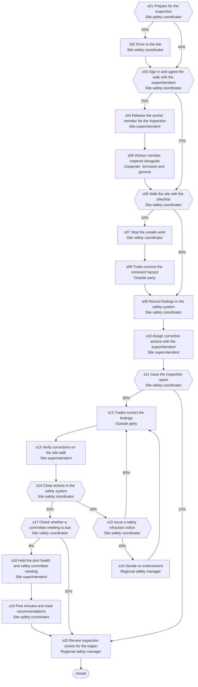

# Inspect sites and run the safety committee

`gc-hse-site-inspection` · construction - non-residential general contracting · health, safety and environment · part of `general-contractor-co`

Each week a site safety coordinator, or on smaller projects a coordinator who covers several sites, walks every active project with a checklist, records unsafe conditions such as missing guardrails, open floor holes and poor housekeeping, and stops work that puts someone in immediate danger. Once a month the walk is the joint health and safety committee inspection, with a worker member alongside. The superintendent assigns each finding to the responsible trade with a due date, and the coordinator follows up until it is closed; trades that repeat findings get written notices, back-charges or workers removed. The slow part is getting subcontractors to correct findings, which can take days to weeks, and closing items in the system when coordinators move between sites.

| | |
|---|---|
| Unit of work | one site safety inspection |
| Starts when | The weekly inspection for a project falls due on the coordinator's schedule. |
| Done when | Every finding from the inspection has been corrected and closed in the safety system, and the inspection score is included in the regional safety report. |
| Organisation | A national Canadian general contractor acting as constructor on about 220 active projects, with 45 site safety coordinators and 6 regional safety managers. (2,800 employees, 2019-2022) |
| Volume | 950 cases a month (range 800 to 1,100) |

## Where it sits

- Starts with **site_safety_plan** from hse-site-safety-plan (100% of cases)
- Relies on **hazard_report** from hse-daily-hazard (a standing input; it does not start a case)
- Sends **inspection_report** to ops-site-coordination (outcome: any)
- Sends **inspection_report** to ops-subcontractor-performance (outcome: any)
- Sends **inspection_report** to hse-cor-audit (outcome: any)
- Sends **compliance_notice** to subcontractor (outcome: any)

## Flow

## Roles

| Role | Department | Layer | FTE on this process | Loaded cost per hour | Evidence |
|---|---|---|---:|---:|---|
| Site safety coordinator | Health, safety and environment | individual contributor | 25 | 50 CAD | C |
| Site superintendent | Construction operations | supervisor | 7 | 75 CAD | C |
| Carpenter (formwork and general) | Concrete and formwork crews | individual contributor | 2.4 | 62 CAD | C |
| Regional safety manager | Health, safety and environment | manager | 0.9 | 80 CAD | C |

## Steps

Hands-on time and the wait before each step show the most common value. Evidence tier A is a sourced number, B a sourced description, C the author's estimate.

| Step | Who | Kind | Hands-on | Wait before | Control | Evidence |
|---|---|---|---:|---:|---|---|
| **s01 Prepare for the inspection.** The safety coordinator opens the project's record in the safety system, reads open findings from last week, recent hazard and near miss reports and the three-week look-ahead schedule, and picks the high-risk activities to look at closely. | Site safety coordinator | lookup | 15 min | 12.0 h |  | C |
| **s02 Drive to the site.** The coordinator drives a company pickup from the office or another project to this site, often combining two or three sites in a day. | Site safety coordinator | travel | 40 min | 30 min |  | C |
| **s03 Sign in and agree the walk with the superintendent.** The coordinator signs in, waits for site access where the building is occupied (hospital wards, schools in session) and meets the superintendent to hear what work is under way and which trades are on site today. | Site safety coordinator | coordination | 15 min | 15 min |  | C |
| **s04 Release the worker member for the inspection.** The superintendent asks the foreman to release the worker member of the joint health and safety committee, or the health and safety representative on a smaller project, so that they can walk the site with the coordinator. | Site superintendent | coordination | 5 min | 15 min | Ontario OHSA s.9: a designated worker member inspects the workplace at least monthly | B [ihsa-jhsc] |
| **s05 Worker member inspects alongside.** The worker member walks with the coordinator, talks to workers from each trade about their concerns, adds findings from the workers' side and signs the monthly inspection record. | Carpenter (formwork and general) | physical | 1.2 h | 0 min | Ontario OHSA s.9: monthly workplace inspection by a committee worker member | B [ihsa-jhsc] |
| **s06 Walk the site with the checklist.** The coordinator walks every active floor and the perimeter with the inspection checklist, checking guardrails and floor-hole covers, scaffolds and ladders, excavations, temporary electrical, crane and rigging, housekeeping, fire protection and PPE, and photographs each finding. | Site safety coordinator | physical | 1.0 h | 5 min | COR workplace inspection element and the site safety plan: documented weekly inspection | B [acsa-cor] |
| **s07 Stop the unsafe work.** The coordinator stops the work at once, for example a worker at an unprotected edge or an unshored trench, tells the trade's foreman what must change before work restarts and informs the superintendent. | Site safety coordinator | judgment | 20 min | 0 min | Constructor's duty under Ontario OHSA s.23 and the company stop-work authority | C |
| **s08 Trade corrects the imminent hazard.** The subcontractor's foreman has the crew install guardrails, tie off, shore the excavation or remove the worker before restarting; the coordinator checks it before leaving the area. | Outside party | external wait | 0 min | 1.5 h |  | C |
| **s09 Record findings in the safety system.** Back in the site trailer the coordinator enters each finding in the safety system with its photo, location, hazard category, responsible trade and a risk rating, and scores the inspection. | Site safety coordinator | data entry | 20 min | 30 min |  | C |
| **s10 Assign corrective actions with the superintendent.** The coordinator goes through the findings with the superintendent, who confirms which trade owns each, sets a due date by risk, and decides which items his own crews will fix. | Site superintendent | coordination | 20 min | 1.0 h |  | C |
| **s11 Issue the inspection report.** The coordinator issues the report from the safety system by email to the superintendent, project manager and each subcontractor with findings, and posts it on the site safety board. | Site safety coordinator | communication | 15 min | 1.0 h | Ontario OHSA s.9: committee inspection findings reported to the committee; COR documentation | C |
| **s12 Trades correct the findings.** Each subcontractor with findings assigns them to its foreman, fixes them in the course of work and tells the superintendent when done; many need materials, a lift or a crew to come back to the floor. | Outside party | external wait | 0 min | 2.0 d |  | C |
| **s13 Verify corrections on the site walk.** The superintendent or assistant superintendent checks each corrected item during the daily site walk and marks it corrected on the printed list or in the app. | Site superintendent | validation | 20 min | 1.0 d |  | C |
| **s14 Close actions in the safety system.** On the next visit the coordinator checks the superintendent's list against the site and closes each corrected action in the safety system, re-opening any item that is not fixed. | Site safety coordinator | data entry | 10 min | 1.0 d |  | C |
| **s15 Issue a safety infraction notice.** The coordinator writes a safety infraction notice to the subcontractor naming the uncorrected or repeated finding, the rule broken and the deadline, and copies the project manager for the subcontractor performance file. | Site safety coordinator | drafting | 25 min | 2.0 h | Subcontract safety clauses and the company progressive enforcement procedure | C |
| **s16 Decide on enforcement.** The regional safety manager reviews the trade's record and decides on a back-charge for the GC fixing the item, removal of a worker from site, or a meeting with the subcontractor's owner, and records the decision. | Regional safety manager | approval | 30 min | 2.0 d | Company subcontractor safety enforcement policy | C |
| **s17 Check whether a committee meeting is due.** The coordinator checks the committee calendar; on projects with a joint health and safety committee, a meeting is due at least every three months and the inspection findings go on its agenda. | Site safety coordinator | lookup | 3 min | 5 min |  | B [ihsa-jhsc] |
| **s18 Hold the joint health and safety committee meeting.** The superintendent co-chairs the committee meeting with the worker co-chair, reviews inspection findings, incidents and worker concerns since the last meeting, and agrees written recommendations. | Site superintendent | coordination | 1.5 h | 5.0 d | Ontario OHSA s.9: joint health and safety committee meets at least every three months | B [ihsa-jhsc] |
| **s19 Post minutes and track recommendations.** The coordinator types the minutes, posts them on the site safety board, files them in the safety system and logs each recommendation with an owner and due date. | Site safety coordinator | drafting | 45 min | 1.0 d | Ontario OHSA s.9: committee minutes and recommendations kept and available | B [ihsa-jhsc] |
| **s20 Review inspection scores for the region.** The regional safety manager opens the weekly inspection dashboard, compares this site's score and open items with other sites, and raises poor trends with the operations manager. | Regional safety manager | review | 4 min | 1.0 d |  | C |

## Exceptions

| Exception | Share of cases | What happens |
|---|---:|---|
| Imminent danger stop-work | 10% | A worker is exposed to an immediate hazard; work stops until the trade corrects it. |
| Uncorrected or repeated finding | 15% | A trade does not fix a finding by the due date; a written notice and possibly enforcement by the safety manager follow, and the loop repeats until corrected. |
| Quarterly committee meeting | 7% | The committee meets, reviews findings and issues recommendations. |

## Benchmarks

| Metric | Value | Unit | Population | Evidence |
|---|---|---|---|---|
| cycle_time_days | p50 10, p90 21 | calendar days from the inspection falling due to all findings closed and reported | Weekly site safety inspections on Canadian commercial building projects | C |
| committee_inspection_frequency | 1 | workplace inspections per month by the committee worker member | Ontario construction projects with a JHSC or health and safety representative | A [ihsa-jhsc] |

## Pain points

- Subcontractors take days to weeks to correct findings, and the same findings recur on the next walk. (steps s12, s15; C)
- Coordinators covering several sites lose an hour or more a day driving, and actions stay open in the system until their next visit. (steps s02, s14; C)
- Findings are photographed on site and re-typed in the trailer, so reports lag the walk. (steps s09; C)

## Assumptions

- The worker member of the committee is modelled with the carpenter role because most worker members come from the company's own carpentry and concrete crews; the organisation file does not list a worker role for this process.
- Ontario committee rules are used as the reference because the head office and about half the field work are in Ontario; Alberta and the Atlantic provinces have similar committee or representative duties.
- Correcting findings is done by subcontractors and costs them, not the company, so it carries no touch time here.
- Loaded costs and shift patterns come from the organisation file.

## Sources

- [ihsa-jhsc] [JHSC / Health and Safety Representative](https://www.ihsa.ca/Resources/HS_Rep.aspx) (Infrastructure Health and Safety Association, 2026). Ontario construction projects: health and safety representative for 6 to 19 workers, joint health and safety committee for 20 or more workers on projects over three months; monthly workplace inspection; committee meets at least every three months; certified members on projects of 50 or more workers; worker trades committee on large multi-trade projects.
- [acsa-cor] [COR Process](https://www.youracsa.ca/cor-secor/cor-process/) (Alberta Construction Safety Association, 2026). COR needs an external audit score of at least 80%, is valid three years with annual internal maintenance audits of at least 60%, and audits review documentation, interviews and observations.

Written by claude-opus on 2026-11-24.
