# Plan site safety and file the notice of project

`gc-hse-site-safety-plan` · construction - non-residential general contracting · health, safety and environment · part of `general-contractor-co`

Before work starts on a new site the general contractor, as the legal constructor, must plan how the site will be run safely and tell the ministry about the project. The safety coordinator and superintendent walk the site, write the site-specific safety plan and emergency plan, the safety manager reviews them, and the coordinator files the notice of project, posts the required documents and collects subcontractors' safety paperwork. A joint health and safety committee or a representative is arranged depending on workforce size. It is slow because site access and subcontractor documents arrive late, and error-prone because template plans are not always tailored to the site.

| | |
|---|---|
| Unit of work | one project safety plan |
| Starts when | Operations issues the startup package for a new project. |
| Done when | The signed site safety plan and emergency plan are in force, the notice of project is filed and posted, and the pre-start check is passed. |
| Organisation | A Canadian national general contractor of about 2,800 employees with a COR-certified health and safety program and about 10 project starts a month, most of them in Ontario. (2,800 employees, 2019-2022) |
| Volume | 10 cases a month (range 7 to 14) |

## Where it sits

- Starts with **startup_package** from ops-project-startup (100% of cases)
- Sends **notice_of_project** to ministry-labour (outcome: plan_in_force)
- Sends **site_safety_plan** to hse-daily-hazard (outcome: plan_in_force)
- Sends **site_safety_plan** to hse-site-inspection (outcome: plan_in_force)
- Sends **site_safety_plan** to hse-safety-training (outcome: plan_in_force)
- Sends **site_safety_plan** to subcontractor (outcome: plan_in_force)
- Sends **site_safety_plan** to ops-site-mobilization (outcome: plan_in_force)

## Flow

```mermaid
flowchart TD
    s01["s01 Receive the startup package and assign a coordinator<br/>Regional safety manager"]
    s02["s02 Determine the legal requirements for the project<br/>Regional safety manager"]
    s03{{"s03 Review hazard information in the contract documents<br/>Site safety coordinator"}}
    s04["s04 Owner provides the designated substances report<br/>Outside party"]
    s05["s05 Drive to the site<br/>Site safety coordinator"]
    s06["s06 Walk the site and assess hazards<br/>Site safety coordinator"]
    s07["s07 Draft the site-specific safety plan and hazard register<br/>Site safety coordinator"]
    s08["s08 Draft the emergency response plan<br/>Site superintendent"]
    s09{{"s09 Review the plans against the company program<br/>Regional safety manager"}}
    s10{{"s10 Approve the plan and its costs<br/>Project manager"}}
    s11["s11 File the notice of project<br/>Site safety coordinator"]
    s12["s12 Ministry portal confirms the notice<br/>Automated"]
    s13["s13 Assemble registration forms and WSIB clearances<br/>Site safety coordinator"]
    s14["s14 Send the safety plan to the first subcontractors<br/>Site safety coordinator"]
    s15{{"s15 Subcontractors return safety documents<br/>Outside party"}}
    s16["s16 Chase missing subcontractor documents<br/>Site safety coordinator"]
    s17["s17 Set up first aid, fire protection and signage<br/>Site superintendent"]
    s18["s18 Put up the health and safety board<br/>Site safety coordinator"]
    s19{{"s19 Decide committee or representative<br/>Site superintendent"}}
    s20["s20 Set up the joint health and safety committee<br/>Regional safety manager"]
    s21["s21 Arrange selection of the health and safety representative<br/>Site superintendent"]
    s22["s22 Prepare the site orientation and training matrix<br/>Site safety coordinator"]
    s23["s23 Hold the pre-start safety meeting<br/>Site superintendent"]
    s24{{"s24 Check the site is ready to start safely<br/>Regional safety manager"}}
    s25["s25 Close the pre-start gaps<br/>Site superintendent"]
    s01 --> s02
    s02 --> s03
    s03 -->|"80%"| s05
    s03 -->|"20%"| s04
    s04 --> s05
    s05 --> s06
    s06 --> s07
    s07 --> s08
    s08 --> s09
    s09 -->|"75%"| s10
    s09 -->|"25%"| s07
    s10 -->|"95%"| s11
    s10 -->|"5%"| s07
    s11 --> s12
    s12 --> s13
    s13 --> s14
    s14 --> s15
    s15 -->|"70%"| s17
    s15 -->|"30%"| s16
    s16 --> s15
    s17 --> s18
    s18 --> s19
    s19 -->|"55%"| s20
    s19 -->|"45%"| s21
    s20 --> s22
    s21 --> s22
    s22 --> s23
    s23 --> s24
    s24 -->|"88%"| end0
    s24 -->|"12%"| s25
    s25 --> end0
    end0(["plan_in_force"])
```

## Roles

| Role | Department | Layer | FTE on this process | Loaded cost per hour | Evidence |
|---|---|---|---:|---:|---|
| Regional safety manager | Health, safety and environment | manager | 0.75 | 80 CAD | C |
| Site safety coordinator | Health, safety and environment | individual contributor | 3.1 | 50 CAD | C |
| Site superintendent | Construction operations | supervisor | 1.1 | 75 CAD | C |
| Project manager | Construction operations | manager | 0.06 | 72 CAD | C |

## Steps

Hands-on time and the wait before each step show the most common value. Evidence tier A is a sourced number, B a sourced description, C the author's estimate.

| Step | Who | Kind | Hands-on | Wait before | Control | Evidence |
|---|---|---|---:|---:|---|---|
| **s01 Receive the startup package and assign a coordinator.** The regional safety manager receives the startup package with the contract summary, site address, start date, logistics plan and expected trades, and assigns a site safety coordinator. Small projects share a coordinator across two or three sites. | Regional safety manager | intake | 45 min | 1.0 d |  | C |
| **s02 Determine the legal requirements for the project.** The safety manager decides which requirements apply: notice of project (expected cost over $50,000, so nearly every job), a health and safety representative or a joint health and safety committee from the expected peak workforce and duration, a worker trades committee at 50 or more workers, and any special notices for trenches, cranes or demolition. | Regional safety manager | judgment | 1.0 h | 12.0 h | Ontario OHSA and O. Reg. 213/91 (Construction Projects): constructor duties | B [mol_forms], [ihsa_rep], [mol_ohsag] |
| **s03 Review hazard information in the contract documents.** The safety coordinator reads the specifications, geotechnical report, existing drawings and the owner's list of designated substances (asbestos, lead, silica) and notes hazards the plan must control: excavation depth, work at height, occupied areas next to the work, overhead lines and confined spaces. | Site safety coordinator | lookup | 3.0 h | 1.0 d |  | C |
| **s04 Owner provides the designated substances report.** The project manager asks the owner for the designated substances report or an update to it; the owner's consultant issues it, sometimes after a new survey of the existing building. | Outside party | external wait | 0 min | 7.0 d |  | C |
| **s05 Drive to the site.** The safety coordinator drives to the site with the superintendent once the owner gives access, taking the logistics plan, drawings and a camera. | Site safety coordinator | travel | 1.0 h | 1.5 d |  | C |
| **s06 Walk the site and assess hazards.** The safety coordinator walks the site with the superintendent, checks access and egress, traffic and pedestrian routes, overhead and buried services, neighbouring occupied buildings, ground conditions and where the first aid station and muster point can go, and photographs each hazard. | Site safety coordinator | physical | 2.5 h | 0 min | Company health and safety program: pre-construction hazard assessment | C |
| **s07 Draft the site-specific safety plan and hazard register.** The safety coordinator fills the company template: project details, roles and responsibilities, hazard register by phase with controls, fall protection, hoisting and crane rules, traffic control, excavation, PPE, site rules, subcontractor requirements, inspection schedule and orientation content. | Site safety coordinator | drafting | 10.0 h | 1.0 d |  | B [ccdc2], [ihsa_start] |
| **s08 Draft the emergency response plan.** The superintendent writes the emergency response plan: muster point, first aid station and first aiders, nearest hospital and route map, emergency contacts, fire and evacuation procedure, and rescue plans for falls and confined spaces. | Site superintendent | drafting | 4.0 h | 0 min | Written emergency procedures required on construction projects (O. Reg. 213/91) | B [ihsa_start] |
| **s09 Review the plans against the company program.** The safety manager reads the draft safety plan and emergency plan against the corporate health and safety program and COR requirements, checks that each listed hazard has a control and a responsible person, and returns comments. | Regional safety manager | review | 2.0 h | 1.0 d | Certificate of Recognition (COR) audit requirements for site-specific planning | C |
| **s10 Approve the plan and its costs.** The project manager reads the plan for cost items (hoarding, fencing, traffic control, flag persons, extra guardrails) and checks them against the general conditions budget, then signs the plan as the constructor's representative. | Project manager | approval | 30 min | 1.0 d | Company policy: project manager signs the site-specific safety plan | C |
| **s11 File the notice of project.** The safety coordinator fills in the Ministry of Labour notice of project e-form in one session: constructor, owner, project address, description, estimated cost, start and end dates, peak number of workers and the first subcontractors, then prints and signs a copy. | Site safety coordinator | data entry | 45 min | 12.0 h | O. Reg. 213/91 s.6: constructor notifies the Ministry before construction begins on projects over $50,000 | B [mol_forms], [ihsa_start] |
| **s12 Ministry portal confirms the notice.** The ministry's online system accepts the notice and returns a confirmation with a notice number, which the coordinator saves to the project file. | Automated | system auto | 0 min | 0 min |  | B [mol_forms] |
| **s13 Assemble registration forms and WSIB clearances.** The safety coordinator completes the company's registration of constructors and employers form for the project, collects the same form and current WSIB clearance certificates for the first-wave subcontractors, and files them for the site. | Site safety coordinator | lookup | 1.0 h | 7.2 h | O. Reg. 213/91 registration of constructors and employers kept at the project | B [mol_forms] |
| **s14 Send the safety plan to the first subcontractors.** The safety coordinator emails the safety plan and site rules to the first subcontractors on site and asks for their safety program, task hazard analyses, working at heights training records and first aid certificates. | Site safety coordinator | communication | 1.0 h | 7.2 h |  | B [ihsa_start] |
| **s15 Subcontractors return safety documents.** The first-wave subcontractors send back their safety programs, task hazard analyses and training records by email; small firms often send partial packages or out-of-date certificates. | Outside party | external wait | 0 min | 3.0 d |  | C |
| **s16 Chase missing subcontractor documents.** The safety coordinator phones and emails each subcontractor with missing training records or hazard analyses and tells them workers cannot start orientation without them. | Site safety coordinator | communication | 30 min | 4.8 h |  | C |
| **s17 Set up first aid, fire protection and signage.** The superintendent orders and places the first aid kit and station, fire extinguishers, eye wash and site signage, names the certified first aiders on the crew, and checks the perimeter fencing and gates match the plan. | Site superintendent | physical | 2.0 h | 12.0 h | First aid requirements under the Workplace Safety and Insurance Act regulation (Reg. 1101) | B [ihsa_start] |
| **s18 Put up the health and safety board.** The safety coordinator posts the Occupational Health and Safety Act and regulations, the signed notice of project, the company health and safety and harassment policies, the emergency procedure, the ministry poster and office contact, and the names of the representative or committee members on the board in the site trailer. | Site safety coordinator | physical | 1.5 h | 12.0 h | OHSA posting requirements and O. Reg. 213/91 s.6 posting of the notice of project | B [ihsa_start], [mol_forms] |
| **s19 Decide committee or representative.** The superintendent confirms the expected peak workforce and duration with the safety manager: 20 or more workers for more than three months needs a joint health and safety committee; six to 19 needs a health and safety representative. | Site superintendent | judgment | 20 min | 7.2 h | Ontario OHSA ss. 8 and 9: health and safety representatives and joint committees on construction projects | B [ihsa_rep], [mol_ohsag] |
| **s20 Set up the joint health and safety committee.** The safety manager names the certified management member, asks the union stewards or workers to select worker members (at least one certified), sets the terms of reference and the monthly inspection and meeting schedule, and books the first meeting. | Regional safety manager | coordination | 2.0 h | 1.0 d | Ontario OHSA s.9: joint health and safety committee with certified members | B [ihsa_rep] |
| **s21 Arrange selection of the health and safety representative.** The superintendent asks the workers, or the union, to select a health and safety representative once the first crews arrive and adds the name to the board. | Site superintendent | coordination | 45 min | 1.0 d | Ontario OHSA s.8: health and safety representative where more than five workers | B [ihsa_rep], [mol_ohsag] |
| **s22 Prepare the site orientation and training matrix.** The safety coordinator builds the site orientation slides and sign-off sheet from the safety plan and sets up a training matrix listing the certificates each trade must show (working at heights, WHMIS, elevating work platforms, rigging) before working. | Site safety coordinator | drafting | 3.0 h | 12.0 h |  | B [ihsa_start] |
| **s23 Hold the pre-start safety meeting.** The superintendent holds a pre-start meeting with the foremen of the first subcontractors and self-perform crews to go through the site rules, hazards and controls, emergency plan and orientation process. | Site superintendent | communication | 1.5 h | 1.5 d | Company health and safety program: pre-start meeting before first work on site | C |
| **s24 Check the site is ready to start safely.** The safety manager or a delegate runs the pre-start checklist: notice of project posted, emergency procedure posted, first aid and first aiders in place, fencing and signage up, committee or representative arranged, orientation ready. | Regional safety manager | review | 1.0 h | 12.0 h | Company health and safety program: pre-start sign-off | C |
| **s25 Close the pre-start gaps.** The superintendent fixes the items the checklist flagged, for example a missing posting, a fence panel or an unnamed first aider, and sends photos to the safety manager. | Site superintendent | physical | 1.0 h | 12.0 h |  | C |

## Exceptions

| Exception | Share of cases | What happens |
|---|---:|---|
| Designated substances report missing | 20% | Renovation or addition projects where the owner's hazardous materials report is missing or out of date; planning waits for a new survey. |
| Plan returned by the safety manager | 25% | The plan reads as a generic template or misses a hazard from the site walk and is rewritten. |
| Subcontractor documents incomplete | 30% | First-wave subcontractors send partial safety programs or training records and are chased. |
| Pre-start gaps | 12% | Postings, fencing or first aid not in place at the pre-start check. |

## Benchmarks

| Metric | Value | Unit | Population | Evidence |
|---|---|---|---|---|
| cycle_time_days | p50 25, p90 40 | calendar days from startup package to pre-start sign-off | Ontario buildings general contractor, 2019-2022 | C |
| notice_of_project_threshold | 50000 | CAD expected cost of labour and materials | Ontario construction projects (O. Reg. 213/91 s.6) during 2019-2022 | A [mol_forms], [ihsa_start], [mol_notices] |
| jhsc_worker_threshold | 20 | workers regularly employed on a project expected to last more than three months | Ontario construction projects | A [ihsa_rep] |

## Pain points

- Plans are copied from a template and not tailored to the site, so the safety manager returns a quarter of them. (steps s07, s09; C)
- Subcontractors send safety programs and training records late or incomplete, delaying orientation. (steps s15, s16; C)
- The site walk and set-up wait for the owner to hand over the site and for the trailer and fence to arrive. (steps s05, s17, s18; C)
- Coordinators covering two or three small sites queue the paperwork behind field inspections. (steps s03, s11; C)

## Assumptions

- Ontario rules are used because the head office and about half of the work are in Ontario. Other provinces have equivalent constructor, notice and committee rules with different thresholds and forms.
- Statutes and regulations on ontario.ca and CanLII could not be opened; legal requirements are cited from the ministry's archived pages and IHSA pages (tier A only where those pages state the number). Section numbers in control bases are named for the reader and were not read in the regulation text.
- The 2021 proposal to replace the $50,000 notice threshold with hazard-based triggers (mol_notices) was not in force during 2019-2022, so every project here files a notice.
- The simulated median (about 30 days) is above the 25-day estimate; the benchmark is itself a tier C estimate and the gap comes from the sequential owner-access and subcontractor-document waits.
- The joint committee or representative is arranged before start but often only fully formed once crews arrive; the case ends at the pre-start sign-off.
- fte_on_process for each role = mean hands-on hours per case from the steps x 10 plans a month / 130 productive hours, plus 25% for calls and email not written as steps.
- The org file's process links omit the safety plan going to subcontractors and to site mobilization; both are added in produces.

## Sources

- [mol_forms] [Health and safety forms (Notice of Project, Registration of Constructors and Employers Engaged in Construction), archived copy](https://bac-lac.wayback.archive-it.org/web/20210901102753/http://www.labour.gov.on.ca/english/hs/forms) (Ontario Ministry of Labour, Training and Skills Development; archived by Library and Archives Canada, 1 September 2021, 2021). Constructors notify the Ministry before construction begins on projects with expected total cost over $50,000 ($250,000 in an automobile factory) using Form 0175, by online e-form or paper; a signed copy is posted in a conspicuous place at the project or kept there for an inspector. Every constructor and employer completes the registration form before work begins; it is kept at the project and not submitted to the Ministry.
- [mol_notices] [Notices: proposed amendments to O. Reg. 213/91 (Construction Projects), archived copy](https://bac-lac.wayback.archive-it.org/web/20210827013927/https://www.labour.gov.on.ca/english/resources/notices.php) (Ontario Ministry of Labour, Training and Skills Development; archived by Library and Archives Canada, 27 August 2021, 2021). 12 July 2021 proposal to modernize the Notice of Project requirement, possibly replacing the $50,000 threshold with hazard-based triggers; a proposal only during the reference period.
- [mol_ohsag] [Guide to the Occupational Health and Safety Act, Part II: Administration, archived copy](https://bac-lac.wayback.archive-it.org/web/2021/https://www.labour.gov.on.ca/english/hs/pubs/ohsa/ohsag_part2.php) (Ontario Ministry of Labour, Training and Skills Development; archived by Library and Archives Canada, 2017). A health and safety representative is required where the number of workers regularly exceeds five and no committee is required; worker trades committees are required on projects that regularly employ 50 or more workers and are expected to last at least three months.
- [ihsa_rep] [JHSC / Health and Safety Representative](https://www.ihsa.ca/Resources/HS_Rep.aspx) (Infrastructure Health and Safety Association (IHSA), None). Construction projects: a health and safety representative where more than 5 workers are regularly employed (6 to 19 workers on projects over three months); a JHSC instead where 20 or more workers are regularly employed and work is expected to last more than three months; at least two members under 50 workers and four at 50 or more; at least one worker and one management member must be certified.
- [ihsa_start] [Getting Started (construction health and safety requirements)](https://www.ihsa.ca/Topics-Hazards/Getting-Started.aspx) (Infrastructure Health and Safety Association (IHSA), None). Ministry of Labour notification for projects valued over $50,000 or meeting other O. Reg. 213/91 s.6 conditions; written health and safety policy and program where more than five employees; written emergency procedure posted; a worker with a valid first aid certificate on duty; required postings (OHSA and regulations, violence and harassment policies, ministry orders, ministry poster and office contact, names of representative or committee members); fall protection and WHMIS training.
- [ccdc2] [CCDC 2 - 2020 Stipulated Price Contract (standard form text in a District of Hudson's Hope tender package)](https://hudsonshope.ca/wp-content/uploads/2026/07/1_CCDC-2-2020_StipulatedPriceContract.pdf) (Canadian Construction Documents Committee; document posted by the District of Hudson's Hope, 2020). GC 3.4.1: construction schedule submitted to owner and consultant before the first application for payment, showing major activities and critical events, monitored and updated monthly or as the Contract Documents state, consultant advised of revisions from extensions of Contract Time; GC 3.6.1: contractor makes written agreements with subcontractors and suppliers that incorporate the prime contract terms; GC 3.6.2-3.6.3: owner may object to a proposed subcontractor before signing; GC 5.2.4: schedule of values at least 15 calendar days before the first application for payment; GC 9.4.1: contractor establishes, maintains and supervises health and safety precautions and programs; GC 10.4.1: evidence of workers' compensation compliance before commencing the Work and with each application for payment; GC 11.1: contractor insurance per CCDC 41.

Written by claude-opus on 2026-11-24.
