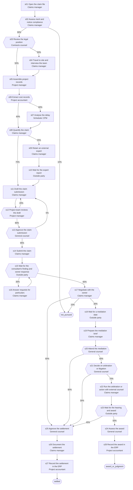

# Manage claims and disputes

`gc-legal-claims-disputes` · construction (non-residential general contracting) · legal and claims · part of `general-contractor-co`

When a change price cannot be agreed, a project is delayed by events the owner is responsible for, or a trade claims against the company, the claims manager turns the dispute into a documented claim. The project team assembles records, a scheduler analyses the delay, the claims manager prices and writes the claim, and the general counsel approves it, negotiates it, takes it to mediation and, if needed, to arbitration or court. Claims are slow because records are scattered across systems, schedulers and project managers are busy on live work, owners take months to respond and formal disputes last more than a year.

| | |
|---|---|
| Unit of work | one claim |
| Starts when | An operations manager refers a disputed change, a delay notice or a subcontractor's claim against the company to the claims manager. |
| Done when | The claim is settled and recorded as a change order, decided by an award or judgment and recorded, or dropped. |
| Organisation | A Canadian national general contractor with a small in-house legal and claims group supporting about 220 active building projects. (2,800 employees, 2019-2022) |
| Volume | 4 cases a month (range 2 to 7) |

## Where it sits

- Starts with **disputed_change** from ops-change-order (45% of cases)
- Starts with **delay_notice** from ops-schedule-management (35% of cases)
- Starts with **disputed_change** from ops-subtrade-change (12% of cases)
- Starts with **claim** from subcontractor (8% of cases)
- Relies on **daily_report** from ops-site-coordination (a standing input; it does not start a case)
- Relies on **schedule** from ops-schedule-management (a standing input; it does not start a case)
- Sends **claim_settlement** to ops-change-order (outcome: settled)
- Sends **claim** to public-owner (outcome: any)
- Sends **claim** to private-owner (outcome: any)
- Sends **claim** to odacc (outcome: award_or_judgment)

## Flow

## Roles

| Role | Department | Layer | FTE on this process | Loaded cost per hour | Evidence |
|---|---|---|---:|---:|---|
| Claims manager | legal | manager | 3.2 | 105 CAD | C |
| Project manager | ops | manager | 1.5 | 72 CAD | C |
| Scheduler (CPM) | ops-support | senior specialist | 1.2 | 68 CAD | C |
| Contracts counsel | legal | senior specialist | 0.3 | 115 CAD | C |
| General counsel | legal | executive | 0.3 | 200 CAD | C |
| Project accountant | fin | individual contributor | 0.4 | 48 CAD | C |

## Steps

Hands-on time and the wait before each step show the most common value. Evidence tier A is a sourced number, B a sourced description, C the author's estimate.

| Step | Who | Kind | Hands-on | Wait before | Control | Evidence |
|---|---|---|---:|---:|---|---|
| **s01 Open the claim file.** The claims manager receives a referral from an operations manager (a disputed change, a delay notice or a trade's claim against the company), opens a matter file, sets up a folder in the document system and records the contract, owner, amounts and notice dates. | Claims manager | intake | 1.0 h | 5.0 d |  | C |
| **s02 Assess merit and notice compliance.** The claims manager reads the contract, the change and delay notices, correspondence and the consultant's findings to judge whether the company has entitlement, whether contract notice time limits were met and roughly what the claim is worth. Weak claims go back to the project for a commercial settlement. | Claims manager | judgment | 8.0 h | 2.0 d |  | A [arcadis_2020], [arcadis_2021] |
| **s03 Review the legal position.** Contracts counsel reviews the merit assessment against the contract terms, supplementary conditions, notice provisions and dispute clauses, and advises on time limits for dispute notices, mediation and arbitration or court action. | Contracts counsel | review | 4.0 h | 3.0 d |  | B [gsnh_part8] |
| **s04 Travel to site and interview the team.** The claims manager travels to the project, walks the work with the superintendent and interviews the project manager, superintendent and engineers about what happened and when. Out-of-region projects need a flight and an overnight stay. | Claims manager | travel | 8.0 h | 5.0 d |  | C |
| **s05 Assemble project records.** The project manager and site team pull daily reports, RFIs, submittal logs, change logs, meeting minutes, photos and correspondence for the claim period into the claim folder. Missing or inconsistent records weaken the claim. | Project manager | lookup | 16.0 h | 5.0 d |  | C |
| **s06 Extract cost records.** The project accountant runs job cost reports from the ERP for the claim period by cost code, with labour hours, equipment charges, subcontract payments and site overheads. They reconcile the extracts to the general ledger. | Project accountant | lookup | 8.0 h | 1.0 d |  | C |
| **s07 Analyse the delay.** The scheduler compares the baseline schedule with each monthly update and the as-built dates, runs a windows analysis to find which events drove the critical path, and allocates delay between owner, contractor and neutral causes. | Scheduler (CPM) | analysis | 1.7 d | 7.0 d |  | C |
| **s08 Quantify the claim.** The claims manager prices the claim: extended site overheads, extended equipment and crane time, labour productivity loss, escalation, subcontractor pass-through claims and financing, tying each head of claim to the records and delay analysis. | Claims manager | analysis | 1.7 d | 2.0 d |  | A [arcadis_2021] |
| **s09 Retain an external expert.** For large claims the claims manager obtains approval to retain a forensic scheduling or quantum expert, agrees scope and fees, and sends the record set. | Claims manager | coordination | 4.0 h | 5.0 d |  | C |
| **s10 Wait for the expert report.** The expert reviews the records and schedules, asks questions and issues a report on delay and quantum. The report is often the critical path of the claim. | Outside party | external wait | 0 min | 45.0 d |  | C |
| **s11 Draft the claim submission.** The claims manager writes the claim document: narrative of events, contract entitlement, delay analysis, quantum and appendices of records. The submission is written to stand on its own before the consultant and, later, a mediator or arbitrator. | Claims manager | drafting | 1.2 d | 2.0 d |  | C |
| **s12 Project team reviews the draft.** The project manager checks facts, dates and quantities in the draft and flags anything that would weaken the relationship with the owner on the live project. Corrections go back to the claims manager. | Project manager | review | 4.0 h | 4.0 d |  | C |
| **s13 Approve the claim submission.** The general counsel approves the claim for submission after weighing value, cost to pursue, owner relationship and future bidding with that owner. Large claims are discussed with the chief operating officer. | General counsel | approval | 2.0 h | 3.0 d | Company delegation of authority for claims and litigation | C |
| **s14 Submit the claim.** The claims manager issues the claim to the consultant and owner as the contract requires, by courier or email, and diarises the response and dispute notice deadlines. | Claims manager | communication | 1.0 h | 1.0 d | Prime contract notice provisions (CCDC 2 Part 8 and GC 6.6) | B [oaa_ccdc2], [gsnh_part8] |
| **s15 Wait for the consultant's finding and owner response.** The consultant reviews the claim and issues a finding, and the owner responds, often with its own consultant's analysis. Detailed claims get extra time for findings. | Outside party | external wait | 0 min | 30.0 d |  | B [oaa_ccdc2] |
| **s16 Answer requests for particulars.** The claims manager answers the owner's or consultant's questions and document requests, often with more cost backup or schedule runs, and resubmits. | Claims manager | communication | 8.0 h | 5.0 d |  | C |
| **s17 Negotiate with the owner.** The claims manager and project manager meet the owner and consultant over several sessions to narrow the issues and trade heads of claim, often packaging the claim with open change orders and the closeout account. | Claims manager | communication | 20.0 h | 30.0 d |  | A [arcadis_2021] |
| **s18 Wait for a mediation date.** The parties agree on a mediator under the contract's dispute clause and find a date that suits the mediator, counsel and executives on both sides. | Outside party | external wait | 0 min | 30.0 d | CCDC 2 Part 8: negotiation and mediation before arbitration | B [gsnh_part8] |
| **s19 Prepare the mediation brief.** The claims manager prepares the mediation brief and settlement ranges with contracts counsel and briefs the general counsel and operations leadership on walk-away positions. | Claims manager | drafting | 1.2 d | 0 min |  | C |
| **s20 Attend the mediation.** The general counsel leads the company's team at a one- or two-day mediation with the owner, the mediator and counsel, and decides whether to accept the settlement on offer. | General counsel | communication | 9.0 h | 1.0 d |  | B [gsnh_part8] |
| **s21 Decide on arbitration or litigation.** The general counsel weighs cost, likely outcome, time and the owner relationship and decides whether to refer the dispute to arbitration or court, or settle at the owner's last figure. The referral has a short deadline after mediation ends. | General counsel | judgment | 4.0 h | 5.0 d | CCDC 2 Part 8: referral to arbitration within 10 Working Days after mediation ends | B [gsnh_part8] |
| **s22 Run the arbitration or action with external counsel.** The claims manager instructs external counsel, assembles document productions, prepares witness statements with the project team and works with experts through pleadings, discoveries and hearing preparation. | Claims manager | coordination | 6.7 d | 2.0 d |  | A [arcadis_2020] |
| **s23 Wait for the hearing and award.** The arbitrator or court schedules the hearing, hears the evidence and issues an award or judgment. Many cases settle on the eve of the hearing. | Outside party | external wait | 0 min | 210.0 d |  | A [arcadis_2020], [arcadis_2021] |
| **s24 Assess the award.** The general counsel reviews the award or judgment with external counsel, decides whether to appeal or seek review, and instructs payment or collection. | General counsel | judgment | 4.0 h | 1.0 d |  | C |
| **s25 Approve the settlement.** The general counsel approves the settlement terms within delegated authority, with the chief financial officer for large amounts, checking the effect on the project forecast and any trade pass-through obligations. | General counsel | approval | 2.0 h | 3.0 d | Company delegation of authority for claim settlements | C |
| **s26 Document the settlement.** The claims manager drafts or checks the settlement agreement and release, and asks the project team to have the consultant issue a change order for the agreed amount and time so it can be billed. | Claims manager | drafting | 4.0 h | 2.0 d |  | C |
| **s27 Record the settlement in the ERP.** The project accountant records the settlement in the ERP contract value and updates the project forecast, reversing any claim revenue that was recognised above the settled amount. | Project accountant | data entry | 1.0 h | 2.0 d | IFRS 15 variable consideration: claim revenue recognised only when highly probable; external audit review of claims | C |
| **s28 Record the award in the ERP.** The project accountant records the award or judgment amount, interest and costs in the ERP and updates the project forecast and receivables. | Project accountant | data entry | 1.0 h | 2.0 d | IFRS 15 variable consideration and external audit review of claims | C |

## Exceptions

| Exception | Share of cases | What happens |
|---|---:|---|
| External expert retained | 22% | Large or complex claims wait one to three months for a forensic scheduling or quantum expert report. |
| Mediation | 27% | Negotiation reaches an impasse and the parties go to a one- or two-day mediation under the contract's dispute clause. |
| Arbitration or litigation | 8% | Mediation fails and the dispute is referred to arbitration or court, adding a year or more. |

## Benchmarks

| Metric | Value | Unit | Population | Evidence |
|---|---|---|---|---|
| cycle_time_days | p50 210, p90 480 | calendar days from referral to settlement, award or withdrawal | All claims referred to the claims group of a Canadian building contractor, 2019-2022 | C |
| average_dispute_length_months | 2018 15.2, 2019 17.6, 2020 14.2 | months | North American construction disputes in the Arcadis Global Construction Disputes Reports | A [arcadis_2020], [arcadis_2021] |
| average_dispute_value_usd_million | 2018 16.3, 2019 18.8, 2020 37.9 | USD million | North American construction disputes in the Arcadis Global Construction Disputes Reports | A [arcadis_2020], [arcadis_2021] |

## Pain points

- Records for the claim period are scattered across the project platform, email and the ERP and have to be pulled by busy project staff. (steps s05, s06; C)
- Owners and consultants take months to respond and ask for more particulars. (steps s15, s16; B [oaa_ccdc2])
- Formal disputes take more than a year. (steps s22, s23; A [arcadis_2020], [arcadis_2021])
- Failure to give contract notices on time weakens or bars claims. (steps s02, s03; A [arcadis_2020])

## Assumptions

- Unit of work is one claim referred to the claims group; change disputes settled by the project team before referral stay in gc-ops-change-order.
- Trade claims against the company are included because the claims manager handles them; the organisation file only lists owner-side triggers.
- External counsel and experts are outside parties; their time is modelled as waits, and their fees are not in the labour cost.
- The claims manager's travel to out-of-region sites uses commercial flights and rental cars, so no company resource is tied up.
- Claim revenue recognition follows IFRS 15 as reported by a TSX-listed contractor.
- Waits include nights and weekends; legal and project office roles work weekdays.
- The simulated 90th percentile (about 390 days) is below the 480-day benchmark because only about 7% of claims reach arbitration or court in this model; the Arcadis averages describe large formal disputes, which are a minority of this contractor's claims.

## Sources

- [arcadis_2020] [Report: Cost and length of North American construction disputes increased in 2019](https://www.arcadis.com/en-us/news/north-america/united-states/2020/6/report-cost-and-length-of-north-american-construction-disputes-increased-in-2019) (Arcadis, 2020). North America: average dispute value rose from $16.3 million (2018) to $18.8 million (2019); average time to resolve rose from 15.2 to 17.6 months; top cause a contractor or subcontractor failing to understand or comply with contractual obligations.
- [arcadis_2021] [Cost of construction disputes increased dramatically in 2020 (Arcadis Global Construction Disputes Report 2021 news release)](https://www.arcadis.com/en-us/news/north-america/united-states/2021/6/cost-of-construction-disputes-increased-dramatically-in-2020) (Arcadis, 2021). North America: average dispute value rose from $18.8 million (2019) to $37.9 million (2020); average length shortened from 17.6 to 14.2 months; leading causes failure to understand or comply with contract obligations, owner-directed changes, third-party or force majeure changes; most disputes settled by party-to-party negotiation.
- [gsnh_part8] [Construction Industry Disputes: Use Of Negotiation, Mediation And Arbitration Clause](https://www.legal500.com/intelligence/canada/real-estate-and-construction/construction-industry-disputes-use-of-negotiation-mediation-and-arbitration-clause) (Goldman Sloan Nash & Haber LLP (via Legal 500 / Mondaq), 2024). CCDC Part 8: a party may refer a dispute to the Consultant for a written finding; notice of dispute within 15 Working Days of the finding, reply within 10 Working Days; amicable negotiation; Project Mediator appointed within 20 Working Days of award; mediation non-binding; if mediation fails either party may refer the dispute to arbitration within 10 Working Days; litigation remains if the parties do not agree to arbitrate.
- [oaa_ccdc2] [Practice Tip PT.23.11: CCDC 2-2020 Stipulated Price Contract, Overview of the Changes in the 2020 Version and Recommended Supplementary Conditions](https://www.oaa.on.ca/OAA/Assets/Documents/Practice-tips/PT.23.11_V01.0_CCDC2-OverviewOfChanges__20210830.pdf) (Ontario Association of Architects, 2021). CCDC 2-2020 GC 6.3.7: change directive costs apply in as much as they contribute directly to implementing the change directive; GC 8.2 adjudication added to align with the Construction Act; negotiation-mediation-arbitration dispute procedure; Consultant must make findings on claims for a change in Contract Price regardless of size or number (GC 2.2.11); GC 6.6.5 allows more time for findings on detailed claims.

Written by claude-opus on 2026-11-24.
