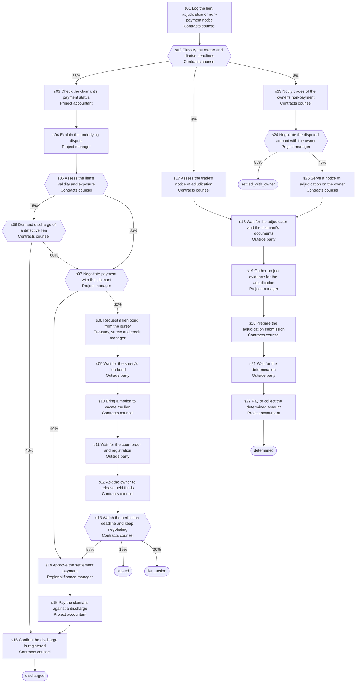

# Handle liens and adjudication

`gc-legal-lien-adjudication` · construction (non-residential general contracting) · legal · part of `general-contractor-co`

Trades that are unpaid can register a lien against the project, which makes owners and lenders hold back payment to the contractor, and since October 2019 Ontario trades and contractors can also send payment disputes to a fast statutory adjudication. Contracts counsel checks each lien against the trade's payment record and the project manager's account of the dispute, tries to settle, and otherwise posts a surety bond and gets a court order vacating the lien so the owner keeps paying. The same group answers or starts adjudications and the notices that follow an owner's refusal to pay. Short statutory deadlines, records split between the ERP and the project team, and waits on the surety and the court drive the work.

| | |
|---|---|
| Unit of work | one lien or adjudication |
| Starts when | A trade registers or preserves a lien on a project, a trade serves a notice of adjudication, or an owner serves a notice of non-payment on a progress invoice. |
| Done when | The lien is discharged, lapses or becomes a lien action; the adjudication determination is paid; or the owner dispute is settled. |
| Organisation | A Canadian national general contractor with a small in-house legal group supporting about 220 active building projects, with most volume in Ontario. (2,800 employees, 2019-2022) |
| Volume | 5 cases a month (range 3 to 9) |

## Where it sits

- Starts with **lien_claim** from subcontractor (88% of cases)
- Starts with **adjudication_notice** from subcontractor (4% of cases)
- Starts with **notice_of_non_payment** from public-owner (3% of cases)
- Starts with **notice_of_non_payment** from fin-owner-receivables (5% of cases)
- Relies on **subcontractor_payment** from fin-sub-invoice-payment (a standing input; it does not start a case)
- Relies on **subcontract** from scm-subcontract-buyout (a standing input; it does not start a case)
- Sends **lien_claim** to fin-sub-invoice-payment (outcome: any)
- Sends **lien_claim** to fin-holdback-release (outcome: any)
- Sends **bond_request** to surety (outcome: any)
- Sends **adjudication_notice** to odacc (outcome: determined)
- Sends **lien_claim** to legal-claims-disputes (outcome: lien_action)

## Flow

## Roles

| Role | Department | Layer | FTE on this process | Loaded cost per hour | Evidence |
|---|---|---|---:|---:|---|
| Contracts counsel | legal | senior specialist | 0.45 | 115 CAD | C |
| Project manager | ops | manager | 0.25 | 72 CAD | C |
| Project accountant | fin | individual contributor | 0.1 | 48 CAD | C |
| Treasury, surety and credit manager | fin | manager | 0.05 | 95 CAD | C |
| Regional finance manager | fin | manager | 0.05 | 88 CAD | C |

## Steps

Hands-on time and the wait before each step show the most common value. Evidence tier A is a sourced number, B a sourced description, C the author's estimate.

| Step | Who | Kind | Hands-on | Wait before | Control | Evidence |
|---|---|---|---:|---:|---|---|
| **s01 Log the lien, adjudication or non-payment notice.** Contracts counsel receives the document, usually forwarded by the owner, the project manager or the land registry search: a claim for lien registered by a trade, a trade's notice of adjudication, or an owner's notice of non-payment. They open a matter, record the project, claimant, amount and service date. | Contracts counsel | intake | 30 min | 1.0 d |  | B [dla_pp] |
| **s02 Classify the matter and diarise deadlines.** Contracts counsel decides which path applies and diarises the statutory deadlines: lien perfection and expiry, adjudication response dates, and the 7-day and 21-day steps that follow an owner's notice of non-payment. | Contracts counsel | judgment | 30 min | 4.0 h | Construction Act (Ontario): lien preservation within 60 days and perfection within 90 days after the last preservation date | B [dla_pp], [bj_pp] |
| **s03 Check the claimant's payment status.** The project accountant pulls the claimant's subcontract ledger from the ERP: contract value, approved changes, invoices, payments, holdback retained and amounts held back for disputes or back-charges. | Project accountant | lookup | 45 min | 1.0 d |  | C |
| **s04 Explain the underlying dispute.** The project manager writes up why the trade is unpaid: disputed extras, deficiencies, back-charges, a default or a payment the owner has not made. They attach correspondence and the subcontract change log. | Project manager | analysis | 1.5 h | 2.0 d |  | A [osler_odacc2], [osler_odacc3] |
| **s05 Assess the lien's validity and exposure.** Contracts counsel checks whether the lien was preserved in time, names the right owner and property, and is not inflated beyond the unpaid contract price, and estimates the company's exposure including costs. | Contracts counsel | analysis | 2.0 h | 1.0 d | Construction Act (Ontario): lien preservation within 60 days and perfection within 90 days after the last preservation date | B [dla_pp] |
| **s06 Demand discharge of a defective lien.** Contracts counsel writes to the claimant or its lawyer setting out why the lien is out of time or improper and demanding a discharge, warning that the company will seek costs on a motion. | Contracts counsel | drafting | 1.0 h | 12.0 h |  | C |
| **s07 Negotiate payment with the claimant.** The project manager meets or calls the trade to agree what is owed after back-charges and deficiencies, and offers to release undisputed amounts in exchange for a discharge. | Project manager | communication | 2.0 h | 3.0 d |  | C |
| **s08 Request a lien bond from the surety.** The treasury, surety and credit manager asks the surety for a lien bond for the lien amount plus the statutory costs allowance, or arranges a letter of credit, and sends the surety the lien and indemnity documents. | Treasury, surety and credit manager | communication | 1.0 h | 1.0 d |  | B [ra_vacate] |
| **s09 Wait for the surety's lien bond.** The surety underwrites and issues the bond under the company's bonding facility. Cash security is used instead when the owner needs the lien off title within days. | Outside party | external wait | 0 min | 5.0 d |  | B [ra_vacate] |
| **s10 Bring a motion to vacate the lien.** Contracts counsel, usually with external counsel, prepares the motion record with an affidavit, the bond and a draft order, and files it with the Superior Court. The security must equal the lien amount plus 25%, capped at $250,000, for costs. | Contracts counsel | drafting | 4.0 h | 1.0 d | Construction Act (Ontario) s.44: security of the lien amount plus 25% (up to $250,000) for costs to vacate a lien | B [ra_vacate] |
| **s11 Wait for the court order and registration.** The court issues the order to vacate once the security reaches the Accountant of the Superior Court, and the order is registered on title. The owner can then release funds it held because of the lien. | Outside party | external wait | 0 min | 10.0 d |  | B [ra_vacate] |
| **s12 Ask the owner to release held funds.** Contracts counsel sends the owner the registered vacating order and asks it to release the amount it withheld from the company's progress payments because of the lien. | Contracts counsel | communication | 30 min | 12.0 h |  | C |
| **s13 Watch the perfection deadline and keep negotiating.** Contracts counsel tracks whether the claimant starts an action to perfect the lien within 90 days, while the project manager keeps negotiating. An unperfected lien expires and the security is returned. | Contracts counsel | coordination | 2.0 h | 45.0 d | Construction Act (Ontario): lien preservation within 60 days and perfection within 90 days after the last preservation date | B [dla_pp] |
| **s14 Approve the settlement payment.** The regional finance manager approves the settlement payment against the subcontract ledger, checking it does not pay twice for amounts already paid or held as holdback. | Regional finance manager | approval | 30 min | 2.0 d | Payments outside the regular subcontract invoice run approved by finance, separate from the negotiating project manager | C |
| **s15 Pay the claimant against a discharge.** The project accountant issues the settlement cheque or transfer in exchange for a signed discharge of the lien, held in escrow by counsel until the funds clear. | Project accountant | data entry | 45 min | 1.0 d |  | C |
| **s16 Confirm the discharge is registered.** Contracts counsel checks the land registry or the owner's records to confirm the discharge is registered or delivered, then asks for any posted security to be returned and closes the matter. | Contracts counsel | validation | 30 min | 3.0 d |  | C |
| **s17 Assess the trade's notice of adjudication.** Contracts counsel reads the trade's notice of adjudication, checks that the dispute is one that can be adjudicated and that the contract dates qualify, and decides whether to consent to the named adjudicator. | Contracts counsel | judgment | 1.0 h | 4.0 h | Construction Act (Ontario) Part II.1 adjudication: adjudicator appointment, documents within 5 days, determination within 30 days | A [osler_odacc3] |
| **s18 Wait for the adjudicator and the claimant's documents.** The named adjudicator consents, or ODACC appoints one, and the claimant delivers its documents. The 30-day clock for the determination starts when the adjudicator receives them. | Outside party | external wait | 0 min | 6.0 d | Construction Act (Ontario) Part II.1 adjudication: adjudicator appointment, documents within 5 days, determination within 30 days | B [dla_pp] |
| **s19 Gather project evidence for the adjudication.** The project manager assembles the subcontract, change records, daily reports, photos and correspondence that answer the claim and writes a statement of the facts for counsel. | Project manager | analysis | 8.0 h | 12.0 h |  | C |
| **s20 Prepare the adjudication submission.** Contracts counsel writes the submission for the company, whether responding to a trade or claiming against an owner, with the evidence package and a calculation of the amount, and delivers it to the adjudicator and the other party. | Contracts counsel | drafting | 12.0 h | 0 min | Construction Act (Ontario) Part II.1 adjudication: adjudicator appointment, documents within 5 days, determination within 30 days | C |
| **s21 Wait for the determination.** The adjudicator reviews the documents, may ask questions or hold a short call, and issues a written determination. About three-quarters are issued within 30 days; the rest are extended by consent. | Outside party | external wait | 0 min | 25.0 d | Construction Act (Ontario) Part II.1 adjudication: adjudicator appointment, documents within 5 days, determination within 30 days | A [osler_odacc2], [osler_odacc3] |
| **s22 Pay or collect the determined amount.** The project accountant pays the determined amount to the trade, or records and collects the amount the owner was ordered to pay, within 10 days of the determination, and the matter is closed or referred to court if a party seeks review. | Project accountant | data entry | 45 min | 3.0 d | Construction Act (Ontario): payment within 10 days of an adjudicator's determination | B [dla_pp] |
| **s23 Notify trades of the owner's non-payment.** When the owner disputes part of a proper invoice, contracts counsel issues the company's notice of non-payment to the affected trades with a copy of the owner's notice and an undertaking to refer the dispute to adjudication within 21 days. | Contracts counsel | drafting | 2.0 h | 1.0 d | Construction Act (Ontario) prompt payment: contractor notice of non-payment within 7 days of the owner's notice, with an undertaking to adjudicate within 21 days | B [bj_pp] |
| **s24 Negotiate the disputed amount with the owner.** The project manager meets the owner and consultant to resolve the disputed portion of the invoice before the adjudication referral deadline. Disputes not settled go to adjudication against the owner. | Project manager | communication | 2.0 h | 3.0 d |  | B [bj_pp] |
| **s25 Serve a notice of adjudication on the owner.** Contracts counsel drafts and serves the notice of adjudication on the owner naming a proposed adjudicator from the ODACC registry, and registers the adjudication with ODACC. | Contracts counsel | drafting | 2.0 h | 1.0 d | Construction Act (Ontario) Part II.1 adjudication: adjudicator appointment, documents within 5 days, determination within 30 days | B [dla_pp] |

## Exceptions

| Exception | Share of cases | What happens |
|---|---:|---|
| Lien vacated by posting security | 50% | No settlement is reached quickly, so the company posts a surety bond and obtains a court order removing the lien from title. |
| Defective lien | 13% | The lien was preserved late or is otherwise improper and counsel demands a discharge. |
| Adjudication | 8% | A trade starts an adjudication against the company, or the company starts one against an owner after a notice of non-payment. |

## Benchmarks

| Metric | Value | Unit | Population | Evidence |
|---|---|---|---|---|
| cycle_time_days | p50 60, p90 130 | calendar days from receipt of the lien or notice to closure or hand-off | Liens and adjudications on a Canadian general contractor's building projects, 2019-2022 | C |
| adjudication_determinations_within_30_days_share | fy2021 0.79, fy2022 0.75 | share of determinations | All ODACC adjudications in Ontario | A [osler_odacc2], [osler_odacc3] |
| adjudications_commenced_per_year | fy2020 32, fy2021 50, fy2022 121 | adjudications | All ODACC adjudications in Ontario, all sectors | A [osler_odacc2], [osler_odacc3] |

## Pain points

- Each lien makes the owner hold back payment to the company until it is vacated or settled. (steps s08, s09, s10, s11; B [ra_vacate])
- Counsel depends on the ERP and the project manager to learn what is actually owed, which takes days. (steps s03, s04; C)
- Statutory deadlines leave little time to assemble an adjudication response. (steps s18, s19, s20; B [dla_pp])

## Assumptions

- Ontario rules are used for all matters; most volume is in the Ontario region and other provinces' lien statutes follow similar preservation, vacating and perfection steps.
- Ontario statutes could not be opened directly; rules are taken from law firm summaries and treated as tier B.
- Liens on public land are preserved by notice to the owner rather than registered on title, but follow the same vacating and settlement steps.
- Lien actions after perfection are handed to the claims and litigation process.
- External counsel and the surety are outside parties; their time is modelled as waits.
- Waits include nights and weekends; legal and finance roles work weekdays.

## Sources

- [dla_pp] [Prompt payment and adjudication have arrived in Ontario](https://www.dlapiper.com/en/insights/publications/2019/10/prompt-payment-and-adjudication-have-arrived-in-ontario) (DLA Piper, 2019). Adjudication starts with a notice of adjudication naming a proposed adjudicator; if the adjudicator does not consent within 4 days ODACC appoints one within 7 days; claimant documents within 5 days of appointment; determination within 30 days of receiving documents, extendable only by consent; payment within 10 days of the determination or work may be suspended; lien preservation 60 days (was 45) and perfection 90 days after the last preservation date.
- [bj_pp] [Prompt Payment for Construction in Ontario](https://www.bennettjones.com/Insights/Blogs/Prompt-Payment-for-Construction-in-Ontario) (Bennett Jones LLP, 2019). Owner pays a proper invoice within 28 days; owner notice of non-payment within 14 days; contractor pays subcontractors within 7 days of payment; contractor notice of non-payment within 7 days of the owner's notice or 35 days after the invoice, with a copy of the owner's notice and an undertaking to refer the matter to adjudication within 21 days.
- [ra_vacate] [The fine print: form and sufficiency of letters of credit to vacate liens](https://www.legal500.com/intelligence/canada/real-estate-and-construction/the-fine-print-form-and-sufficiency-of-letters-of-credit-to-vacate-liens) (Robins Appleby LLP (via Legal 500 / Mondaq), 2024). Under Construction Act s.44 a party may vacate a lien by posting security with the Superior Court equal to the full lien amount plus 25% of it (up to $250,000) for costs; security may be cash, an irrevocable letter of credit or a lien bond; cash is used when urgent, bonds or letters of credit otherwise; the court issues an order to vacate once the approved security reaches the Accountant of the Superior Court.
- [osler_odacc2] [Adjudication: ODACC releases second annual report](https://www.osler.com/en/insights/blogs/construction/adjudication-odacc-releases-second-annual-report/) (Osler, Hoskin & Harcourt LLP, 2021). ODACC fiscal 2021 (to 31 July 2021): 50 adjudications commenced (32 in fiscal 2020); 34 determinations (3 in fiscal 2020); 79% within the 30-day timeline, the rest extended; about $8.7 million claimed, average $174,193; $908,123 awarded, average $26,710; disputes mainly valuation of services and payment under a contract including change orders; none on holdback; commercial 10, public buildings 3, industrial 3 of 50.
- [osler_odacc3] [Adjudication: ODACC releases third annual report](https://www.osler.com/en/insights/blogs/construction/adjudication-odacc-releases-third-annual-report/) (Osler, Hoskin & Harcourt LLP, 2023). ODACC fiscal 2022 (1 August 2021 to 31 July 2022): 121 adjudications commenced; 24 terminated; 67 determinations, 75% within 30 days; about $33.5 million claimed, average $277,168; $3,449,619 awarded; mostly valuation and payment disputes including change orders; residential 52, transportation and infrastructure 30, commercial 23, public buildings 10, industrial 6.

Written by claude-opus on 2026-11-24.
