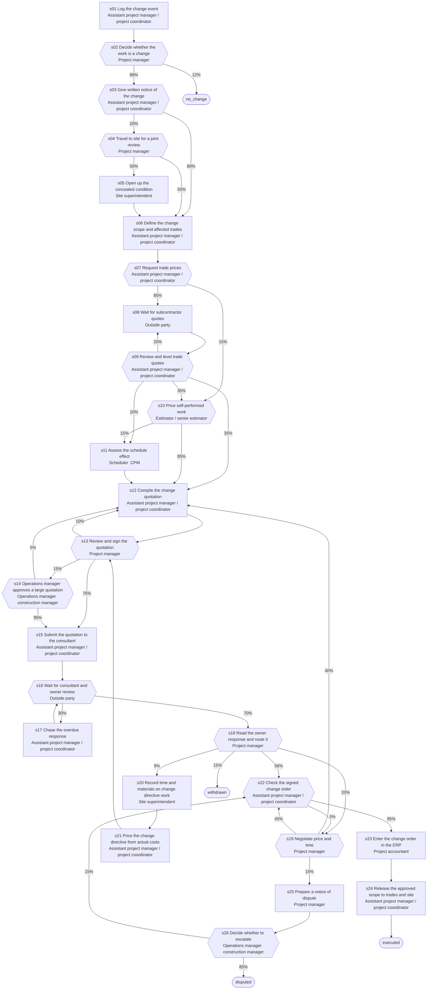

# Price and process owner changes

`gc-ops-change-order` · construction (non-residential general contracting) · project operations · part of `general-contractor-co`

When the consultant proposes a change, an RFI answer adds scope or the site finds a condition the drawings did not show, the project team prices the change and asks the owner to pay for it. The assistant project manager collects subcontractor quotes, an estimator prices self-performed work, the project manager signs the quotation and negotiates it with the consultant and owner, and the owner either issues a change order, directs the work at a price to be agreed, or declines. Most of the elapsed time is waiting: for trade quotes, for the consultant's review and for owner signing authority, while revision cycles and disputed pricing tie up cash for the contractor and its trades.

| | |
|---|---|
| Unit of work | one change event |
| Starts when | The consultant issues a proposed change notice, an RFI answer or site instruction adds scope, the site finds a changed condition, or an owner requests or directs a change. |
| Done when | An executed change order is entered in the ERP and released to trades, or the event is closed as no change, withdrawn by the owner, or referred to the claims process as a disputed change. |
| Organisation | A Canadian national general contractor with about 220 active building projects run by project managers and assistant project managers from regional offices. (2,800 employees, 2019-2022) |
| Volume | 900 cases a month (range 600 to 1,300) |

## Where it sits

- Starts with **change_request** from consultant (40% of cases)
- Starts with **change_request** from ops-rfi (20% of cases)
- Starts with **change_request** from ops-site-coordination (20% of cases)
- Starts with **change_request** from private-owner (10% of cases)
- Starts with **change_directive** from public-owner (10% of cases)
- Starts with **claim_settlement** from legal-claims-disputes (0% of cases)
- Relies on **sub_quote** from ops-subtrade-change (a standing input; it does not start a case)
- Relies on **subcontract** from scm-subcontract-buyout (a standing input; it does not start a case)
- Relies on **schedule** from ops-schedule-management (a standing input; it does not start a case)
- Sends **change_quotation** to public-owner (outcome: any)
- Sends **change_quotation** to private-owner (outcome: any)
- Sends **change_request** to ops-subtrade-change (outcome: any)
- Sends **change_order** to ops-schedule-management (outcome: executed)
- Sends **change_order** to ops-progress-draw (outcome: executed)
- Sends **change_order** to ops-monthly-cost-forecast (outcome: executed)
- Sends **disputed_change** to legal-claims-disputes (outcome: disputed)

## Flow

## Roles

| Role | Department | Layer | FTE on this process | Loaded cost per hour | Evidence |
|---|---|---|---:|---:|---|
| Project manager | ops | manager | 20 | 72 CAD | C |
| Assistant project manager / project coordinator | ops | individual contributor | 30 | 48 CAD | C |
| Estimator / senior estimator | bd-estimating | senior specialist | 5 | 68 CAD | C |
| Site superintendent | ops | supervisor | 5 | 75 CAD | C |
| Scheduler (CPM) | ops-support | senior specialist | 2 | 68 CAD | C |
| Operations manager (construction manager) | ops | manager | 1 | 115 CAD | C |
| Project accountant | fin | individual contributor | 1.5 | 48 CAD | C |

## Steps

Hands-on time and the wait before each step show the most common value. Evidence tier A is a sourced number, B a sourced description, C the author's estimate.

| Step | Who | Kind | Hands-on | Wait before | Control | Evidence |
|---|---|---|---:|---:|---|---|
| **s01 Log the change event.** The assistant project manager opens a new change event in the project platform for a consultant's proposed change notice, an RFI answer that adds scope, a site instruction or an owner request. They give it a number, link the source document, drawings and photos, and tag the likely cost codes. | Assistant project manager / project coordinator | intake | 20 min | 12.0 h |  | B [ab_change], [usace_agc] |
| **s02 Decide whether the work is a change.** The project manager reads the change event against the drawings, specifications, tender clarifications and the prime contract. They decide whether the work is outside the contract scope and worth a quotation, or already included, and note any schedule effect. | Project manager | judgment | 25 min | 1.0 d |  | C |
| **s03 Give written notice of the change.** The assistant project manager sends the consultant and owner a notice that the instruction or condition is a change, with a first view of cost and time effects. The notice protects the right to claim later if the price is disputed. | Assistant project manager / project coordinator | communication | 20 min | 4.0 h | Prime contract change and claim notice provisions (CCDC 2 Part 6 and GC 6.6) | B [oaa_ccdc2] |
| **s04 Travel to site for a joint review.** The project manager drives from the regional office to the site and walks the affected area with the superintendent and the consultant's representative. They agree what has changed, take photos and measurements and note whether hidden conditions must be opened up. | Project manager | travel | 1.5 h | 3.0 d |  | C |
| **s05 Open up the concealed condition.** The superintendent assigns a carpentry and labour crew with a telehandler to open ceilings, walls or excavations so the consultant can see the condition. Before work starts the crew completes a hazard assessment and checks the designated substances report. | Site superintendent | physical | 2.0 h | 2.0 d | Ontario OHSA and O. Reg. 213/91: field-level hazard assessment and designated substances report before opening walls or excavating | C |
| **s06 Define the change scope and affected trades.** The assistant project manager writes a scope sheet with marked-up sketches and quantities, lists the subcontracts and self-performed work affected, and sets up cost codes. The scope sheet becomes the basis for every price request. | Assistant project manager / project coordinator | analysis | 40 min | 1.0 d |  | B [ab_change] |
| **s07 Request trade prices.** The assistant project manager sends the scope sheet to each affected subcontractor with a request for a priced breakdown and a due date, which starts a subcontract change case for each trade. Self-perform-only changes go straight to the estimator. | Assistant project manager / project coordinator | communication | 25 min | 2.0 h |  | C |
| **s08 Wait for subcontractor quotes.** Subcontractors price the change with their own suppliers and sub-trades and return quotes by email. Late or missing quotes are the most common reason a change quotation cannot be assembled. | Outside party | external wait | 0 min | 7.0 d |  | B [usace_agc] |
| **s09 Review and level trade quotes.** The assistant project manager checks each quote against the scope sheet and the subcontract unit rates and markups, and looks for gaps and double counting between trades. Quotes with errors go back to the trade. | Assistant project manager / project coordinator | review | 40 min | 12.0 h |  | B [clearstory] |
| **s10 Price self-performed work.** The estimator does a take-off of the concrete, formwork or carpentry work, applies crew productivity, union labour rates and company equipment rates, and adds materials from current supplier prices. The price goes on the company's own change estimate sheet. | Estimator / senior estimator | analysis | 1.5 h | 2.0 d |  | C |
| **s11 Assess the schedule effect.** The scheduler inserts the change activities as a fragment into the current CPM schedule update and measures the effect on the critical path and completion date. The result supports any request for more contract time. | Scheduler (CPM) | analysis | 3.0 h | 3.0 d |  | B [usace_agc] |
| **s12 Compile the change quotation.** The assistant project manager builds the quotation summary: trade prices, self-perform cost, general conditions, contract fee and any time request, with each quote attached as backup. They write a short narrative of why the work is a change. | Assistant project manager / project coordinator | drafting | 45 min | 1.0 d |  | B [usace_agc] |
| **s13 Review and sign the quotation.** The project manager checks the quotation for scope, markups, fee and time, compares it with the project budget and the owner's likely position, and signs it. Errors go back to the assistant project manager; large values need the operations manager. | Project manager | review | 30 min | 1.0 d | Company delegation of authority: project manager signs change quotations up to a set value | C |
| **s14 Operations manager approves a large quotation.** The operations manager reviews large or unusual quotations for margin, risk and the effect on the owner relationship before they go out. They sign or ask for changes. | Operations manager (construction manager) | approval | 20 min | 2.0 d | Company delegation of authority for quotations above the project manager limit | C |
| **s15 Submit the quotation to the consultant.** The assistant project manager issues the quotation to the consultant and owner through the project platform or email and logs the submission date. The open quotation is listed in the change log reviewed at each owner meeting. | Assistant project manager / project coordinator | communication | 15 min | 2.0 h |  | B [ab_change] |
| **s16 Wait for consultant and owner review.** The consultant and the owner's cost consultant review the quotation in detail against their own estimate, and the owner checks budget and signing authority. They approve, ask questions, issue a change directive or decline. | Outside party | external wait | 0 min | 9.0 d |  | B [usace_agc], [ab_change] |
| **s17 Chase the overdue response.** The assistant project manager raises the overdue quotation in the weekly owner meeting and by email, and notes the follow-up in the change log. Some owners hold changes until funds are approved. | Assistant project manager / project coordinator | communication | 10 min | 0 min |  | B [usace_agc] |
| **s18 Read the owner response and route it.** The project manager reads the response and decides the next move: accept the change order, negotiate a reduced price, proceed under a change directive while price is settled, or close the event if the owner does not proceed. | Project manager | judgment | 20 min | 12.0 h |  | B [ab_change], [ab_cd] |
| **s19 Negotiate price and time.** The project manager meets or calls the consultant and owner, goes through the cost breakdown line by line, and trades items until both sides agree or reach an impasse. Agreed changes go to change order; others are revised or escalated. | Project manager | communication | 1.2 h | 3.0 d |  | B [clearstory], [usace_agc] |
| **s20 Record time and materials on change directive work.** The superintendent records daily labour, equipment and material used on the directed work on force-account sheets and gets them signed by the consultant's site representative. Unsigned sheets are the main cause of later disputes. | Site superintendent | data entry | 1.5 h | 5.0 d |  | B [ab_cd] |
| **s21 Price the change directive from actual costs.** The assistant project manager prices the signed force-account sheets, trade invoices and equipment rates into a final quotation. Only costs that contribute directly to the directed work are claimable. | Assistant project manager / project coordinator | analysis | 1.5 h | 3.0 d | CCDC 2-2020 GC 6.3.7 cost rules for valuing a change directive | B [oaa_ccdc2], [mlt_ccdc2] |
| **s22 Check the signed change order.** The assistant project manager compares the change order issued by the consultant with the agreed quotation, checking price, time, scope wording and signatures. A change order that differs goes back to negotiation. | Assistant project manager / project coordinator | validation | 20 min | 4.0 d |  | B [ab_change] |
| **s23 Enter the change order in the ERP.** The project accountant enters the executed change order in the ERP: contract value, billing schedule line and budget by cost code. Revenue on the change can be billed only after this entry. | Project accountant | data entry | 20 min | 2.0 d | Contract revenue changes recorded only from executed change orders (IFRS 15 contract modification) | B [ab_cd] |
| **s24 Release the approved scope to trades and site.** The assistant project manager tells the superintendent and affected subcontractors that the change is approved so subcontract change orders can be issued and the work billed. The change log is closed for the event. | Assistant project manager / project coordinator | communication | 20 min | 1.0 h |  | C |
| **s25 Prepare a notice of dispute.** The project manager writes up the disputed change with the quotation, correspondence and the consultant's finding, and drafts a notice of dispute. The notice must go out within the contract's time limit after the finding. | Project manager | drafting | 2.0 h | 3.0 d | CCDC 2 Part 8: notice of dispute within 15 Working Days of the Consultant's finding | B [gsnh_part8] |
| **s26 Decide whether to escalate.** The operations manager reviews the disputed change and decides whether to refer it to the claims manager, hold it for a global settlement at closeout, or accept the owner's figure. Accepted figures go back to change order. | Operations manager (construction manager) | approval | 1.0 h | 3.0 d | Company delegation of authority for disputes and claims | C |

## Exceptions

| Exception | Share of cases | What happens |
|---|---:|---|
| Concealed condition opened up | 10% | The change cannot be priced until a crew opens walls, ceilings or an excavation for the consultant to see, which needs a free crew and a hazard assessment. |
| Trade quote revision loop | 17% | A subcontractor quote with wrong scope or excess markup goes back for revision, adding another wait for quotes. |
| Change directive priced from actual cost | 9% | The owner directs the work before price is agreed; the site records force-account time and the team prices actual costs afterwards. |
| Disputed change | 3% | Negotiation fails and the project manager issues a notice of dispute for the claims process. |

## Benchmarks

| Metric | Value | Unit | Population | Evidence |
|---|---|---|---|---|
| cycle_time_days | p50 50, p90 130 | calendar days from change event logged to executed change order or closure | Change events on Canadian non-residential building projects, 2019-2022 | C |
| proposal_preparation_days | 30 | average calendar days from request for proposal to contractor proposal | USACE vertical building and public works contracts, contractor change registers | A [usace_agc] |
| proposal_to_modification_days | mean 90, median 55 | calendar days from proposal received to signed modification | USACE vertical building and public works contracts | A [usace_agc] |
| change_order_request_to_signed_change_order_days | 26 | average calendar days | US specialty contractors (survey with Dodge Construction Network), 2026 | A [clearstory] |

## Pain points

- Late or incomplete subcontractor quotes hold up the whole quotation. (steps s08, s09; B [usace_agc])
- Quotations wait weeks for consultant review and owner signing authority, and are chased in owner meetings. (steps s16, s17; A [usace_agc])
- Disputed pricing and thin backup trigger revision cycles and reduced settlements. (steps s12, s19; A [clearstory])
- Work under a change directive cannot be billed until a change order is issued, so the contractor finances it. (steps s20, s21; B [ab_cd])

## Assumptions

- Unit of work is one change event as logged by the project team, including events later closed as no change or withdrawn; this keeps the volume consistent with the organisation file (about 900 a month).
- The trade pricing inside s07 to s09 is the subcontract change process seen from the owner change; trade-side steps are in gc-ops-subtrade-change.
- Project manager travel uses the manager's own vehicle with a mileage allowance, so no company vehicle resource is tied up.
- Construction of the change work itself belongs to site coordination and self-perform processes; only opening up concealed conditions for pricing is modelled here.
- Loops for chasing the owner restart the full owner-review wait, which slightly overstates long tails.
- Contract notice and cost rules are modelled as policy controls because they come from contracts, not statute.
- Waits include nights and weekends; project office roles work weekdays.
- Simulated hands-on time (mean about 10.5 hours per event, including revision and chase loops) implies about 73 FTE against 64.5 stated; the stated figures assume part of the assistant project manager and project manager time is absorbed in owner meetings counted under other processes.

## Sources

- [usace_agc] [Construction Contract Modifications: A Joint Study by the U.S. Army Corps of Engineers and Associated General Contractors of America](https://www.agc.org/sites/default/files/USACE-AGC%20Joint%20Study%20on%20Construction%20Contract%20Modifications.pdf) (Associated General Contractors of America and U.S. Army Corps of Engineers, 2021). Contractor change registers overlaid on USACE change logs (vertical building and public works, design-bid-build and design-build): a general contractor submitted a proposal about 30 days after a request for proposal on average; the government issued the modification on average within 90 days of proposal receipt, median 55 days; causes include disagreement on merit, requests for more documentation, missing subcontractor pricing delaying proposals for weeks or months, and change volume exceeding staff; contractors log a change when notified by RFI response or submittal comment, on average 30 days before the government records it.
- [clearstory] [2026 State of Change Orders: Specialty Contractor Report](https://www.clearstory.build/construction-blog/2026-sc-change-order-report) (Clearstory with Dodge Construction Network, 2026). Survey of US general and specialty contractors: average 22 days from a signed T&M tag to a fully priced change order request; average 26 days from change order request submission to a signed change order from the GC; 43% wait three weeks or more; 97% sometimes start work before approval, 42% more than half the time; more than half of requests need two or more revision cycles; GCs cite disputed pricing (66%) and insufficient backup (53%) when reducing payment; 48% have had disputes escalate to arbitration or legal process.
- [ab_change] [Change Process for Construction Management Contracts (flowchart CA_MC_605_TRC)](https://www.alberta.ca/system/files/custom_downloaded_images/tr-ca-cm-change-process-flowchart.pdf) (Government of Alberta, Alberta Infrastructure, 2024). Public owner change process: project team identifies a potential change through site instructions, RFIs or other methods; consultant prepares a change request with cost estimate and reasons, signed under expenditure signing authority; consultant issues a contemplated change notice for pricing; the construction manager prices it, obtaining subcontractor pricing; consultant and cost consultant review the quote in detail; if not agreed the change is not approved due to cost; otherwise a change authorization or change order is issued and the contractor proceeds.
- [ab_cd] [Change Directive (CD) Process (flowchart CA_MC_660_TRC)](https://www.alberta.ca/system/files/custom_downloaded_images/tr-ca-cm-change-directive-process-flowchart.pdf) (Government of Alberta, Alberta Infrastructure, 2023). For urgent changes the consultant prepares a change directive with a maximum upset price, signed under expenditure signing authority, directing the contractor to proceed before price is agreed; a final quotation is then requested and a change order issued; contractors cannot invoice against a change directive, only against an approved change order.
- [oaa_ccdc2] [Practice Tip PT.23.11: CCDC 2-2020 Stipulated Price Contract, Overview of the Changes in the 2020 Version and Recommended Supplementary Conditions](https://www.oaa.on.ca/OAA/Assets/Documents/Practice-tips/PT.23.11_V01.0_CCDC2-OverviewOfChanges__20210830.pdf) (Ontario Association of Architects, 2021). CCDC 2-2020 GC 6.3.7: change directive costs apply in as much as they contribute directly to implementing the change directive; GC 8.2 adjudication added to align with the Construction Act; negotiation-mediation-arbitration dispute procedure; Consultant must make findings on claims for a change in Contract Price regardless of size or number (GC 2.2.11); GC 6.6.5 allows more time for findings on detailed claims.
- [mlt_ccdc2] [The new CCDC 2 - 2020: contract changes you need to know](https://www.mltaikins.com/insights/the-new-ccdc-2-2020-contract-changes-you-need-to-know/) (MLT Aikins LLP, 2020). CCDC 2-2020 revises the list of claimable actual costs for change directives to those contributing directly to the change directive (GC 6.3.7); contract does not affect rights to statutory adjudication; GC 6.5.2 delay by stop work order extends contract time with reasonable delay costs.
- [gsnh_part8] [Construction Industry Disputes: Use Of Negotiation, Mediation And Arbitration Clause](https://www.legal500.com/intelligence/canada/real-estate-and-construction/construction-industry-disputes-use-of-negotiation-mediation-and-arbitration-clause) (Goldman Sloan Nash & Haber LLP (via Legal 500 / Mondaq), 2024). CCDC Part 8: a party may refer a dispute to the Consultant for a written finding; notice of dispute within 15 Working Days of the finding, reply within 10 Working Days; amicable negotiation; Project Mediator appointed within 20 Working Days of award; mediation non-binding; if mediation fails either party may refer the dispute to arbitration within 10 Working Days; litigation remains if the parties do not agree to arbitrate.

Written by claude-opus on 2026-11-24.
