# Close deficiencies and reach substantial performance

`gc-ops-deficiency-closeout` · construction (non-residential general contracting) · construction operations · part of `general-contractor-co`

When a building is nearly finished, the contractor must find and fix incomplete or defective work, get occupancy approved, have the consultant certify substantial performance and publish the certificate, and hand the building to the owner with manuals, as-builts and training. The superintendent and assistant superintendent run the deficiency walks and trades, the project manager handles the applications, and the commissioning coordinator assembles the turnover package. It is slow because trades have left for other jobs, consultants and inspectors book weeks out, closeout documents must be chased, and the certificate date starts the lien and holdback clock.

| | |
|---|---|
| Unit of work | one project handover |
| Starts when | The superintendent declares the building substantially complete and ready for deficiency review. |
| Done when | The certificate of substantial performance is published, the owner has taken over the building, and the consultant's deficiency list is closed or carried to warranty. |
| Organisation | A Canadian national general contractor of about 2,800 employees building institutional, commercial and industrial buildings, with about 220 active projects run from regional offices, a web-based project management platform and a construction ERP. (2,800 employees, 2019-2022) |
| Volume | 10 cases a month (range 7 to 14) |

## Where it sits

- Starts with **completion_notice** from ops-site-coordination (100% of cases)
- Relies on **commissioning_report** from ops-commissioning (a standing input; it does not start a case)
- Relies on **deficiency_list** from consultant (a standing input; it does not start a case)
- Relies on **reviewed_submittal** from ops-submittals (a standing input; it does not start a case)
- Sends **deficiency_list** to subcontractor (outcome: any)
- Sends **inspection_request** to municipality (outcome: any)
- Sends **substantial_performance_application** to consultant (outcome: any)
- Sends **substantial_performance_cert** to fin-holdback-release (outcome: any)
- Sends **handover_certificate** to public-owner (outcome: any)
- Sends **handover_certificate** to private-owner (outcome: any)
- Sends **handover_certificate** to p3-project-co (outcome: any)
- Sends **equipment_request** to spe-equipment-dispatch (outcome: any)
- Sends **handover_certificate** to ops-closeout-documents (outcome: handed_over)
- Sends **handover_certificate** to ops-project-closeout-financial (outcome: handed_over)
- Sends **handover_certificate** to ops-warranty-service (outcome: handed_over)

## Flow

```mermaid
flowchart TD
    s01["s01 Plan the handover<br/>Site superintendent"]
    s02["s02 Walk the building and record the contractor's deficiency list<br/>Assistant superintendent"]
    s03["s03 Issue deficiency lists to the trades<br/>Assistant superintendent"]
    s04["s04 Trades correct the contractor's list<br/>Outside party"]
    s05["s05 Confirm life-safety and systems commissioning<br/>Commissioning and closeout coordinator"]
    s06{{"s06 Building department and fire inspections for occupancy<br/>Outside party"}}
    s07["s07 Correct occupancy items and rebook<br/>Site superintendent"]
    s08["s08 Request the consultant's substantial performance review<br/>Project manager"]
    s09["s09 Walk the building with the consultant<br/>Site superintendent"]
    s10["s10 Consultant issues its deficiency list<br/>Outside party"]
    s11["s11 Log the consultant's list and assign items<br/>Site superintendent"]
    s12["s12 Prepare the application for substantial performance<br/>Project manager"]
    s13{{"s13 Consultant verifies and certifies substantial performance<br/>Outside party"}}
    s14["s14 Publish the certificate and notify finance<br/>Project manager"]
    s15{{"s15 Assemble the turnover package<br/>Commissioning and closeout coordinator"}}
    s16["s16 Chase trades for missing closeout documents<br/>Commissioning and closeout coordinator"]
    s17["s17 Train the owner's operators<br/>Commissioning and closeout coordinator"]
    s18["s18 Apply for Ready-for-Takeover<br/>Project manager"]
    s19{{"s19 Consultant reviews Ready-for-Takeover<br/>Outside party"}}
    s20["s20 Hold the handover meeting<br/>Site superintendent"]
    s21["s21 Request demobilisation of trailer and equipment<br/>Site superintendent"]
    s22{{"s22 Demobilise the site<br/>Assistant superintendent"}}
    s23["s23 Seasonal exterior items wait for suitable weather<br/>Outside party"]
    s24["s24 Trades close the consultant's items in the occupied building<br/>Outside party"]
    s25["s25 Drive back to the occupied site<br/>Assistant superintendent"]
    s26{{"s26 Back-check closed items with the consultant<br/>Assistant superintendent"}}
    s27["s27 Close out and notify warranty and finance<br/>Project manager"]
    s01 --> s02
    s02 --> s03
    s03 --> s04
    s04 --> s05
    s05 --> s06
    s06 -->|"75%"| s08
    s06 -->|"25%"| s07
    s07 --> s06
    s08 --> s09
    s09 --> s10
    s10 --> s11
    s11 --> s12
    s12 --> s13
    s13 -->|"82%"| s14
    s13 -->|"18%"| s11
    s14 --> s15
    s15 -->|"65%"| s16
    s15 -->|"35%"| s17
    s16 --> s17
    s17 --> s18
    s18 --> s19
    s19 -->|"85%"| s20
    s19 -->|"15%"| s16
    s20 --> s21
    s21 --> s22
    s22 -->|"25%"| s23
    s22 -->|"75%"| s24
    s23 --> s24
    s24 --> s25
    s25 --> s26
    s26 -->|"70%"| s27
    s26 -->|"30%"| s24
    s27 --> end0
    end0(["handed_over"])
```

## Roles

| Role | Department | Layer | FTE on this process | Loaded cost per hour | Evidence |
|---|---|---|---:|---:|---|
| Site superintendent | Construction operations | supervisor | 6 | 75 CAD | C |
| Assistant superintendent | Construction operations | supervisor | 6 | 58 CAD | C |
| Project manager | Construction operations | manager | 2.5 | 72 CAD | C |
| Commissioning and closeout coordinator | Construction operations | individual contributor | 6 | 55 CAD | C |

## Steps

Hands-on time and the wait before each step show the most common value. Evidence tier A is a sourced number, B a sourced description, C the author's estimate.

| Step | Who | Kind | Hands-on | Wait before | Control | Evidence |
|---|---|---|---:|---:|---|---|
| **s01 Plan the handover.** The superintendent reviews the schedule, the open work of each trade, commissioning status and the owner's occupancy date, and sets dates for the internal deficiency walk, the occupancy inspection, the consultant's review and the handover meeting. | Site superintendent | judgment | 2.0 h | 1.0 d |  | C |
| **s02 Walk the building and record the contractor's deficiency list.** The assistant superintendent walks every room, roof and service space with a tablet, records each incomplete or defective item with a photo, location and responsible trade in the project platform, and uses an aerial lift for high ceilings and atria. | Assistant superintendent | physical | 20.0 h | 2.0 d | O. Reg. 213/91 elevating work platform rules and fall protection; operator trained on the platform | C |
| **s03 Issue deficiency lists to the trades.** The assistant superintendent sorts the list by trade, sends each subcontractor its items through the platform or by email with a completion date, and reviews progress at the weekly subcontractor meeting. | Assistant superintendent | data entry | 2.0 h | 12.0 h |  | C |
| **s04 Trades correct the contractor's list.** Subcontractor crews return to fix paint, ceilings, doors and hardware, trims, mechanical and electrical devices and labelling; trades with crews already moved to other jobs are slow to come back. | Outside party | external wait | 0 min | 10.0 d |  | C |
| **s05 Confirm life-safety and systems commissioning.** The commissioning coordinator collects the fire alarm verification, sprinkler and standpipe test, emergency lighting, elevator, backflow and generator certificates and the commissioning reports, and checks nothing needed for occupancy is outstanding. | Commissioning and closeout coordinator | validation | 4.0 h | 1.0 d | Ontario Building Code occupancy requirements: fire alarm verification and life-safety systems tested before occupancy | C |
| **s06 Building department and fire inspections for occupancy.** The municipal building inspector and fire prevention officer inspect the building, review the life-safety certificates and either permit occupancy or list items that must be fixed and re-inspected. | Outside party | external wait | 0 min | 4.0 d | Ontario Building Code Act: occupancy of a new building permitted only after inspection | C |
| **s07 Correct occupancy items and rebook.** The superintendent gets the trades to fix the items on the inspector's list, such as fire separations, door hardware or signage, collects the missing certificate and rebooks the inspection. | Site superintendent | coordination | 4.0 h | 2.0 d |  | C |
| **s08 Request the consultant's substantial performance review.** The project manager writes to the consultant that the work is ready for review for substantial performance, attaches the status of the contractor's list and the occupancy permit, and proposes dates for the review walk. | Project manager | communication | 1.0 h | 12.0 h |  | C |
| **s09 Walk the building with the consultant.** The superintendent accompanies the architect and the mechanical and electrical engineers through the building over one or more days, opening rooms and ceiling access and noting what each consultant records. | Site superintendent | physical | 8.0 h | 5.0 d |  | C |
| **s10 Consultant issues its deficiency list.** The architect and engineers compile their observations into a formal deficiency list with item numbers, which becomes the list the contractor must complete and the basis for valuing incomplete work. | Outside party | external wait | 0 min | 5.0 d |  | B [pawson] |
| **s11 Log the consultant's list and assign items.** The superintendent keys or imports the consultant's items into the platform, merges them with the open contractor items, assigns each to a trade with a date, and sends the lists out. | Site superintendent | data entry | 4.0 h | 1.0 d |  | C |
| **s12 Prepare the application for substantial performance.** The project manager values the incomplete and deficient work, checks the value against the statutory substantial performance threshold, and sends the application with the list of items to be completed, the statutory declaration and the WSIB clearance to the consultant. | Project manager | drafting | 4.0 h | 1.0 d | Ontario Construction Act: substantial performance defined by value of work remaining; contract requires application with list of items (CCDC 2 GC 5.4) | B [pawson], [mlt] |
| **s13 Consultant verifies and certifies substantial performance.** The consultant checks the valuation and the list, and as payment certifier signs the certificate of substantial performance with its date, or tells the contractor what must be finished first. | Outside party | external wait | 0 min | 7.0 d | Ontario Construction Act: payment certifier certifies substantial performance; CCDC 2-2008 GC 5.4.2 20 calendar days | B [pawson] |
| **s14 Publish the certificate and notify finance.** The project manager arranges publication of the certificate of substantial performance in a construction trade newspaper, sends the certificate to the subcontractors and to finance, and diarises the end of the 60-day lien period for holdback release. | Project manager | communication | 30 min | 2.0 d | Ontario Construction Act: publication of the certificate of substantial performance starts the 60-day lien preservation period | B [dla] |
| **s15 Assemble the turnover package.** The commissioning coordinator compiles operations and maintenance manuals, warranties, as-built drawings, spare parts and attic stock lists and test reports from every trade into the owner's required format, and checks them against the specification closeout list. | Commissioning and closeout coordinator | drafting | 20.0 h | 0 min |  | C |
| **s16 Chase trades for missing closeout documents.** The commissioning coordinator emails and phones trades for missing manuals, warranties and as-builts, escalates to the project manager, and warns that holdback or final payment will be held until documents arrive. | Commissioning and closeout coordinator | communication | 4.0 h | 2.0 d |  | C |
| **s17 Train the owner's operators.** The commissioning coordinator schedules and runs training sessions in which trades and equipment suppliers show the owner's facility staff how to operate and maintain systems, and records attendance for the turnover package. | Commissioning and closeout coordinator | coordination | 8.0 h | 2.0 d |  | B [mlt] |
| **s18 Apply for Ready-for-Takeover.** The project manager sends the consultant the application for Ready-for-Takeover with the certificate, occupancy permit, turnover package, as-builts, start-up test results and training records, and requests the takeover date. | Project manager | drafting | 2.0 h | 12.0 h |  | B [mlt] |
| **s19 Consultant reviews Ready-for-Takeover.** The consultant checks the prerequisites and either confirms the takeover date or lists what is missing; on CCDC 2-1994 and 2008 contracts the owner's acceptance of the turnover package plays the same role. | Outside party | external wait | 0 min | 5.0 d | CCDC 2-2020 GC 12.1 Ready-for-Takeover: consultant responds within 10 calendar days | B [mlt] |
| **s20 Hold the handover meeting.** The superintendent walks the owner's facility manager through the building, hands over keys, access cards, attic stock and spare parts, transfers site security and utilities, and gets the handover certificate signed. | Site superintendent | coordination | 3.0 h | 2.0 d | Ontario OHSA: constructor responsibility for the site ends and control passes to the owner at handover; utilities and fire protection transferred | C |
| **s21 Request demobilisation of trailer and equipment.** The superintendent sends the equipment request to the yard coordinator to remove the site trailer, containers, hoarding and company equipment, and cancels temporary power, water and waste services. | Site superintendent | communication | 30 min | 1.0 d |  | C |
| **s22 Demobilise the site.** The assistant superintendent supervises loading of the trailer, containers, fencing and small tools onto boom trucks, checks the laydown area is restored, and records what went back to the yard. | Assistant superintendent | physical | 8.0 h | 3.0 d | O. Reg. 213/91 lifting and rigging rules for boom truck lifts; company lift plan | C |
| **s23 Seasonal exterior items wait for suitable weather.** Asphalt top coat, line painting, sod and planting and some roofing or sealant items cannot be done in winter, so they are carried on the list with a value held back until spring. | Outside party | external wait | 0 min | 42.0 d |  | C |
| **s24 Trades close the consultant's items in the occupied building.** Trades return to finish the consultant's items while the owner occupies the building, often working evenings or weekends or waiting for the owner to give access to occupied rooms. | Outside party | external wait | 0 min | 14.0 d |  | C |
| **s25 Drive back to the occupied site.** With the trailer gone, the assistant superintendent drives from another project or the office to the occupied building for the back-check, signing in with the owner's facility staff. | Assistant superintendent | travel | 1.0 h | 1.0 d |  | C |
| **s26 Back-check closed items with the consultant.** The assistant superintendent checks every item reported closed, walks the remaining items with the architect, closes them in the platform, and returns any not properly fixed to the trade. | Assistant superintendent | validation | 4.0 h | 0 min |  | C |
| **s27 Close out and notify warranty and finance.** The project manager confirms the deficiency list is complete, writes to the consultant and owner, and tells warranty, finance and the closeout team so warranty start dates, holdback release and final billing can proceed. | Project manager | communication | 30 min | 1.0 d |  | C |

## Exceptions

| Exception | Share of cases | What happens |
|---|---:|---|
| Failed occupancy inspection | 25% | The building or fire inspector lists items such as fire separations, door hardware or missing certificates; they are fixed and the inspection rebooked. |
| Substantial performance not yet certified | 18% | The consultant finds too much work outstanding and the contractor must close more items before re-applying. |
| Seasonal exterior items deferred | 25% | Winter handovers carry asphalt, landscaping and similar items until spring. |
| Missing closeout documents | 65% | Trades have not delivered manuals, warranties or as-builts, and the coordinator chases them, sometimes after the consultant rejects the takeover application. |

## Benchmarks

| Metric | Value | Unit | Population | Evidence |
|---|---|---|---|---|
| cycle_time_days | p50 95, p90 185 | calendar days from completion notice to deficiency list closed | Handovers of institutional and commercial buildings by a Canadian general contractor | C |
| consultant_period_to_verify_substantial_performance | 20 | calendar days | CCDC 2-2008 stipulated price contracts | A [pawson] |
| consultant_period_to_respond_to_ready_for_takeover | 10 | calendar days | CCDC 2-2020 stipulated price contracts | A [mlt] |
| lien_preservation_period_after_publication | 60 | calendar days | Ontario Construction Act from 1 July 2018 contracts | A [dla] |

## Pain points

- Trades have moved crews to other projects and return slowly to fix deficiencies, especially after the owner has moved in. (steps s04, s24, s26; C)
- Closeout documents (manuals, warranties, as-builts) arrive late and incomplete, holding up takeover and holdback. (steps s15, s16, s19; C)
- Consultants and inspectors book walks and inspections one to two weeks out, and certification takes up to the full contract period. (steps s09, s10, s13, s06; B [pawson], [mlt])
- Consultant deficiency lists arrive as PDFs or spreadsheets and are re-keyed into the platform, with duplicates and errors. (steps s11; C)

## Assumptions

- The simulated median of about 114 days is above the 95-day tier C benchmark because 30% of back-checks send items back to the trades for another two-week round and winter handovers wait months for seasonal items; neither the benchmark nor the waits rest on a measured source.
- A case runs from the superintendent's completion notice to closure of the consultant's deficiency list; warranty work after that is ops-warranty-service.
- Turnover package assembly and training run in parallel with consultant certification in practice; the simulation adds their waits in sequence, so concurrent steps are given short waits.
- Trade, consultant, inspector and owner time is outside the organisation and given zero touch time.
- Statutory thresholds for substantial performance and the publication rules are those of the Ontario Construction Act; the statute itself could not be opened, so its rules are cited from law firm and contract summaries.
- P3 handovers go to Project Co and the public sponsor, and building department occupancy inspections are an outside step; the organisation file lacks these two links.
- Loaded costs are the organisation file's (1.35 loading factor for salaried staff).
- Organisation file corrected on 2026-11-24: the contractor sends the consultant an application for substantial performance; the consultant issues the certificate, so the output to consultant is now substantial_performance_application.

## Sources

- [pawson] [Stipulated Price Contract](https://canadianconsultingengineer.com/features/stipulated-price-contract) (Canadian Consulting Engineer (Owen Pawson, Miller Thomson), 2008). CCDC 2-2008: consultant reviews shop drawings with reasonable promptness so as to cause no delay (GC 3.10.12) and indicates acceptance or rejection of deviations in writing (GC 3.10.9); the contractor remains responsible for errors or omissions in shop drawings (GC 3.10.10); the consultant has 20 calendar days after the contractor submits an application and a list of items to be completed or corrected to verify substantial performance (GC 5.4.2); payment certificates within 10 calendar days (GC 5.3.1).
- [mlt] [The new CCDC 2 - 2020: contract changes you need to know](https://www.mltaikins.com/insights/the-new-ccdc-2-2020-contract-changes-you-need-to-know/) (MLT Aikins LLP, 2020). CCDC 2-2020 Ready-for-Takeover (GC 12.1) prerequisites include certified or verified substantial performance, evidence of occupancy compliance or an occupancy permit, final cleaning, operations and maintenance documentation, as-built drawings and start-up testing; the consultant has 10 calendar days to respond to the contractor's application; holdback is paid no later than 10 working days after the holdback period expires; substantial performance is as defined in the lien legislation of the place of the work.
- [dla] [Prompt payment and adjudication have arrived in Ontario](https://www.dlapiper.com/en/insights/publications/2019/10/prompt-payment-and-adjudication-have-arrived-in-ontario) (DLA Piper, 2019). Ontario Construction Act: prompt payment and adjudication in force 1 October 2019; holdback release mandatory unless the payer publishes a notice of non-payment of holdback; publication of a certificate of substantial performance is a trigger date; lien preservation period raised from 45 to 60 days and perfection to 90 days after the last day to preserve.

Written by claude-opus on 2026-11-24.
