# Prepare the monthly cost report and forecast

`gc-ops-monthly-cost-forecast` · non-residential construction (general contracting) · project operations and project controls · part of `general-contractor-co`

Every month each project produces a cost report that compares budget, committed cost and cost to date by cost code and forecasts the cost to complete and the final margin. The project accountant cleans job cost, project controls builds the report, the superintendent measures self-performed work, the project manager forecasts each code and the operations manager and finance review it. The forecast sets percent complete and therefore revenue, so optimistic estimates show up later as write-downs; the work is squeezed between the AP cut-off and the corporate close.

| | |
|---|---|
| Unit of work | one project cost report for one month |
| Starts when | Finance issues the preliminary job cost report after the AP and payroll cut-off, a few working days after month end. |
| Done when | The forecast is approved, locked in the ERP for revenue recognition and published to the regional cost report. |
| Organisation | A Canadian national general contractor with about 220 active building projects, an ERP job cost ledger, Excel cost report workbooks and monthly job reviews by regional operations managers. (2,800 employees, 2019-2022) |
| Volume | 220 cases a month (range 190 to 260) |

## Where it sits

- Starts with **job_cost_report** from fin-month-end-close (100% of cases)
- Relies on **project_budget** from ops-project-startup (a standing input; it does not start a case)
- Relies on **commitment** from scm-subcontract-buyout (a standing input; it does not start a case)
- Relies on **commitment** from scm-material-procurement (a standing input; it does not start a case)
- Relies on **change_order** from ops-change-order (a standing input; it does not start a case)
- Relies on **subcontract_change_order** from ops-subtrade-change (a standing input; it does not start a case)
- Relies on **labour_cost** from fin-union-payroll (a standing input; it does not start a case)
- Relies on **equipment_charges** from spe-equipment-dispatch (a standing input; it does not start a case)
- Relies on **schedule** from ops-schedule-management (a standing input; it does not start a case)
- Sends **cost_forecast** to fin-month-end-close (outcome: approved)
- Sends **cost_forecast** to ops-p3-reporting (outcome: approved)
- Sends **cost_forecast** to exec-operational-review (outcome: approved)
- Sends **cost_forecast** to ops-owner-meetings (outcome: approved)

## Flow

```mermaid
flowchart TD
    s01["s01 Review job cost detail for miscodings<br/>Project accountant"]
    s02["s02 Accrue unbilled subtrade and material cost<br/>Project accountant"]
    s03["s03 Build the cost report workbook<br/>Project controls specialist  cost"]
    s04{{"s04 Reconcile commitments and pending changes<br/>Project controls specialist  cost"}}
    s05["s05 Compare self-perform labour and equipment with budget<br/>Project controls specialist  cost"]
    s06["s06 Measure installed quantities and remaining crew hours<br/>Site superintendent"]
    s07["s07 Forecast cost to complete by cost code<br/>Project manager"]
    s08["s08 Decide which change revenue to include<br/>Project manager"]
    s09["s09 Forecast general conditions and schedule costs<br/>Project manager"]
    s10["s10 Enter the forecast and compute margin<br/>Project controls specialist  cost"]
    s11{{"s11 Check the forecast for anomalies<br/>Project controls specialist  cost"}}
    s12["s12 Write the forecast narrative<br/>Project manager"]
    s13{{"s13 Review the forecast in the monthly job review<br/>Operations manager  construction manager"}}
    s14["s14 Regional vice-president reviews a fading job<br/>Regional vice-president"]
    s15{{"s15 Finance reviews the forecast against the WIP<br/>Regional finance manager"}}
    s16["s16 Calculate the loss provision<br/>Financial reporting analyst"]
    s17["s17 Lock the forecast and pass it to the close<br/>Project accountant"]
    s18["s18 Publish the cost report to dashboards<br/>Automated"]
    s01 --> s02
    s02 --> s03
    s03 --> s04
    s04 -->|"65%"| s05
    s04 -->|"35%"| s07
    s05 --> s06
    s06 --> s07
    s07 --> s08
    s08 --> s09
    s09 --> s10
    s10 --> s11
    s11 -->|"88%"| s12
    s11 -->|"12%"| s07
    s12 --> s13
    s13 -->|"76%"| s15
    s13 -->|"12%"| s07
    s13 -->|"12%"| s14
    s14 --> s15
    s15 -->|"88%"| s17
    s15 -->|"6%"| s16
    s15 -->|"6%"| s12
    s16 --> s17
    s17 --> s18
    s18 --> end0
    end0(["approved"])
```

## Roles

| Role | Department | Layer | FTE on this process | Loaded cost per hour | Evidence |
|---|---|---|---:|---:|---|
| Project accountant | Finance | individual contributor | 5.2 | 48 CAD | C |
| Project controls specialist (cost) | Operations support (project controls, scheduling, VDC, quality) | senior specialist | 8.4 | 62 CAD | C |
| Site superintendent | Construction operations | supervisor | 1.9 | 75 CAD | C |
| Project manager | Construction operations | manager | 13.5 | 72 CAD | C |
| Operations manager (construction manager) | Construction operations | manager | 1.9 | 115 CAD | C |
| Regional vice-president | Construction operations | director | 0.3 | 160 CAD | C |
| Regional finance manager | Finance | manager | 1 | 88 CAD | C |
| Financial reporting analyst | Finance | senior specialist | 0.2 | 60 CAD | C |

## Steps

Hands-on time and the wait before each step show the most common value. Evidence tier A is a sourced number, B a sourced description, C the author's estimate.

| Step | Who | Kind | Hands-on | Wait before | Control | Evidence |
|---|---|---|---:|---:|---|---|
| **s01 Review job cost detail for miscodings.** The project accountant opens the preliminary job cost report for the project after the AP and payroll cut-off, scans the transactions posted this month by cost code, and recodes invoices, timesheets and equipment charges that landed on the wrong code or the wrong job. | Project accountant | validation | 1.2 h | 8.0 h |  | B [jlc] |
| **s02 Accrue unbilled subtrade and material cost.** The project accountant compares the trade progress billings and material receipts for the month with the invoices posted, and books accruals for work done but not yet invoiced so the cost to date reflects the work in place. | Project accountant | data entry | 1.0 h | 4.0 h | Period-end cut-off of job costs for IFRS 15 cost-to-cost revenue recognition (TSX-listed issuer) | B [cfma] |
| **s03 Build the cost report workbook.** The project controls specialist exports budget, approved changes, commitments and costs to date by cost code from the ERP into the company's monthly cost report workbook, rolling forward last month's forecast so each line shows its prior estimate. | Project controls specialist (cost) | data entry | 1.0 h | 1.0 d |  | C |
| **s04 Reconcile commitments and pending changes.** The project controls specialist checks open subcontract and purchase order balances against the commitment register, adds subcontract change orders and backcharges agreed but not yet issued, and lists exposures where trades have priced extras. | Project controls specialist (cost) | validation | 1.0 h | 1.0 h |  | C |
| **s05 Compare self-perform labour and equipment with budget.** The project controls specialist pulls this month's crew hours from timekeeping and equipment charges by cost code, divides by installed quantities to get unit rates, and flags codes where productivity is below the estimate. | Project controls specialist (cost) | analysis | 45 min | 1.0 h |  | C |
| **s06 Measure installed quantities and remaining crew hours.** The superintendent walks the self-perform work with the drawings, measures formwork placed, concrete poured and carpentry installed to date, and estimates the crew hours and equipment weeks still needed, correcting any hours booked to the wrong code. | Site superintendent | analysis | 1.5 h | 1.0 d | Site orientation, PPE and fall protection for persons walking an active site (Ontario O. Reg. 213/91) | C |
| **s07 Forecast cost to complete by cost code.** The project manager works down every cost code, comparing budget, committed cost and cost to date, and types an estimate to complete for each, deciding where buyout savings are real and where overruns will continue to the end of the job. | Project manager | judgment | 3.0 h | 1.0 d |  | B [jlc], [cfma] |
| **s08 Decide which change revenue to include.** The project manager reviews the change order log, includes signed change orders in contract value, judges which pending quotations and directives are probable enough to forecast, and matches each with its forecast cost so margin is not overstated. | Project manager | judgment | 45 min | 0 min |  | B [haynie] |
| **s09 Forecast general conditions and schedule costs.** The project manager checks the schedule's forecast completion date, extends site staff, trailers, cranes, hoarding and winter heat to that date, and adds the cost of any delay or acceleration not yet covered by a change. | Project manager | analysis | 40 min | 0 min |  | C |
| **s10 Enter the forecast and compute margin.** The project controls specialist enters the cost-to-complete figures in the ERP forecast screen or cost report, and the workbook computes forecast final cost, margin, percent complete on a cost-to-cost basis and the over- or under-billed position. | Project controls specialist (cost) | data entry | 1.0 h | 8.0 h |  | B [cfma] |
| **s11 Check the forecast for anomalies.** The project controls specialist looks for negative costs to complete, codes over budget with no forecast change, percent complete far from schedule progress and swings from last month, and sends questions back to the project manager. | Project controls specialist (cost) | validation | 30 min | 1.0 h |  | C |
| **s12 Write the forecast narrative.** The project manager writes a short narrative for the cost report: what moved the margin since last month, the main risks and opportunities, pending changes, and the billing position and actions to recover any underbilling. | Project manager | drafting | 45 min | 4.0 h |  | B [haynie] |
| **s13 Review the forecast in the monthly job review.** The operations manager meets the project manager and project controls specialist, goes through the cost report line by line against the original bid margin and last month, challenges optimistic estimates to complete, and approves or sends it back. | Operations manager (construction manager) | review | 45 min | 2.0 d |  | B [cfma], [haynie] |
| **s14 Regional vice-president reviews a fading job.** For a job whose margin has faded beyond the reporting threshold or is forecast to lose money, the regional vice-president reviews the cost report with the operations manager, sets a recovery plan and approves the reduced forecast for reporting. | Regional vice-president | approval | 1.0 h | 1.0 d | Delegation of authority: margin fade above threshold escalated to regional executive | C |
| **s15 Finance reviews the forecast against the WIP.** The regional finance manager compares the approved forecast with the work-in-progress schedule, revenue recognised to date and billings, questions unusual margin swings and unapproved change revenue, and decides whether a loss provision is needed. | Regional finance manager | review | 30 min | 12.0 h | Internal control over financial reporting: finance review of contract estimates (NI 52-109 certification) | B [cfma] |
| **s16 Calculate the loss provision.** The financial reporting analyst calculates the full expected loss on the contract from the forecast, documents the estimate for the auditors, and prepares the provision entry so the whole loss is recognised this period rather than spread over the job. | Financial reporting analyst | analysis | 1.5 h | 1.0 d | IFRS (IAS 37 onerous contracts / IFRS 15) applied by TSX-listed issuers | C |
| **s17 Lock the forecast and pass it to the close.** The project accountant locks the forecast version in the ERP, posts the percent complete used for revenue recognition and the over- or under-billing adjustment, and confirms to the corporate close team that the project is final. | Project accountant | data entry | 20 min | 4.0 h | IFRS 15 input method requires the period-end estimate of total contract cost | B [cfma], [jlc] |
| **s18 Publish the cost report to dashboards.** The overnight reporting job refreshes the regional cost report and margin dashboards from the locked forecasts and distributes them to the operations review and owner meeting packs without anyone touching it. | Automated | system auto | 0 min | 12.0 h |  | C |

## Exceptions

| Exception | Share of cases | What happens |
|---|---:|---|
| Forecast sent back at the job review | 12% | The operations manager challenges the cost to complete and the PM re-forecasts the affected codes. |
| Margin fade escalated | 12% | Fade beyond threshold or a loss job goes to the regional vice-president for a recovery plan. |
| Loss provision | 6% | A forecast loss is provided for in full this period. |
| Fully subcontracted project | 35% | No self-perform labour or equipment to measure, so the superintendent step is skipped. |

## Benchmarks

| Metric | Value | Unit | Population | Evidence |
|---|---|---|---|---|
| cycle_time_days | p50 9, p90 14 | calendar days from the preliminary job cost report to the published forecast | Monthly project cost reports at Canadian general contractors, 2019-2022 | C |
| margin_fade_example | 6 | percentage points of margin lost between bid (20%) and current forecast (14%) | Illustrative example in a CFMA practitioner post | B [cfma] |

## Pain points

- Project managers defer recognising overruns, expecting to recover them, so fades appear late and in large steps. (steps s07, s13; B [jlc])
- Costs to date lag the field because invoices and accruals are late, so the forecast is built on stale numbers. (steps s01, s02; B [jlc])
- Re-keying between ERP exports and the Excel cost report, and back into the ERP, adds errors and checking time. (steps s03, s10, s11; C)

## Assumptions

- Loaded costs come from the organisation file (1.35 loading on salaried wages).
- The superintendent, regional vice-president and financial reporting analyst are included because measuring self-performed work, approving fades and booking loss provisions need them; the organisation file lists only the PM, project controls, operations manager and project accountant on this process.
- Equipment charges and the schedule are added as standing inputs; the organisation file lists them for other processes only.
- The project manager's forecasting time (about 8 hours per project per month including rework) is the author's estimate; it equals about 13.5 FTE, or 12% of the 110 project managers' time.
- Revenue recognition entries themselves are posted in fin-month-end-close; this workflow ends when the forecast is locked.
- Simulated median cycle time is 10.2 days (p90 14.8) against the 9-day estimate; the extra day comes from forecasts sent back for revision. Stated FTEs (32.4) match touch time x volume.

## Sources

- [cfma] [How to actually read a WIP schedule](https://cafe.cfma.org/blogs/michael-dedo/2026/07/06/how-to-actually-read-a-wip-schedule) (CFMA (Construction Financial Management Association) blog, Michael Dedo, 2026). Percent complete on a cost-to-cost basis (cost incurred / total estimated cost); earned revenue and over- or under-billing; margin fade example of 20% bid margin falling to 14%; controller reads the WIP monthly so the PM can act; sureties and banks review WIP for fade across the backlog.
- [jlc] [Cost to Complete: An Essential Monthly Metric](https://www.jlconline.com/business/money/cost-to-complete-an-essential-monthly-metric/) (Journal of Light Construction, Ian Schwandt, 2026). The project manager owns cost to complete; accounting processes bills and produces the WIP; the month is not closed until bills are job-costed, cost to complete is updated and production agrees; delaying recognition of cost overruns in the hope of recovering them distorts the WIP and revenue.
- [haynie] [The Monthly Job Review: The Operating System Behind Predictable Profit for Contractors](https://www.hayniecpas.com/the-monthly-job-review/) (Haynie & Company, None). Monthly job review with numbers updated before the meeting; packet of summary sheet, contract extract, job cost review with forecast support and change order log; outputs are an updated forecast, billing actions and follow-ups; underbilling and billing lagging production as problems the review catches.

Written by claude-opus on 2026-11-24.
