# Prepare the monthly progress draw

`gc-ops-progress-draw` · non-residential construction (general contracting) · project operations · part of `general-contractor-co`

Each month the project team of a general contractor bills the owner for the work done on one project. The assistant project manager collects trade billings, the superintendent and project manager walk the site to agree percentages against the schedule of values, the project accountant reconciles and issues a proper invoice with a statutory declaration and WSIB clearance, and the prime consultant certifies the amount. It is slow because it waits on trades, on site walks and on the consultant, and error-prone because percentages are judgment calls that consultants cut.

| | |
|---|---|
| Unit of work | one monthly progress draw for one project |
| Starts when | The month's progress update from site coordination and the approaching billing cut-off (about the 20th to 25th). |
| Done when | The consultant has certified the draw, the certified receivable and holdback are booked, and collections has the draw. |
| Organisation | A Canadian national general contractor with about 220 active building projects, an Ontario head office and regional project teams, billing owners monthly under CCDC 2 or owner-written contracts. (2,800 employees, 2019-2022) |
| Volume | 220 cases a month (range 190 to 260) |

## Where it sits

- Starts with **progress_update** from ops-site-coordination (100% of cases)
- Relies on **change_order** from ops-change-order (a standing input; it does not start a case)
- Relies on **subcontractor_invoice** from fin-sub-invoice-payment (a standing input; it does not start a case)
- Relies on **schedule** from ops-schedule-management (a standing input; it does not start a case)
- Relies on **wsib_clearance** from wcb (a standing input; it does not start a case)
- Sends **progress_draw** to consultant (outcome: any)
- Sends **progress_draw** to public-owner (outcome: any)
- Sends **progress_draw** to private-owner (outcome: any)
- Sends **progress_draw** to p3-project-co (outcome: any)
- Sends **progress_draw** to fin-owner-receivables (outcome: certified)

## Flow

```mermaid
flowchart TD
    s01["s01 Collect subtrade pencil billings<br/>Assistant project manager / project coordinator"]
    s02["s02 Travel to site for the draw walk<br/>Project manager"]
    s03["s03 Walk the site to assess percent complete<br/>Site superintendent"]
    s04["s04 Update the schedule of values with percentages<br/>Assistant project manager / project coordinator"]
    s05["s05 Add approved change orders to the draw<br/>Assistant project manager / project coordinator"]
    s06["s06 Reconcile the draft draw to job cost and trade billings<br/>Project accountant"]
    s07{{"s07 Review the draft draw and adjust<br/>Project manager"}}
    s08["s08 Send the pencil draw to the consultant<br/>Project manager"]
    s09{{"s09 Wait for consultant comments on the pencil draw<br/>Outside party"}}
    s10["s10 Meet the consultant to settle disputed lines<br/>Project manager"]
    s11["s11 Prepare the formal application and invoice<br/>Project accountant"]
    s12["s12 Download a current WSIB clearance certificate<br/>Project accountant"]
    s13["s13 Draft the statutory declaration<br/>Project accountant"]
    s14["s14 Sign the statutory declaration and approve release<br/>Operations manager  construction manager"]
    s15{{"s15 Issue the proper invoice to consultant and owner<br/>Project accountant"}}
    s16["s16 Prepare the P3 certifier and lender package<br/>Project manager"]
    s17{{"s17 Wait for the consultant's payment certificate<br/>Outside party"}}
    s18["s18 Review consultant reductions<br/>Project manager"]
    s19["s19 Correct and reissue the application<br/>Project accountant"]
    s20["s20 Record the certified amount in the ERP<br/>Project accountant"]
    s21["s21 Hand the certified draw to collections<br/>Project accountant"]
    s22["s22 File the certificate and roll the schedule of values forward<br/>Assistant project manager / project coordinator"]
    s01 --> s02
    s02 --> s03
    s03 --> s04
    s04 --> s05
    s05 --> s06
    s06 --> s07
    s07 -->|"85%"| s08
    s07 -->|"15%"| s04
    s08 --> s09
    s09 -->|"55%"| s11
    s09 -->|"45%"| s10
    s10 --> s11
    s11 --> s12
    s12 --> s13
    s13 --> s14
    s14 --> s15
    s15 -->|"8%"| s16
    s15 -->|"92%"| s17
    s16 --> s17
    s17 -->|"76%"| s20
    s17 -->|"18%"| s18
    s17 -->|"6%"| s19
    s18 --> s20
    s19 --> s15
    s20 --> s21
    s21 --> s22
    s22 --> end0
    end0(["certified"])
```

## Roles

| Role | Department | Layer | FTE on this process | Loaded cost per hour | Evidence |
|---|---|---|---:|---:|---|
| Assistant project manager / project coordinator | Construction operations | individual contributor | 10.7 | 48 CAD | C |
| Project manager | Construction operations | manager | 6.8 | 72 CAD | C |
| Project accountant | Finance | individual contributor | 8.5 | 48 CAD | C |
| Site superintendent | Construction operations | supervisor | 3.1 | 75 CAD | C |
| Operations manager (construction manager) | Construction operations | manager | 0.5 | 115 CAD | C |

## Steps

Hands-on time and the wait before each step show the most common value. Evidence tier A is a sourced number, B a sourced description, C the author's estimate.

| Step | Who | Kind | Hands-on | Wait before | Control | Evidence |
|---|---|---|---:|---:|---|---|
| **s01 Collect subtrade pencil billings.** The assistant project manager emails the 15 to 30 active subcontractors a reminder of the billing cut-off, then collects each trade's draft progress billing by the 25th from email and the project platform, chasing the late ones by phone so their percentages can roll into the owner draw. | Assistant project manager / project coordinator | coordination | 2.5 h | 2.0 d |  | C |
| **s02 Travel to site for the draw walk.** The project manager, who usually runs two projects from the regional office, drives to site for the monthly walk with the superintendent, timing the visit to the billing cut-off and the superintendent's availability around pours and inspections. | Project manager | travel | 1.0 h | 1.0 d |  | C |
| **s03 Walk the site to assess percent complete.** The superintendent walks each floor and area with the project manager and the schedule of values printout, estimating the percentage installed for each line (concrete, steel, envelope, mechanical rough-in) and challenging trade percentages that look ahead of what is physically in place. | Site superintendent | physical | 1.5 h | 1.0 h | Site orientation and PPE for all persons entering an active site (Ontario O. Reg. 213/91) | C |
| **s04 Update the schedule of values with percentages.** The assistant project manager types the agreed percentages into the schedule of values billing workbook or the ERP progress billing screen line by line, and checks that no line exceeds 100% and that stored materials are supported by invoices. | Assistant project manager / project coordinator | data entry | 1.5 h | 1.0 d |  | C |
| **s05 Add approved change orders to the draw.** The assistant project manager opens the change order log, adds each change order the owner signed since the last draw as a new billing line, and bills the percentage complete of change work, leaving pending quotations and disputed changes out. | Assistant project manager / project coordinator | lookup | 30 min | 0 min |  | B [mlt] |
| **s06 Reconcile the draft draw to job cost and trade billings.** The project accountant compares the draft draw with costs posted in job cost and the trade billings in AP by cost code, looking for underbilling (cost ahead of billing) and overbilling, checks the 10% holdback calculation and HST, and returns questions to the project team. | Project accountant | validation | 1.2 h | 1.0 d | Finance review of billings before issue; 10% holdback retained under the Construction Act and contract | B [bj] |
| **s07 Review the draft draw and adjust.** The project manager reviews the reconciled draft, weighs how far to push percentages on front-loaded lines against the risk of the consultant cutting them, decides on underbilled lines, and either signs off or sends it back for changes. | Project manager | review | 1.0 h | 1.0 d |  | C |
| **s08 Send the pencil draw to the consultant.** The project manager emails the pencil (draft) draw with the schedule of values and change order list to the prime consultant and the owner's project representative, asking for comments before the formal application is issued. | Project manager | communication | 20 min | 0 min |  | C |
| **s09 Wait for consultant comments on the pencil draw.** The prime consultant's contract administrator compares the pencil draw with what they saw at the last site meeting and their own site review notes and replies with agreed values or line-by-line comments. | Outside party | external wait | 0 min | 2.0 d |  | C |
| **s10 Meet the consultant to settle disputed lines.** The project manager meets the consultant in the site trailer or walks the areas in question, explains the percentages and stored materials, agrees revised values line by line, and notes what will be carried to next month's draw. | Project manager | communication | 1.0 h | 12.0 h |  | C |
| **s11 Prepare the formal application and invoice.** The project accountant creates the progress billing invoice in the ERP receivables module, prints the application for payment on the owner's or CCDC form with the agreed values, computes holdback and HST, and assembles the backup the contract requires. | Project accountant | drafting | 1.0 h | 1.0 d |  | B [mlt], [bj] |
| **s12 Download a current WSIB clearance certificate.** The project accountant logs into the WSIB clearance portal, downloads the company's current clearance certificate, checks that its validity period covers the invoice date, and attaches it to the application as workers' compensation evidence. | Project accountant | lookup | 10 min | 0 min | CCDC 2-2020 GC 5.2: workers' compensation evidence with each application; WSIB clearance policy 14-02-19 | B [mlt], [wsib] |
| **s13 Draft the statutory declaration.** The project accountant fills in the CCDC 9A statutory declaration, checking in AP that every subcontractor and supplier included in the previous draw has been paid, and lists any amounts withheld under a notice of non-payment. | Project accountant | validation | 40 min | 1.0 h | CCDC 2-2020 GC 5.2: CCDC 9A statutory declaration with each application after the first | B [mlt] |
| **s14 Sign the statutory declaration and approve release.** The operations manager, as an officer with signing authority, reviews the draw total and the declaration, swears the declaration before a commissioner of oaths in the office, and approves the application for release. | Operations manager (construction manager) | approval | 15 min | 12.0 h | Officer signature on sworn declarations and billing approval under the delegation of authority | C |
| **s15 Issue the proper invoice to consultant and owner.** The project accountant emails or uploads the signed application, invoice, statutory declaration and clearance to the consultant and the owner on the same day, recording the delivery date because it starts the 28-day payment clock. | Project accountant | communication | 20 min | 2.0 h | Ontario Construction Act s. 6.1-6.4: proper invoice delivered monthly; owner pays within 28 days | B [bj], [mlt] |
| **s16 Prepare the P3 certifier and lender package.** On P3 and lender-funded projects the project manager assembles the monthly progress report for the independent certifier or lender's technical advisor, with photos, schedule status and cost-to-complete, so Project Co can draw construction financing. | Project manager | drafting | 4.0 h | 1.0 d |  | C |
| **s17 Wait for the consultant's payment certificate.** The consultant reviews the formal application against its own site observations and the contract, then issues a certificate for payment, sometimes reducing lines, or returns the application if documents are missing. | Outside party | external wait | 0 min | 5.0 d |  | C |
| **s18 Review consultant reductions.** The project manager compares the certified amount with the application, decides whether to accept each reduction and re-bill it next month or dispute it, and tells the project accountant how to record the difference. | Project manager | judgment | 45 min | 8.0 h |  | C |
| **s19 Correct and reissue the application.** The project accountant fixes what the consultant rejected, such as an expired clearance, a missing declaration page or a wrong holdback figure, and reissues the corrected package, which restarts the payment clock. | Project accountant | drafting | 40 min | 1.0 d |  | B [bj] |
| **s20 Record the certified amount in the ERP.** The project accountant adjusts the receivable invoice to the certified amount, issuing a credit note for any reduction, and books the holdback receivable so the billing, holdback and job cost records agree. | Project accountant | data entry | 20 min | 12.0 h |  | C |
| **s21 Hand the certified draw to collections.** The project accountant emails the certificate and invoice reference to the billing and collections specialist, who tracks the payment due date, and notes any disputed reduction that may need a notice or adjudication. | Project accountant | communication | 10 min | 0 min |  | C |
| **s22 File the certificate and roll the schedule of values forward.** The assistant project manager files the certified draw package in the project document store and rolls the schedule of values forward so next month's draw starts from the certified percentages rather than the applied ones. | Assistant project manager / project coordinator | data entry | 20 min | 12.0 h |  | C |

## Exceptions

| Exception | Share of cases | What happens |
|---|---:|---|
| Pencil draw disputed by the consultant | 45% | The consultant comments on some lines and the project manager meets them to agree values before the formal issue. |
| Consultant reduces the certified amount | 18% | Lines are cut at certification; the PM decides to re-bill next month or dispute, and the accountant books a credit note. |
| Application returned as not a proper invoice | 6% | A missing declaration, expired clearance or wrong form means the package is reissued and the payment clock restarts. |
| P3 certifier package | 8% | On P3 projects a progress report for the independent certifier or lender's adviser is added before certification. |

## Benchmarks

| Metric | Value | Unit | Population | Evidence |
|---|---|---|---|---|
| cycle_time_days | p50 20, p90 30 | calendar days from the billing cut-off reminder to the certified draw being filed | Monthly progress draws on Canadian building projects, 2019-2022 | C |
| owner_payment_deadline_days | 28 | calendar days from proper invoice to owner payment | Ontario construction contracts entered after 1 October 2019 and CCDC 2-2020 | B [bj], [mlt] |

## Pain points

- Late trade billings hold up the whole draw; the owner draw cannot be built until the main trades submit. (steps s01; C)
- Percent complete is negotiated twice, once at the pencil review and again at certification, and reductions push cash into the next month. (steps s09, s10, s17, s18; C)
- Paper statutory declarations need an officer's signature before a commissioner, which waits on the officer's calendar. (steps s13, s14; B [mlt])

## Assumptions

- Loaded costs come from the organisation file (1.35 loading on salaried wages).
- The superintendent and the operations manager are included because the percent-complete walk and the sworn declaration need them; the organisation file lists only the project manager, assistant project manager and project accountant on this process.
- Owner payment and notices of non-payment are documented in fin-owner-receivables; this workflow ends at certification.
- The simulated median cycle time (21.6 days, p90 26.4) is close to the 20-day estimate; the simulated p90 is a little tight because real consultant turnaround has a longer tail than a triangular range shows.
- Staffing: the stated FTEs (29.6) match touch time x volume; about 17 hours of staff time per draw is the author's estimate.
- Self-perform labour is not billed separately; it sits inside schedule of values lines.

## Sources

- [bj] [Prompt Payment for Construction in Ontario](https://www.bennettjones.com/Insights/Blogs/Prompt-Payment-for-Construction-in-Ontario) (Bennett Jones LLP, 2019). Construction Act Part I.1 in force 1 October 2019 for contracts entered after that date; proper invoice monthly unless the contract says otherwise and cannot depend on certifier action; owner pays within 28 days; owner notice of non-payment within 14 days; contractor pays subcontractors within 7 days of receiving payment, or 35 days after the proper invoice unless it gives notice; undertaking to adjudicate within 21 days.
- [mlt] [The new CCDC 2 - 2020: contract changes you need to know](https://www.mltaikins.com/insights/the-new-ccdc-2-2020-contract-changes-you-need-to-know/) (MLT Aikins LLP, 2020). Monthly applications for payment to the consultant and owner simultaneously; workers' compensation evidence and a CCDC 9A statutory declaration with each application after the first; owner pays within 28 days (20 days under CCDC 2-2008); holdback paid no later than 10 working days after the holdback period expires; consultant responds to a Ready-for-Takeover application within 10 days.
- [wsib] [Clearance Certificate in Construction (Operational Policy Manual document 14-02-19)](https://www.wsib.ca/en/operational-policy-manual/clearance-certificate-construction) (Workplace Safety and Insurance Board (Ontario), 2020). A principal that retains a construction contractor must have a clearance in place for the whole time the contractor works; a clearance is valid for up to 90 calendar days and is renewable; without one the principal may be liable for the contractor's WSIB obligations up to the labour portion of the contract; records kept 3 years; policy applies from 1 January 2020.

Written by claude-opus on 2026-11-24.
