# Start up a project and turn it over from estimating

`gc-ops-project-startup` · construction - non-residential general contracting · construction operations · part of `general-contractor-co`

When a contract is signed, the estimating team that priced the job hands it to the operations team that will build it. The operations manager staffs the project, the estimator walks the team through the bid, the project manager turns the estimate into a budget by cost code, and the job is set up in the ERP and the project platform. The superintendent walks the site and plans logistics, and the startup package launches buyout, safety planning, scheduling, permits and mobilization. It is slow because the estimator and the site staff are still busy on other jobs, and error-prone because assumptions and late scope changes from bid day are lost in the handover.

| | |
|---|---|
| Unit of work | one new project |
| Starts when | Business development passes on an executed contract (or a letter of intent with notice to proceed). |
| Done when | The operations manager releases the project to mobilize, with the team assigned, budget loaded, systems set up and the startup package issued to the departments that act on it; or the owner defers the start. |
| Organisation | A Canadian national general contractor of about 2,800 employees building institutional, commercial and industrial buildings, with about 10 project starts a month across three regions. (2,800 employees, 2019-2022) |
| Volume | 10 cases a month (range 7 to 14) |

## Where it sits

- Starts with **contract** from bd-contract-award (100% of cases)
- Relies on **cost_estimate** from bd-preconstruction-services (a standing input; it does not start a case)
- Relies on **design_package** from bd-design-management (a standing input; it does not start a case)
- Sends **startup_package** to scm-subcontract-buyout (outcome: ready_to_mobilize)
- Sends **startup_package** to ops-schedule-management (outcome: ready_to_mobilize)
- Sends **startup_package** to hse-site-safety-plan (outcome: ready_to_mobilize)
- Sends **startup_package** to hse-environmental (outcome: ready_to_mobilize)
- Sends **startup_package** to ops-site-mobilization (outcome: ready_to_mobilize)
- Sends **startup_package** to ops-permits-utilities (outcome: ready_to_mobilize)
- Sends **design_package** to ops-vdc-coordination (outcome: ready_to_mobilize)
- Sends **project_budget** to ops-monthly-cost-forecast (outcome: ready_to_mobilize)
- Sends **labour_request** to spe-crew-planning (outcome: ready_to_mobilize)
- Sends **hire_request** to hr-recruit-salaried (outcome: ready_to_mobilize)
- Sends **it_request** to it-site-connectivity (outcome: ready_to_mobilize)
- Sends **wsib_clearance** to public-owner (outcome: ready_to_mobilize)
- Sends **insurance_certificate** to public-owner (outcome: ready_to_mobilize)

## Flow

```mermaid
flowchart TD
    s01{{"s01 Open the startup file from the signed contract<br/>Operations manager  construction manager"}}
    s02["s02 Choose the project manager and superintendent<br/>Operations manager  construction manager"]
    s03{{"s03 Approve the team and any outside hire<br/>Regional vice-president"}}
    s04["s04 Raise a hire request for the missing role<br/>Operations manager  construction manager"]
    s05["s05 Assemble the estimating turnover package<br/>Estimator / senior estimator"]
    s06["s06 Read the contract against the bid<br/>Project manager"]
    s07["s07 Book the turnover meeting<br/>Assistant project manager / project coordinator"]
    s08["s08 Run the estimating to operations turnover meeting<br/>Estimator / senior estimator"]
    s09["s09 Review site logistics and constructability in the meeting<br/>Site superintendent"]
    s10{{"s10 Log gaps between the bid and the contract<br/>Project manager"}}
    s11["s11 Answer open questions on the estimate<br/>Estimator / senior estimator"]
    s12["s12 Build the project budget by cost code<br/>Project manager"]
    s13{{"s13 Review and approve the budget and margin<br/>Operations manager  construction manager"}}
    s14["s14 Set up the job and load the budget in the ERP<br/>Project accountant"]
    s15["s15 Set up the project platform and document folders<br/>Assistant project manager / project coordinator"]
    s16["s16 Send WSIB clearance and insurance certificates to the owner<br/>Assistant project manager / project coordinator"]
    s17["s17 Drive to the site for the startup walk<br/>Site superintendent"]
    s18["s18 Walk the site and record existing conditions<br/>Site superintendent"]
    s19["s19 Draft the site logistics plan<br/>Site superintendent"]
    s20["s20 Prepare the buyout plan and procurement schedule<br/>Project manager"]
    s21["s21 Request self-perform crews and equipment<br/>Site superintendent"]
    s22["s22 Request site trailer IT and phones<br/>Assistant project manager / project coordinator"]
    s23["s23 Issue the startup package and hold the internal kickoff<br/>Project manager"]
    s24["s24 Attend the owner's pre-construction meeting<br/>Project manager"]
    s25{{"s25 Approve project readiness to mobilize<br/>Operations manager  construction manager"}}
    s01 -->|"98%"| s02
    s01 -->|"2%"| end0
    s02 --> s03
    s03 -->|"20%"| s04
    s03 -->|"80%"| s05
    s04 --> s05
    s05 --> s06
    s06 --> s07
    s07 --> s08
    s08 --> s09
    s09 --> s10
    s10 -->|"30%"| s11
    s10 -->|"70%"| s12
    s11 --> s12
    s12 --> s13
    s13 -->|"85%"| s14
    s13 -->|"15%"| s12
    s14 --> s15
    s15 --> s16
    s16 --> s17
    s17 --> s18
    s18 --> s19
    s19 --> s20
    s20 --> s21
    s21 --> s22
    s22 --> s23
    s23 --> s24
    s24 --> s25
    s25 -->|"92%"| end1
    s25 -->|"8%"| s23
    end0(["deferred_by_owner"])
    end1(["ready_to_mobilize"])
```

## Roles

| Role | Department | Layer | FTE on this process | Loaded cost per hour | Evidence |
|---|---|---|---:|---:|---|
| Operations manager (construction manager) | Construction operations | manager | 0.74 | 115 CAD | C |
| Regional vice-president | Construction operations | director | 0.05 | 160 CAD | C |
| Project manager | Construction operations | manager | 4.86 | 72 CAD | C |
| Assistant project manager / project coordinator | Construction operations | individual contributor | 1.01 | 48 CAD | C |
| Estimator / senior estimator | Estimating | senior specialist | 1.23 | 68 CAD | C |
| Site superintendent | Construction operations | supervisor | 1.79 | 75 CAD | C |
| Project accountant | Finance | individual contributor | 0.44 | 48 CAD | C |

## Steps

Hands-on time and the wait before each step show the most common value. Evidence tier A is a sourced number, B a sourced description, C the author's estimate.

| Step | Who | Kind | Hands-on | Wait before | Control | Evidence |
|---|---|---|---:|---:|---|---|
| **s01 Open the startup file from the signed contract.** The operations manager receives the executed contract and award notice from business development by email, opens a startup folder on the document drive and records the project in the opportunity tracker as won. He checks the contract value, delivery model, start date and region to decide which office runs it. | Operations manager (construction manager) | intake | 30 min | 12.0 h |  | C |
| **s02 Choose the project manager and superintendent.** The operations manager compares the size, type and location of the job with the staff who are coming off other projects, then picks a project manager, superintendent, field engineer and assistant project manager. He weighs who knows the owner or building type against who is actually free in the next month. | Operations manager (construction manager) | judgment | 2.0 h | 1.0 d |  | C |
| **s03 Approve the team and any outside hire.** The regional vice-president reviews the proposed team at the weekly operations meeting or by email, checks it against the project's risk and the region's other starts, and approves it or swaps a person. Where no one suitable is free he authorises a salaried hire. | Regional vice-president | approval | 30 min | 1.0 d | Company delegation of authority: regional vice-president approves project leadership appointments | B [procore_setup] |
| **s04 Raise a hire request for the missing role.** The operations manager writes a hire request to HR naming the role, project, location, start date and salary band, and attaches the approval from the regional vice-president. Field engineers and assistant superintendents are the roles most often requested. | Operations manager (construction manager) | drafting | 45 min | 12.0 h |  | C |
| **s05 Assemble the estimating turnover package.** The estimator who priced the job pulls the final bid sheets, take-off files, trade bid tabulations, qualifications, exclusions, allowances, alternates and the bid-day scope sheets into one turnover folder. He writes a short memo on the assumptions behind general conditions, self-perform production rates and duration. | Estimator / senior estimator | drafting | 8.0 h | 2.0 d |  | B [dataforma] |
| **s06 Read the contract against the bid.** The project manager reads the executed contract, supplementary conditions, specifications and addenda, and compares them with the bid qualifications and the turnover package. He lists clauses that change risk or cost: liquidated damages, holdback terms, owner-supplied items, phasing and any scope added during negotiation. | Project manager | review | 8.0 h | 1.5 d |  | B [dataforma] |
| **s07 Book the turnover meeting.** The assistant project manager finds a half day when the estimator, project manager, superintendent, operations manager and project accountant are free, books a room or Teams call and circulates the turnover package beforehand. | Assistant project manager / project coordinator | coordination | 30 min | 7.2 h |  | C |
| **s08 Run the estimating to operations turnover meeting.** The estimator walks the project team through the estimate line by line: scope by trade, carried allowances, exclusions, self-perform quantities and rates, general conditions and the planned duration. The team challenges assumptions and records open questions and commitments made to the owner during the pursuit. | Estimator / senior estimator | communication | 3.0 h | 2.0 d |  | B [dataforma], [procore_setup] |
| **s09 Review site logistics and constructability in the meeting.** In the same meeting the superintendent tests the estimate's crane, hoist, hoarding and site trailer allowances against how he would build the job, and flags sequence or access problems the estimate did not price. He notes items for the logistics plan. | Site superintendent | review | 3.0 h | 0 min |  | C |
| **s10 Log gaps between the bid and the contract.** The project manager enters each open question, scope gap and contract difference in a turnover log with an owner and a cost estimate, and decides which ones need the estimator to explain or price before the budget can be set. | Project manager | analysis | 4.0 h | 1.0 d |  | C |
| **s11 Answer open questions on the estimate.** The estimator goes back to the bid files and trade bids to explain how a disputed item was priced, which subcontractor's number carried it, or why it was excluded, and replies to the project manager by email with figures. | Estimator / senior estimator | lookup | 2.0 h | 2.0 d |  | C |
| **s12 Build the project budget by cost code.** The project manager re-cuts the estimate into the company's cost code structure in an Excel budget template: one line per trade package, self-perform labour, material and equipment, general conditions, contingency and fee. He adds allowances for logged gaps and agrees the target margin with the bid margin. | Project manager | drafting | 15.0 h | 1.5 d |  | C |
| **s13 Review and approve the budget and margin.** The operations manager compares the draft budget with the bid summary, checks that fee, contingency and general conditions match what was approved at bid, and questions lines that grew or shrank. He approves it for loading or sends it back with comments. | Operations manager (construction manager) | approval | 2.0 h | 2.0 d | Company project controls policy: original budget approved by operations manager before job cost loading | C |
| **s14 Set up the job and load the budget in the ERP.** The project accountant creates the job number, customer, contract value, billing terms, 10% holdback and retention settings and the cost code list in the construction ERP, then imports the approved budget. She sets up the schedule of values skeleton for the first progress draw. | Project accountant | data entry | 4.0 h | 1.5 d |  | B [procore_setup], [ccdc2] |
| **s15 Set up the project platform and document folders.** The assistant project manager creates the project in the project management platform, uploads the contract drawings and specifications, builds the directory of owner, consultant and team contacts, and opens empty RFI, submittal and meeting logs. She mirrors the folder structure on the document drive. | Assistant project manager / project coordinator | data entry | 7.0 h | 0 min |  | B [procore_setup] |
| **s16 Send WSIB clearance and insurance certificates to the owner.** The assistant project manager downloads a current WSIB clearance certificate from the government portal, obtains the project insurance certificates from the risk department, and sends both to the owner and consultant as the contract requires before work starts. | Assistant project manager / project coordinator | communication | 1.5 h | 1.0 d | CCDC 2-2020 GC 10.4.1 (workers' compensation compliance before commencing the Work) and GC 11.1 insurance | B [ccdc2] |
| **s17 Drive to the site for the startup walk.** The superintendent drives from the regional office or his current job to the new site once the owner allows access, carrying the drawings, a camera and a measuring wheel. | Site superintendent | travel | 1.0 h | 1.0 d |  | C |
| **s18 Walk the site and record existing conditions.** The superintendent walks the site and surroundings, photographs existing conditions and neighbouring buildings, checks access routes, overhead lines, utility locations, laydown space and where the trailer, crane and hoarding can go, and notes anything that differs from the drawings. | Site superintendent | physical | 3.0 h | 0 min |  | C |
| **s19 Draft the site logistics plan.** Back at the office the superintendent marks up a site plan with the trailer compound, hoarding line, gates, crane radius, hoist, laydown and traffic routes, and lists temporary services needed. The plan feeds mobilization, permits and the safety plan. | Site superintendent | drafting | 8.0 h | 1.0 d |  | C |
| **s20 Prepare the buyout plan and procurement schedule.** The project manager lists every trade package and major material order with its budget, the bidders from tender, required award date and long-lead items, and sets the order in which packages must be bought out to support the schedule. | Project manager | drafting | 6.0 h | 12.0 h |  | B [projul_buyout], [meltplan_buyout] |
| **s21 Request self-perform crews and equipment.** The superintendent tells the self-perform group how many concrete, formwork and general labour crews, cranes and formwork sets the job needs and when, using the estimate quantities and his sequence, so crew planning can book them. | Site superintendent | communication | 1.5 h | 12.0 h |  | C |
| **s22 Request site trailer IT and phones.** The assistant project manager raises an IT ticket for the site trailer: internet connection, printer, laptops or tablets for new staff and phone numbers, giving the address and the date the trailer arrives. | Assistant project manager / project coordinator | data entry | 30 min | 4.8 h |  | C |
| **s23 Issue the startup package and hold the internal kickoff.** The project manager assembles the startup package (contract summary, budget, logistics plan, buyout plan, key dates and team list) and sends it to supply chain, scheduling, safety, environment and permits. He runs a kickoff with the site team and the operations manager to agree roles, risks and the first month's priorities. | Project manager | communication | 5.0 h | 1.0 d |  | B [procore_setup] |
| **s24 Attend the owner's pre-construction meeting.** The project manager meets the owner and consultant to confirm contacts, lines of communication, submittal and RFI procedures, draw dates, site access, owner-supplied items and the date the construction schedule is due. | Project manager | communication | 3.0 h | 2.0 d |  | C |
| **s25 Approve project readiness to mobilize.** The operations manager goes through the readiness checklist with the project manager: budget loaded, team assigned, insurance and WSIB sent, safety plan under way, permits applied for, first subcontracts in progress. He releases the job to mobilize or names items to close first. | Operations manager (construction manager) | approval | 1.5 h | 1.0 d | Company project readiness checklist sign-off before mobilization | B [procore_setup] |

## Exceptions

| Exception | Share of cases | What happens |
|---|---:|---|
| Bid assumptions do not match the contract | 30% | Scope added in negotiation or a qualification the owner struck out is found at turnover; the estimator has to explain the pricing before the budget can be set. |
| Budget returned by the operations manager | 15% | Fee, contingency or general conditions do not agree with the approved bid, or lines are mis-coded, and the budget is rebuilt. |
| No staff free for the team | 20% | A field engineer or assistant superintendent has to be hired or transferred from another region. |
| Owner defers the start | 2% | Funding, permits or a land issue hold the start after the contract is signed; the file is parked. |

## Benchmarks

| Metric | Value | Unit | Population | Evidence |
|---|---|---|---|---|
| cycle_time_days | p50 35, p90 55 | calendar days from executed contract to release to mobilize | Canadian buildings general contractor, projects of $1-100M, 2019-2022 | B [procore_setup] |
| hands_on_hours_per_startup | 105 | hours of staff time per project start | Same | C |

## Pain points

- The estimator has moved on to the next bid, so the turnover package and answers to questions arrive late and incomplete. (steps s05, s11; B [dataforma])
- Scope added during negotiation or verbal promises to the owner are lost between the bid and the contract and resurface later as unbudgeted cost. (steps s06, s08, s10; B [dataforma])
- The estimate is re-cut into job cost codes by hand in Excel and keyed into the ERP, so the original budget carries coding errors into every cost report. (steps s12, s14; C)
- Superintendents and project managers are released late from finishing jobs, which delays the team's first site walk and logistics plan. (steps s02, s17; C)

## Assumptions

- The case starts at the executed contract and ends at release to mobilize. Buyout, scheduling, safety planning, permits and mobilization are separate processes that start from the startup package and run partly in parallel with the last steps here.
- Steps that in practice overlap (meeting attendance, platform setup alongside ERP setup) are listed in sequence with near-zero waits and named in concurrent_with.
- The turnover meeting is attended by five people; the step times count the estimator and superintendent only, so labour cost per start is understated by about 6-8 hours of other attendees' time.
- The simulated median (about 40 days) is above the 35-day benchmark because the simulation adds every wait in sequence, while in practice the site walk, logistics plan and buyout plan overlap with budget setup. The gap is within the range the benchmark itself is uncertain by.
- Readiness sign-off is shown with the operations manager; the Brinkmann source has the regional vice-president approve it, which this organisation reserves for team appointments.
- fte_on_process for each role = mean hands-on hours per case from the steps x 10 starts a month / 130 productive hours, plus 25% for coordination not written as steps.
- The org file's process roles omit regional-vp (who approves the team) and assistant-pm (who sets up the platform and sends start-of-work documents); both are org roles and are used here.

## Sources

- [dataforma] [The Sales-To-Operations Handoff Checklist For General Contractors](https://www.dataforma.com/the-sales-to-operations-handoff-checklist-for-general-contractors/) (Dataforma, None). What a general contractor hands from sales/estimating to operations: final scope with alternates, exclusions and allowances, commitments made during the pursuit, executed contract, contacts, site and access details, pricing and budget, estimate assumptions on labour, materials, subcontractors, production rates and duration; typical failures are scope drift, lost commitments, scattered documents, assumptions disconnected from the plan and unclear ownership.
- [procore_setup] [Project Setup (Brinkmann Constructors process database)](https://support.procore.com/tc/brinkmann/Procore_Process_Database/Project_Setup) (Procore Technologies support site, Brinkmann Constructors process pages, None). A project readiness report started at least 4 weeks before the project begins and approved by the regional vice-president before construction starts; project start-up meeting of PM, superintendent and project engineer; kickoff strategy meeting with the director; accounting and project platform setup from a new project setup form.
- [ccdc2] [CCDC 2 - 2020 Stipulated Price Contract (standard form text in a District of Hudson's Hope tender package)](https://hudsonshope.ca/wp-content/uploads/2026/07/1_CCDC-2-2020_StipulatedPriceContract.pdf) (Canadian Construction Documents Committee; document posted by the District of Hudson's Hope, 2020). GC 3.4.1: construction schedule submitted to owner and consultant before the first application for payment, showing major activities and critical events, monitored and updated monthly or as the Contract Documents state, consultant advised of revisions from extensions of Contract Time; GC 3.6.1: contractor makes written agreements with subcontractors and suppliers that incorporate the prime contract terms; GC 3.6.2-3.6.3: owner may object to a proposed subcontractor before signing; GC 5.2.4: schedule of values at least 15 calendar days before the first application for payment; GC 9.4.1: contractor establishes, maintains and supervises health and safety precautions and programs; GC 10.4.1: evidence of workers' compensation compliance before commencing the Work and with each application for payment; GC 11.1: contractor insurance per CCDC 41.
- [projul_buyout] [Construction Buyout Process Guide](https://projul.com/blog/construction-buyout-process-guide/) (Projul, None). Buyout in weekly waves after award (long-lead and early trades in week 1, structure and MEP week 2, interiors week 3, specialties week 4); bulk of buyout takes two to four weeks on a typical commercial project and six to eight weeks on larger ones; verify insurance certificates before signing the subcontract; scope gaps between bids become change orders.
- [meltplan_buyout] [Construction Buyout: How GCs Finalize Subcontract Awards After Bid Leveling](https://www.meltplan.com/blogs/construction-buyout-how-gcs-finalize-subcontract-awards-after-bid-leveling) (Meltplan, None). Buyout steps after leveling: buyout log, letters of intent for long-lead items (16-36+ week lead times), shortlist of 1-2 subs per package, scope clarification meetings, best and final offers, executed subcontracts; buyout typically takes 2-6 weeks after award, 4-6 weeks with 20+ trade packages; unresolved scope gaps turn into change orders.

Written by claude-opus on 2026-11-24.
