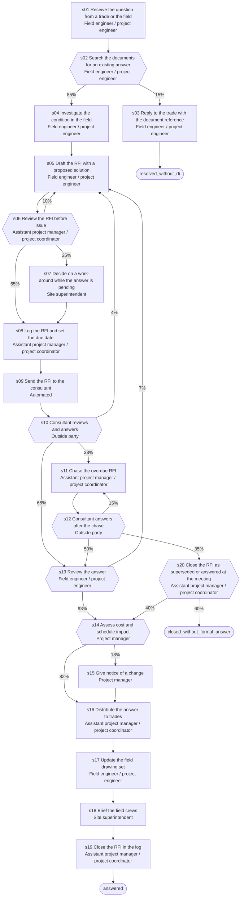

# Manage requests for information

`gc-ops-rfi` · construction (non-residential general contracting) · construction operations · part of `general-contractor-co`

A request for information (RFI) is a written question from the contractor to the design consultant when drawings or specifications are unclear, conflict or do not fit site conditions. The field engineer researches and drafts it, the assistant project manager reviews, logs and chases it, the consultant answers, and the project manager decides whether the answer changes scope. Late answers stop or re-sequence work, some answers are never given formally, and about one in five or six answers turns into a change notice.

| | |
|---|---|
| Unit of work | one RFI (one question raised by a trade or the site team) |
| Starts when | A subcontractor, the superintendent's walk or BIM coordination raises a question the documents do not answer. |
| Done when | The answer is distributed, the field set is updated and the RFI is closed, or the question is closed without an RFI or without a formal answer. |
| Organisation | A Canadian national general contractor of about 2,800 employees building institutional, commercial and industrial buildings, with about 220 active projects run from regional offices, a web-based project management platform and a construction ERP. (2,800 employees, 2019-2022) |
| Volume | 2,200 cases a month (range 1,700 to 3,000) |

## Where it sits

- Starts with **rfi** from ops-site-coordination (45% of cases)
- Starts with **rfi** from subcontractor (40% of cases)
- Starts with **rfi** from ops-vdc-coordination (15% of cases)
- Sends **rfi** to consultant (outcome: any)
- Sends **rfi_response** to ops-site-coordination (outcome: answered)
- Sends **rfi_response** to subcontractor (outcome: answered)
- Sends **change_request** to ops-change-order (outcome: answered)
- Sends **rfi_response** to ops-site-coordination (outcome: resolved_without_rfi)

## Flow

## Roles

| Role | Department | Layer | FTE on this process | Loaded cost per hour | Evidence |
|---|---|---|---:|---:|---|
| Field engineer / project engineer | Construction operations | individual contributor | 26 | 46 CAD | C |
| Assistant project manager / project coordinator | Construction operations | individual contributor | 14 | 48 CAD | C |
| Project manager | Construction operations | manager | 5 | 72 CAD | C |
| Site superintendent | Construction operations | supervisor | 2.5 | 75 CAD | C |

## Steps

Hands-on time and the wait before each step show the most common value. Evidence tier A is a sourced number, B a sourced description, C the author's estimate.

| Step | Who | Kind | Hands-on | Wait before | Control | Evidence |
|---|---|---|---:|---:|---|---|
| **s01 Receive the question from a trade or the field.** The field engineer receives a question from a subcontractor by email, phone or the project platform, or from the superintendent's walk, and reads it to see whether it is a real question about the design or a request for direction that the site team can give. | Field engineer / project engineer | intake | 10 min | 4.0 h |  | C |
| **s02 Search the documents for an existing answer.** The field engineer searches the current drawings, specifications, addenda, earlier RFI answers and reviewed shop drawings for an answer, and checks whether a revised drawing has already resolved the conflict. | Field engineer / project engineer | lookup | 30 min | 30 min |  | B [cdive] |
| **s03 Reply to the trade with the document reference.** The field engineer replies to the trade or superintendent with the drawing, detail or specification clause that answers the question, attaches a marked-up snip, and closes the question without issuing an RFI. | Field engineer / project engineer | communication | 10 min | 15 min |  | C |
| **s04 Investigate the condition in the field.** The field engineer goes to the location, measures the conflict, checks what is already installed, photographs it and talks to the trade foreman so the RFI states the actual condition and a workable proposed solution. | Field engineer / project engineer | physical | 30 min | 2.0 h |  | C |
| **s05 Draft the RFI with a proposed solution.** The field engineer writes the RFI in the project platform: the question, drawing and specification references, photos or a sketch, a proposed solution, whether cost or schedule may be affected, and the date an answer is needed to avoid delay. | Field engineer / project engineer | drafting | 35 min | 1.0 h |  | C |
| **s06 Review the RFI before issue.** The assistant project manager reads the draft for clarity, checks it is not a duplicate, removes wording that would concede scope, confirms the required-by date against the lookahead, and either returns it or passes it on. | Assistant project manager / project coordinator | review | 10 min | 4.0 h | Company project procedure: RFIs reviewed by the project office before issue to the consultant | C |
| **s07 Decide on a work-around while the answer is pending.** The superintendent looks at the affected area and the lookahead and decides whether crews can work elsewhere, whether to proceed at risk with the proposed solution, or whether work stops until the answer arrives, and tells the trade. | Site superintendent | judgment | 15 min | 4.0 h |  | C |
| **s08 Log the RFI and set the due date.** The assistant project manager numbers the RFI, assigns the consultant reviewer and any sub-consultant, sets the contractual or agreed response date, and adds it to the RFI log shown at the weekly consultant meeting. | Assistant project manager / project coordinator | data entry | 5 min | 30 min |  | C |
| **s09 Send the RFI to the consultant.** The project platform emails the RFI to the consultant's contract administrator with the attachments and due date, records the date sent, and starts the overdue clock shown in the RFI log. | Automated | system auto | 0 min | 0 min |  | C |
| **s10 Consultant reviews and answers.** The architect's contract administrator reviews the RFI, routes it to the structural, mechanical or electrical sub-consultant where needed, and returns a written answer, a sketch, a supplemental instruction, or a request for more information. | Outside party | external wait | 0 min | 5.0 d |  | B [cj], [ascc] |
| **s11 Chase the overdue RFI.** The assistant project manager emails and phones the consultant about overdue RFIs, raises them at the weekly consultant meeting with the required-by dates, and records the delay so it can support a later time extension. | Assistant project manager / project coordinator | communication | 10 min | 1.0 d |  | C |
| **s12 Consultant answers after the chase.** After the reminder the consultant either sends the written answer, answers verbally at the meeting or by issuing a revised drawing or supplemental instruction that supersedes the RFI, or still leaves it outstanding. | Outside party | external wait | 0 min | 3.0 d |  | B [cj] |
| **s13 Review the answer.** The field engineer reads the answer against the question and the field condition, checks that every discipline's comments agree and that it can be built, and returns it as a follow-up RFI if it is incomplete. | Field engineer / project engineer | review | 20 min | 4.0 h |  | C |
| **s14 Assess cost and schedule impact.** The project manager reads the answer against the contract scope and the subcontract scopes, and decides whether it changes the work, the cost or the schedule enough to give notice of a change to the consultant and owner. | Project manager | judgment | 20 min | 8.0 h |  | C |
| **s15 Give notice of a change.** The project manager writes a change notice or request for a change quotation citing the RFI answer, asks affected trades for pricing, and records it in the change log so the change order process can price and negotiate it. | Project manager | drafting | 30 min | 8.0 h | CCDC 2 Part 6: written notice of changes and claims within the contract periods | C |
| **s16 Distribute the answer to trades.** The assistant project manager forwards the answer through the platform to every affected subcontractor and the superintendent, asks for pricing where it is a change, and marks the RFI as answered in the log. | Assistant project manager / project coordinator | communication | 15 min | 4.0 h |  | C |
| **s17 Update the field drawing set.** The field engineer links or clouds the RFI answer on the current drawings in the platform and on the paper set in the trailer, and notes it for the as-built record so crews build to the answer. | Field engineer / project engineer | data entry | 15 min | 4.0 h |  | B [cdive] |
| **s18 Brief the field crews.** The superintendent tells the affected foremen about the answer at the next start-up meeting or at the work face and confirms any work-around or stopped work can now proceed. | Site superintendent | communication | 10 min | 10.0 h |  | C |
| **s19 Close the RFI in the log.** The assistant project manager records the answer date and the linked change notice, if any, and closes the RFI so the log shows response times and open items for the monthly report and any later claim. | Assistant project manager / project coordinator | data entry | 5 min | 4.0 h |  | C |
| **s20 Close the RFI as superseded or answered at the meeting.** The assistant project manager records the meeting minute or revised drawing that answered the RFI, asks the consultant to confirm in writing where the answer was verbal, and either closes the RFI or sends it for impact review. | Assistant project manager / project coordinator | data entry | 10 min | 1.0 d |  | B [cj] |

## Exceptions

| Exception | Share of cases | What happens |
|---|---:|---|
| Overdue answer chased | 24% | The consultant misses the due date; the assistant project manager chases weekly until a written answer, a revised drawing or a verbal answer arrives. |
| Closed without a formal answer | 5% | The question is answered at a meeting or overtaken by a revised drawing and closed without a written RFI response. |
| Answer changes scope | 15% | The project manager gives notice of a change and the answer feeds the change order process. |
| Follow-up RFI | 10% | The consultant asks for more information or the answer is incomplete, so the RFI is redrafted and re-issued. |

## Benchmarks

| Metric | Value | Unit | Population | Evidence |
|---|---|---|---|---|
| cycle_time_days | p50 11, p90 26 | calendar days from question raised to RFI closed | RFIs on Canadian building projects | C |
| consultant_response_time_mean | 9.7 | calendar days | Over 1 million RFIs on over 1,300 projects of $5M to $5B | A [cj] |
| share_never_answered | 0.22 | share of RFIs | Navigant RFI study | A [cj] |
| cost_per_rfi_review_and_response | 1080 | USD per RFI, all parties | Navigant RFI study, 1,362 projects | A [ascc] |
| rfis_per_million_construction_cost | 17.2 | RFIs per $1M | Projects of $5M to $50M | A [ascc] |

## Pain points

- Consultant answers average about ten days and some never come, so crews work around open questions or proceed at risk. (steps s10, s11, s12, s07; B [cj])
- Many questions are already answered in the documents or earlier RFIs, but finding the current information takes hours. (steps s02; B [cdive])
- Scope-changing answers are not always recognised, so the cost is absorbed instead of claimed. (steps s14; C)
- Paper drawing sets in the trailer fall out of step with RFI answers, a source of rework. (steps s17, s18; B [cdive])

## Assumptions

- The simulated median of about 13.5 days is above the 11-day benchmark because the company-side queues (field engineer, assistant project manager and project manager) are tier C estimates that add about three days to the Navigant consultant response; the consultant step alone reproduces a mean answer time of about 10 days.
- Volume is set from the Navigant rate of 17.2 RFIs per $1 million of construction cost (src ascc) applied to about $1.5 billion of revenue, not from the organisation file's 3,300 a month.
- The 15% of questions resolved from the documents without a formal RFI are counted as cases, because the field engineer still does the intake and search.
- Consultant and sub-consultant review time is outside the organisation and is given zero touch time, so the staffing check covers company staff only; Navigant's about 8 hours per RFI (src ascc) covers all parties.
- The interface to ops-change-order is attached to the 'answered' outcome; about 15% of answered RFIs produce a change request.
- Loaded costs are the organisation file's (1.35 loading factor for salaried staff).
- US-heavy Navigant figures are used as a proxy for Canadian practice, as CCDC contracts and consultant practice are similar.

## Sources

- [ascc] [Request for Information (RFI) and Rework](https://ascconline.org/Home/News/articleType/ArticleView/articleId/121/Request-for-Information-RFI-and-Rework) (American Society of Concrete Contractors, The Voice newsletter (Bruce Suprenant), 2020). Summary of the Navigant Construction Forum study 'Impact & Control of RFIs on Construction Projects': 1,362 projects, an average of about 800 RFIs per project, about 8 hours on average to review and respond to an RFI, $1,080 average cost per RFI, 17.2 RFIs per $1 million of construction cost on $5M-$50M projects and 1.1 on $1B-$5B projects.
- [cj] [The cost of RFIs and best practices for construction professionals](https://constructionjunkie.com/blog/2015/9/7/the-cost-of-rfis-and-best-practices-for-construction-professionals) (Construction Junkie, 2015). Summary of the Navigant Construction Forum RFI study (Hughes, Wells, Nutter, Zack): over 1 million RFIs on over 1,300 projects of $5 million to $5 billion; average response time just below 10 days; roughly 22% of RFIs never answered; slightly more than $1,000 per RFI in administrative and technical review.
- [cdive] [Industry could be overspending $177B per year, study finds](https://www.constructiondive.com/news/industry-could-be-overspending-177b-per-year-study-finds/529450/) (Construction Dive (Kathleen Brown), 2018). FMI and PlanGrid 'Construction Disconnected' survey of 600 professionals (49% general contractors): 35% of time on non-optimal activities, more than 14 hours per person per week; 5.5 hours a week looking for project data, almost 5 hours managing disagreements, nearly 4 hours on mistakes needing rework; poor communication 26% and poor project information 22% of rework.

Written by claude-opus on 2026-11-24.
