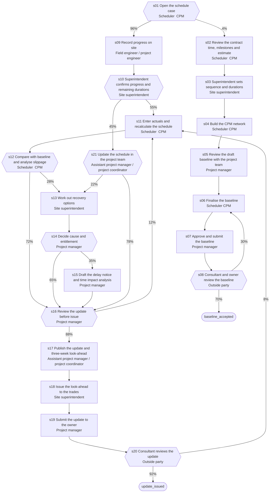

# Build and update the project schedule

`gc-ops-schedule-management` · construction - non-residential general contracting · construction operations (project controls) · part of `general-contractor-co`

Every project has a critical path schedule that shows how the work will finish within the contract time. A scheduler builds the baseline from the contract and the superintendent's sequence, and then every month the field engineer records progress, the superintendent confirms it, the scheduler updates and analyses the schedule, and the project manager reviews it and sends it to the owner. When a milestone slips the team works out recovery and, if the owner caused it, gives notice of delay. It is slow because a dozen schedulers serve about 220 projects, and error-prone because progress is estimated by eye and field sequence changes are not always passed on.

| | |
|---|---|
| Unit of work | one project schedule update |
| Starts when | The month-end data date passes on an active project (about 95% of cases), or the startup package for a new project arrives and a baseline is needed (about 5%). |
| Done when | The consultant accepts the monthly update or the baseline, and the three-week look-ahead is with the trades. |
| Organisation | A Canadian national general contractor of about 2,800 employees with about 220 active projects and a central scheduling group in operations support. (2,800 employees, 2019-2022) |
| Volume | 220 cases a month (range 190 to 260) |

## Where it sits

- Starts with **progress_update** from ops-site-coordination (96% of cases)
- Starts with **startup_package** from ops-project-startup (4% of cases)
- Relies on **change_order** from ops-change-order (a standing input; it does not start a case)
- Sends **schedule** to ops-site-coordination (outcome: update_issued)
- Sends **schedule** to spe-crew-planning (outcome: update_issued)
- Sends **schedule** to ops-owner-meetings (outcome: any)
- Sends **schedule** to ops-p3-reporting (outcome: any)
- Sends **schedule** to ops-winter-protection (outcome: any)
- Sends **schedule** to public-owner (outcome: any)
- Sends **schedule** to private-owner (outcome: any)
- Sends **delay_notice** to legal-claims-disputes (outcome: update_issued)
- Sends **schedule** to ops-progress-draw (outcome: baseline_accepted)

## Flow

## Roles

| Role | Department | Layer | FTE on this process | Loaded cost per hour | Evidence |
|---|---|---|---:|---:|---|
| Scheduler (CPM) | Operations support (project controls, scheduling, VDC, quality) | senior specialist | 10.32 | 68 CAD | C |
| Assistant project manager / project coordinator | Construction operations | individual contributor | 4.04 | 48 CAD | C |
| Site superintendent | Construction operations | supervisor | 6.66 | 75 CAD | C |
| Field engineer / project engineer | Construction operations | individual contributor | 5.58 | 46 CAD | C |
| Project manager | Construction operations | manager | 5.2 | 72 CAD | C |

## Steps

Hands-on time and the wait before each step show the most common value. Evidence tier A is a sourced number, B a sourced description, C the author's estimate.

| Step | Who | Kind | Hands-on | Wait before | Control | Evidence |
|---|---|---|---:|---:|---|---|
| **s01 Open the schedule case.** The scheduler assigned to the project opens the schedule file for the month: either a new project's startup package arrives and a baseline must be built, or the month-end data date has passed and the monthly update is due. He checks the folder, the last issued version and the owner's due date. | Scheduler (CPM) | intake | 15 min | 0 min |  | C |
| **s02 Review the contract time, milestones and estimate.** The scheduler reads the contract time, interim milestones, phasing and liquidated damages clauses, the estimate's duration assumptions and the site logistics plan, and agrees the work breakdown structure with the project manager. | Scheduler (CPM) | lookup | 8.0 h | 2.0 d |  | B [ccdc2] |
| **s03 Superintendent sets sequence and durations.** The superintendent marks up a sequence for the job: excavation and foundations, structure by floor or zone, envelope, rough-ins, finishes and commissioning, with crew-based durations and the long-lead deliveries he depends on. | Site superintendent | analysis | 8.0 h | 2.0 d |  | C |
| **s04 Build the CPM network.** The scheduler enters activities, durations and logic links in Primavera P6 or Microsoft Project, typically several hundred to over a thousand activities, adds procurement and submittal activities, owner milestones and a winter calendar, and runs the schedule to find the critical path. | Scheduler (CPM) | drafting | 1.2 d | 1.0 d |  | B [ccdc2], [ab_01321] |
| **s05 Review the draft baseline with the project team.** The project manager runs a review session with the superintendent and scheduler, walks the critical path and float, tests the sequence against the buyout plan and logistics, and lists changes. | Project manager | review | 4.0 h | 2.0 d |  | C |
| **s06 Finalise the baseline.** The scheduler makes the agreed changes or the consultant's revisions, checks logic quality (open ends, constraints, lags), assigns cost or manpower loading where the contract asks for it, and prints the baseline Gantt chart and narrative. | Scheduler (CPM) | drafting | 5.0 h | 12.0 h |  | C |
| **s07 Approve and submit the baseline.** The project manager approves the baseline and submits it to the consultant and owner with a narrative, before the first application for payment as the contract requires. | Project manager | approval | 1.0 h | 1.0 d | CCDC 2-2020 GC 3.4.1.1: construction schedule submitted before the first application for payment (contract requirement) | B [ccdc2] |
| **s08 Consultant and owner review the baseline.** The consultant and owner review the baseline for completeness, milestones and contract time and either accept it or return comments for revision. | Outside party | external wait | 0 min | 7.0 d |  | B [ab_01321] |
| **s09 Record progress on site.** The field engineer walks the site with the current three-week look-ahead and records actual start and finish dates and percent complete for each activity in progress, noting areas not started, trades short of manpower and work lost to weather. | Field engineer / project engineer | physical | 2.5 h | 12.0 h |  | B [nms_013216] |
| **s10 Superintendent confirms progress and remaining durations.** The superintendent checks the field engineer's mark-up, corrects percent complete, sets remaining durations and notes sequence changes he has already made in the field or plans for next month. | Site superintendent | review | 1.5 h | 12.0 h |  | C |
| **s11 Enter actuals and recalculate the schedule.** The scheduler keys actual dates, percent complete and remaining durations into the schedule, adjusts logic for the sequence changes, moves the data date to month end and recalculates. | Scheduler (CPM) | data entry | 1.5 h | 1.0 d |  | B [ab_01321] |
| **s12 Compare with baseline and analyse slippage.** The scheduler compares the update with the baseline and last month: critical path changes, float lost, milestones moved, and which activities drove the movement. He writes the variance section of the narrative. | Scheduler (CPM) | analysis | 1.0 h | 4.8 h |  | B [nms_013216] |
| **s13 Work out recovery options.** The superintendent and scheduler test ways to win back time: re-sequencing zones, adding a crew or shift, overtime, earlier deliveries or splitting activities, and estimate what each costs. | Site superintendent | analysis | 2.0 h | 1.0 d |  | B [nms_013216] |
| **s14 Decide cause and entitlement.** The project manager decides whether the delay was caused by the owner or consultant (changes, late RFI answers, late permits, unforeseen conditions), by weather, or by the company and its subcontractors, and whether to give notice of delay. | Project manager | judgment | 1.0 h | 12.0 h |  | C |
| **s15 Draft the delay notice and time impact analysis.** The project manager writes the notice of delay with the scheduler's time impact fragnet showing the delay inserted into the schedule, the affected milestones and the extension requested, and sends it to the consultant and the claims team. | Project manager | drafting | 4.0 h | 1.0 d | CCDC 2-2020 Part 6 (delays and extensions of Contract Time) and GC 3.4.1.3 schedule revisions | B [ccdc2] |
| **s16 Review the update before issue.** The project manager reads the updated schedule and narrative, checks that forecast dates match what he is telling the owner and that delays are described consistently with any notices, and approves it or sends corrections back. | Project manager | review | 45 min | 1.0 d |  | C |
| **s17 Publish the update and three-week look-ahead.** The assistant project manager prints the updated Gantt chart, the narrative and a three-week look-ahead filtered by trade, and posts them to the project platform. | Assistant project manager / project coordinator | drafting | 1.0 h | 7.2 h |  | B [nms_013216] |
| **s18 Issue the look-ahead to the trades.** The superintendent hands out and walks through the look-ahead at the weekly subcontractor coordination meeting, confirming each foreman's manpower and start dates for the next three weeks. | Site superintendent | communication | 30 min | 12.0 h |  | B [nms_013216] |
| **s19 Submit the update to the owner.** The project manager sends the updated schedule and narrative to the consultant and owner with the monthly progress report and draw, as the contract requires monthly. | Project manager | communication | 20 min | 12.0 h | CCDC 2-2020 GC 3.4.1.2: schedule updated monthly or as the Contract Documents stipulate | B [ccdc2], [ab_01321] |
| **s20 Consultant reviews the update.** The consultant reviews the update at or before the monthly owner meeting and accepts it or asks for revisions where progress or logic is questioned. | Outside party | external wait | 0 min | 3.0 d |  | B [ab_01321] |
| **s21 Update the schedule in the project team.** On a smaller project the assistant project manager keys the confirmed progress and remaining durations into the Microsoft Project schedule, moves the status date, compares the forecast with the baseline milestones and notes any slippage for the project manager. | Assistant project manager / project coordinator | data entry | 1.5 h | 1.0 d |  | C |

## Exceptions

| Exception | Share of cases | What happens |
|---|---:|---|
| Baseline for a new project | 4% | A new project needs a baseline built, reviewed and accepted before the first draw. |
| Critical slippage | 27% | A milestone or completion date slips; recovery options are worked out and the cause decided. |
| Owner-caused delay notice | 9% | The delay is owner-caused and the project manager issues a delay notice with a time impact analysis. |
| Update corrected before issue or after consultant comments | 19% | The project manager or consultant questions progress or logic and the update is reworked. |

## Benchmarks

| Metric | Value | Unit | Population | Evidence |
|---|---|---|---|---|
| cycle_time_days | p50 11, p90 20 | calendar days from month-end data date to accepted update (monthly cases) | Canadian building projects with monthly schedule updates | B [ab_01321] |
| baseline_submission_days | 15 | days after commencement for the initial schedule | Alberta Transportation contracts | A [ab_01321] |

## Pain points

- About a dozen schedulers support about 220 projects, so updates queue behind each other at month end. (steps s11, s12; C)
- Progress is estimated by eye on paper printouts and re-keyed into the scheduling software, so percent complete is often optimistic. (steps s09, s10, s11; C)
- Sequence changes made in the field reach the scheduler late, so the issued schedule does not match how the job is being built. (steps s10, s13; C)
- Delay notices are given late or without a contemporaneous schedule analysis, weakening extension of time requests. (steps s14, s15; C)

## Assumptions

- One case is one project's schedule cycle in a month; about 4.5% of cases are new baselines (10 starts among about 220 cases). Baseline and update follow different paths in the same file.
- The monthly cycle starts at the data date, not at the start of the month, so the cycle time measures turnaround of the update, not the reporting period.
- Schedulers update about 55% of projects (larger and P3 jobs); on the rest the assistant project manager keeps a Microsoft Project schedule (s21). With every update on schedulers, the step times imply about 14 scheduler FTE against 12 in the organisation file. The org file's process roles omit assistant-pm and field-engineer, which are used here.
- fte_on_process for each role = mean hands-on hours per case from the steps x 220 cases a month / 130 productive hours, plus 15% for coordination not written as steps.
- The simulated median turnaround (about 13 days) is a little above the 11-day benchmark because the simulation adds the queue at each step in sequence; the Alberta 5-day submission target is rarely met on busy month ends.
- The look-ahead to trades and the submission to the owner run in parallel and are listed in sequence with concurrent_with.
- Produces adds private-owner and ops-progress-draw links that the org file's process map lacks; private owners also receive schedules, and the accepted baseline is a precondition of the first draw under CCDC 2 GC 3.4.1.

## Sources

- [ccdc2] [CCDC 2 - 2020 Stipulated Price Contract (standard form text in a District of Hudson's Hope tender package)](https://hudsonshope.ca/wp-content/uploads/2026/07/1_CCDC-2-2020_StipulatedPriceContract.pdf) (Canadian Construction Documents Committee; document posted by the District of Hudson's Hope, 2020). GC 3.4.1: construction schedule submitted to owner and consultant before the first application for payment, showing major activities and critical events, monitored and updated monthly or as the Contract Documents state, consultant advised of revisions from extensions of Contract Time; GC 3.6.1: contractor makes written agreements with subcontractors and suppliers that incorporate the prime contract terms; GC 3.6.2-3.6.3: owner may object to a proposed subcontractor before signing; GC 5.2.4: schedule of values at least 15 calendar days before the first application for payment; GC 9.4.1: contractor establishes, maintains and supervises health and safety precautions and programs; GC 10.4.1: evidence of workers' compensation compliance before commencing the Work and with each application for payment; GC 11.1: contractor insurance per CCDC 41.
- [ab_01321] [Section 01321 Bar Chart Construction Schedule (standard specification)](https://alberta.ca/system/files/trans-section01321.pdf) (Alberta Transportation, Government of Alberta, 2017). Initial construction schedule within 15 days after commencement; owner returns it or requires revisions within 10 days of receipt; revised schedule within 5 days of comments; updated schedule within 5 days after the end of each month; progress revisions within 15 days of notice when progress departs from the schedule and substantial performance is in jeopardy.
- [nms_013216] [Section 01 32 16 Construction Progress Schedule (National Master Specification based section in City of Winnipeg Bid Opportunity 21-2017)](https://legacy.winnipeg.ca/finance/findata/matmgt/documents/2017/21-2017/21-2017_NMS_Section-013216.pdf) (City of Winnipeg, 2017). Schedule updates reflect activity changes, completions and activities in progress, with a narrative comparing progress to baseline, current forecasts, problem areas, anticipated delays and mitigation; the schedule is discussed at regular site meetings, with activities behind baseline identified and recovery measures given; weather delays discussed.

Written by claude-opus on 2026-11-24.
