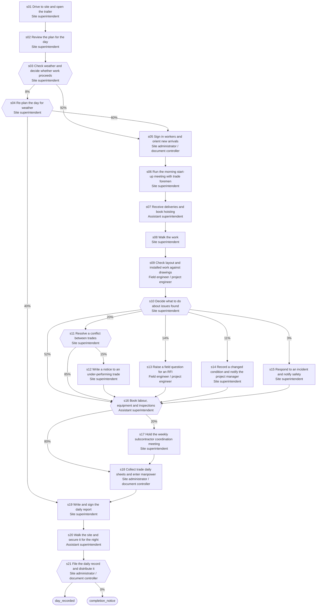

# Coordinate the site day to day

`gc-ops-site-coordination` · construction (non-residential general contracting) · construction operations · part of `general-contractor-co`

The superintendent runs each active site day by day: opening the site, planning the day against the lookahead, holding a start-up meeting with trade foremen, receiving deliveries, walking the work, sorting out conflicts and questions, booking labour, equipment and inspections, and writing the daily report. The assistant superintendent, field engineer and site administrator share the work. Weather, late or short-manned trades, missing information and changed conditions force constant re-planning, and a thin daily record weakens later delay and change claims.

| | |
|---|---|
| Unit of work | one project-day of site coordination |
| Starts when | A working day starts on an active, mobilized site. |
| Done when | The site is secured, the signed daily report is filed and distributed, and any RFIs, change requests, labour, equipment and inspection requests raised that day have been passed on. |
| Organisation | A Canadian national general contractor of about 2,800 employees building institutional, commercial and industrial buildings, with about 220 active projects run from regional offices, a web-based project management platform and a construction ERP. (2,800 employees, 2019-2022) |
| Volume | 4,600 cases a month (range 3,800 to 5,300) |

## Where it sits

- Starts with **mobilized_site** from ops-site-mobilization (100% of cases)
- Relies on **subcontract** from scm-subcontract-buyout (a standing input; it does not start a case)
- Relies on **schedule** from ops-schedule-management (a standing input; it does not start a case)
- Relies on **coordinated_model** from ops-vdc-coordination (a standing input; it does not start a case)
- Relies on **rfi_response** from ops-rfi (a standing input; it does not start a case)
- Relies on **reviewed_submittal** from ops-submittals (a standing input; it does not start a case)
- Relies on **lift_plan** from spe-crane-operations (a standing input; it does not start a case)
- Relies on **environmental_plan** from hse-environmental (a standing input; it does not start a case)
- Relies on **inspection_report** from hse-site-inspection (a standing input; it does not start a case)
- Relies on **ministry_order** from hse-ministry-inspection (a standing input; it does not start a case)
- Relies on **system_release** from it-system-change (a standing input; it does not start a case)
- Relies on **daily_report** from spe-concrete-placement (a standing input; it does not start a case)
- Relies on **daily_report** from spe-general-works (a standing input; it does not start a case)
- Sends **rfi** to ops-rfi (outcome: any)
- Sends **change_request** to ops-change-order (outcome: any)
- Sends **material_requisition** to scm-material-procurement (outcome: any)
- Sends **labour_request** to spe-crew-planning (outcome: any)
- Sends **equipment_request** to spe-equipment-dispatch (outcome: any)
- Sends **inspection_request** to ops-quality-inspection (outcome: any)
- Sends **work_plan** to hse-daily-hazard (outcome: any)
- Sends **incident_report** to hse-incident-management (outcome: any)
- Sends **performance_issue** to ops-subcontractor-performance (outcome: any)
- Sends **progress_update** to ops-schedule-management (outcome: day_recorded)
- Sends **progress_update** to ops-progress-draw (outcome: day_recorded)
- Sends **daily_report** to legal-claims-disputes (outcome: day_recorded)
- Sends **completion_notice** to ops-commissioning (outcome: completion_notice)
- Sends **completion_notice** to ops-deficiency-closeout (outcome: completion_notice)

## Flow

## Roles

| Role | Department | Layer | FTE on this process | Loaded cost per hour | Evidence |
|---|---|---|---:|---:|---|
| Site superintendent | Construction operations | supervisor | 75 | 75 CAD | C |
| Assistant superintendent | Construction operations | supervisor | 40 | 58 CAD | C |
| Field engineer / project engineer | Construction operations | individual contributor | 40 | 46 CAD | C |
| Site administrator / document controller | Construction operations | individual contributor | 24 | 36 CAD | C |

## Steps

Hands-on time and the wait before each step show the most common value. Evidence tier A is a sourced number, B a sourced description, C the author's estimate.

| Step | Who | Kind | Hands-on | Wait before | Control | Evidence |
|---|---|---|---:|---:|---|---|
| **s01 Drive to site and open the trailer.** The superintendent drives the company pickup from home or the regional office to the site, unlocks the gate and the site office trailer, and checks overnight security, temporary heat or pumps before the trades arrive around 7:00. | Site superintendent | travel | 35 min | 0 min |  | C |
| **s02 Review the plan for the day.** In the trailer the superintendent opens the three-week lookahead, yesterday's daily report, the delivery and crane booking sheet and the inspection bookings, and lists which trades should be on site, in which areas, and what must happen today. | Site superintendent | lookup | 20 min | 5 min |  | C |
| **s03 Check weather and decide whether work proceeds.** The superintendent checks the forecast and site conditions (rain, wind speed for crane lifts, temperature for concrete placing and curing) and decides whether planned pours, lifts and roofing go ahead or are cancelled and the trades re-sequenced. | Site superintendent | judgment | 5 min | 0 min |  | C |
| **s04 Re-plan the day for weather.** The superintendent phones or texts trade foremen to cancel or move crews, reschedules the concrete supplier, pump and crane, moves crews to interior work where possible, and records the lost hours and the weather as a delay for later claims. | Site superintendent | coordination | 1.0 h | 15 min |  | C |
| **s05 Sign in workers and orient new arrivals.** The site administrator checks the sign-in sheet or gate log against the expected trades, gives the site-specific orientation to new workers, checks their working-at-heights training card, and files the signed orientation forms. | Site administrator / document controller | data entry | 25 min | 10 min | Ontario OHSA constructor duties and O. Reg. 297/13 working-at-heights training; company site orientation rule | C |
| **s06 Run the morning start-up meeting with trade foremen.** The superintendent gathers subcontractor and self-perform foremen at the trailer, walks through today's work areas, crane and hoist slots, deliveries, overlapping work and hazards, and agrees who works where so trades do not block each other. | Site superintendent | coordination | 20 min | 5 min | Constructor's duty under Ontario OHSA s.23 to coordinate trades; company pre-task coordination meeting | C |
| **s07 Receive deliveries and book hoisting.** The assistant superintendent checks arriving trucks against the delivery schedule and purchase orders, directs them to the laydown area, books the telehandler, hoist or crane for offloading, signs the delivery tickets and notes shortages or damage. | Assistant superintendent | coordination | 30 min | 30 min |  | C |
| **s08 Walk the work.** The superintendent walks every active area, compares progress with the lookahead, checks installed work for visible quality problems, housekeeping, guardrails and openings, and notes problems, trade manpower and photos on a tablet or notebook. | Site superintendent | physical | 1.2 h | 30 min |  | C |
| **s09 Check layout and installed work against drawings.** The field engineer checks gridlines, elevations, embeds and sleeves before pours, compares installed work with the current drawings, RFI answers and reviewed shop drawings, and photographs anything that does not match. | Field engineer / project engineer | physical | 1.2 h | 5 min |  | C |
| **s10 Decide what to do about issues found.** The superintendent reviews the notes from the walk and the field engineer's check and decides whether each issue can be fixed by a trade today, needs another trade to move, needs a question to the designer, is extra work, or is a safety incident. | Site superintendent | judgment | 15 min | 10 min |  | C |
| **s11 Resolve a conflict between trades.** The superintendent meets the foremen involved at the work face, decides who goes first or who repairs damaged work, adjusts the sequence and hoist time, and confirms the decision by text or email so it is on record. | Site superintendent | coordination | 40 min | 30 min |  | B [cdive] |
| **s12 Write a notice to an under-performing trade.** The superintendent writes an email or site memo to the subcontractor's project manager stating the missed manpower or dates, the schedule impact and the required recovery, copies the project manager, and records it for the subcontractor performance file. | Site superintendent | drafting | 30 min | 3.0 h | Subcontract notice provisions (CCA 1 style): written notice before back-charge or default | C |
| **s13 Raise a field question for an RFI.** The field engineer measures and photographs the conflict, writes a short description with grid references and a proposed solution, and passes it to the RFI process so it can be issued to the consultant. | Field engineer / project engineer | drafting | 30 min | 30 min |  | C |
| **s14 Record a changed condition and notify the project manager.** The superintendent photographs the condition, records the time, crews and equipment affected, issues or requests a site instruction, and emails the project manager so a change notice can be raised within the contract notice period. | Site superintendent | communication | 30 min | 30 min | CCDC 2 Part 6 change provisions: prompt written notice of changes and claims | C |
| **s15 Respond to an incident and notify safety.** The superintendent makes the area safe, arranges first aid, secures the scene if the injury is critical, phones the regional safety manager and starts the incident report so the safety team can investigate and report to regulators. | Site superintendent | communication | 1.5 h | 0 min | Ontario OHSA s.51-52: notice of critical injury and accidents; scene preserved | C |
| **s16 Book labour, equipment and inspections.** The assistant superintendent phones or emails the yard coordinator for equipment, sends the labour request for self-perform crews, books testing-agency and municipal inspections for tomorrow, and orders small materials. | Assistant superintendent | coordination | 30 min | 30 min |  | C |
| **s17 Hold the weekly subcontractor coordination meeting.** Once a week the superintendent chairs a meeting with all trade foremen and project managers, reviews the three-week lookahead against the master schedule, open RFIs and submittals, safety items and manpower, and records actions in minutes. | Site superintendent | coordination | 1.5 h | 2.0 h |  | C |
| **s18 Collect trade daily sheets and enter manpower.** The site administrator collects subcontractor foremen's daily sheets or texts, enters workers and hours by trade, equipment on site and visitors into the daily log in the project platform, and chases trades that did not report. | Site administrator / document controller | data entry | 30 min | 1.0 h |  | B [fieldwire] |
| **s19 Write and sign the daily report.** At the end of the day the superintendent completes the daily report in the project platform: weather, manpower by trade, equipment, work done by area, deliveries, inspections, delays, visitors, incidents and photos, then signs it. | Site superintendent | drafting | 45 min | 30 min | Company project controls procedure: signed daily report every working day, kept as contract record | B [fieldwire] |
| **s20 Walk the site and secure it for the night.** The assistant superintendent walks the perimeter, checks hoarding, fencing and gates, covers openings, checks temporary heat, pumps and fire extinguishers, makes sure the crane is weather-vaned, and locks the site and trailer. | Assistant superintendent | physical | 30 min | 15 min | O. Reg. 213/91 protection of the public and site security; company end-of-day checklist | C |
| **s21 File the daily record and distribute it.** Next working morning the site administrator checks the daily report has been signed, files the timesheets and photos, and sends the report to the project manager; on Fridays the week's reports go to the scheduler and project accountant for the progress update. | Site administrator / document controller | data entry | 15 min | 12.0 h |  | C |

## Exceptions

| Exception | Share of cases | What happens |
|---|---:|---|
| Weather stand-down | 8% | Rain, wind or cold stops pours, lifts or roofing; the superintendent re-plans and in 40% of these days the site is rained out and only the record is made. |
| Trade conflict escalated to a performance notice | 3% | A repeatedly late or short-manned trade gets a written notice that feeds the subcontractor performance process. |
| Site incident | 3% | A near miss, injury or damage event takes the superintendent away from coordination for one to four hours. |

## Benchmarks

| Metric | Value | Unit | Population | Evidence |
|---|---|---|---|---|
| cycle_time_days | p50 1.0, p90 1.4 | calendar days from site opening to filed daily record | One project-day on a Canadian general contractor building site | C |
| share_of_time_on_non_optimal_activities | 0.35 | share of work hours | 600 US construction professionals, 49% general contractors, 2018 | A [cdive] |
| hours_per_week_looking_for_project_information | 5.5 | hours per person per week | 600 US construction professionals, 2018 | A [cdive] |

## Pain points

- Superintendents spend a large part of the day searching for current drawings and answers and resolving disagreements between trades, rather than planning ahead. (steps s09, s10, s11; B [cdive])
- Weather cancels pours and lifts at short notice and forces re-sequencing of crews, pumps and cranes. (steps s03, s04; C)
- The daily report is written at the end of a long day and often leaves out delays, extra work and manpower shortfalls that later matter for change orders and delay claims. (steps s19, s18; B [fieldwire])
- Manpower is re-keyed from trade daily sheets into the platform by the site administrator, and missing sheets have to be chased. (steps s18; C)

## Assumptions

- The simulated median of about 1.3 days is above the 1.0-day benchmark because the simulator runs steps one after another; in practice the field engineer's checks, sign-in and the start-up meeting overlap the superintendent's walk (marked concurrent_with), so the real day is shorter.
- A case is one project-day; every active project runs this process each working day, so step shares (weekly meeting on 20% of days, weather on 8%) are per-day probabilities.
- The superintendent, assistant superintendent, field engineer and site administrator are the organisation file's roles; on small projects one superintendent covers two sites or an assistant superintendent acts as lead, so per-day hands-on time is an average across project sizes.
- The staffing check uses 130 productive hours a month; site roles work about 190 hours a month in season (10-hour days and some Saturdays), so the stated FTE are lower than hands-on time x volume / 130 would suggest.
- Subcontractor foremen take part in the start-up meeting and weekly meeting but are outside the organisation; their time is not counted.
- Field level hazard assessments are done by each crew in hse-daily-hazard and are an input to the start-up meeting, not a step here.
- Loaded costs are the organisation file's (1.35 loading factor for salaried staff).
- Practice described is Ontario; other provinces have equivalent constructor, orientation and incident-reporting rules.

## Sources

- [cdive] [Industry could be overspending $177B per year, study finds](https://www.constructiondive.com/news/industry-could-be-overspending-177b-per-year-study-finds/529450/) (Construction Dive (Kathleen Brown), 2018). FMI and PlanGrid 'Construction Disconnected' survey of 600 professionals (49% general contractors): 35% of time on non-optimal activities, more than 14 hours per person per week; 5.5 hours a week looking for project data, almost 5 hours managing disagreements, nearly 4 hours on mistakes needing rework; poor communication 26% and poor project information 22% of rework.
- [fieldwire] [Construction daily report forms: How field teams document daily work](https://www.fieldwire.com/blog/daily-report-form-for-construction/) (Fieldwire (Hilti), n.d.). Daily report is completed by the superintendent or foreman and finalised at the end of each workday; on larger projects each trade foreman logs their own crew and the superintendent compiles the site report; sections cover weather, crew and labour hours, subcontractors and visitors, equipment, materials, work performed, delays and safety incidents, photos and sign-off; daily reports are cited with schedules and correspondence as evidence in delay claims.

Written by claude-opus on 2026-11-24.
