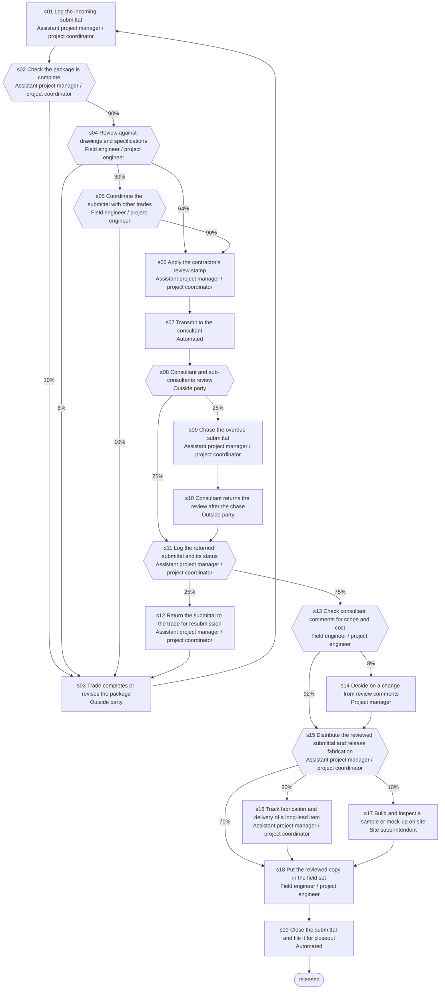

# Manage shop drawings and submittals

`gc-ops-submittals` · construction (non-residential general contracting) · construction operations · part of `general-contractor-co`

Before trades fabricate or order materials, they send shop drawings, product data and samples to the general contractor, which checks them against the drawings and specifications, stamps them and sends them to the design consultant for review. The assistant project manager logs, chases and distributes, the field engineer reviews and coordinates, and the consultant and its engineers return a status. Long consultant reviews, incomplete packages and resubmission loops delay procurement of long-lead items and can push the schedule.

| | |
|---|---|
| Unit of work | one submittal (one shop drawing, product data or sample package for a specification section) |
| Starts when | A subcontractor or supplier sends a submittal package for review. |
| Done when | The reviewed submittal is released to the trade for fabrication or ordering, placed in the field set and filed for closeout. |
| Organisation | A Canadian national general contractor of about 2,800 employees building institutional, commercial and industrial buildings, with about 220 active projects run from regional offices, a web-based project management platform and a construction ERP. (2,800 employees, 2019-2022) |
| Volume | 2,800 cases a month (range 2,000 to 3,800) |

## Where it sits

- Starts with **submittal** from subcontractor (88% of cases)
- Starts with **submittal** from supplier (12% of cases)
- Sends **submittal** to consultant (outcome: any)
- Sends **reviewed_submittal** to subcontractor (outcome: released)
- Sends **reviewed_submittal** to scm-material-procurement (outcome: released)
- Sends **reviewed_submittal** to ops-site-coordination (outcome: released)
- Sends **reviewed_submittal** to spe-concrete-placement (outcome: released)
- Sends **reviewed_submittal** to ops-closeout-documents (outcome: released)
- Sends **change_request** to ops-change-order (outcome: released)

## Flow

## Roles

| Role | Department | Layer | FTE on this process | Loaded cost per hour | Evidence |
|---|---|---|---:|---:|---|
| Field engineer / project engineer | Construction operations | individual contributor | 32 | 46 CAD | C |
| Assistant project manager / project coordinator | Construction operations | individual contributor | 28 | 48 CAD | C |
| Project manager | Construction operations | manager | 2.5 | 72 CAD | C |
| Site superintendent | Construction operations | supervisor | 3 | 75 CAD | C |

## Steps

Hands-on time and the wait before each step show the most common value. Evidence tier A is a sourced number, B a sourced description, C the author's estimate.

| Step | Who | Kind | Hands-on | Wait before | Control | Evidence |
|---|---|---|---:|---:|---|---|
| **s01 Log the incoming submittal.** The assistant project manager receives the shop drawings, product data or sample transmittal from the trade or supplier, gives it a number against the specification section, attaches the files in the project platform and sets the internal and consultant due dates from the submittal schedule. | Assistant project manager / project coordinator | data entry | 15 min | 4.0 h |  | C |
| **s02 Check the package is complete.** The assistant project manager checks that every item in the specification section is included, that the trade has stamped and signed its own review, that drawings are legible and to scale, and that samples or colour charts are attached where required. | Assistant project manager / project coordinator | validation | 10 min | 1.0 h |  | C |
| **s03 Trade completes or revises the package.** The subcontractor or supplier's detailer adds the missing items or revises the drawings to the comments, re-stamps them and sends a new revision; the GC waits and chases if the revision is late. | Outside party | external wait | 0 min | 4.0 d |  | C |
| **s04 Review against drawings and specifications.** The field engineer compares the submittal with the contract drawings, specifications, coordinated model and reviewed submittals of adjoining trades, checks dimensions, products, performance data and connections, and marks up deviations and questions. | Field engineer / project engineer | review | 50 min | 1.0 d |  | B [pawson], [iglc] |
| **s05 Coordinate the submittal with other trades.** For mechanical, electrical, structural steel, precast and similar packages the field engineer overlays the drawings on the coordinated model or adjoining trades' reviewed submittals and resolves clashes with the trades before submission. | Field engineer / project engineer | coordination | 45 min | 8.0 h |  | C |
| **s06 Apply the contractor's review stamp.** The assistant project manager confirms the field engineer's review is complete, applies the general contractor's review stamp with the reviewer's name and date to the PDF, and attaches the GC markups for the consultant. | Assistant project manager / project coordinator | approval | 10 min | 2.0 h | CCDC 2 GC 3.10: contractor reviews shop drawings before submission and remains responsible for errors and omissions (GC 3.10.10) | B [pawson] |
| **s07 Transmit to the consultant.** The project platform sends the stamped submittal to the consultant's contract administrator with a transmittal, records the date and starts the review clock; where the consultant uses its own portal the assistant project manager uploads it there as well. | Automated | system auto | 0 min | 30 min |  | C |
| **s08 Consultant and sub-consultants review.** The architect reviews for general conformance with the design intent and routes structural, mechanical and electrical packages to the responsible engineer, who marks up the drawings and returns them with a review status. | Outside party | external wait | 0 min | 9.0 d | Architect or professional engineer reviews shop drawings for conformance with design intent (CCDC 2 GC 3.10.12) | B [csi], [pawson] |
| **s09 Chase the overdue submittal.** The assistant project manager emails the consultant with the list of overdue submittals and the dates materials are needed, raises them at the weekly consultant meeting, and warns that late reviews will delay fabrication. | Assistant project manager / project coordinator | communication | 10 min | 1.0 d |  | C |
| **s10 Consultant returns the review after the chase.** After the reminder the consultant finishes the review, often after a sub-consultant has returned its markups, and sends the submittal back with its review status. | Outside party | external wait | 0 min | 5.0 d |  | B [csi] |
| **s11 Log the returned submittal and its status.** The assistant project manager records the return date and status (reviewed, reviewed as noted, revise and resubmit, or rejected) in the submittal log and decides whether it goes back to the trade for revision or forward for release. | Assistant project manager / project coordinator | data entry | 10 min | 4.0 h |  | C |
| **s12 Return the submittal to the trade for resubmission.** The assistant project manager sends the consultant's markups to the trade with a request to revise and resubmit by a set date, and flags the item on the lookahead if fabrication or installation depends on it. | Assistant project manager / project coordinator | communication | 10 min | 2.0 h |  | C |
| **s13 Check consultant comments for scope and cost.** The field engineer reads every consultant comment, checks whether any comment changes the work beyond the contract documents or affects another trade, and flags those to the project manager. | Field engineer / project engineer | review | 15 min | 8.0 h |  | C |
| **s14 Decide on a change from review comments.** The project manager compares the comment with the contract documents and decides whether to give notice of a change to the consultant before the trade proceeds, or to accept the comment as clarification within the contract. | Project manager | judgment | 30 min | 8.0 h | CCDC 2 GC 3.10.9: deviations accepted in writing; Part 6 change notice before proceeding | B [pawson] |
| **s15 Distribute the reviewed submittal and release fabrication.** The assistant project manager sends the reviewed submittal to the trade with written release to fabricate or order, copies the superintendent and supply chain, and notes any long-lead item whose delivery date needs tracking. | Assistant project manager / project coordinator | communication | 10 min | 2.0 h |  | C |
| **s16 Track fabrication and delivery of a long-lead item.** The assistant project manager asks the trade or supplier for a fabrication slot and delivery date, enters it in the procurement log and the schedule, and checks it against the date the superintendent needs the material on site. | Assistant project manager / project coordinator | coordination | 20 min | 2.0 d |  | C |
| **s17 Build and inspect a sample or mock-up on site.** The superintendent arranges for the trade to install a sample panel, masonry or envelope mock-up, books the consultant's site visit, walks the mock-up with the architect and records acceptance or required changes. | Site superintendent | physical | 2.0 h | 5.0 d |  | C |
| **s18 Put the reviewed copy in the field set.** The field engineer adds the reviewed shop drawing to the current field set in the platform and the trailer, removes superseded revisions, and tells the superintendent which areas can now be built. | Field engineer / project engineer | data entry | 10 min | 8.0 h |  | B [cdive] |
| **s19 Close the submittal and file it for closeout.** The project platform marks the submittal closed with its final status and date, and tags product data and shop drawings that must go into the operations and maintenance manuals at closeout. | Automated | system auto | 0 min | 0 min |  | C |

## Exceptions

| Exception | Share of cases | What happens |
|---|---:|---|
| Revise and resubmit | 25% | The consultant returns the submittal as revise and resubmit or rejected, and the trade revises it; the loop repeats the GC review and the consultant review. |
| Incomplete package returned before review | 10% | The assistant project manager returns a package missing items or the trade's own stamp. |
| Overdue consultant review | 25% | The consultant misses the review period and the assistant project manager chases weekly. |
| Mock-up required | 10% | Envelope, masonry and finish items need an on-site mock-up accepted by the architect before production. |

## Benchmarks

| Metric | Value | Unit | Population | Evidence |
|---|---|---|---|---|
| cycle_time_days | p50 21, p90 55 | calendar days from first receipt from the trade to release | Submittals on Canadian building projects | C |
| consultant_review_period_allowed | low 10, high 21 | days (working or calendar, by contract) | Specification and contract clauses | B [csi] |

## Pain points

- Consultant reviews run past the contract period, delaying fabrication slots for long-lead items such as steel, precast, switchgear and air handlers. (steps s08, s09, s10, s16; B [csi], [iglc])
- Incomplete or unclear packages from trades cause rejections and resubmission loops. (steps s02, s03, s12; B [iglc])
- GC review is rushed by field engineers who also do layout and RFIs, so errors reach the consultant or the field. (steps s04, s06; C)
- Superseded revisions stay in the field set and crews build to the wrong drawing. (steps s18; B [cdive])

## Assumptions

- The simulated median of about 25 days is above the 21-day benchmark mainly because of the resubmission loop (about a quarter of cases) and day-long internal queues; both are tier C estimates and the gap is within the range the sources allow (consultant averages of 28 to 42 days on slow projects).
- One case is one submittal package; resubmissions are loops within the case, not new cases.
- Consultant, sub-consultant and trade detailer time is outside the organisation and given zero touch time, so the staffing check covers company staff only.
- No source opened gives a measured resubmission rate; 25% is the author's estimate for building projects.
- Rebar shop drawings and concrete mix designs for self-performed work come from suppliers (12% of triggers); the organisation file lists only subcontractors as the trigger.
- Review comments that change scope (about 7% of cases) produce a change request to ops-change-order; the organisation file has no such link.
- Loaded costs are the organisation file's (1.35 loading factor for salaried staff).
- US contract periods (EJCDC, AIA-style clauses) from src csi are used beside CCDC 2 because CCDC 2-2008 sets no fixed period and CCDC 2-2020 moved timing to Division 01.

## Sources

- [pawson] [Stipulated Price Contract](https://canadianconsultingengineer.com/features/stipulated-price-contract) (Canadian Consulting Engineer (Owen Pawson, Miller Thomson), 2008). CCDC 2-2008: consultant reviews shop drawings with reasonable promptness so as to cause no delay (GC 3.10.12) and indicates acceptance or rejection of deviations in writing (GC 3.10.9); the contractor remains responsible for errors or omissions in shop drawings (GC 3.10.10); the consultant has 20 calendar days after the contractor submits an application and a list of items to be completed or corrected to verify substantial performance (GC 5.4.2); payment certificates within 10 calendar days (GC 5.3.1).
- [csi] [Shop drawings and submittals: timeliness of submittal reviews](https://www.csiresources.org/blogs/kevin-obeirne-pe-fcsi-ccs-ccca-cdt1/2022/01/14/shop-drawings-and-submittals-timeliness-of-submitt) (Construction Specifications Institute blog (Kevin O'Beirne), 2022). Design teams observed averaging 28 days and 42 or more days to respond to submittals; example contract clause giving the architect 21 days; EJCDC language allowing not less than 14 days for engineer's review with more for large or complex submittals; simple submittals may need two or three days.
- [iglc] [Identifying Root Causes of Long Review Times for Engineering Shop Drawings](https://iglc.net/Papers/Details/626) (International Group for Lean Construction, IGLC-17 (Chang-Sun Chin), 2009). Review times for structural steel and reinforcing bar shop drawings are unnecessarily long and often miss contractors' expected response times; the root cause is insufficient and unclear information rather than reviewer capability or availability.
- [cdive] [Industry could be overspending $177B per year, study finds](https://www.constructiondive.com/news/industry-could-be-overspending-177b-per-year-study-finds/529450/) (Construction Dive (Kathleen Brown), 2018). FMI and PlanGrid 'Construction Disconnected' survey of 600 professionals (49% general contractors): 35% of time on non-optimal activities, more than 14 hours per person per week; 5.5 hours a week looking for project data, almost 5 hours managing disagreements, nearly 4 hours on mistakes needing rework; poor communication 26% and poor project information 22% of rework.

Written by claude-opus on 2026-11-24.
