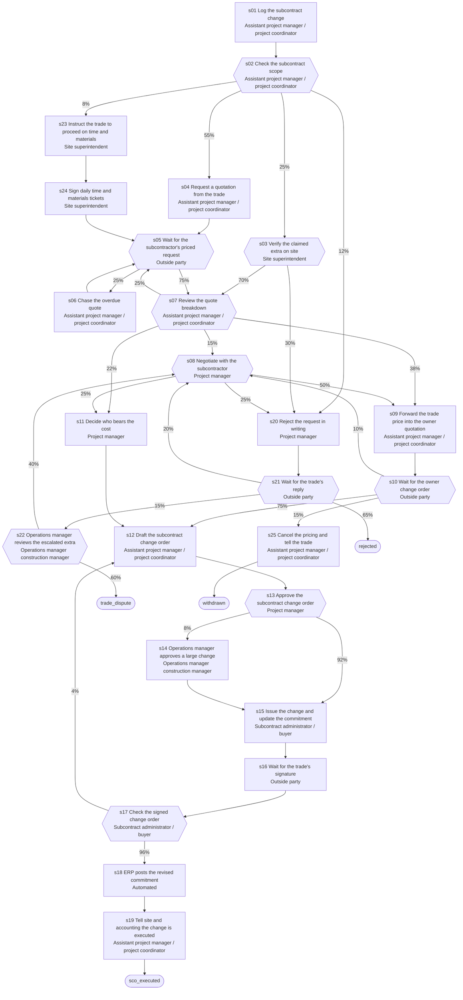

# Process subcontract change orders

`gc-ops-subtrade-change` · construction (non-residential general contracting) · project operations · part of `general-contractor-co`

Every owner change that touches subcontracted work, and every extra a trade claims on its own, has to become a priced and signed change to that trade's subcontract. The assistant project manager requests and reviews the trade's quote, the project manager negotiates and approves it, and the subcontract administrator issues it and updates the commitment in the ERP so the trade can bill. Changes recoverable from the owner wait for the owner change order, so trades often work for weeks before their change is signed, and revision cycles, unsigned time and materials tickets and disputed extras cause many lien and claim threats.

| | |
|---|---|
| Unit of work | one subcontract change |
| Starts when | An owner change needs trade pricing, a subcontractor submits a change order request for an extra, or the site directs a trade to do extra work. |
| Done when | A signed subcontract change order is posted to the commitment in the ERP, or the request is rejected, cancelled with the owner change, or escalated as a trade dispute. |
| Organisation | A Canadian national general contractor with about 220 active building projects and about 3,000 active subcontracts. (2,800 employees, 2019-2022) |
| Volume | 1,500 cases a month (range 1,000 to 2,200) |

## Where it sits

- Starts with **change_request** from ops-change-order (65% of cases)
- Starts with **sub_quote** from subcontractor (27% of cases)
- Starts with **change_request** from ops-site-coordination (8% of cases)
- Relies on **subcontract** from scm-subcontract-buyout (a standing input; it does not start a case)
- Sends **sub_quote** to ops-change-order (outcome: any)
- Sends **subcontract_change_order** to subcontractor (outcome: sco_executed)
- Sends **subcontract_change_order** to fin-sub-invoice-payment (outcome: sco_executed)
- Sends **subcontract_change_order** to ops-monthly-cost-forecast (outcome: sco_executed)
- Sends **disputed_change** to legal-claims-disputes (outcome: trade_dispute)

## Flow

## Roles

| Role | Department | Layer | FTE on this process | Loaded cost per hour | Evidence |
|---|---|---|---:|---:|---|
| Assistant project manager / project coordinator | ops | individual contributor | 22 | 48 CAD | C |
| Project manager | ops | manager | 9 | 72 CAD | C |
| Subcontract administrator / buyer | scm | individual contributor | 7 | 47 CAD | C |
| Site superintendent | ops | supervisor | 5 | 75 CAD | C |
| Operations manager (construction manager) | ops | manager | 0.3 | 115 CAD | C |

## Steps

Hands-on time and the wait before each step show the most common value. Evidence tier A is a sourced number, B a sourced description, C the author's estimate.

| Step | Who | Kind | Hands-on | Wait before | Control | Evidence |
|---|---|---|---:|---:|---|---|
| **s01 Log the subcontract change.** The assistant project manager opens a subcontract change record in the project platform, linked to the owner change event, a subcontractor's change order request or a site instruction. They record the trade, the subcontract number and the claimed or expected value. | Assistant project manager / project coordinator | intake | 15 min | 12.0 h |  | C |
| **s02 Check the subcontract scope.** The assistant project manager opens the subcontract, its scope of work, tender inclusions and exclusions and unit prices, and checks whether the work is already included. They decide whether to request pricing, verify a claimed extra on site, direct urgent work on time and materials or reject the request. | Assistant project manager / project coordinator | lookup | 20 min | 12.0 h |  | C |
| **s03 Verify the claimed extra on site.** The superintendent walks the area, compares the claimed work with daily reports, photos and any signed time and materials tickets, and confirms whether the work was outside the trade's scope and actually done. They record the finding in the change record. | Site superintendent | validation | 30 min | 2.0 d |  | C |
| **s04 Request a quotation from the trade.** The assistant project manager sends the trade the change scope sheet and drawings and asks for a breakdown of labour hours, rates, materials, equipment and markup by a due date. The request refers to the subcontract change clause. | Assistant project manager / project coordinator | communication | 20 min | 4.0 h |  | C |
| **s05 Wait for the subcontractor's priced request.** The subcontractor prices the change with its suppliers and sub-trades and returns a change order request. Specialty contractors report that preparing a fully priced request takes about three weeks on average after the field work is known. | Outside party | external wait | 0 min | 7.0 d |  | A [clearstory] |
| **s06 Chase the overdue quote.** The assistant project manager emails and phones the trade's project manager for the overdue quote and raises it in the weekly subcontractor meeting. The owner quotation cannot go out without it. | Assistant project manager / project coordinator | communication | 10 min | 0 min |  | B [usace_agc] |
| **s07 Review the quote breakdown.** The assistant project manager checks labour hours, rates, material prices and markups against the subcontract allowances and the company's own estimate, and checks for overlap with other trades. Quotes with errors or thin backup go back for revision. | Assistant project manager / project coordinator | review | 30 min | 1.0 d |  | A [clearstory] |
| **s08 Negotiate with the subcontractor.** The project manager meets or calls the trade's manager to settle hours, rates and scope gaps, sometimes trading against back-charges on the same subcontract. The agreed figure is noted in the change record. | Project manager | communication | 45 min | 2.0 d |  | C |
| **s09 Forward the trade price into the owner quotation.** The assistant project manager attaches the reviewed trade price to the owner change quotation and tells the trade that the subcontract change will be issued when the owner approves. The trade price is held open while the owner decides. | Assistant project manager / project coordinator | coordination | 20 min | 4.0 h |  | B [ab_change] |
| **s10 Wait for the owner change order.** The owner change works through consultant review, negotiation and signing, and the trade waits. When the owner approves, the subcontract change is issued; if the owner declines or cuts the change, the trade change is cancelled or renegotiated. | Outside party | external wait | 0 min | 14.0 d |  | A [usace_agc] |
| **s11 Decide who bears the cost.** For changes the owner will not pay for, such as coordination errors or acceleration, the project manager decides whether to charge contingency, transfer budget between cost codes or back-charge another trade. They record the reason in the change record. | Project manager | judgment | 20 min | 1.0 d | Company project controls policy: contingency drawdowns and budget transfers approved by the project manager and reported in the monthly forecast | C |
| **s12 Draft the subcontract change order.** The assistant project manager drafts the subcontract change order in the project platform with the scope description, agreed price, schedule effect, cost code and link to the owner change. They attach the trade quote as backup. | Assistant project manager / project coordinator | drafting | 20 min | 1.0 d |  | C |
| **s13 Approve the subcontract change order.** The project manager checks the draft against the agreed price, the owner change and the budget, then approves it in the project platform. Values above the manager's limit go to the operations manager. | Project manager | approval | 10 min | 1.0 d | Company delegation of authority for subcontract commitments | C |
| **s14 Operations manager approves a large change.** The operations manager reviews large subcontract changes for budget and contract risk and approves them by email or in the platform. Rejected drafts go back for rework. | Operations manager (construction manager) | approval | 15 min | 2.0 d | Company delegation of authority above the project manager limit | C |
| **s15 Issue the change and update the commitment.** The subcontract administrator checks the approvals, confirms the trade's insurance and workers' compensation clearance are current, enters the commitment change in the ERP and generates the formal subcontract change order. They email it to the trade for signature. | Subcontract administrator / buyer | data entry | 20 min | 2.0 d | Commitment changes keyed by subcontract administration only against a documented project manager approval | C |
| **s16 Wait for the trade's signature.** The subcontractor reviews the change order, signs it and returns it by email. Trades sometimes hold the signature to argue over wording or reserve rights on time. | Outside party | external wait | 0 min | 4.0 d |  | C |
| **s17 Check the signed change order.** The subcontract administrator compares the returned document with the issued version for altered terms or reservations of rights, files it in the document system and marks the commitment as executed. | Subcontract administrator / buyer | validation | 10 min | 1.0 d |  | C |
| **s18 ERP posts the revised commitment.** The ERP adds the executed change to the subcontract commitment and job cost committed amounts, so the trade can bill it on its next progress invoice and the change appears in the monthly cost forecast. | Automated | system auto | 0 min | 0 min |  | C |
| **s19 Tell site and accounting the change is executed.** The assistant project manager notifies the superintendent and the project accountant that the subcontract change is executed and can be billed, and closes the change record in the platform. | Assistant project manager / project coordinator | communication | 10 min | 4.0 h |  | C |
| **s20 Reject the request in writing.** The project manager writes to the trade explaining why the work is in scope, unsubstantiated or not agreed, citing the subcontract clauses and site records. The letter keeps the record straight if the trade later liens or claims. | Project manager | drafting | 30 min | 1.0 d |  | C |
| **s21 Wait for the trade's reply.** The trade accepts the rejection, comes back with new evidence or escalates to a formal claim. Unresolved extras often resurface at closeout or as a lien. | Outside party | external wait | 0 min | 5.0 d |  | A [clearstory] |
| **s22 Operations manager reviews the escalated extra.** The operations manager reviews the trade's escalated claim with the project manager and decides whether to settle, hold it for the closeout account or refer it to the claims manager. | Operations manager (construction manager) | judgment | 1.0 h | 3.0 d | Company delegation of authority for disputes | C |
| **s23 Instruct the trade to proceed on time and materials.** For urgent work the superintendent issues a written site instruction telling the trade to proceed and record labour, equipment and materials daily, with a not-to-exceed value set by the project manager. | Site superintendent | communication | 20 min | 2.0 h |  | B [ab_cd] |
| **s24 Sign daily time and materials tickets.** The superintendent checks each day's ticket against the crew and equipment actually on the work and signs it. The trade then prices the signed tickets into a change order request. | Site superintendent | validation | 30 min | 3.0 d |  | A [clearstory] |
| **s25 Cancel the pricing and tell the trade.** When the owner does not proceed, the assistant project manager cancels the subcontract change record and tells the trade in writing that the priced work will not go ahead. Any pricing costs are handled under the subcontract terms. | Assistant project manager / project coordinator | communication | 10 min | 12.0 h |  | C |

## Exceptions

| Exception | Share of cases | What happens |
|---|---:|---|
| Quote revision loop | 22% | The trade's quote goes back for revision because of missing backup or excess markup, adding another wait. |
| Urgent work on time and materials | 8% | The trade proceeds on a site instruction and the change is priced from signed daily tickets afterwards. |
| Owner withdraws the change | 5% | The owner does not proceed and the priced trade change is cancelled. |
| Disputed extra | 4% | The trade rejects the contractor's refusal and escalates; unresolved extras feed liens and claims. |

## Benchmarks

| Metric | Value | Unit | Population | Evidence |
|---|---|---|---|---|
| cycle_time_days | p50 45, p90 110 | calendar days from trade change logged to signed subcontract change order or closure | Subcontract changes on Canadian non-residential building projects, 2019-2022 | C |
| tm_tag_to_priced_request_days | 22 | average calendar days | US specialty contractors (survey with Dodge Construction Network), 2026 | A [clearstory] |
| request_to_signed_change_order_days | 26 | average calendar days | US specialty contractors (survey with Dodge Construction Network), 2026 | A [clearstory] |

## Pain points

- Trades wait for the owner change order before their own change is signed, so they work and finance extras for weeks. (steps s09, s10; A [clearstory])
- Quotes come back for repeated revisions over backup and markup. (steps s05, s07; A [clearstory])
- Time and materials tickets signed late or for the wrong work start disputes. (steps s23, s24; C)

## Assumptions

- Unit of work is one subcontract change, including pricing requests later cancelled because the owner did not proceed.
- Owner-side pricing and negotiation are documented in gc-ops-change-order; s10 stands in for that wait here.
- The Clearstory and Dodge survey is US and from 2026; it is used as the closest published measurement of trade change timing and shows the same mechanics as Canadian practice.
- Subcontract administrators in supply chain key commitments; at some regional offices the assistant project manager does this directly.
- Loops for revision and chasing restart the full wait for the trade's quote, which slightly overstates long tails.
- Waits include nights and weekends; office roles work weekdays and superintendents work extended hours in season.
- Simulated hands-on time (about 4.3 hours per change including revision loops) implies about 49 FTE against 43.3 stated; the gap is within the estimate's uncertainty and part of the review time overlaps owner-change pricing in gc-ops-change-order.

## Sources

- [clearstory] [2026 State of Change Orders: Specialty Contractor Report](https://www.clearstory.build/construction-blog/2026-sc-change-order-report) (Clearstory with Dodge Construction Network, 2026). Survey of US general and specialty contractors: average 22 days from a signed T&M tag to a fully priced change order request; average 26 days from change order request submission to a signed change order from the GC; 43% wait three weeks or more; 97% sometimes start work before approval, 42% more than half the time; more than half of requests need two or more revision cycles; GCs cite disputed pricing (66%) and insufficient backup (53%) when reducing payment; 48% have had disputes escalate to arbitration or legal process.
- [usace_agc] [Construction Contract Modifications: A Joint Study by the U.S. Army Corps of Engineers and Associated General Contractors of America](https://www.agc.org/sites/default/files/USACE-AGC%20Joint%20Study%20on%20Construction%20Contract%20Modifications.pdf) (Associated General Contractors of America and U.S. Army Corps of Engineers, 2021). Contractor change registers overlaid on USACE change logs (vertical building and public works, design-bid-build and design-build): a general contractor submitted a proposal about 30 days after a request for proposal on average; the government issued the modification on average within 90 days of proposal receipt, median 55 days; causes include disagreement on merit, requests for more documentation, missing subcontractor pricing delaying proposals for weeks or months, and change volume exceeding staff; contractors log a change when notified by RFI response or submittal comment, on average 30 days before the government records it.
- [ab_change] [Change Process for Construction Management Contracts (flowchart CA_MC_605_TRC)](https://www.alberta.ca/system/files/custom_downloaded_images/tr-ca-cm-change-process-flowchart.pdf) (Government of Alberta, Alberta Infrastructure, 2024). Public owner change process: project team identifies a potential change through site instructions, RFIs or other methods; consultant prepares a change request with cost estimate and reasons, signed under expenditure signing authority; consultant issues a contemplated change notice for pricing; the construction manager prices it, obtaining subcontractor pricing; consultant and cost consultant review the quote in detail; if not agreed the change is not approved due to cost; otherwise a change authorization or change order is issued and the contractor proceeds.
- [ab_cd] [Change Directive (CD) Process (flowchart CA_MC_660_TRC)](https://www.alberta.ca/system/files/custom_downloaded_images/tr-ca-cm-change-directive-process-flowchart.pdf) (Government of Alberta, Alberta Infrastructure, 2023). For urgent changes the consultant prepares a change directive with a maximum upset price, signed under expenditure signing authority, directing the contractor to proceed before price is agreed; a final quotation is then requested and a change order issued; contractors cannot invoice against a change directive, only against an approved change order.

Written by claude-opus on 2026-11-24.
