# Award subcontracts and purchase orders (buyout)

`gc-scm-subcontract-buyout` · construction - non-residential general contracting · supply chain and subcontracts · part of `general-contractor-co`

After a project is won, the general contractor turns each trade bid carried in its price into a signed subcontract. For each of about 25 packages per project the team re-levels the bids against the final contract, checks the bidder is prequalified, holds a scope review meeting, gets a final price, approves the award, checks insurance and bonds, drafts and signs the subcontract and enters it in the ERP as a commitment. Buyout gains or losses against the estimate set the project's early margin. It is slow because subcontractors take days to reprice, sign and send certificates, and error-prone because scope that falls between trades is easy to miss.

| | |
|---|---|
| Unit of work | one subcontract award |
| Starts when | A trade package is released for buyout from the project's buyout plan in the startup package. |
| Done when | The subcontract is signed by both parties, entered in the ERP as a commitment and distributed to the site and accounts payable; or the package is re-tendered or self-performed. |
| Organisation | A Canadian national general contractor of about 2,800 employees that subcontracts most trades and awards about 25 subcontracts per project. (2,800 employees, 2019-2022) |
| Volume | 250 cases a month (range 180 to 330) |

## Where it sits

- Starts with **startup_package** from ops-project-startup (100% of cases)
- Relies on **trade_bid** from bd-trade-tendering (a standing input; it does not start a case)
- Relies on **prequalification_record** from scm-subcontractor-prequal (a standing input; it does not start a case)
- Sends **subcontract** to subcontractor (outcome: awarded)
- Sends **subcontract** to ops-site-coordination (outcome: awarded)
- Sends **subcontract** to fin-sub-invoice-payment (outcome: awarded)
- Sends **commitment** to ops-monthly-cost-forecast (outcome: awarded)
- Sends **vendor_setup_request** to scm-vendor-master (outcome: awarded)
- Sends **subcontract** to ops-submittals (outcome: awarded)
- Sends **trade_tender** to bd-trade-tendering (outcome: retendered)

## Flow

```mermaid
flowchart TD
    s01["s01 Open the trade package in the buyout log<br/>Subcontract administrator / buyer"]
    s02["s02 Pull the tender bids and leveling sheet<br/>Subcontract administrator / buyer"]
    s03["s03 Re-level bids against the contract documents<br/>Assistant project manager / project coordinator"]
    s04{{"s04 Check prequalification of the low bidders<br/>Subcontractor prequalification analyst"}}
    s05["s05 Subcontractor submits prequalification documents<br/>Outside party"]
    s06["s06 Shortlist bidders and set negotiation strategy<br/>Project manager"]
    s07["s07 Book the scope review meeting<br/>Subcontract administrator / buyer"]
    s08["s08 Hold the scope review meeting<br/>Project manager"]
    s09["s09 Write and issue the meeting minutes<br/>Subcontract administrator / buyer"]
    s10["s10 Subcontractor returns the final price<br/>Outside party"]
    s11{{"s11 Evaluate the final price against budget and decide<br/>Project manager"}}
    s12{{"s12 Approve the award<br/>Operations manager  construction manager"}}
    s13{{"s13 Check insurance, WSIB clearance and bonds<br/>Subcontract administrator / buyer"}}
    s14["s14 Chase missing certificates or bonds<br/>Subcontract administrator / buyer"]
    s15["s15 Subcontractor supplies certificates or bonds<br/>Outside party"]
    s16["s16 Draft the subcontract<br/>Subcontract administrator / buyer"]
    s17{{"s17 Review the subcontract for non-standard terms<br/>Supply chain manager"}}
    s18["s18 Legal review of changed terms<br/>Contracts counsel"]
    s19["s19 Sign the subcontract for the company<br/>Project manager"]
    s20["s20 Send the subcontract for signature<br/>Subcontract administrator / buyer"]
    s21{{"s21 Subcontractor reviews and signs<br/>Outside party"}}
    s22["s22 Negotiate the subcontractor's markups<br/>Subcontract administrator / buyer"]
    s23{{"s23 Enter the commitment in the ERP<br/>Subcontract administrator / buyer"}}
    s24["s24 Request vendor setup for a new subcontractor<br/>Subcontract administrator / buyer"]
    s25["s25 Update committed cost and buyout log<br/>Automated"]
    s26["s26 Distribute the executed subcontract<br/>Assistant project manager / project coordinator"]
    s01 --> s02
    s02 --> s03
    s03 --> s04
    s04 -->|"88%"| s06
    s04 -->|"12%"| s05
    s05 --> s04
    s06 --> s07
    s07 --> s08
    s08 --> s09
    s09 --> s10
    s10 --> s11
    s11 -->|"35%"| s12
    s11 -->|"50%"| s13
    s11 -->|"10%"| s07
    s11 -->|"5%"| end0
    s12 -->|"93%"| s13
    s12 -->|"7%"| s07
    s13 -->|"72%"| s16
    s13 -->|"28%"| s14
    s14 --> s15
    s15 --> s13
    s16 --> s17
    s17 -->|"83%"| s19
    s17 -->|"12%"| s18
    s17 -->|"5%"| s16
    s18 --> s19
    s19 --> s20
    s20 --> s21
    s21 -->|"80%"| s23
    s21 -->|"20%"| s22
    s22 --> s20
    s23 -->|"15%"| s24
    s23 -->|"85%"| s25
    s24 --> s25
    s25 --> s26
    s26 --> end1
    end0(["retendered"])
    end1(["awarded"])
```

## Roles

| Role | Department | Layer | FTE on this process | Loaded cost per hour | Evidence |
|---|---|---|---:|---:|---|
| Subcontract administrator / buyer | Supply chain and subcontracts | individual contributor | 17.22 | 47 CAD | C |
| Assistant project manager / project coordinator | Construction operations | individual contributor | 8.58 | 48 CAD | C |
| Subcontractor prequalification analyst | Supply chain and subcontracts | individual contributor | 2.18 | 40 CAD | C |
| Project manager | Construction operations | manager | 10.71 | 72 CAD | C |
| Operations manager (construction manager) | Construction operations | manager | 0.53 | 115 CAD | C |
| Supply chain manager | Supply chain and subcontracts | manager | 1.34 | 85 CAD | C |
| Contracts counsel | Legal, risk and insurance | senior specialist | 0.64 | 115 CAD | C |

## Steps

Hands-on time and the wait before each step show the most common value. Evidence tier A is a sourced number, B a sourced description, C the author's estimate.

| Step | Who | Kind | Hands-on | Wait before | Control | Evidence |
|---|---|---|---:|---:|---|---|
| **s01 Open the trade package in the buyout log.** The subcontract administrator takes the next trade package from the project's buyout plan, enters it in the buyout log with its budget, scope sheet, required award date and the bidders from tender, and opens a package folder. Packages are released in waves following the construction sequence. | Subcontract administrator / buyer | intake | 20 min | 2.0 d |  | B [projul_buyout], [meltplan_buyout] |
| **s02 Pull the tender bids and leveling sheet.** The subcontract administrator retrieves the trade bids received on bid day, the estimator's leveling sheet and any bid depository or portal records from the estimating files, and checks how many compliant bids the package has. | Subcontract administrator / buyer | lookup | 45 min | 4.8 h |  | B [meltplan_buyout] |
| **s03 Re-level bids against the contract documents.** The assistant project manager compares each bidder's inclusions, exclusions and qualifications with the final contract drawings, specifications and addenda line by line, prices the holes so every bid covers the same scope, and flags scope that falls between two trades. | Assistant project manager / project coordinator | analysis | 2.5 h | 12.0 h |  | B [meltplan_buyout], [procore_buyout] |
| **s04 Check prequalification of the low bidders.** The prequalification analyst looks up the two lowest bidders in the prequalification database: safety record (experience modification rate, COR status), WSIB clearance, insurance, bonding capacity and the dollar limit approved for that trade. She replies with pass, conditional or fail. | Subcontractor prequalification analyst | validation | 40 min | 12.0 h | Company subcontractor prequalification policy (safety, financial and bonding limits) | B [procore_buyout] |
| **s05 Subcontractor submits prequalification documents.** The bidder that is not on file, or whose file has expired, completes the questionnaire and sends financial references, safety statistics, COR certificate, insurance and WSIB documents, which then return to the analyst for checking. | Outside party | external wait | 0 min | 4.0 d |  | C |
| **s06 Shortlist bidders and set negotiation strategy.** The project manager reviews the re-levelled comparison and prequalification results, shortlists one or two bidders, and decides what to clarify: schedule, crew size, exclusions and alternates. Where a bid depository applies he must use the carried bidder unless there is a reasonable objection. | Project manager | judgment | 45 min | 12.0 h | Bid depository rules and company ethics policy against bid shopping | B [procore_buyout], [meltplan_buyout] |
| **s07 Book the scope review meeting.** The subcontract administrator calls the shortlisted bidder's estimator and project manager, agrees a time for a scope review meeting at the office or by Teams, and sends the scope sheet, draft schedule and standard subcontract terms in advance. | Subcontract administrator / buyer | coordination | 20 min | 4.8 h |  | B [procore_buyout] |
| **s08 Hold the scope review meeting.** The project manager walks the bidder through the scope sheet line by line, confirms exclusions, schedule and manpower, safety requirements, insurance, holdback and payment terms, and asks the bidder to price any gaps. He states that the standard subcontract terms are not negotiable. | Project manager | communication | 1.5 h | 1.5 d |  | B [procore_buyout], [meltplan_buyout] |
| **s09 Write and issue the meeting minutes.** The subcontract administrator writes the scope clarifications, inclusions, exclusions and action items into minutes, sends them to the bidder within a day and asks for a revised price on that basis. | Subcontract administrator / buyer | drafting | 45 min | 7.2 h |  | B [procore_buyout] |
| **s10 Subcontractor returns the final price.** The bidder reprices the clarified scope, adds or removes items and returns a best and final price, often with new qualifications attached. | Outside party | external wait | 0 min | 2.0 d |  | B [meltplan_buyout] |
| **s11 Evaluate the final price against budget and decide.** The project manager compares the final price with the package budget and the next bidder, records the buyout gain or loss, and decides to award, negotiate again, or re-tender the package or self-perform it. Awards above his limit or over budget go to the operations manager. | Project manager | analysis | 1.0 h | 12.0 h |  | C |
| **s12 Approve the award.** The operations manager reviews the recommendation, the buyout variance and the bidder's risk profile, and approves the award or sends it back for more negotiation. Higher-risk subcontractors get a closer look before award. | Operations manager (construction manager) | approval | 30 min | 1.0 d | Company delegation of authority for subcontract awards by value and budget variance | B [procore_buyout] |
| **s13 Check insurance, WSIB clearance and bonds.** The subcontract administrator checks that the subcontractor's insurance certificate names the company and owner with the required limits, downloads a current WSIB clearance certificate, and confirms whether performance and labour and material payment bonds are required for this package. | Subcontract administrator / buyer | validation | 30 min | 7.2 h | Company subcontract policy and prime contract insurance requirements (CCDC 2-2020 GC 11.1 flowed down) | B [projul_buyout], [ccdc2] |
| **s14 Chase missing certificates or bonds.** The subcontract administrator emails and phones the subcontractor's office or broker for the missing insurance certificate, WSIB clearance or bond, and notes the request in the buyout log. | Subcontract administrator / buyer | communication | 20 min | 2.4 h |  | C |
| **s15 Subcontractor supplies certificates or bonds.** The subcontractor's broker issues the certificate, or its surety issues the bonds, and sends them back; bonds take longest because the surety reviews the subcontract value. | Outside party | external wait | 0 min | 2.0 d |  | C |
| **s16 Draft the subcontract.** The subcontract administrator fills the company's standard subcontract form in the ERP or Word: parties, price, scope schedule from the minutes, unit rates, schedule dates, holdback, insurance and safety requirements, and the prime contract terms that flow down. | Subcontract administrator / buyer | drafting | 2.0 h | 12.0 h | CCDC 2-2020 GC 3.6.1 (subcontracts must incorporate the prime contract terms) | B [ccdc2], [meltplan_buyout] |
| **s17 Review the subcontract for non-standard terms.** The supply chain manager reads the draft against the standard form and the minutes, checks scope wording, price and bonding, and sends any changed clauses or subcontractor-proposed terms to legal. | Supply chain manager | review | 30 min | 12.0 h | Company policy: subcontracts reviewed by supply chain before signature | C |
| **s18 Legal review of changed terms.** Contracts counsel reviews the clauses the subcontractor changed (limitation of liability, warranty, payment, design responsibility) and marks acceptable wording or a fallback position. | Contracts counsel | review | 2.0 h | 2.0 d |  | C |
| **s19 Sign the subcontract for the company.** The project manager, within his signing authority, signs the subcontract for the company after a final check that price and scope match the approved award. | Project manager | approval | 15 min | 12.0 h | Company signing authority matrix | C |
| **s20 Send the subcontract for signature.** The subcontract administrator sends the signed subcontract to the subcontractor by email or e-signature with a cover note listing what must come back: signed copy, schedule of values and safety documents. | Subcontract administrator / buyer | communication | 15 min | 2.4 h |  | C |
| **s21 Subcontractor reviews and signs.** The subcontractor's office reviews the subcontract, often with its own lawyer or bonding company, and either signs it and returns the schedule of values or sends back markups on clauses it will not accept. | Outside party | external wait | 0 min | 2.0 d |  | C |
| **s22 Negotiate the subcontractor's markups.** The subcontract administrator collects the markups, gets the project manager's and if needed counsel's position on each, and agrees final wording with the subcontractor by phone and email before re-issuing. | Subcontract administrator / buyer | coordination | 1.0 h | 12.0 h |  | C |
| **s23 Enter the commitment in the ERP.** The subcontract administrator enters the subcontract in the ERP as a commitment against the project's cost codes, with schedule of values lines and holdback percentage, so invoices can be matched and the cost report shows committed cost. | Subcontract administrator / buyer | data entry | 40 min | 12.0 h |  | C |
| **s24 Request vendor setup for a new subcontractor.** For a subcontractor not yet in the ERP, the subcontract administrator sends a vendor setup request with legal name, address, HST number, banking form and WSIB number to the vendor master team. | Subcontract administrator / buyer | data entry | 20 min | 2.4 h |  | C |
| **s25 Update committed cost and buyout log.** The ERP posts the commitment to the job cost report and the buyout log spreadsheet picks up the committed amount and variance for the package. | Automated | system auto | 0 min | 0 min |  | B [meltplan_buyout], [procore_buyout] |
| **s26 Distribute the executed subcontract.** The assistant project manager files the executed subcontract in the project platform, sends copies to the superintendent and accounts payable, adds the trade to the directory and opens its submittal register. | Assistant project manager / project coordinator | communication | 30 min | 7.2 h |  | C |

## Exceptions

| Exception | Share of cases | What happens |
|---|---:|---|
| Bidder not prequalified | 12% | The low bidder is not in the database or its file has expired; it has to submit documents before the award can proceed. |
| Second round of negotiation | 12% | The final price still excludes scope or exceeds budget, so another scope meeting is held. |
| Missing insurance, clearance or bonds | 28% | Certificates or bonds are missing or expired and the award waits for the broker or surety. |
| Subcontractor marks up the terms | 20% | The subcontractor returns the subcontract with changed clauses that have to be negotiated and re-issued. |
| Package re-tendered or self-performed | 5% | No acceptable price can be reached and the package goes back to tender or to the self-perform group. |

## Benchmarks

| Metric | Value | Unit | Population | Evidence |
|---|---|---|---|---|
| cycle_time_days | p50 21, p90 40 | calendar days from package release to executed subcontract | Commercial and institutional general contractors | B [procore_buyout], [projul_buyout], [meltplan_buyout] |
| share_of_work_bought_out_in_2_to_4_weeks | 0.9 | share of subcontract value | One US general contractor's internal standard | B [procore_buyout] |

## Pain points

- Scope that falls between two trades is missed when bids are levelled in a hurry and returns months later as a change order. (steps s03, s08; B [meltplan_buyout], [projul_buyout])
- Awards wait on subcontractors' brokers and sureties for certificates and bonds. (steps s13, s14, s15; B [projul_buyout])
- Subcontractors take days to reprice and sign, and some return markups that restart the signing loop. (steps s10, s21, s22; C)
- The buyout log is a spreadsheet kept apart from the ERP, so committed cost and buyout variance are re-keyed. (steps s01, s23, s25; C)

## Assumptions

- The case is one trade package from release for buyout to executed subcontract. Material purchase orders are handled by scm-material-procurement and not counted here.
- The wait at s01 spreads packages over the first two to four weeks after the startup package, following the trade sequence; it is part of the cycle time because the clock starts at release of the startup package.
- Bid re-levelling at buyout is done by the assistant project manager; the organisation file's process roles list assistant-pm already, but omit prequal-analyst, operations-manager (award approval), and contracts-counsel (non-standard terms), which are used here.
- fte_on_process for each role = mean hands-on hours per case from the steps x 250 awards a month / 130 productive hours, plus 20% for calls and email not written as steps. This puts about 16 of the 22 subcontract administrators on buyout; the rest handle purchase orders and subcontract changes.
- The simulated median (about 26 days) is above the 21-day per-package benchmark because the sources describe 90% of value bought out in 2-4 weeks, with the large early packages moving fastest, while the simulation weights every package equally including small late ones.
- Bid depository rules apply to some public projects in Ontario; the shortlist step carries that control. Branch shares are tier C estimates.

## Sources

- [procore_buyout] [Buyout (Brinkmann Constructors process database)](https://support.procore.com/tc/brinkmann/Procore_Process_Database/Buyout) (Procore Technologies support site, Brinkmann Constructors process pages, None). Bid analysis and normalising, buyout meetings with each bidder's estimator and operations lead, minutes issued within 24 hours, review of EMR (above 1.00 flags safety risk) and bond rate (above 2.5% flags financial risk), confirmation of insurance and payment terms, director review of risky subcontractors before award, call the number 2 bidder first, then issue subcontracts and purchase orders; typically 90% of the work is bought out within 2-4 weeks depending on project size.
- [projul_buyout] [Construction Buyout Process Guide](https://projul.com/blog/construction-buyout-process-guide/) (Projul, None). Buyout in weekly waves after award (long-lead and early trades in week 1, structure and MEP week 2, interiors week 3, specialties week 4); bulk of buyout takes two to four weeks on a typical commercial project and six to eight weeks on larger ones; verify insurance certificates before signing the subcontract; scope gaps between bids become change orders.
- [meltplan_buyout] [Construction Buyout: How GCs Finalize Subcontract Awards After Bid Leveling](https://www.meltplan.com/blogs/construction-buyout-how-gcs-finalize-subcontract-awards-after-bid-leveling) (Meltplan, None). Buyout steps after leveling: buyout log, letters of intent for long-lead items (16-36+ week lead times), shortlist of 1-2 subs per package, scope clarification meetings, best and final offers, executed subcontracts; buyout typically takes 2-6 weeks after award, 4-6 weeks with 20+ trade packages; unresolved scope gaps turn into change orders.
- [ccdc2] [CCDC 2 - 2020 Stipulated Price Contract (standard form text in a District of Hudson's Hope tender package)](https://hudsonshope.ca/wp-content/uploads/2026/07/1_CCDC-2-2020_StipulatedPriceContract.pdf) (Canadian Construction Documents Committee; document posted by the District of Hudson's Hope, 2020). GC 3.4.1: construction schedule submitted to owner and consultant before the first application for payment, showing major activities and critical events, monitored and updated monthly or as the Contract Documents state, consultant advised of revisions from extensions of Contract Time; GC 3.6.1: contractor makes written agreements with subcontractors and suppliers that incorporate the prime contract terms; GC 3.6.2-3.6.3: owner may object to a proposed subcontractor before signing; GC 5.2.4: schedule of values at least 15 calendar days before the first application for payment; GC 9.4.1: contractor establishes, maintains and supervises health and safety precautions and programs; GC 10.4.1: evidence of workers' compensation compliance before commencing the Work and with each application for payment; GC 11.1: contractor insurance per CCDC 41.

Written by claude-opus on 2026-11-24.
