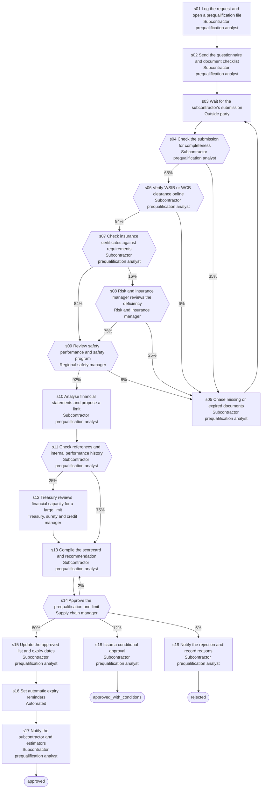

# Prequalify subcontractors

`gc-scm-subcontractor-prequal` · construction (non-residential general contracting) · supply chain · part of `general-contractor-co`

A general contractor that subcontracts most of its work only invites trades to bid once they have shown they are financially sound, insured, registered with the workers' compensation board and safe to have on site. Prequalification analysts send each new or renewing trade a questionnaire, chase the certificates and statements, verify the WSIB clearance online and check insurance, then a regional safety manager rates the safety record and the analyst sets a subcontract limit from the financial statements. The supply chain manager approves the limit, and the record feeds the bid lists estimators use. The process is slow because trades send incomplete or expired documents and the work waits on busy safety managers, and errors come from self-reported statistics and certificates that expire after approval.

| | |
|---|---|
| Unit of work | one subcontractor prequalification, new or annual renewal |
| Starts when | An estimator or project manager wants to invite a trade that is not on the approved list, a trade applies, or an approved trade's annual prequalification is due for renewal. |
| Done when | The trade is on the approved list with a limit and expiry dates, approved with conditions, or rejected with reasons recorded. |
| Organisation | A Canadian national general contractor with about $1.5B annual revenue, about 3,000 active subcontracts and a central supply chain team keeping the approved subcontractor list. (2,800 employees, 2019-2022) |
| Volume | 110 cases a month (range 70 to 160) |

## Where it sits

- Starts with **prequal_submission** from subcontractor (80% of cases)
- Starts with **trade_bid** from bd-trade-tendering (20% of cases)
- Relies on **wsib_clearance** from wcb (a standing input; it does not start a case)
- Relies on **insurance_certificate** from insurer (a standing input; it does not start a case)
- Relies on **performance_issue** from ops-subcontractor-performance (a standing input; it does not start a case)
- Relies on **inspection_report** from hse-site-inspection (a standing input; it does not start a case)
- Sends **prequalification_record** to bd-trade-tendering (outcome: approved)
- Sends **prequalification_record** to bd-trade-tendering (outcome: approved_with_conditions)
- Sends **prequalification_record** to scm-subcontract-buyout (outcome: approved)
- Sends **prequalification_record** to scm-subcontract-buyout (outcome: approved_with_conditions)
- Sends **prequalification_record** to subcontractor (outcome: any)

## Flow

## Roles

| Role | Department | Layer | FTE on this process | Loaded cost per hour | Evidence |
|---|---|---|---:|---:|---|
| Subcontractor prequalification analyst | Supply chain and subcontracts | individual contributor | 4.6 | 40 CAD | C |
| Supply chain manager | Supply chain and subcontracts | manager | 0.3 | 85 CAD | C |
| Regional safety manager | Health, safety and environment | manager | 0.8 | 80 CAD | C |
| Risk and insurance manager | Legal, risk and insurance | manager | 0.1 | 88 CAD | C |
| Treasury, surety and credit manager | Finance | manager | 0.25 | 95 CAD | C |

## Steps

Hands-on time and the wait before each step show the most common value. Evidence tier A is a sourced number, B a sourced description, C the author's estimate.

| Step | Who | Kind | Hands-on | Wait before | Control | Evidence |
|---|---|---|---:|---:|---|---|
| **s01 Log the request and open a prequalification file.** The prequalification analyst records a new firm referred by an estimator or project manager, a firm applying on its own, or an approved firm whose annual prequalification is about to expire, and opens or updates its record in the prequalification database. | Subcontractor prequalification analyst | intake | 15 min | 12.0 h |  | C |
| **s02 Send the questionnaire and document checklist.** The analyst sends the questionnaire link or form with the checklist of documents: financial statements, bonding letter, insurance certificates, WSIB or WCB clearance and premium rate statements, injury statistics, COR certificate, safety manual contents and references. | Subcontractor prequalification analyst | communication | 15 min | 4.0 h |  | B [ketek-prequal], [gravel-prequal] |
| **s03 Wait for the subcontractor's submission.** The trade's office manager or owner fills in the questionnaire and gathers certificates and statements from its accountant, broker, surety and the WSIB, then uploads or emails the package. | Outside party | external wait | 0 min | 4.0 d |  | B [gravel-prequal] |
| **s04 Check the submission for completeness.** The analyst opens each attachment, checks that every required document is present, current, signed and issued to the same legal name, and that the questionnaire answers are complete. | Subcontractor prequalification analyst | validation | 25 min | 12.0 h |  | C |
| **s05 Chase missing or expired documents.** The analyst emails or phones the subcontractor listing what is missing or expired (most often insurance certificates, the WSIB clearance or year-end statements) and sets a follow-up date. | Subcontractor prequalification analyst | communication | 20 min | 1.0 h |  | C |
| **s06 Verify WSIB or WCB clearance online.** The analyst looks up the firm's account in the WSIB eClearance service (or the provincial WCB portal), confirms the clearance is valid, records the expiry date and saves the certificate to the file. | Subcontractor prequalification analyst | lookup | 10 min | 1.0 h | Workplace Safety and Insurance Act (Ontario): principal liable for a contractor's unpaid premiums and offence if construction work proceeds without a valid clearance; provincial WCB equivalents | A [wsib-clearance-faq] |
| **s07 Check insurance certificates against requirements.** The analyst compares the broker's certificate with the company's minimums for general liability, automobile, and for some trades professional or pollution liability, and checks the additional insured wording and expiry dates. | Subcontractor prequalification analyst | validation | 20 min | 2.0 h |  | B [ketek-prequal], [gravel-prequal] |
| **s08 Risk and insurance manager reviews the deficiency.** The risk and insurance manager decides whether a lower limit or different wording is acceptable for the trade's risk, needs an endorsement from the broker, or blocks the approval. | Risk and insurance manager | judgment | 30 min | 2.0 d | Corporate insurance policy: minimum subcontractor insurance limits and additional insured requirements | C |
| **s09 Review safety performance and safety program.** The regional safety manager reviews three years of lost-time and recordable injury rates, the WSIB experience rating against the industry rate, fatalities, ministry orders and fines, COR status and the safety program contents for the trade's hazards, and rates the firm. | Regional safety manager | review | 45 min | 2.0 d | OHSA constructor duty to ensure every employer on the project complies (Ontario OHSA s. 23) and company subcontractor safety prequalification policy | B [ketek-prequal], [gravel-prequal] |
| **s10 Analyse financial statements and propose a limit.** The analyst enters the last two or three years of financial statements into the scoring spreadsheet, calculates working capital, debt to equity and revenue trend, reads the bonding letter, and proposes a single-subcontract and aggregate limit. | Subcontractor prequalification analyst | analysis | 1.0 h | 12.0 h |  | C |
| **s11 Check references and internal performance history.** The analyst reads post-job evaluations and any performance notices from the company's own projects, and calls two or three other contractors or owners named as references about schedule, quality, manpower and payment of their suppliers. | Subcontractor prequalification analyst | lookup | 40 min | 1.0 d |  | B [gravel-prequal] |
| **s12 Treasury reviews financial capacity for a large limit.** The treasury manager reviews the statements and bonding letter for firms seeking large subcontracts, may call the trade's surety to confirm bonding capacity, and sets whether a performance bond or a lower limit is required. | Treasury, surety and credit manager | review | 1.0 h | 2.0 d |  | C |
| **s13 Compile the scorecard and recommendation.** The analyst combines the safety, financial, insurance, reference and capability scores into the weighted scorecard and writes the recommendation: approve, approve with conditions (limit, bond, safety plan) or reject. | Subcontractor prequalification analyst | drafting | 30 min | 4.0 h |  | C |
| **s14 Approve the prequalification and limit.** The supply chain manager reviews the scorecard and approves, attaches conditions or rejects, so that the analyst who gathered the information is not the person who grants the limit. | Supply chain manager | approval | 15 min | 1.0 d | Procurement policy: subcontractor limits approved by a manager independent of the analyst | C |
| **s15 Update the approved list and expiry dates.** The analyst records the approval, trades, regions, single and aggregate limits and the expiry dates of insurance, clearance and the prequalification itself in the database that estimators use to build bid lists. | Subcontractor prequalification analyst | data entry | 15 min | 4.0 h |  | C |
| **s16 Set automatic expiry reminders.** The prequalification database schedules reminders to the subcontractor and analyst before the insurance certificate, WSIB clearance and annual prequalification expire. | Automated | system auto | 0 min | 0 min |  | B [wsib-clearance-faq] |
| **s17 Notify the subcontractor and estimators.** The analyst emails the approval letter with the limit and renewal date to the subcontractor and tells the requesting estimator that the firm can now be invited to bid. | Subcontractor prequalification analyst | communication | 10 min | 1.0 h |  | C |
| **s18 Issue a conditional approval.** The analyst records the conditions (reduced limit, performance bond, site-specific safety plan or probation on the first job) in the database and sends the conditional approval letter to the subcontractor and estimator. | Subcontractor prequalification analyst | communication | 25 min | 4.0 h |  | C |
| **s19 Notify the rejection and record reasons.** The analyst records the reasons in the database, sends a letter explaining which requirements were not met and when the firm may reapply, and informs the estimator who requested it. | Subcontractor prequalification analyst | communication | 20 min | 4.0 h |  | C |

## Exceptions

| Exception | Share of cases | What happens |
|---|---:|---|
| Incomplete or expired documents | 45% | The trade sends a package with missing statements or expired insurance or clearance certificates, and the analyst chases it one or more times before review can start. |
| Insurance deficiency | 16% | Limits or additional insured wording fall short and the risk and insurance manager decides whether to accept or require a revised certificate. |
| Large limit needs treasury review | 25% | A trade bidding mechanical, electrical or structural packages asks for a limit above the analyst's authority, so treasury reviews financial capacity and bonding. |
| Urgent prequalification before a bid closes | 15% | An estimator needs a new trade approved within days to have coverage on a package; the analyst and safety manager fast-track the file, which is when checks are most often shortened. |

## Benchmarks

| Metric | Value | Unit | Population | Evidence |
|---|---|---|---|---|
| cycle_time_days | p50 18, p90 40 | calendar days from request to decision | Canadian general contractors' subcontractor prequalification, 2019-2022 | C |
| wsib_clearance_validity | 90 | days (maximum validity of a clearance) | Ontario construction principals and contractors | A [wsib-clearance-faq] |

## Pain points

- Trades send incomplete packages or expired certificates, and chasing them is most of the elapsed time. (steps s03, s04, s05; C)
- Safety review waits on regional safety managers whose main job is site safety, so files sit in their queue. (steps s09; C)
- Clearances and insurance certificates expire after approval, so a trade on the approved list may be working without valid cover unless reminders are acted on. (steps s15, s16; A [wsib-clearance-faq])
- Injury statistics and financial statements are self-reported and often unaudited, so limits rest on information the analyst cannot verify. (steps s09, s10; B [ketek-prequal])

## Assumptions

- Volume includes annual renewals of already-approved trades as well as new firms; the organisation file's 40 to 90 a month appears to count only new firms.
- Loaded costs and titles come from the organisation file (wage x 1.35 for salaried staff).
- Roles needed but not listed for this process in the organisation file: risk-insurance-manager (insurance deficiencies) and treasury-manager (large limits).
- Ongoing quarterly WSIB clearance checks before each subcontractor payment belong to subcontractor invoice payment, not to this process.
- Approval shares (80% approved, 12% conditional, 6% rejected) are estimates; most firms that would fail never complete a submission.
- The chase loop returns to the subcontractor wait step, so each chase re-samples the trade's response time of two to fourteen days.

## Sources

- [wsib-clearance-faq] [Questions and answers: Clearances](https://wsib.ca/en/clearancefaqs) (Workplace Safety and Insurance Board (Ontario), 2026). Clearances are valid for up to 90 days from issue and most expire on 20 February, May, August and November; a valid clearance must be in place for the full length of the job; if construction work proceeds without one, the principal and the contractor both commit an offence (maximum fine $100,000 under the WSIA); principals can verify clearance numbers and search registered businesses online; WSIB issues a new clearance automatically if the account is in good standing.
- [ketek-prequal] [F211 Contractor Pre-Qualification Package (revision 13)](https://ketek.ca/wp-content/uploads/2021/01/F211-Contractor-Pre-Qualification-Package.pdf) (Ketek Group Inc., 2021). A Canadian contractor's 2021 prequalification package: contractors must prequalify before working on its sites; required documents are a safety manual table of contents, a current WCB clearance letter, three years of WCB premium rate statements with the industry rate, $2,000,000 general liability and $2,000,000 automobile liability insurance, a COR certificate if held, an environmental policy and a COVID-19 plan; questionnaire on lost-time and total recordable injury frequency (per 200,000 hours) for three years, fatalities, fines, hazard identification, safety program elements and critical work procedures; a vice-president can waive requirements after reviewing a contractor risk mitigation plan.
- [gravel-prequal] [Subcontractor Prequalification (form)](https://gravelbc.ca/wp-content/uploads/2020/09/Subcontractor-Prequalification.pdf) (gravelbc.ca (contractor's subcontractor form; company name not shown in the extracted text), 2020). Subcontractors must complete the prequalification form and supporting documents before bidding; failure to submit excludes them from work; technical specialists review WCB details, safety statistics and performance and decide suitability for bidding; required WCB clearance, $2,000,000 general liability and $1,000,000 automobile liability certificates; safety registries listed (Avetta, ISN, ComplyWorks, COR); post-job safety performance reviews of all subcontractors.

Written by claude-opus on 2026-11-24.
