# Form, place and finish concrete

`gc-spe-concrete-placement` · construction - non-residential general contracting · self-perform construction · part of `general-contractor-co`

A self-perform concrete crew builds the forms and shoring for one pour, waits for the rebar subcontractor and the trades to place reinforcing and embeds, passes the foreman's check, the formwork engineer's pre-pour inspection and the engineer of record's rebar review, then places, finishes and cures the concrete and strips the forms once it is strong enough. Foremen, carpenters, labourers, finishers and the tower crane operator do the work; outside engineers, testing technicians and ready-mix suppliers control the pace. Weather, late trucks, failed inspections and waiting for strength before stripping stretch the cycle and tie up formwork sets.

| | |
|---|---|
| Unit of work | one concrete pour |
| Starts when | The weekly crew plan assigns a concrete crew to a pour on a project. |
| Done when | The concrete is placed, finished and cured, forms are stripped (and re-shored where needed) and cycled or returned, and the pour record is closed. Twenty-eight-day strength results arrive later and are handled by quality inspection. |
| Organisation | A Canadian national general contractor of about 2,800 people with union concrete and formwork crews that self-perform structural concrete on its own building projects. (2,800 employees, 2019-2022) |
| Volume | 600 cases a month (range 400 to 850) |

## Where it sits

- Starts with **crew_assignment** from spe-crew-planning (100% of cases)
- Relies on **reviewed_submittal** from ops-submittals (a standing input; it does not start a case)
- Relies on **formwork_delivery** from spe-yard-inventory (a standing input; it does not start a case)
- Relies on **lift_plan** from spe-crane-operations (a standing input; it does not start a case)
- Relies on **equipment_delivery** from spe-equipment-dispatch (a standing input; it does not start a case)
- Relies on **purchase_order** from supplier (a standing input; it does not start a case)
- Relies on **test_report** from testing-agency (a standing input; it does not start a case)
- Sends **material_requisition** to scm-material-procurement (outcome: any)
- Sends **inspection_request** to ops-quality-inspection (outcome: any)
- Sends **equipment_request** to spe-equipment-dispatch (outcome: any)
- Sends **equipment_request** to spe-crane-operations (outcome: any)
- Sends **formwork_delivery** to spe-yard-inventory (outcome: completed)
- Sends **timesheet** to spe-field-timekeeping (outcome: any)
- Sends **work_plan** to hse-daily-hazard (outcome: any)
- Sends **daily_report** to ops-site-coordination (outcome: any)

## Flow

```mermaid
flowchart TD
    s01["s01 Review pour package and sequence<br/>Foreman  concrete, formwork or carpentry crew"]
    s02{{"s02 Confirm engineered formwork drawings on site<br/>General foreman"}}
    s03["s03 Request formwork, equipment and crane time<br/>Foreman  concrete, formwork or carpentry crew"]
    s04["s04 Lay out gridlines and set out forms<br/>Carpenter  formwork and general"]
    s05["s05 Hold pre-task hazard assessment with crew<br/>Foreman  concrete, formwork or carpentry crew"]
    s06["s06 Erect forms, shoring and edge protection<br/>Carpenter  formwork and general"]
    s07["s07 Move material and clean forms for carpenters<br/>Construction labourer"]
    s08["s08 Rebar subcontractor places reinforcing<br/>Outside party"]
    s09["s09 Trades install sleeves and embedded services<br/>Outside party"]
    s10{{"s10 Foreman pre-pour check<br/>Foreman  concrete, formwork or carpentry crew"}}
    s11{{"s11 Formwork engineer inspects before the pour<br/>Outside party"}}
    s12{{"s12 Engineer of record reviews the reinforcing<br/>Outside party"}}
    s13["s13 Correct form, shoring or rebar deficiencies<br/>Carpenter  formwork and general"]
    s14["s14 Order concrete and pump<br/>Foreman  concrete, formwork or carpentry crew"]
    s15{{"s15 Check forecast and confirm the pour<br/>General foreman"}}
    s16["s16 Pre-pour meeting and set up placing equipment<br/>Foreman  concrete, formwork or carpentry crew"]
    s17["s17 Place and consolidate concrete<br/>Construction labourer"]
    s18["s18 Operate tower crane for bucket placement<br/>Tower and mobile crane operator"]
    s19["s19 Testing company samples the concrete<br/>Outside party"]
    s20["s20 Finish and protect the surface<br/>Concrete finisher"]
    s21["s21 Cure and protect from cold or heat<br/>Construction labourer"]
    s22["s22 Record the pour in the daily report and timesheets<br/>Foreman  concrete, formwork or carpentry crew"]
    s23{{"s23 Confirm strength before stripping<br/>General foreman"}}
    s24["s24 Strip forms and install re-shores<br/>Carpenter  formwork and general"]
    s25["s25 Clean, sort and cycle or return forms<br/>Construction labourer"]
    s26["s26 Close the pour record<br/>Foreman  concrete, formwork or carpentry crew"]
    s27{{"s27 Engineer investigates low strength<br/>Outside party"}}
    s28["s28 Carry out remedial work<br/>Carpenter  formwork and general"]
    s01 --> s02
    s02 -->|"93%"| s03
    s02 -->|"7%"| s02
    s03 --> s04
    s04 --> s05
    s05 --> s06
    s06 --> s07
    s07 --> s08
    s08 --> s09
    s09 --> s10
    s10 -->|"90%"| s11
    s10 -->|"10%"| s13
    s11 -->|"88%"| s12
    s11 -->|"12%"| s13
    s12 -->|"90%"| s14
    s12 -->|"10%"| s13
    s13 --> s11
    s14 --> s15
    s15 -->|"88%"| s16
    s15 -->|"12%"| s15
    s16 --> s17
    s17 --> s18
    s18 --> s19
    s19 --> s20
    s20 --> s21
    s21 --> s22
    s22 --> s23
    s23 -->|"97%"| s24
    s23 -->|"3%"| s27
    s24 --> s25
    s25 --> s26
    s26 --> end0
    s27 -->|"80%"| s24
    s27 -->|"20%"| s28
    s28 --> s25
    end0(["completed"])
```

## Roles

| Role | Department | Layer | FTE on this process | Loaded cost per hour | Evidence |
|---|---|---|---:|---:|---|
| Foreman (concrete, formwork or carpentry crew) | Concrete and formwork crews | supervisor | 75 | 65 CAD | C |
| General foreman | Concrete and formwork crews | supervisor | 30 | 72 CAD | C |
| Carpenter (formwork and general) | Concrete and formwork crews | individual contributor | 400 | 62 CAD | C |
| Construction labourer | Carpentry and general labour crews | individual contributor | 170 | 50 CAD | C |
| Concrete finisher | Concrete and formwork crews | individual contributor | 100 | 58 CAD | C |
| Tower and mobile crane operator | Equipment and yards | individual contributor | 15 | 72 CAD | C |

## Steps

Hands-on time and the wait before each step show the most common value. Evidence tier A is a sourced number, B a sourced description, C the author's estimate.

| Step | Who | Kind | Hands-on | Wait before | Control | Evidence |
|---|---|---|---:|---:|---|---|
| **s01 Review pour package and sequence.** The foreman opens the crew assignment, the structural drawings, the reviewed rebar and formwork shop drawings and the pour sequence on the project platform, and works out the forms, shoring, crew size and pour volume for this placement. He notes embedded items, construction joints and any missing information to raise with the superintendent. | Foreman (concrete, formwork or carpentry crew) | intake | 1.0 h | 8.0 h |  | C |
| **s02 Confirm engineered formwork drawings on site.** The general foreman checks that the formwork, falsework and re-shoring design drawings stamped by the formwork engineer cover this pour, match the current structural revision and are on site. If they are missing or out of date he asks the formwork engineer for a revision and holds the work. | General foreman | validation | 30 min | 4.0 h | O. Reg. 213/91 ss. 89(2), 90 and 92: formwork, falsework and re-shoring designed by an engineer, design drawings kept on the project while in use | B [ihsa_formwork] |
| **s03 Request formwork, equipment and crane time.** The foreman calls or emails the yard for the formwork sets and shoring, sends an equipment request for telehandlers and pumps or buckets, asks for tower crane time in the daily crane schedule and raises a material requisition for ties, form oil, chairs and curing supplies. | Foreman (concrete, formwork or carpentry crew) | coordination | 40 min | 1.0 h |  | C |
| **s04 Lay out gridlines and set out forms.** Two carpenters take the gridlines and elevations from the field engineer's survey control, snap lines and set bottom plates, sill plates or edge forms. Touch time is elapsed working time for the pair; the wait before is forms and telehandlers arriving from the yard. | Carpenter (formwork and general) | physical | 3.0 h | 12.0 h |  | C |
| **s05 Hold pre-task hazard assessment with crew.** The foreman walks the crew through the formwork task on the hazard assessment form: fall protection at the leading edge, crane loads overhead, material handling and access. Each worker signs the form, which goes to the site safety coordinator. | Foreman (concrete, formwork or carpentry crew) | communication | 25 min | 0 min | Company health and safety program: daily field-level hazard assessment before work starts (COR program element) | C |
| **s06 Erect forms, shoring and edge protection.** Carpenters build the wall, column or deck forms, set shores and stringers to the engineered layout, install edge protection and openings and oil the form faces. Touch time is elapsed working time for a crew of 4 to 10 carpenters; a small footing takes part of a day and a large suspended deck takes most of a week. | Carpenter (formwork and general) | physical | 20.0 h | 0 min |  | C |
| **s07 Move material and clean forms for carpenters.** Labourers unload and stage plywood, shores and ties, clean and oil form panels, carry material to the deck and keep the work area clear while the carpenters build. Touch time is elapsed working time for the one to three labourers attached to the crew. | Construction labourer | physical | 10.0 h | 0 min |  | C |
| **s08 Rebar subcontractor places reinforcing.** The rebar subcontractor's rodmen place and tie the reinforcing steel and dowels to the reviewed bar placing drawings once the forms are ready. The self-perform crew waits for them or moves to other work. | Outside party | external wait | 0 min | 1.0 d |  | C |
| **s09 Trades install sleeves and embedded services.** Mechanical and electrical subcontractors set sleeves, conduit, boxes and embedded plates in the forms while the rebar goes in. The foreman checks with their foremen that every embed on the coordination drawing is in. | Outside party | external wait | 0 min | 2.0 h |  | C |
| **s10 Foreman pre-pour check.** The foreman walks the forms with a tape and level and checks dimensions, elevations, shoring, ties, embeds, cleanliness and access for the pump or bucket, and fills in the company pre-pour checklist. He sends the inspection request for the formwork and rebar inspections. | Foreman (concrete, formwork or carpentry crew) | validation | 1.0 h | 2.0 h | Company quality plan: foreman pre-pour checklist before requesting inspection | C |
| **s11 Formwork engineer inspects before the pour.** The formwork engineer, or a competent worker the engineer has designated in writing, inspects the formwork and falsework against the design drawings and signs a written statement that it is built as designed. This applies to shored decks and tall forms; for simple footings the superintendent's own check stands in. | Outside party | external wait | 0 min | 12.0 h | O. Reg. 213/91 s. 89(3)-(4): engineer or designated competent worker inspects formwork and falsework before concrete is placed and states in writing that it matches the design drawings | B [ihsa_formwork] |
| **s12 Engineer of record reviews the reinforcing.** The structural engineer of record's field reviewer, or the inspection and testing company, checks bar sizes, spacing, cover and laps against the drawings and issues a field review report. Defects go back to the rebar subcontractor and the crew. | Outside party | external wait | 0 min | 4.0 h | Contract specification and Ontario Building Code general review: structural engineer of record reviews reinforcing before concrete is placed | C |
| **s13 Correct form, shoring or rebar deficiencies.** Carpenters add missing shores or braces, re-align forms, fix ties or clean out debris, and the rebar subcontractor corrects bars where needed. The foreman then asks for the inspection again. | Carpenter (formwork and general) | physical | 2.0 h | 4.0 h |  | C |
| **s14 Order concrete and pump.** The foreman phones the ready-mix dispatcher against the supplier purchase order, confirms the mix design, volume, slump, start time and truck spacing, and books the concrete pump or confirms crane time for bucket placement. He also books the testing company technician. | Foreman (concrete, formwork or carpentry crew) | communication | 25 min | 4.0 h |  | C |
| **s15 Check forecast and confirm the pour.** The general foreman reviews the forecast the evening before and early on pour day for rain, wind for crane work and cold below 5 C, checks heaters, blankets and hoarding are ready, and confirms or cancels the trucks and pump. A cancelled pour waits for the next suitable day. | General foreman | judgment | 20 min | 12.0 h |  | C |
| **s16 Pre-pour meeting and set up placing equipment.** The foreman briefs the placing crew, pump operator, crane operator and finishers on the pour sequence, washout, signals, exclusion zones under the boom and bucket, and who stops the pour if forms move. The crew sets out vibrators, screeds and walkways. | Foreman (concrete, formwork or carpentry crew) | communication | 30 min | 0 min | Pre-job safety meeting and O. Reg. 213/91 ss. 104 and 106: signaller for crane and pump boom when the operator's view is blocked | B [ihsa_rigging] |
| **s17 Place and consolidate concrete.** Labourers guide the pump hose or bucket, spread and vibrate the concrete in lifts and watch for honeycombing, while a carpenter watches the forms for movement. Trucks that arrive late leave the crew standing; touch time is elapsed placing time for a crew of 4 to 6. | Construction labourer | physical | 5.0 h | 45 min |  | C |
| **s18 Operate tower crane for bucket placement.** Where the pump cannot reach, the tower crane operator flies the concrete bucket from the truck to the deck on the signaller's direction. Most pours are pumped and this step takes little or no crane time. | Tower and mobile crane operator | physical | 1.0 h | 0 min |  | C |
| **s19 Testing company samples the concrete.** The testing technician checks slump, air content and temperature on the first truck and at the specified frequency, and casts cylinders for 7-day and 28-day strength. A truck that fails slump or air is rejected and sent back. | Outside party | external wait | 0 min | 0 min | CSA A23.1/A23.2 field testing by a certified technician; air content tested with every set of cylinders | B [cfca_a231] |
| **s20 Finish and protect the surface.** Finishers screed, bull-float and power-trowel slabs to the specified flatness once bleed water has gone, and patch and rub wall ties where required. Walls and footings need little finishing; touch time is elapsed time for a finishing crew of 3 to 5. | Concrete finisher | physical | 5.0 h | 1.0 h |  | C |
| **s21 Cure and protect from cold or heat.** Labourers place curing compound, wet burlap or poly, and in cold weather set insulated blankets, hoarding and heaters and log concrete temperatures so the concrete stays at 10 C or more for the curing period. | Construction labourer | physical | 2.0 h | 0 min | CSA A23.1 cold-weather protection and curing: concrete kept at 10 C or more for three or seven days, as written into the project specification | B [cfca_a231] |
| **s22 Record the pour in the daily report and timesheets.** The foreman writes the pour into the daily report (location, volume, trucks, weather, problems) and codes the crew's hours to the concrete cost codes in the timekeeping app or on paper sheets. | Foreman (concrete, formwork or carpentry crew) | data entry | 30 min | 2.0 h |  | C |
| **s23 Confirm strength before stripping.** The general foreman waits for the curing period and the early cylinder or field-cured results from the testing company and decides with the engineer when forms and shores can come out. Walls strip in a day or two, suspended decks after several days and only with re-shores. | General foreman | judgment | 20 min | 2.0 d | O. Reg. 213/91 s. 88: forms and falsework not removed until the concrete can support itself and applied loads or is adequately re-shored | B [ihsa_formwork] |
| **s24 Strip forms and install re-shores.** Carpenters strip wall and column forms or fly the deck tables, install re-shores to the engineer's re-shoring layout under suspended slabs and send the panels to the next pour. Touch time is elapsed time for a crew of 3 to 6. | Carpenter (formwork and general) | physical | 5.0 h | 4.0 h | O. Reg. 213/91 s. 90: re-shoring designed by an engineer and installed to the design drawings | B [ihsa_formwork] |
| **s25 Clean, sort and cycle or return forms.** Labourers scrape and oil panels, sort ties and hardware, stack forms for the next pour or load damaged and surplus sets for return to the yard. | Construction labourer | physical | 3.0 h | 0 min |  | C |
| **s26 Close the pour record.** The foreman files the inspection statements, test reports, delivery tickets and pour card in the project platform and reports the poured quantity so the cost report shows units in place. | Foreman (concrete, formwork or carpentry crew) | data entry | 30 min | 4.0 h |  | C |
| **s27 Engineer investigates low strength.** The engineer of record asks for field-cured results, cores or rebound tests and reviews them against design strength. The pour stays shored until the engineer accepts it or orders a repair. | Outside party | external wait | 0 min | 14.0 d |  | C |
| **s28 Carry out remedial work.** Carpenters and labourers remove and replace a small section, add supplementary support or prepare the surface for an engineered repair, as the engineer's disposition directs, and then strip the remaining forms. | Carpenter (formwork and general) | physical | 10.0 h | 5.0 d |  | C |

## Exceptions

| Exception | Share of cases | What happens |
|---|---:|---|
| Failed pre-pour inspection | 20% | The foreman, the formwork engineer or the rebar reviewer finds missing shores, braces, bars or embeds; the crew fixes them and the inspection is repeated, often pushing the pour a day. |
| Pour postponed for weather | 12% | Rain, high wind or a cold forecast cancels the trucks and pump; the formed and inspected pour waits for the next workable day while the formwork set stays tied up. |
| Low early strength | 3% | Early cylinders come in low; the deck stays shored while the engineer reviews cores and decides whether a repair is needed. |

## Benchmarks

| Metric | Value | Unit | Population | Evidence |
|---|---|---|---|---|
| cycle_time_days | p50 10, p90 20 | calendar days from crew assignment to forms stripped and pour record closed | Mix of footing, wall, column, slab-on-grade and suspended deck pours on Canadian building projects, 2019-2022 | C |
| crew_person_hours_per_pour | p50 190, p90 360 | person-hours | Same mix | C |

## Pain points

- Formwork and rebar inspections are booked with outside engineers and often fail on small items, so the crew re-works and the pour slips a day. (steps s10, s11, s12, s13; C)
- Pours wait on weather and on ready-mix truck spacing; crews stand idle when trucks are late. (steps s15, s17; C)
- Formwork sets sit under curing concrete for days, so the number of sets limits how fast a crew can cycle floors. (steps s23, s24; B [ihsa_formwork])
- Hours are coded to cost codes on paper or in an app at day end and are often wrong, which distorts unit-cost reports. (steps s22; C)

## Assumptions

- Crew-step touch times are the crew's elapsed working minutes at the step, so the simulated cycle time is not inflated by adding up every crew member's minutes. Person-hours are touch time times crew size (stated in each step description): about 190 person-hours for a typical pour against about 80 hours of elapsed crew time. Simulated labour cost per pour therefore counts one person per step and understates crew cost by a factor of about 3 to 5; resource occupied_min for concrete-crew and finishing-crew gives the crew hours.
- Reinforcing steel is placed by a rebar subcontractor, as is common for Ontario building contractors; the self-perform crew forms, places, finishes and strips. The org file's self-perform page (Bird) lists concrete but not rebar.
- Outside parties (rebar subcontractor, formwork engineer, engineer of record, testing company) are modelled as external waits with no touch time, so their effort is not in the staffing check.
- Stated FTE (790) is above the validator's implied FTE because touch time counts one crew's elapsed time, not every member's hours; 600 pours at about 190 person-hours use about 114,000 person-hours a month, about 870 FTE at 130 productive hours or about 650 at the 175 hours trades work in season.
- Simulated median cycle time (about 15 days) is about 1.5 times the tier C benchmark of 10 days. The simulator adds concurrent steps in sequence (labourers alongside carpenters, crane and testing alongside placing, embeds alongside rebar), and one set of triangular ranges mixes very different pour types, which also makes the simulated p90 (about 18 days) narrower than real spread; footings and walls sit at the low end and suspended decks at the high end.
- The organisation's process map does not list the testing agency as an input or the rebar subcontractor; the workflow adds test_report from testing-agency as an input.
- O. Reg. 213/91 sections are cited from the IHSA summary of the current text; these formwork and crane sections were in force in substantially the same form in 2019-2022.

## Sources

- [ihsa_formwork] [Formwork | IHSA Construction Safety App](https://ohsguide.ihsa.ca/en/topic/formwork) (Infrastructure Health and Safety Association (IHSA), 2026). O. Reg. 213/91 ss. 87-92: formwork, falsework and re-shoring designed by an engineer (s. 89(2), s. 90); design drawings kept on the project (ss. 89(5), 92(2)); inspection before concrete is placed by an engineer or a competent worker designated in writing by the engineer, with a written statement (s. 89(3)-(4)); forms not removed until the concrete supports itself or is re-shored, with no fixed waiting period (s. 88); footings protected from frost heave (s. 91).
- [ihsa_rigging] [Rigging | IHSA Construction Safety App](https://ohsguide.ihsa.ca/en/topic/rigging) (Infrastructure Health and Safety Association (IHSA), 2026). O. Reg. 213/91 crane and hoisting rules: operator certificates by crane type and capacity (s. 150(1)); signaller when the operator's view is blocked, competent and doing no other work (ss. 104, 106); weekly cable inspection recorded in the crane log (s. 170); engineer inspection of tower crane climbing systems before first climb and every 12 months (s. 159); competent-worker inspection of tower crane shoring and bracing before and after each climb and weekly (s. 157(13)); minimum distances and written procedures near energized overhead lines (s. 188).
- [cfca_a231] [Concrete Floor Contractors Association Study - 2014 Concrete Materials Lab Test Study](https://www.naylornetwork.com/oga-nwl/articles/print.asp?aid=754563) (Concrete Floor Contractors Association (via Naylor Network), 2019). CSA A23.1-2019 requires concrete materials to be kept at 10 C or more for the curing period of three or seven days; air content tested with every set of cylinders. Article date not stated; it cites the 2019 edition.

Written by claude-opus on 2026-11-24.
