# Erect, operate and dismantle cranes

`gc-spe-crane-operations` · construction - non-residential general contracting · equipment and yards · part of `general-contractor-co`

The equipment team plans each tower crane erection, climb and dismantle and each mobile crane set-up for a heavy or critical lift. The equipment manager assesses the site, an outside engineer designs bases and reviews critical plans, the superintendent gets street permits and prepares the site, certified operators set up and run the crane with a signaller, and an engineer inspects tower cranes before use. Municipal permits, engineer availability and wind decide the day, and a postponed lift means rebooking the assist crane, trucks and traffic control.

| | |
|---|---|
| Unit of work | one crane set-up, critical lift or dismantle |
| Starts when | A project asks the equipment team for a tower crane erection, climb or dismantle, or a mobile crane for a heavy or critical lift. |
| Done when | The crane has been set up and the lift made, or the tower crane erected, inspected and put in service, or dismantled and removed; logs are recorded and the lift plan filed and sent to the site. |
| Organisation | A Canadian national general contractor of about 2,800 people that owns about 12 tower cranes and 6 mobile cranes and rents larger cranes with operators. (2,800 employees, 2019-2022) |
| Volume | 25 cases a month (range 15 to 40) |

## Where it sits

- Starts with **equipment_request** from ops-site-mobilization (40% of cases)
- Starts with **equipment_request** from spe-concrete-placement (60% of cases)
- Sends **lift_plan** to ops-site-coordination (outcome: completed)
- Sends **lift_plan** to spe-concrete-placement (outcome: completed)
- Sends **service_work_order** to spe-equipment-maintenance (outcome: any)
- Sends **permit_application** to municipality (outcome: any)
- Sends **rental_order** to equipment-rental (outcome: any)

## Flow

```mermaid
flowchart TD
    s01["s01 Receive the crane request<br/>Equipment and yard manager"]
    s02["s02 Check crane fleet and operator availability<br/>Equipment and yard manager"]
    s03["s03 Drive to the site<br/>Equipment and yard manager"]
    s04{{"s04 Assess crane location, ground and overhead hazards<br/>Equipment and yard manager"}}
    s05["s05 Engineer designs the tower crane base and ties<br/>Outside party"]
    s06["s06 Build the crane base and prepare the site<br/>Site superintendent"]
    s07{{"s07 Prepare the lift or erection plan<br/>Equipment and yard manager"}}
    s08{{"s08 Engineer reviews the plan<br/>Outside party"}}
    s09{{"s09 Decide whether a street permit is needed<br/>Site superintendent"}}
    s10["s10 Apply for the street occupation and hoisting permit<br/>Site superintendent"]
    s11["s11 Municipality reviews and issues the permit<br/>Outside party"]
    s12["s12 Book the assist crane, trucks and rentals<br/>Equipment dispatcher / yard coordinator"]
    s13["s13 Assign a certified operator<br/>Equipment and yard manager"]
    s14["s14 Prepare the site for the crane<br/>Site superintendent"]
    s15{{"s15 Check the wind forecast and permit window<br/>Equipment and yard manager"}}
    s16["s16 Mobilize the crane to site<br/>Tower and mobile crane operator"]
    s17["s17 Set up, erect, climb or dismantle the crane<br/>Tower and mobile crane operator"]
    s18["s18 Mechanic checks hydraulics and electrics<br/>Heavy-duty mechanic"]
    s19{{"s19 Operator pre-use inspection and crane log<br/>Tower and mobile crane operator"}}
    s20{{"s20 Engineer inspects the tower crane before use<br/>Outside party"}}
    s21["s21 Correct erection deficiencies<br/>Heavy-duty mechanic"]
    s22["s22 Hold the pre-lift meeting<br/>Site superintendent"]
    s23["s23 Make the lift or load test<br/>Tower and mobile crane operator"]
    s24["s24 Signal the lift<br/>Construction labourer"]
    s25["s25 Rig down and demobilize<br/>Tower and mobile crane operator"]
    s26{{"s26 Record hours and defects<br/>Tower and mobile crane operator"}}
    s27["s27 Repair the crane defect<br/>Heavy-duty mechanic"]
    s28["s28 Distribute the final lift plan and close the job<br/>Equipment and yard manager"]
    s01 --> s02
    s02 --> s03
    s03 --> s04
    s04 -->|"15%"| s05
    s04 -->|"85%"| s07
    s05 --> s06
    s06 --> s07
    s07 -->|"45%"| s08
    s07 -->|"55%"| s09
    s08 -->|"90%"| s09
    s08 -->|"10%"| s07
    s09 -->|"45%"| s10
    s09 -->|"55%"| s12
    s10 --> s11
    s11 --> s12
    s12 --> s13
    s13 --> s14
    s14 --> s15
    s15 -->|"85%"| s16
    s15 -->|"15%"| s15
    s16 --> s17
    s17 --> s18
    s18 --> s19
    s19 -->|"25%"| s20
    s19 -->|"75%"| s22
    s20 -->|"92%"| s22
    s20 -->|"8%"| s21
    s21 --> s20
    s22 --> s23
    s23 --> s24
    s24 --> s25
    s25 --> s26
    s26 -->|"85%"| s28
    s26 -->|"15%"| s27
    s27 --> s28
    s28 --> end0
    end0(["completed"])
```

## Roles

| Role | Department | Layer | FTE on this process | Loaded cost per hour | Evidence |
|---|---|---|---:|---:|---|
| Equipment and yard manager | Equipment and yards | manager | 1.2 | 85 CAD | C |
| Site superintendent | Construction operations | supervisor | 0.8 | 75 CAD | C |
| Tower and mobile crane operator | Equipment and yards | individual contributor | 3.5 | 72 CAD | B [sto_tower] |
| Heavy-duty mechanic | Equipment and yards | individual contributor | 1 | 60 CAD | C |
| Construction labourer | Carpentry and general labour crews | individual contributor | 0.6 | 50 CAD | B [ihsa_rigging] |
| Equipment dispatcher / yard coordinator | Equipment and yards | individual contributor | 0.2 | 42 CAD | C |

## Steps

Hands-on time and the wait before each step show the most common value. Evidence tier A is a sourced number, B a sourced description, C the author's estimate.

| Step | Who | Kind | Hands-on | Wait before | Control | Evidence |
|---|---|---|---:|---:|---|---|
| **s01 Receive the crane request.** The equipment and yard manager receives a request from a project for a tower crane erection, climb or dismantle, or for a mobile crane set-up for a heavy or critical lift, with the load, radius, date and site drawings. | Equipment and yard manager | intake | 30 min | 4.0 h |  | C |
| **s02 Check crane fleet and operator availability.** The manager checks the register for a free company tower or mobile crane of the right capacity and for certified operators, and decides whether to use company equipment or rent a crane with operator. | Equipment and yard manager | lookup | 30 min | 0 min |  | C |
| **s03 Drive to the site.** The manager drives to the project, usually within a day or two of the request, to see the crane location, access roads, neighbouring buildings and surroundings for himself. | Equipment and yard manager | travel | 1.5 h | 12.0 h |  | C |
| **s04 Assess crane location, ground and overhead hazards.** With the superintendent the manager checks ground bearing and buried services at the outrigger or base location, overhead power lines and their clearances, swing over neighbours and streets, and delivery access for crane components. | Equipment and yard manager | analysis | 2.0 h | 0 min | O. Reg. 213/91 s. 188: minimum distances from energized overhead lines and written measures to prevent encroachment | B [ihsa_rigging] |
| **s05 Engineer designs the tower crane base and ties.** A structural engineer engaged by the company designs the crane foundation or mat, anchor bolts and any building ties from the crane manufacturer's loads and the geotechnical report. | Outside party | external wait | 0 min | 10.0 d | Tower crane foundation designed by an engineer to the manufacturer's specifications (O. Reg. 213/91 tower crane provisions) | C |
| **s06 Build the crane base and prepare the site.** The superintendent schedules excavation, the base pour by the concrete crew and the anchor installation, and keeps the base area clear until the concrete reaches strength. | Site superintendent | coordination | 3.0 h | 7.0 d |  | C |
| **s07 Prepare the lift or erection plan.** The manager works out the crane configuration, counterweight, outrigger loads, rigging and the load chart capacity at the working radius, and writes the lift plan or the erection, climbing or dismantling sequence from the manufacturer's manual. | Equipment and yard manager | drafting | 4.0 h | 1.0 d |  | C |
| **s08 Engineer reviews the plan.** For critical lifts (near capacity, tandem or over occupied areas) and for tower crane erection, climbing and dismantling, an engineer reviews the plan, the climbing system and ties and stamps it or asks for changes. | Outside party | external wait | 0 min | 3.0 d | Company critical lift procedure and O. Reg. 213/91 s. 159: engineer inspection of tower crane climbing systems before the first climb | B [ihsa_rigging] |
| **s09 Decide whether a street permit is needed.** The superintendent checks whether the crane, its outriggers, the assist crane or the boom swing will occupy or pass over the street or sidewalk, which needs a municipal permit and possibly a lane closure. | Site superintendent | judgment | 20 min | 4.0 h |  | C |
| **s10 Apply for the street occupation and hoisting permit.** The superintendent prepares the application with the lift plan, crane drawings, insurance certificate, traffic control plan and, for tower crane swing, aviation approvals, and files it with the municipality. | Site superintendent | drafting | 2.0 h | 4.0 h |  | B [toronto_sop] |
| **s11 Municipality reviews and issues the permit.** The municipality's right-of-way office reviews the application and issues the permit with the allowed dates and hours. Tower crane swing permits in Toronto take about 12 weeks; one-day mobile crane hoisting permits take days to a few weeks. | Outside party | external wait | 0 min | 10.0 d | Municipal right-of-way by-laws: street occupation permit for crane hoisting, boom swing and lane closures | B [toronto_sop] |
| **s12 Book the assist crane, trucks and rentals.** The yard coordinator books the assist or rental crane with operator, trucks for crane components and counterweights, mats and traffic control for the agreed date. | Equipment dispatcher / yard coordinator | coordination | 45 min | 1.0 d |  | C |
| **s13 Assign a certified operator.** The manager assigns an operator and checks the certificate of qualification matches the crane type and capacity, and that the operator knows this crane model. | Equipment and yard manager | validation | 20 min | 1.0 h | O. Reg. 213/91 s. 150(1): mobile crane operator 1 or 2 or tower crane operator certificate by crane type and capacity; tower crane operator is a compulsory trade | B [ihsa_rigging], [sto_tower] |
| **s14 Prepare the site for the crane.** The superintendent clears the crane pad and swing area, sets barricades and traffic control, has utilities covered or de-energized where needed and tells the trades and neighbours about the exclusion zone. | Site superintendent | coordination | 1.5 h | 12.0 h |  | C |
| **s15 Check the wind forecast and permit window.** The manager checks the wind forecast against the crane manufacturer's limits for erection and lifting, and the permit's allowed hours, and confirms or postpones the crane, trucks and traffic control the day before. | Equipment and yard manager | judgment | 15 min | 12.0 h |  | C |
| **s16 Mobilize the crane to site.** The operator drives the mobile crane to site, or for tower crane work travels with the crane components, assist crane and counterweight trucks, and checks in at the gate. | Tower and mobile crane operator | travel | 1.5 h | 0 min |  | C |
| **s17 Set up, erect, climb or dismantle the crane.** The operators rig the outriggers and mats and install counterweight, or for tower cranes assemble or dismantle the mast, jib and counter-jib with the assist crane, or jack the crane up a climb. A mobile set-up takes an hour or two; a tower crane erection takes two to three days. | Tower and mobile crane operator | physical | 4.0 h | 0 min |  | B [sto_tower] |
| **s18 Mechanic checks hydraulics and electrics.** A heavy-duty mechanic connects power, checks hydraulics, limit switches, brakes and load moment indicators and fixes faults found during assembly before the operator takes over. | Heavy-duty mechanic | physical | 1.0 h | 0 min |  | C |
| **s19 Operator pre-use inspection and crane log.** The operator walks the crane before use, checks wire ropes, hooks, limit switches and the load chart on board and records the inspection in the crane log book. | Tower and mobile crane operator | validation | 30 min | 0 min | O. Reg. 213/91 s. 170: cables inspected by a competent worker at least weekly and recorded in the crane log | B [ihsa_rigging] |
| **s20 Engineer inspects the tower crane before use.** An engineer inspects the erected or climbed tower crane, its base, ties and climbing system, witnesses the load test and issues a written report before the crane goes into service. | Outside party | external wait | 0 min | 1.0 d | O. Reg. 213/91 ss. 157(13) and 159: inspection of tower crane shoring, bracing and climbing systems before use | B [ihsa_rigging] |
| **s21 Correct erection deficiencies.** The mechanic and operators fix the deficiencies the engineer noted, such as bolt torque, missing pins or limit switch settings, and call the engineer back. | Heavy-duty mechanic | physical | 3.0 h | 4.0 h |  | C |
| **s22 Hold the pre-lift meeting.** The superintendent gathers the operator, signaller, riggers and affected trades, goes through the lift plan, exclusion zone, signals and stop-work triggers, and records the hazard assessment. | Site superintendent | communication | 30 min | 0 min | Pre-lift hazard assessment and O. Reg. 213/91 ss. 104 and 106: competent signaller doing no other work when the operator's view is blocked | B [ihsa_rigging] |
| **s23 Make the lift or load test.** The operator makes the critical lift, the tower crane load test or the dismantling picks on the signaller's direction, watching the load moment indicator and wind. | Tower and mobile crane operator | physical | 2.0 h | 30 min |  | C |
| **s24 Signal the lift.** A trained labourer acts as signaller for the whole lift, in full view of the operator, by radio or hand signals, doing no other work. | Construction labourer | physical | 2.0 h | 0 min |  | B [ihsa_rigging] |
| **s25 Rig down and demobilize.** The operator stows the boom, removes counterweight and mats and drives the mobile crane away; after a tower crane dismantle the components are loaded onto trucks for the yard. | Tower and mobile crane operator | travel | 2.0 h | 0 min |  | C |
| **s26 Record hours and defects.** The operator records crane hours and any defects in the crane log and the equipment system so the project is charged and the shop knows what to fix. | Tower and mobile crane operator | data entry | 15 min | 2.0 h |  | C |
| **s27 Repair the crane defect.** The mechanic opens a service work order and repairs or orders parts for the defect; the crane waits in the yard or on site until it is fixed. | Heavy-duty mechanic | physical | 6.0 h | 1.0 d |  | C |
| **s28 Distribute the final lift plan and close the job.** The manager files the lift plan, engineer reports, permits and log entries in the project folder, sends the lift plan to the site and the concrete crews, and closes the crane job. | Equipment and yard manager | data entry | 30 min | 8.0 h |  | C |

## Exceptions

| Exception | Share of cases | What happens |
|---|---:|---|
| Lift postponed for wind | 15% | The forecast exceeds the crane's wind limit; the crane, trucks and traffic control are rebooked for another day inside the permit window. |
| Engineer asks for changes | 4% | The engineer's review of a critical lift or tower crane plan sends it back for a different configuration or rigging. |
| Tower crane fails engineer inspection | 2% | The engineer finds erection deficiencies and the crane stays out of service until fixed and re-inspected. |

## Benchmarks

| Metric | Value | Unit | Population | Evidence |
|---|---|---|---|---|
| cycle_time_days | p50 15, p90 45 | calendar days from crane request to job closed | Mix of mobile crane lifts and tower crane erections, climbs and dismantles, 2019-2022 | C |

## Pain points

- Municipal crane swing and street occupation permits take weeks to months and set the earliest date for tower crane work. (steps s10, s11; B [toronto_sop])
- Wind postpones lifts and erections, and every postponement means rebooking the assist crane, trucks and traffic control. (steps s15, s12; C)
- Outside engineers for bases, critical lift reviews and pre-use inspections are booked days ahead and hold the schedule. (steps s05, s08, s20; C)

## Assumptions

- One set of triangular ranges covers very different events (a two-hour mobile lift and a three-day tower crane erection), so branch shares carry most of the difference.
- Simulated median cycle time (about 18 days) is about 1.2 times the tier C benchmark of 15 days; the permit branch and engineer waits drive the long tail (simulated p90 about 42 days).
- The tower-crane resource in the set-up step has a mode of zero because most cases are mobile crane work.
- Outside engineers, the municipality and rental crane firms are external waits with no touch time.
- The org file's process map sends lift plans to ministry-labour; no rule requiring lift plans to be filed with the regulator in 2019-2022 was found (engineer reports are kept at the project), so that link is left out. Permit applications to the municipality and rental orders to equipment-rental are added.
- Mechanics, labourers as signallers and the yard coordinator take part although the process map lists only the equipment manager, crane operators and superintendents.
- O. Reg. 213/91 sections are cited from the IHSA summary of the current text; tower crane inspection rules were tightened in 2024-2025, after the reference period, but the cited sections (150, 104, 106, 157, 159, 170, 188) applied in 2019-2022.
- The Toronto street occupation page is the 2026 version; 2019-2022 requirements were similar but fees differed.

## Sources

- [ihsa_rigging] [Rigging | IHSA Construction Safety App](https://ohsguide.ihsa.ca/en/topic/rigging) (Infrastructure Health and Safety Association (IHSA), 2026). O. Reg. 213/91 crane and hoisting rules: operator certificates by crane type and capacity (s. 150(1)); signaller when the operator's view is blocked, competent and doing no other work (ss. 104, 106); weekly cable inspection recorded in the crane log (s. 170); engineer inspection of tower crane climbing systems before first climb and every 12 months (s. 159); competent-worker inspection of tower crane shoring and bracing before and after each climb and weekly (s. 157(13)); minimum distances and written procedures near energized overhead lines (s. 188).
- [sto_tower] [Hoisting Engineer - Tower Crane Operator](https://skilledtradesontario.ca/trade-information/hoisting-engineer-tower-crane-operator) (Skilled Trades Ontario, 2026). Tower crane operation is a compulsory trade in Ontario (certificate of qualification or registered training agreement required); 3,000 hours of training; operators perform pre-operational inspections, plan lifts and calculate capacity, rig, and help set up, dismantle and jack cranes.
- [toronto_sop] [Street Occupation Permit](https://www.toronto.ca/services-payments/building-construction/infrastructure-city-construction/construction-standards-permits/construction-permits/street-occupation-permit/) (City of Toronto, 2026). Permits needed to occupy the public right of way for mobile crane or boom truck hoisting, tower crane hoisting and boom swing; tower crane swing needs drawings, a $2 million insurance certificate and Transport Canada and Nav Canada approvals; crane applications take about 12 weeks after a complete submission; RoDARS notice required; per-day hoisting and lane closure fees. Page is the 2026 version.

Written by claude-opus on 2026-11-24.
