# Plan and allocate self-perform crews

`gc-spe-crew-planning` · construction - non-residential general contracting · self-perform construction · part of `general-contractor-co`

Each week the general foremen in a region collect labour requests from superintendents, check them against project schedules, the trades on payroll, training records and formwork availability, and draft a crew board. The director of self-perform operations settles conflicts between projects at a weekly call with operations managers and decides whether to call extra trades from the union hall or lay some off. Weather, failed inspections and late subcontractors move pours daily, so the plan is redone through the week, and the spreadsheet board and phone calls make it easy for crews to sit idle or turn up at the wrong site.

| | |
|---|---|
| Unit of work | one weekly regional crew plan |
| Starts when | The weekly planning cycle starts when superintendents send their labour requests for the coming weeks. |
| Done when | The crew plan has been approved and published, hires and layoffs requested, the week has been worked with daily changes, and planned and actual crew hours have been reconciled. |
| Organisation | A Canadian national general contractor of about 2,800 people with about 1,330 union trades in concrete, formwork, carpentry and labour crews, planned by region. (2,800 employees, 2019-2022) |
| Volume | 17 cases a month (range 15 to 20) |

## Where it sits

- Starts with **labour_request** from ops-site-coordination (85% of cases)
- Starts with **labour_request** from ops-project-startup (15% of cases)
- Relies on **schedule** from ops-schedule-management (a standing input; it does not start a case)
- Relies on **training_record** from hse-safety-training (a standing input; it does not start a case)
- Sends **crew_assignment** to spe-concrete-placement (outcome: plan executed)
- Sends **crew_assignment** to spe-general-works (outcome: plan executed)
- Sends **hire_request** to hr-hire-trades (outcome: any)
- Sends **layoff_notice** to hr-layoff-recall (outcome: any)

## Flow

```mermaid
flowchart TD
    s01["s01 Superintendents submit next week's labour requests<br/>Site superintendent"]
    s02["s02 Pull lookahead schedules for projects in the region<br/>General foreman"]
    s03["s03 Compile requests on the regional crew board<br/>General foreman"]
    s04["s04 Check who is available next week<br/>General foreman"]
    s05["s05 Check training and tickets for assigned work<br/>General foreman"]
    s06["s06 Confirm formwork and equipment for the planned pours<br/>Equipment dispatcher / yard coordinator"]
    s07["s07 Draft the crew allocation<br/>General foreman"]
    s08["s08 Hold the weekly crew planning meeting<br/>Director of self-perform operations"]
    s09["s09 Operations managers press project priorities<br/>Operations manager  construction manager"]
    s10{{"s10 Resolve conflicts and set pour priorities<br/>Director of self-perform operations"}}
    s11["s11 Call the union hall for trades<br/>General foreman"]
    s12{{"s12 Union dispatches trades<br/>Outside party"}}
    s13["s13 Cover the shortfall<br/>Director of self-perform operations"]
    s14["s14 Issue layoff notices<br/>General foreman"]
    s15["s15 Approve the weekly crew plan<br/>Director of self-perform operations"]
    s16["s16 Send crew assignments to foremen and superintendents<br/>General foreman"]
    s17["s17 Set up crews and cost codes in timekeeping<br/>General foreman"]
    s18["s18 Visit sites to walk upcoming work<br/>General foreman"]
    s19{{"s19 Re-plan daily for weather and pour readiness<br/>General foreman"}}
    s20["s20 Reshuffle crews and notify<br/>General foreman"]
    s21["s21 Reconcile planned against actual crew hours<br/>General foreman"]
    s01 --> s02
    s02 --> s03
    s03 --> s04
    s04 --> s05
    s05 --> s06
    s06 --> s07
    s07 --> s08
    s08 --> s09
    s09 --> s10
    s10 -->|"40%"| s11
    s10 -->|"15%"| s14
    s10 -->|"45%"| s15
    s11 --> s12
    s12 -->|"85%"| s15
    s12 -->|"15%"| s13
    s13 --> s15
    s14 --> s15
    s15 --> s16
    s16 --> s17
    s17 --> s18
    s18 --> s19
    s19 -->|"55%"| s20
    s19 -->|"45%"| s21
    s20 --> s21
    s21 --> end0
    end0(["plan executed"])
```

## Roles

| Role | Department | Layer | FTE on this process | Loaded cost per hour | Evidence |
|---|---|---|---:|---:|---|
| Site superintendent | Construction operations | supervisor | 1.2 | 75 CAD | C |
| General foreman | Concrete and formwork crews | supervisor | 2.8 | 72 CAD | C |
| Director of self-perform operations | Self-perform construction and equipment | director | 0.4 | 140 CAD | C |
| Operations manager (construction manager) | Construction operations | manager | 0.3 | 115 CAD | C |
| Equipment dispatcher / yard coordinator | Equipment and yards | individual contributor | 0.1 | 42 CAD | C |

## Steps

Hands-on time and the wait before each step show the most common value. Evidence tier A is a sourced number, B a sourced description, C the author's estimate.

| Step | Who | Kind | Hands-on | Wait before | Control | Evidence |
|---|---|---|---:|---:|---|---|
| **s01 Superintendents submit next week's labour requests.** Each superintendent in the region fills in the self-perform labour request sheet for the coming two weeks: crews, trades and headcount by day, pours planned and any special tickets needed. Touch time is the total for all superintendents feeding one regional plan, about 20 to 35 projects. | Site superintendent | data entry | 9.0 h | 12.0 h |  | C |
| **s02 Pull lookahead schedules for projects in the region.** The general foreman opens each project's three-week lookahead and master schedule extract and lists the concrete and carpentry activities that need self-perform crews, so he can test the superintendents' requests against the schedule. | General foreman | lookup | 1.0 h | 4.0 h |  | C |
| **s03 Compile requests on the regional crew board.** The general foreman types every request into the regional crew board spreadsheet, one row per crew per day, and totals demand by trade (carpenters, finishers, labourers, operators) against the crews now on payroll. | General foreman | data entry | 3.0 h | 1.0 h |  | C |
| **s04 Check who is available next week.** The general foreman checks the timekeeping and HR records for the current crew roster, vacations, injured workers on modified duties, apprentices due at school and anyone on layoff who can be recalled. | General foreman | lookup | 1.5 h | 0 min |  | C |
| **s05 Check training and tickets for assigned work.** The general foreman checks in the safety system that the workers he plans to send hold the training the work needs, such as working at heights, fall arrest, rigging or powder-actuated tools, and flags who must attend training before starting. | General foreman | validation | 1.0 h | 0 min | Ontario O. Reg. 297/13 working-at-heights training and O. Reg. 213/91 competent-worker requirements; equivalent rules in other provinces | C |
| **s06 Confirm formwork and equipment for the planned pours.** The yard coordinator checks the equipment register for the formwork sets, shoring, telehandlers and tower crane time the crews will need and tells the general foreman which pours lack forms or machines. | Equipment dispatcher / yard coordinator | lookup | 40 min | 4.0 h |  | C |
| **s07 Draft the crew allocation.** The general foreman matches foremen and crews to projects for each day, keeps experienced foremen on the hardest pours, splits crews where two pours overlap and lists the shortfall or surplus by trade. | General foreman | analysis | 2.0 h | 0 min |  | C |
| **s08 Hold the weekly crew planning meeting.** The director of self-perform operations chairs the weekly call with the region's general foremen and operations managers, walks the draft plan project by project and hears which pours the projects say cannot move. | Director of self-perform operations | judgment | 1.5 h | 1.0 d |  | C |
| **s09 Operations managers press project priorities.** Operations managers for the projects argue for their pours and schedule milestones, offer to move work to free a crew and commit their superintendents to dates the crews can meet. | Operations manager (construction manager) | coordination | 1.5 h | 0 min |  | C |
| **s10 Resolve conflicts and set pour priorities.** The director decides which pours get crews when demand exceeds supply, based on contract milestones, liquidated damages exposure and crane and formwork availability, and decides whether to hire, lay off or hold the workforce level. | Director of self-perform operations | judgment | 45 min | 0 min |  | C |
| **s11 Call the union hall for trades.** The general foreman phones the union business agent or dispatcher with the number of carpenters, labourers or finishers needed, the start date and site, and names any members the company wants by name request, then sends the hire request to HR. | General foreman | communication | 45 min | 1.0 h | ICI collective agreements: trades hired through the union dispatch and name-request rules | C |
| **s12 Union dispatches trades.** The union hall sends members from its out-of-work list with dispatch slips. In busy months the hall may not fill the request fully or on time. | Outside party | external wait | 0 min | 1.0 d |  | C |
| **s13 Cover the shortfall.** The director borrows a crew from a neighbouring region, adds overtime or a Saturday shift, or asks the project to move a pour, and updates the plan. | Director of self-perform operations | judgment | 1.0 h | 4.0 h |  | C |
| **s14 Issue layoff notices.** The general foreman chooses which trades to lay off, tells their foremen and the union, and sends the layoff notice to HR and payroll for the record of employment and final pay. | General foreman | communication | 40 min | 1.0 h |  | C |
| **s15 Approve the weekly crew plan.** The director reviews the final crew board, checks overtime and total crew cost against the week before and approves it for release to the projects. | Director of self-perform operations | approval | 30 min | 4.0 h |  | C |
| **s16 Send crew assignments to foremen and superintendents.** The general foreman emails the crew board and phones or texts each foreman with his project, start time, pour dates and crew members, and tells superintendents which crews they get. | General foreman | communication | 1.0 h | 1.0 h |  | C |
| **s17 Set up crews and cost codes in timekeeping.** The general foreman adds new hires and moved workers to the right crew and project in the timekeeping app and checks the cost codes for the planned pours exist, so foremen can enter hours. | General foreman | data entry | 40 min | 2.0 h |  | C |
| **s18 Visit sites to walk upcoming work.** The general foreman drives to the projects with large pours coming up, walks the work with the superintendent and foreman and confirms forms, access and crane time are ready. | General foreman | travel | 5.0 h | 12.0 h |  | C |
| **s19 Re-plan daily for weather and pour readiness.** Through the week the general foreman checks forecasts and calls from superintendents each evening, and decides whether rain, cold, a failed inspection or a late rebar crew means a crew must move to another project. | General foreman | judgment | 2.5 h | 1.0 d |  | C |
| **s20 Reshuffle crews and notify.** The general foreman moves crews between projects, calls the foremen and superintendents affected and updates the crew board so timekeeping and the next week's plan reflect the change. | General foreman | communication | 1.5 h | 1.0 h |  | C |
| **s21 Reconcile planned against actual crew hours.** After the week the general foreman compares the crew board with timekeeping hours by project and notes idle crews, overtime and pours that slipped, which feeds next week's plan and the cost report. | General foreman | analysis | 1.0 h | 3.0 d |  | C |

## Exceptions

| Exception | Share of cases | What happens |
|---|---:|---|
| Union hall cannot fill the request | 6% | In the busy season the hall sends fewer trades than requested or sends them late; the director borrows a crew from another region or the project moves a pour. |
| Mid-week reshuffle | 55% | Rain, cold, a failed pre-pour inspection or a late rebar crew forces crews to move mid-week. |

## Benchmarks

| Metric | Value | Unit | Population | Evidence |
|---|---|---|---|---|
| cycle_time_days | p50 10, p90 13 | calendar days from labour requests to week reconciled | Weekly regional crew plans in a Canadian union general contractor | C |

## Pain points

- The crew board lives in a spreadsheet and phone calls; changes during the week are not always passed to timekeeping or to the superintendents, so crews arrive at the wrong site or wait. (steps s03, s16, s20; C)
- Pours compete for the same experienced foremen and formwork sets, and projects push their own dates at the weekly call. (steps s08, s09, s10; C)
- Superintendents over-request crews to protect their schedule, so the general foreman has to second-guess every request against the lookahead. (steps s01, s02; C)

## Assumptions

- Touch times on the first step are the total across all superintendents feeding one regional plan.
- The workflow follows one plan from requests to the reconciliation after the week; the week itself is waiting time before reconciliation.
- Operations managers and the yard coordinator take part although the org file's process map lists only the director, general foremen and superintendents.
- No crew resource is tied up by planning; crews are allocated, not occupied, so only the general foreman's pickup truck is listed.
- No surge is given: the plan is weekly all year; the seasonal swing shows in the hire and layoff branches.
- No web source was found that describes crew planning at a Canadian contractor; every figure is a tier C estimate.

Written by claude-opus on 2026-11-24.
