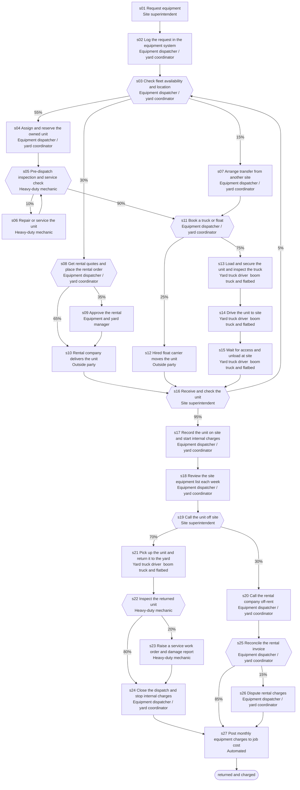

# Dispatch equipment to sites

`gc-spe-equipment-dispatch` · construction - non-residential general contracting · equipment and yards · part of `general-contractor-co`

Superintendents and foremen ask the regional yard for machines and tools. The yard coordinator finds an owned unit in the yard or on another site or rents one, a mechanic checks it, a yard driver trucks it to site, and the register starts charging the project an internal rate until the unit comes back. Requests come by phone and text and are keyed into the equipment register by hand; units left idle on sites keep charging projects and keep the fleet short, and rental invoices often disagree with the dates the yard recorded.

| | |
|---|---|
| Unit of work | one equipment request |
| Starts when | A superintendent or foreman asks the yard for a machine or tool for a site. |
| Done when | The unit has been delivered, used, returned to the yard or off-rented, and its internal or rental charges posted to the project's job cost. |
| Organisation | A Canadian national general contractor of about 2,800 people with four regional equipment and formwork yards and an owned fleet of small and mid-size machines. (2,800 employees, 2019-2022) |
| Volume | 450 cases a month (range 300 to 650) |

## Where it sits

- Starts with **equipment_request** from ops-site-coordination (50% of cases)
- Starts with **equipment_request** from spe-concrete-placement (30% of cases)
- Starts with **equipment_request** from ops-site-mobilization (15% of cases)
- Starts with **equipment_request** from ops-deficiency-closeout (5% of cases)
- Relies on **equipment_delivery** from spe-equipment-maintenance (a standing input; it does not start a case)
- Sends **equipment_charges** to fin-month-end-close (outcome: returned and charged)
- Sends **equipment_delivery** to spe-concrete-placement (outcome: any)
- Sends **rental_order** to equipment-rental (outcome: any)
- Sends **service_work_order** to spe-equipment-maintenance (outcome: any)

## Flow

## Roles

| Role | Department | Layer | FTE on this process | Loaded cost per hour | Evidence |
|---|---|---|---:|---:|---|
| Site superintendent | Construction operations | supervisor | 2 | 75 CAD | C |
| Equipment dispatcher / yard coordinator | Equipment and yards | individual contributor | 5 | 42 CAD | C |
| Equipment and yard manager | Equipment and yards | manager | 0.3 | 85 CAD | C |
| Heavy-duty mechanic | Equipment and yards | individual contributor | 4 | 60 CAD | C |
| Yard truck driver (boom truck and flatbed) | Equipment and yards | individual contributor | 12 | 48 CAD | C |

## Steps

Hands-on time and the wait before each step show the most common value. Evidence tier A is a sourced number, B a sourced description, C the author's estimate.

| Step | Who | Kind | Hands-on | Wait before | Control | Evidence |
|---|---|---|---:|---:|---|---|
| **s01 Request equipment.** The superintendent or foreman phones, texts or emails the yard asking for a machine or tool: type and size, site, delivery day and how long it is needed. Most requests are for telehandlers, skid steers, aerial platforms, heaters, pumps and site equipment. | Site superintendent | intake | 10 min | 0 min |  | C |
| **s02 Log the request in the equipment system.** The yard coordinator types the request into the equipment register or dispatch board with project, cost code, requester, unit type and dates, and calls back if the request is incomplete. | Equipment dispatcher / yard coordinator | data entry | 8 min | 1.0 h |  | C |
| **s03 Check fleet availability and location.** The coordinator searches the register for an owned unit of the right type that is in the yard, coming off another site soon or out for repair, and compares the internal rate with a rental for the expected duration. | Equipment dispatcher / yard coordinator | lookup | 15 min | 0 min |  | C |
| **s04 Assign and reserve the owned unit.** The coordinator assigns a specific unit number to the request in the register so no one else books it and flags it for the shop to check. | Equipment dispatcher / yard coordinator | data entry | 5 min | 0 min |  | C |
| **s05 Pre-dispatch inspection and service check.** A mechanic checks the unit before it leaves: fluids, tires, hydraulics, safety devices, the operator's manual and load chart on board, and service hours against the maintenance schedule. | Heavy-duty mechanic | validation | 30 min | 4.0 h | Manufacturer inspection and maintenance requirements and the constructor's duty under the Occupational Health and Safety Act to keep equipment in good condition | C |
| **s06 Repair or service the unit.** The mechanic opens a service work order, orders parts if needed and repairs or services the unit before it can go out; if repair will take too long the coordinator finds another unit. | Heavy-duty mechanic | physical | 3.0 h | 1.0 d |  | C |
| **s07 Arrange transfer from another site.** The coordinator calls the superintendent holding the unit to agree a release date, and tells both sites when the truck will come. Superintendents often hold machines they are not using. | Equipment dispatcher / yard coordinator | coordination | 20 min | 0 min |  | C |
| **s08 Get rental quotes and place the rental order.** The coordinator phones two or three rental companies for price and availability, picks one and places the rental order with delivery date, site contact and job number. | Equipment dispatcher / yard coordinator | coordination | 30 min | 1.0 h |  | C |
| **s09 Approve the rental.** The equipment and yard manager reviews long or expensive rentals, asks whether an owned unit could be freed or the rental bought out, and approves or redirects. | Equipment and yard manager | approval | 10 min | 4.0 h | Company purchasing authority limits for rentals | C |
| **s10 Rental company delivers the unit.** The rental company trucks the unit to site on its own schedule; in the busy season popular units are booked out and delivery slips. | Outside party | external wait | 0 min | 1.0 d |  | C |
| **s11 Book a truck or float.** The coordinator puts the move on the boom-truck schedule for the day or, for heavy machines and when the trucks are booked, hires a float carrier. | Equipment dispatcher / yard coordinator | coordination | 10 min | 4.0 h |  | C |
| **s12 Hired float carrier moves the unit.** A float carrier picks up the unit at the yard or releasing site and delivers it to the requesting site on its own schedule. | Outside party | external wait | 0 min | 1.0 d |  | C |
| **s13 Load and secure the unit and inspect the truck.** The yard truck driver does the daily trip inspection of the boom truck, loads the unit with the boom or ramps at the yard or releasing site, and chains and straps it to the cargo securement rules. | Yard truck driver (boom truck and flatbed) | physical | 40 min | 1.0 h | Highway Traffic Act commercial vehicle daily inspection and cargo securement rules (Ontario and equivalent provincial rules) | C |
| **s14 Drive the unit to site.** The driver drives to the project, in city traffic for most sites and up to several hours for regional jobs. | Yard truck driver (boom truck and flatbed) | travel | 1.2 h | 0 min |  | C |
| **s15 Wait for access and unload at site.** The driver waits for the site's delivery window, a clear laydown area or the gate to open, unloads the unit, gets the delivery ticket signed and drives back to the yard. | Yard truck driver (boom truck and flatbed) | physical | 30 min | 30 min |  | C |
| **s16 Receive and check the unit.** The superintendent or foreman checks the unit is the one asked for and undamaged, signs the delivery ticket and assigns an operator with the right training. | Site superintendent | validation | 10 min | 30 min |  | C |
| **s17 Record the unit on site and start internal charges.** The coordinator enters the delivery date and site against the unit in the register, which starts the internal rate charge to the project, or records the rental's on-rent date. | Equipment dispatcher / yard coordinator | data entry | 5 min | 4.0 h |  | C |
| **s18 Review the site equipment list each week.** While the unit works on site, the coordinator sends each superintendent the list of units charged to the project and asks which can come back. Touch time is the total of those weekly checks for one unit; the wait is the time the unit is on site. | Equipment dispatcher / yard coordinator | communication | 10 min | 14.0 d |  | C |
| **s19 Call the unit off site.** The superintendent tells the yard the unit is finished. Units often sit idle for days before anyone calls them off, still charging the project. | Site superintendent | communication | 5 min | 1.0 d |  | C |
| **s20 Call the rental company off-rent.** The coordinator phones the rental company to stop the rental, records the off-rent number and the pick-up date in the register. | Equipment dispatcher / yard coordinator | communication | 10 min | 1.0 h |  | C |
| **s21 Pick up the unit and return it to the yard.** The driver collects the unit from site when a truck is free and brings it back to the yard or straight to the next site. | Yard truck driver (boom truck and flatbed) | travel | 2.5 h | 1.0 d |  | C |
| **s22 Inspect the returned unit.** A mechanic checks the returned unit for damage, missing attachments, fluid leaks and service due, and records the hour meter reading in the register. | Heavy-duty mechanic | validation | 20 min | 1.0 d |  | C |
| **s23 Raise a service work order and damage report.** The mechanic writes a service work order for the shop and, where the damage was caused on site, a damage report so the repair can be charged back to the project. | Heavy-duty mechanic | drafting | 20 min | 0 min |  | C |
| **s24 Close the dispatch and stop internal charges.** The coordinator records the return date in the register, which stops the internal rate charge, and marks the unit available or in the shop. | Equipment dispatcher / yard coordinator | data entry | 5 min | 2.0 h |  | C |
| **s25 Reconcile the rental invoice.** When the rental invoice arrives the coordinator checks the rate, on-rent and off-rent dates, damage and fuel charges against the order and codes it to the project for accounts payable. | Equipment dispatcher / yard coordinator | validation | 10 min | 7.0 d | Three-way match of rental invoices to order and off-rent record before payment | C |
| **s26 Dispute rental charges.** The coordinator calls or emails the rental company about wrong dates, rates or damage charges and waits for a credit note before releasing the invoice. | Equipment dispatcher / yard coordinator | communication | 30 min | 1.0 d |  | C |
| **s27 Post monthly equipment charges to job cost.** At month end the equipment system calculates internal rental charges for owned units by days on site and posts them, with coded rental invoices, to each project's job cost in the ERP. | Automated | system auto | 0 min | 5.0 d |  | C |

## Exceptions

| Exception | Share of cases | What happens |
|---|---:|---|
| Unit needs repair before dispatch | 6% | The pre-dispatch check finds a defect or overdue service; the shop repairs it or the coordinator swaps units. |
| Wrong or damaged unit delivered | 5% | The site rejects the unit because it is the wrong size or damaged and the request is sourced again. |
| Rental billing dispute | 4% | The rental invoice charges days after the off-rent call or damage the site disputes. |

## Benchmarks

| Metric | Value | Unit | Population | Evidence |
|---|---|---|---|---|
| cycle_time_days | p50 35, p90 65 | calendar days from request to charges posted (includes time on site) | Owned and rented units dispatched from a contractor's regional yard | C |
| request_to_delivery_days | p50 2, p90 5 | calendar days | Same | C |

## Pain points

- Units sit idle on sites for days before superintendents call them off, charging the project and leaving the yard short. (steps s18, s19; C)
- Requests arrive by phone and text and are keyed into the register by hand; location and dates are often wrong, so internal charges and rental invoices disagree. (steps s02, s17, s25; C)
- Boom trucks are booked solid in season, so moves wait a day or go to hired floats. (steps s11, s21; C)

## Assumptions

- The org file has no truck driver role; the workflow adds truck-driver (not_in_org_file). Equipment operators listed in the process map operate machines on site rather than dispatch them, so they do not appear.
- Time a unit spends working on site is modelled as the wait before the weekly review step; touch time there is the total of the weekly checks.
- Hired float carriers and rental company deliveries are external waits with no touch time.
- Superintendents and mechanics take part although the org file's process map lists only the yard coordinator, equipment manager and equipment operator.
- No public source describing contractor equipment dispatch in Canada was opened; figures are tier C estimates.

Written by claude-opus on 2026-11-24.
