# Record crew time and cost codes

`gc-spe-field-timekeeping` · construction (non-residential general contracting) · self-perform field operations · part of `general-contractor-co`

Every week each self-perform crew's foreman records the hours of every worker by day and cost code, the general foreman approves the sheet, and payroll keys it into the ERP so the crew is paid on Thursday and the labour cost lands on the right budget line. In 2019-2022 most crews still used paper crew sheets, some used tablet apps. The process is slow because sheets wait for the end of the week, for the general foreman's drive between sites and for the Monday payroll cut-off, and error-prone because cost codes are written by hand under time pressure. Miscoded hours distort the cost forecast and are usually found a week or two later by project controls.

| | |
|---|---|
| Unit of work | one crew weekly timesheet |
| Starts when | A self-perform crew starts its work week on a project. |
| Done when | The crew's hours are paid through the weekly payroll and accepted, or reclassified, by project controls in job cost. |
| Organisation | A Canadian national general contractor with about 1,330 unionised hourly carpenters, finishers and labourers in roughly 135 crews on about 220 projects. (2,800 employees, 2019-2022) |
| Volume | 580 cases a month (range 450 to 700) |

## Where it sits

- Starts with **timesheet** from spe-concrete-placement (70% of cases)
- Starts with **timesheet** from spe-general-works (30% of cases)
- Relies on **crew_assignment** from spe-crew-planning (a standing input; it does not start a case)
- Relies on **collective_agreement** from hr-labour-relations (a standing input; it does not start a case)
- Sends **timesheet** to fin-union-payroll (outcome: any)
- Sends **labour_cost** to ops-monthly-cost-forecast (outcome: reclassified)

## Flow

```mermaid
flowchart TD
    s01["s01 Open the crew sheet for the week<br/>Foreman  concrete, formwork or carpentry crew"]
    s02["s02 Record daily hours by cost code<br/>Foreman  concrete, formwork or carpentry crew"]
    s03{{"s03 Finish the week and add premiums<br/>Foreman  concrete, formwork or carpentry crew"}}
    s04["s04 Record a weather day and reporting time<br/>Foreman  concrete, formwork or carpentry crew"]
    s05{{"s05 Crew members check and initial their hours<br/>Foreman  concrete, formwork or carpentry crew"}}
    s06["s06 General foreman drives to collect paper sheets<br/>General foreman"]
    s07{{"s07 General foreman reviews and approves crew hours<br/>General foreman"}}
    s08["s08 Foreman corrects the sheet<br/>Foreman  concrete, formwork or carpentry crew"]
    s09["s09 Send approved sheets to payroll by the Monday cut-off<br/>General foreman"]
    s10{{"s10 Payroll logs the sheet against the expected crew list<br/>Payroll specialist  union and salaried"}}
    s11["s11 Payroll chases the missing or unreadable sheet<br/>Payroll specialist  union and salaried"]
    s12["s12 Key hours into the payroll timecard batch<br/>Payroll specialist  union and salaried"]
    s13{{"s13 ERP edits check the timecard lines<br/>Automated"}}
    s14{{"s14 Resolve timecard edit errors<br/>Payroll specialist  union and salaried"}}
    s15["s15 Project controls assigns or opens the cost code<br/>Project controls specialist  cost"]
    s16["s16 Check batch totals against the sheet<br/>Payroll specialist  union and salaried"]
    s17["s17 Timecard batch closes for the payroll run<br/>Automated"]
    s18["s18 Labour hours and cost post to job cost<br/>Automated"]
    s19{{"s19 Project controls reviews weekly labour by cost code<br/>Project controls specialist  cost"}}
    s20["s20 Draft the labour cost reclass<br/>Project controls specialist  cost"]
    s21["s21 Project accountant posts the reclass<br/>Project accountant"]
    s01 --> s02
    s02 --> s03
    s03 -->|"85%"| s05
    s03 -->|"15%"| s04
    s04 --> s05
    s05 -->|"65%"| s06
    s05 -->|"35%"| s07
    s06 --> s07
    s07 -->|"88%"| s09
    s07 -->|"12%"| s08
    s08 --> s07
    s09 --> s10
    s10 -->|"92%"| s12
    s10 -->|"8%"| s11
    s11 --> s09
    s12 --> s13
    s13 -->|"85%"| s16
    s13 -->|"15%"| s14
    s14 -->|"70%"| s16
    s14 -->|"30%"| s15
    s15 --> s16
    s16 --> s17
    s17 --> s18
    s18 --> s19
    s19 -->|"90%"| end0
    s19 -->|"10%"| s20
    s20 --> s21
    s21 --> end1
    end0(["accepted"])
    end1(["reclassified"])
```

## Roles

| Role | Department | Layer | FTE on this process | Loaded cost per hour | Evidence |
|---|---|---|---:|---:|---|
| Foreman (concrete, formwork or carpentry crew) | Concrete and formwork crews | supervisor | 9 | 65 CAD | C |
| General foreman | Concrete and formwork crews | supervisor | 3 | 72 CAD | C |
| Payroll specialist (union and salaried) | Finance transactions (AP, billing, payroll) | individual contributor | 2.8 | 40 CAD | C |
| Project controls specialist (cost) | Operations support (project controls, scheduling, VDC, quality) | senior specialist | 0.6 | 62 CAD | C |
| Project accountant | Finance | individual contributor | 0.1 | 48 CAD | C |

## Steps

Hands-on time and the wait before each step show the most common value. Evidence tier A is a sourced number, B a sourced description, C the author's estimate.

| Step | Who | Kind | Hands-on | Wait before | Control | Evidence |
|---|---|---|---:|---:|---|---|
| **s01 Open the crew sheet for the week.** On Monday morning the foreman takes a blank weekly crew sheet (or opens the tablet form) pre-printed with the crew names, union local, classification and the project's cost code list issued by project controls. He crosses off workers who left and writes in anyone added by the general foreman. | Foreman (concrete, formwork or carpentry crew) | lookup | 10 min | 0 min |  | B [vista-dft], [procore-ts] |
| **s02 Record daily hours by cost code.** At the end of each shift Monday to Thursday the foreman writes each worker's hours against the cost codes the crew worked on (forms, rebar placing, pour, strip), splits overtime from straight time and notes travel or board allowance days. He often fills two or three days at once from memory when the site is busy. | Foreman (concrete, formwork or carpentry crew) | data entry | 50 min | 0 min |  | B [procore-ts], [vista-dft] |
| **s03 Finish the week and add premiums.** On Friday (or Saturday when the crew works a sixth day) the foreman records the last day, totals each worker's straight time, overtime and double time, and marks shift premiums, travel time and board allowance entitlements under the collective agreement. | Foreman (concrete, formwork or carpentry crew) | data entry | 20 min | 4.0 d |  | B [bacu-ici] |
| **s04 Record a weather day and reporting time.** When rain, wind or cold stops concrete or crane work, the foreman waits to see whether the weather clears, then sends the crew home and records the reporting-time pay the agreement guarantees and the hours actually worked. He notes the lost day in the daily report so the superintendent can track weather delay. | Foreman (concrete, formwork or carpentry crew) | data entry | 10 min | 2.0 h |  | C |
| **s05 Crew members check and initial their hours.** Before leaving on the last day the foreman reads out or shows each worker his hours and allowances, and each worker initials the paper sheet or taps acknowledge on the tablet. Disagreements are fixed on the spot. | Foreman (concrete, formwork or carpentry crew) | review | 10 min | 15 min | Collective agreement: timesheets for members are mandatory and signed copies go with the pay (BACU-Guild ICI art. 22.01) | B [bacu-ici] |
| **s06 General foreman drives to collect paper sheets.** The general foreman, who looks after several crews on two or three sites, drives between sites on Friday afternoon or Monday morning to pick up the paper sheets left in the site trailer. | General foreman | travel | 30 min | 12.0 h |  | C |
| **s07 General foreman reviews and approves crew hours.** The general foreman compares each sheet with the crew plan and the daily reports: crew size, days worked, overtime authorised and whether the cost codes match the work done (no forming hours on a code that was finished last week). He signs the sheet or approves it on the tablet. | General foreman | approval | 15 min | 4.0 h | Company timekeeping policy: supervisor approval of hours and overtime before payroll | C |
| **s08 Foreman corrects the sheet.** The general foreman phones or meets the foreman; the foreman checks his notes, moves hours to the right cost code, adds missed overtime or removes a worker who was absent, and resubmits the sheet. | Foreman (concrete, formwork or carpentry crew) | data entry | 10 min | 8.0 h |  | C |
| **s09 Send approved sheets to payroll by the Monday cut-off.** The general foreman scans or photographs paper sheets and emails them to the regional payroll inbox, or submits the tablet batch, before the end of Monday so that payday is not held up. | General foreman | communication | 5 min | 1.0 h | Collective agreement timesheet deadline: end of business day Monday after the workweek (BACU-Guild ICI art. 22.01) | B [bacu-ici] |
| **s10 Payroll logs the sheet against the expected crew list.** A payroll specialist ticks the crew off the weekly list of expected sheets for the region and checks that every page is legible and signed. Missing or unreadable sheets are chased before the Tuesday batch closes. | Payroll specialist (union and salaried) | intake | 4 min | 4.0 h |  | C |
| **s11 Payroll chases the missing or unreadable sheet.** The payroll specialist emails and then phones the general foreman or foreman, explaining that the crew will not be paid on Thursday without the sheet, and asks for a resend or for the hours by phone with the signed copy to follow. | Payroll specialist (union and salaried) | communication | 10 min | 30 min |  | B [bacu-ici] |
| **s12 Key hours into the payroll timecard batch.** For paper sheets the payroll specialist types each worker's daily hours into the ERP timecard batch by job, cost code, earning type (straight time, overtime, double time), union local and classification; tablet batches are imported and spot-checked. A crew of ten over five days is fifty or more lines. | Payroll specialist (union and salaried) | data entry | 25 min | 4.0 h |  | C |
| **s13 ERP edits check the timecard lines.** The ERP checks each line when the batch is validated: employee active and set up for that union local, job and cost code open, classification rate on file, and daily hours under a limit. Lines that fail are listed on an edit report. | Automated | system auto | 0 min | 30 min |  | C |
| **s14 Resolve timecard edit errors.** The payroll specialist works the edit report: a closed cost code, a new hire not yet set up, a worker keyed under the wrong local. She fixes keying errors herself, asks HR for a missing set-up, and sends cost code questions to project controls. | Payroll specialist (union and salaried) | validation | 15 min | 1.0 h |  | C |
| **s15 Project controls assigns or opens the cost code.** The project controls specialist decides which budget line the hours belong to, for example a new code for change-order work that must be tracked for pricing, opens it in the ERP and replies to payroll. | Project controls specialist (cost) | judgment | 10 min | 8.0 h |  | C |
| **s16 Check batch totals against the sheet.** The payroll specialist compares the hours and head count in the ERP batch with the totals written on the sheet and ticks the sheet as entered. | Payroll specialist (union and salaried) | validation | 4 min | 0 min | Internal control over payroll: batch totals agreed to source documents before the run | C |
| **s17 Timecard batch closes for the payroll run.** The ERP locks the region's timecard batch at the Tuesday cut-off; no more lines can be added, and the batch is handed to the weekly payroll calculation for the Thursday payday. | Automated | system auto | 0 min | 4.0 h |  | B [bacu-ici] |
| **s18 Labour hours and cost post to job cost.** When the payroll run is posted (after the Thursday payday) the ERP writes each worker's hours and burdened labour cost to the job and cost code, where they appear on the weekly labour report. | Automated | system auto | 0 min | 2.0 d |  | B [bacu-ici] |
| **s19 Project controls reviews weekly labour by cost code.** The project controls specialist runs the weekly labour report and compares hours and unit costs by cost code with the budget and the quantities in the daily reports, looking for hours on finished codes, codes with hours but no progress, and crews charged to the wrong project. | Project controls specialist (cost) | analysis | 5 min | 1.0 d |  | C |
| **s20 Draft the labour cost reclass.** The project controls specialist lists the hours and dollars to move between cost codes or jobs, with the reason, and sends the reclass request to the project accountant. | Project controls specialist (cost) | drafting | 20 min | 4.0 h |  | C |
| **s21 Project accountant posts the reclass.** The project accountant checks the reclass request against the job cost detail and posts a job cost adjustment in the ERP so that the next cost report and forecast use the corrected figures. | Project accountant | approval | 10 min | 1.0 d | Journal and job cost adjustments posted by accounting, not by the requester | C |

## Exceptions

| Exception | Share of cases | What happens |
|---|---:|---|
| Hours questioned by the general foreman | 12% | Wrong cost code, missed overtime or an absent worker on the sheet; the foreman corrects and resubmits. |
| Late or unreadable sheet | 8% | Payroll chases the general foreman before the Tuesday batch closes; if it is still missing the crew risks being paid late. |
| Weather day | 15% | The crew is sent home and reporting-time pay is recorded. |
| Miscoded hours found in job cost | 10% | Project controls finds hours on the wrong code a week or more later and has them reclassified. |

## Benchmarks

| Metric | Value | Unit | Population | Evidence |
|---|---|---|---|---|
| cycle_time_days | p50 10, p90 14 | calendar days from the first day of the work week to hours accepted in job cost | Union ICI crews paid weekly, Ontario | B [bacu-ici] |
| timesheet_deadline_after_week_end_days | 1 | business days | BACU-Guild ICI agreement, Ontario, 2022-2025 | A [bacu-ici] |

## Pain points

- Cost codes written by hand at the end of the day are often wrong or transposed, so the weekly labour report and the cost forecast are wrong until project controls finds and reclassifies them. (steps s02, s19, s20; B [procore-ts])
- Paper sheets wait for the general foreman's drive between sites, and a sheet that misses the Monday cut-off puts the Thursday payday at risk, with a two-hour-a-day late pay penalty in some agreements. (steps s06, s09, s11; B [bacu-ici])
- Payroll re-keys every paper sheet line by line into the ERP. (steps s12; C)

## Assumptions

- The case runs from Monday's first entry to job cost acceptance, so the working week itself (about 4 to 5 days) is in the wait before s03.
- Paper sheets 65%, tablet entry 35% in 2019-2022; tablet sheets skip the general foreman's collection drive.
- Recording daily hours (s02) happens during the shift days and overlaps the opening of the sheet; it is listed in sequence with no wait.
- Posting to job cost (s18) depends on the weekly payroll run documented in gc-fin-union-payroll.
- Loaded costs come from the organisation file (about 1.6 loading on union wages, 1.35 on salaries).
- The organisation file lists foreman, general-foreman and payroll-specialist for this process; project-controls and project-accountant are added because they review and correct the cost coding.

## Sources

- [bacu-ici] [BACU-Guild Province Wide ICI Collective Agreement (marble, tile, terrazzo, cement masons, resilient floor layers and helpers), 1 April 2022 to 30 April 2025](https://negotech.service.canada.ca/eng/agreements/14/1448404a.pdf) (Brick and Allied Craft Union of Canada and Terrazzo, Tile & Marble Guild of Ontario; filed with Employment and Social Development Canada (Negotech), 2022). Art. 5.01 employer hires from the Local Union office and the union supplies a referral slip; 5.02 recall within 35 days of layoff; 5.03 75% of additional hires may be requested by name; 5.05 hire from other sources as probationary members when the union cannot supply; 7.03 union refers only members with Fall Arrest, WHMIS and Working at Heights training; 18.03 deductions and contributions compiled monthly and remitted with the report form by the 15th of the following month; 18.04 three remittance forms each month; 19.01 5% a month liquidated damages on remittances more than 10 days in arrears; 22.01 timesheets mandatory, paper sheets due by end of business day Monday after the workweek; 22.02 time books closed weekly and Thursday payday within four working days of closing; 22.03 direct deposit by 5 p.m. Thursday; 22.04 pay statement contents; 22.05 two hours' pay per day of late pay; 24.01 normal week of four or five days of 8 to 10 hours.
- [procore-ts] [Timesheets](https://www.procore.com/en-ca/field-productivity/timesheets) (Procore Technologies, 2026). Field teams enter time for individuals or crews on mobile or web; foremen select cost codes daily; approval processes; export to payroll or ERP.
- [vista-dft] [PR Daily Foreman Timesheet](https://help.trimble.com/en/vista/vista/reports-catalog/payroll-reports/payroll-general-reports/pr-daily-foreman-timesheet) (Trimble Viewpoint (Vista help), 2026). Construction ERP payroll report printed as a daily foreman timesheet, sorted by job and employee, designed to be filled out and entered daily.

Written by claude-opus on 2026-11-24.
