# Execute a planned thermal unit outage

`gen-eng-execute-major-outage` · electric power generation · engineering and asset management · part of `power-generation-co`

During a planned outage a converted gas unit or cogeneration plant is shut down, isolated and opened; company specialist crews and contractor crews inspect, repair and reassemble the turbine, boiler and auxiliaries on two shifts, and the unit is tested and returned to the market. Outage managers and planners run the schedule, plant engineers and inspectors decide on repairs, operators isolate and restart the unit and safety advisors run orientation and incident response. Discovered work, late parts, failed pressure tests and start-up problems extend outages, and every extra day is lost market revenue.

| | |
|---|---|
| Unit of work | one planned thermal or cogeneration unit outage (major or minor) |
| Starts when | The outage plan is issued and contractors begin to mobilise for the scheduled shutdown. |
| Done when | The unit is back in the market, the condition report is written and the outage is closed out. |
| Organisation | An Alberta merchant generator with about 1,300 staff, three gas steam units converted from coal at the Wabamun-area sites, two cogeneration plants, 17 hydro plants and 12 wind farms, with a central engineering and asset management division of about 130 people. (1,300 employees, 2019-2022) |
| Volume | 0.8 cases a month (range 0.5 to 1.5) |

## Where it sits

- Starts with **outage_plan** from eng-plan-major-outages (100% of cases)
- Relies on **contractor_agreement** from scm-contractor-management (a standing input; it does not start a case)
- Relies on **work_permit** from gas-issue-work-permits (a standing input; it does not start a case)
- Sends **permit_request** to gas-issue-work-permits (outcome: outage_closed)
- Sends **service_order** to contractors (outcome: outage_closed)
- Sends **service_order** to oem_providers (outcome: outage_closed)
- Sends **asset_condition_report** to eng-reliability-analysis (outcome: outage_closed)
- Sends **timesheet** to hr-run-payroll (outcome: outage_closed)
- Sends **incident_report** to hse-manage-incidents (outcome: outage_closed)
- Sends **test_request** to eng-performance-testing (outcome: outage_closed)
- Sends **availability_change** to mkt-restate-offers (outcome: outage_closed)

## Flow

```mermaid
flowchart TD
    s01["s01 Mobilise contractors and run site orientation<br/>Safety advisor"]
    s02["s02 Shut down unit and hand over to the outage<br/>Shift supervisor  first-class power engineer"]
    s03["s03 Request isolations and permits<br/>Specialist crew lead"]
    s04{{"s04 Open up boiler and equipment<br/>Outside party"}}
    s05["s05 Open turbine and repair rotors at laydown<br/>Specialist maintenance technician  turbine, valve, rigging"]
    s06["s06 Inspect components and run NDE<br/>Outside party"]
    s07{{"s07 Assess findings and decide repairs<br/>Plant engineer"}}
    s08{{"s08 Approve discovered work<br/>Outage manager"}}
    s09["s09 Wait for expedited parts or shop repair<br/>Outside party"]
    s10["s10 Update the critical-path schedule<br/>Outage planner and scheduler"]
    s11["s11 Repair and reassemble turbine and valves<br/>Specialist maintenance technician  turbine, valve, rigging"]
    s12["s12 Repair boiler and auxiliaries<br/>Outside party"]
    s13["s13 Make outdoor lifts with the mobile crane<br/>Crane operator"]
    s14{{"s14 Run shift coordination and safety meetings<br/>Outage manager"}}
    s15["s15 Report and investigate an incident<br/>Safety advisor"]
    s16{{"s16 Get pressure equipment inspection sign-off<br/>Plant engineer"}}
    s17["s17 Close work orders and surrender permits<br/>Specialist crew lead"]
    s18["s18 Remove locks and return systems to operations<br/>Shift supervisor  first-class power engineer"]
    s19{{"s19 Start up and run hold-point tests<br/>Control room operator  second-class power engineer"}}
    s20["s20 Synchronise and declare the unit available<br/>Shift supervisor  first-class power engineer"]
    s21["s21 Request capability and heat-rate test<br/>Plant engineer"]
    s22["s22 Demobilise contractors and release cranes<br/>Specialist crew lead"]
    s23["s23 Reconcile timesheets and change orders<br/>Outage planner and scheduler"]
    s24["s24 Write as-found and as-left condition report<br/>Reliability engineer"]
    s25["s25 Hold lessons-learned review and close the outage<br/>Outage manager"]
    s01 --> s02
    s02 --> s03
    s03 --> s04
    s04 -->|"25%"| s05
    s04 -->|"75%"| s06
    s05 --> s06
    s06 --> s07
    s07 -->|"45%"| s08
    s07 -->|"55%"| s10
    s08 -->|"45%"| s09
    s08 -->|"55%"| s10
    s09 --> s10
    s10 --> s11
    s11 --> s12
    s12 --> s13
    s13 --> s14
    s14 -->|"10%"| s15
    s14 -->|"90%"| s16
    s15 --> s16
    s16 -->|"8%"| s12
    s16 -->|"92%"| s17
    s17 --> s18
    s18 --> s19
    s19 -->|"10%"| s11
    s19 -->|"90%"| s20
    s20 --> s21
    s21 --> s22
    s22 --> s23
    s23 --> s24
    s24 --> s25
    s25 --> end0
    end0(["outage_closed"])
```

## Roles

| Role | Department | Layer | FTE on this process | Loaded cost per hour | Evidence |
|---|---|---|---:|---:|---|
| Outage manager | Outage planning | manager | 1 | 122 CAD | C |
| Outage planner and scheduler | Outage planning | individual contributor | 1.5 | 75 CAD | C |
| Specialist crew lead | Specialist maintenance crews | supervisor | 1.5 | 85 CAD | C |
| Specialist maintenance technician (turbine, valve, rigging) | Specialist maintenance crews | individual contributor | 6 | 68 CAD | C |
| Crane operator | Specialist maintenance crews | individual contributor | 0.6 | 64 CAD | C |
| Safety advisor | Health and safety | senior specialist | 1 | 80 CAD | C |
| Shift supervisor (first-class power engineer) | Wabamun-area converted units | supervisor | 0.3 | 92 CAD | C |
| Control room operator (second-class power engineer) | Wabamun-area converted units | individual contributor | 0.2 | 70 CAD | C |
| Plant engineer | Thermal technical services | senior specialist | 0.5 | 92 CAD | C |
| Reliability engineer | Asset management and reliability | senior specialist | 0.3 | 98 CAD | C |

## Steps

Hands-on time and the wait before each step show the most common value. Evidence tier A is a sourced number, B a sourced description, C the author's estimate.

| Step | Who | Kind | Hands-on | Wait before | Control | Evidence |
|---|---|---|---:|---:|---|---|
| **s01 Mobilise contractors and run site orientation.** In the week before shutdown the safety advisor runs site orientations for arriving contractor crews (often several hundred workers for a major), checks training records and tickets, issues site access and explains the outage safety plan, muster points and confined-space rescue arrangements. | Safety advisor | communication | 20.0 h | 2.0 d | Alberta OHS Act and Code worker orientation and training duties; company contractor safety standard | C |
| **s02 Shut down unit and hand over to the outage.** At the scheduled hour the shift supervisor ramps the unit down under AESO dispatch, trips the turbine, puts it on turning gear and records the hand-over of the unit from operations to the outage team. The unit stays out of the market until return to service. | Shift supervisor (first-class power engineer) | physical | 8.0 h | 4.0 d |  | C |
| **s03 Request isolations and permits.** The crew lead submits permit requests in the permit-to-work system for each work package against the prepared isolation lists, starting with the systems on the critical path, and confirms the order of isolation with the shift supervisor. | Specialist crew lead | communication | 8.0 h | 2.4 h | Alberta OHS Code Part 15 ss. 212-214 control of hazardous energy; company permit-to-work standard | B [ohs15] |
| **s04 Open up boiler and equipment.** Contractor crews erect scaffolding inside the furnace and around the turbine, remove insulation and lagging, open manways and drain systems once the permits are live and the boiler and turbine have cooled enough to enter. | Outside party | physical | 1.2 d | 2.0 d |  | C |
| **s05 Open turbine and repair rotors at laydown.** On a major outage the specialist crew unbolts the turbine casings and, with the turbine hall crane, lifts the upper casings and removes the high, intermediate and low pressure rotors to laydown, then cleans them and repairs blades and seals at laydown, working two 10- to 12-hour shifts. This step carries the extra turbine time of a major. | Specialist maintenance technician (turbine, valve, rigging) | physical | 10.0 d | 12.0 h |  | B [pe2009] |
| **s06 Inspect components and run NDE.** OEM field engineers and NDE contractors inspect blades, seals, valves and boiler tubes with visual, ultrasonic, magnetic particle and thickness testing and record findings with photos against the inspection plan. | Outside party | physical | 1.0 d | 12.0 h |  | C |
| **s07 Assess findings and decide repairs.** The plant engineer, with the reliability engineer and OEM representative, compares findings with acceptance criteria and OEM guidance and decides for each item whether to repair, replace, run as is or defer, which often adds discovered work to the schedule. | Plant engineer | judgment | 12.0 h | 12.0 h |  | B [powermag2014] |
| **s08 Approve discovered work.** The outage manager reviews each discovered work item for cost, schedule impact and risk of leaving it, approves it within the outage contingency or escalates it, and issues change orders to contractors. | Outage manager | approval | 3.0 h | 7.2 h | Outage scope change control and delegation of financial authority | C |
| **s09 Wait for expedited parts or shop repair.** Supply chain and the OEM expedite replacement parts or ship components to a repair shop; the outage team waits while work continues elsewhere, and the return date often sets the new critical path. | Outside party | external wait | 1.0 h | 5.0 d |  | B [powermag2014] |
| **s10 Update the critical-path schedule.** The outage planner collects progress from each crew every shift, enters percent complete and new work into the scheduling tool, recalculates the critical path and the forecast return-to-service date, and issues the updated schedule for the next shift meeting. | Outage planner and scheduler | analysis | 10.0 h | 0 min |  | C |
| **s11 Repair and reassemble turbine and valves.** The specialist crew repairs or replaces blades, seals and valve internals, sets clearances, reinstalls rotors and casings with the turbine hall crane, aligns the shaft train and torques the bolting, recording as-left readings at each hold point. | Specialist maintenance technician (turbine, valve, rigging) | physical | 2.5 d | 1.0 d |  | B [pe2009] |
| **s12 Repair boiler and auxiliaries.** Contractor crews replace or pad-weld boiler tubes, repair burners, fans, air heaters and pumps, and close up the boiler, working in parallel with the turbine work under their own permits. | Outside party | physical | 1.0 d | 0 min |  | B [pe2009], [iir2003] |
| **s13 Make outdoor lifts with the mobile crane.** The crane operator sets up the hydraulic mobile crane for lifts outside the turbine hall (fan motors, transformer parts, valves to the boiler roof), following the lift plan, and stops when wind speed exceeds the crane's limit. | Crane operator | physical | 6.0 h | 7.2 h | Alberta OHS Code Part 6 cranes, hoists and lifting devices; company critical lift procedure | C |
| **s14 Run shift coordination and safety meetings.** The outage manager chairs the start-of-shift meeting with crew leads, contractors and operations: safety topics, permits for the shift, critical-path progress and blockers. The time here is the total over the outage. | Outage manager | coordination | 10.0 h | 0 min |  | C |
| **s15 Report and investigate an incident.** The safety advisor records the incident or near miss in the incident system, secures the scene, interviews the workers and contractor supervisor, notifies Alberta OHS if the incident is serious and passes the report to the incident investigation process. | Safety advisor | drafting | 10.0 h | 2.4 h | Alberta OHS Act serious incident reporting | C |
| **s16 Get pressure equipment inspection sign-off.** The plant engineer walks the boiler and pressure piping repairs with the inspector, reviews weld records and NDE reports, witnesses the hydrostatic test and gets the inspection signed before the boiler can be closed and fired. | Plant engineer | validation | 8.0 h | 12.0 h | Alberta Pressure Equipment Safety Regulation; ABSA inspection of repairs and alterations | C |
| **s17 Close work orders and surrender permits.** The crew lead confirms each job is complete and the area clean, records hours and as-left notes on the work orders in the ERP and signs off the permits so the systems can be returned to operations. | Specialist crew lead | data entry | 10.0 h | 12.0 h | Alberta OHS Code Part 15 ss. 212-214 control of hazardous energy; company permit-to-work standard | B [ohs15] |
| **s18 Remove locks and return systems to operations.** The shift supervisor checks that all personal locks are removed and permits surrendered, removes the isolations in sequence, refills and vents systems and returns each system to operations. | Shift supervisor (first-class power engineer) | physical | 12.0 h | 7.2 h | Alberta OHS Code Part 15 ss. 212-214 control of hazardous energy; company permit-to-work standard | B [ohs15] |
| **s19 Start up and run hold-point tests.** Control room operators fire the boiler, roll the turbine and run the post-outage tests: valve stroking, overspeed trip, vibration checks and protection checks, stopping to fix anything that fails. | Control room operator (second-class power engineer) | physical | 16.0 h | 12.0 h |  | C |
| **s20 Synchronise and declare the unit available.** The shift supervisor synchronises the unit to the grid, tells the real-time desk the unit is back and the available MW so offers and availability can be restated, and logs the end of the outage. | Shift supervisor (first-class power engineer) | communication | 2.0 h | 2.4 h | AESO ISO rules on available capability and outage completion | C |
| **s21 Request capability and heat-rate test.** The plant engineer sends a test request to the performance testing process so the unit's capability and heat rate after the outage can be measured and declared. | Plant engineer | communication | 2.0 h | 1.0 d |  | C |
| **s22 Demobilise contractors and release cranes.** The crew lead releases contractor crews in stages, returns rental equipment, releases the cranes and specialist crews for other sites and checks that laydown areas are cleared. | Specialist crew lead | coordination | 10.0 h | 1.0 d |  | C |
| **s23 Reconcile timesheets and change orders.** The outage planner checks contractor timesheets and change order claims against daily logs and approved changes, queries differences and approves the totals; company overtime timesheets go to payroll. | Outage planner and scheduler | validation | 1.7 d | 10.0 d | Internal control over contractor invoices: approval against field records | C |
| **s24 Write as-found and as-left condition report.** The reliability engineer compiles inspection findings, repairs, measurements and deferred items into the outage condition report and recommends follow-up inspections and maintenance strategy changes. | Reliability engineer | drafting | 1.0 d | 2.0 d |  | C |
| **s25 Hold lessons-learned review and close the outage.** The outage manager holds the lessons-learned meeting, compares actual duration and cost with plan, records lessons for the next outage on this unit and closes the outage cost collector. | Outage manager | review | 10.0 h | 10.0 d |  | C |

## Exceptions

| Exception | Share of cases | What happens |
|---|---:|---|
| Discovered work needing parts | 20% | Inspection finds damage beyond the planned scope and the replacement part or shop repair sets a new critical path. |
| Failed start-up test | 10% | Vibration, a leaking valve or a protection fault at start-up sends crews back into the turbine or valves. |
| Rejected pressure part repair | 8% | A boiler tube or piping repair fails inspection or the hydrostatic test and is redone. |
| Safety incident | 10% | An injury or significant near miss is reported and investigated during the outage. |

## Benchmarks

| Metric | Value | Unit | Population | Evidence |
|---|---|---|---|---|
| cycle_time_days | p50 60, p90 105 | calendar days from contractor mobilisation to outage closeout | Planned thermal unit outages, mix of about three minors to one major | C |
| major_outage_duration | low 42, mode 45, high 60 | days from shutdown to return to service | Coal-fired steam units with boiler and turbine work | B [pe2009], [iir2003] |
| boiler_conversion_cost_done_in_outage | low 31, mode 34, high 39 | million CAD per converted unit | TransAlta Keephills 2, Keephills 3 and Sundance 6 conversions, 2021 | A [tac2021ir] |

## Pain points

- Discovered work found after opening, and the parts it needs, sets a new critical path and delays return to market. (steps s07, s08, s09; B [powermag2014])
- Shared specialist crews and cranes move between sites, so a slip on one outage delays turbine work on another. (steps s05, s11, s13; C)
- Start-up test failures send crews back after systems have been returned, repeating permits and isolations. (steps s19, s11, s17, s18; C)
- Contractor timesheets and change orders are reconciled by hand against paper daily logs weeks after the outage. (steps s23; C)

## Assumptions

- Touch time on crew steps (s04, s05, s06, s11, s12) is elapsed working time of the crew on two shifts, not summed person-hours, so that the simulated cycle reflects the outage duration. Person-hours are several times higher, which is why stated FTE exceed the FTE implied by touch time.
- Parallel work (boiler, turbine, crane lifts, daily meetings) is listed in sequence with near-zero waits and named in concurrent_with; the parallel steps carry only the time not already covered by the critical path.
- The converted unit is held for the outage duration; it is listed without a running cost because it burns no fuel while offline. Lost market margin is not modelled.
- Hydro and wind unit outages are executed by their divisions and are not part of this file's volume.
- Loaded costs are taken from the organisation file (wage x 1.40). Contractor labour is not costed because contractor steps use the role external.
- The simulated median (about 76 days) sits above the 60-day benchmark and the p90 (about 93 days) below the 105-day benchmark. The simulator draws each step's time independently, so major-outage cases do not also get long repair, test and closeout times, and office touch time (timesheets, reports) is counted as continuous elapsed time. The spread between minor and major outages is therefore narrower than in practice.
- The roles state about 13 FTE against about 4 FTE implied by touch time because crew steps record elapsed crew time, not the person-hours of six-person crews (see the first assumption).

## Sources

- [powermag2014] [Critical Path: Getting Your Outage Ducks in a Row (A. Larson)](https://www.powermag.com/critical-path-getting-your-outage-ducks-in-a-row/) (POWER magazine, 2014). Outage preparation is continuous and can be a full-time department; major projects are planned years ahead; scope is frozen early and contractors estimate and schedule only after the freeze; readiness meetings 90, 60 and 30 days before shutdown with tasks coded green, yellow or red; long-lead parts are a typical red item; unready tasks go on a risk register; scope creep and emergent work are the main threat.
- [tac2019mda] [TransAlta Corporation Management's Discussion and Analysis for 2019 (Exhibit 13.2 to Form 40-F)](https://www.sec.gov/Archives/edgar/data/1144800/000162828020002853/a20191231tacex132mda.htm) (TransAlta Corporation via U.S. SEC EDGAR, 2020). Canadian Coal planned major maintenance 34 million CAD in 2019, 15 million in 2018, 54 million in 2017; two planned major outages (Keephills 1 and Sundance 4) in 2019, one planned major outage at a non-operated unit in 2018 and four planned outages in 2017; Canadian Gas planned major maintenance 8, 16 and 22 million; consolidated sustaining capital 141 million CAD (2019), 150 million (2018), 218 million (2017) and 170 to 200 million forecast for 2020.
- [tac2021ir] [TransAlta Corporation 2021 Integrated Report (Form 6-K)](https://www.sec.gov/Archives/edgar/data/1144800/000114480022000006/tac2021integratedreportf.htm) (TransAlta Corporation via U.S. SEC EDGAR, 2022). Coal-to-gas conversions completed 2020-2021 at 7 to 39 million CAD per unit (Keephills 3 31 million, Keephills 2 34 million, Sundance 6 39 million); planned outages for the Keephills 2 and 3 boiler conversions reduced 2021 adjusted availability to 86.6 percent; planned major maintenance is part of sustaining capital; 2022 sustaining capital assumption 150 to 170 million CAD; significant planned major outages expected in 2022.
- [pe2009] [Short-term Fixes Often Trump Major Component Replacements (S. Blankinship)](https://www.power-eng.com/operations-maintenance/short-term-fixes-often-trump-major-component-replacements/) (Power Engineering, 2009). Major work at coal plants is done as a capital outage scheduled with a major boiler inspection and repair every three years or so; a typical boiler major lasts 45 days or longer; a high-pressure turbine can be replaced in about 25 days and a low-pressure turbine in 35 to 38 days; modern designs allow about 100,000 hours between low-pressure turbine inspections.
- [iir2003] [April Outage Scheduled for Warrick Generating Station](https://www.industrialinfo.com/news/article/april-outage-scheduled-for-warrick-generating-station--12461) (Industrial Info Resources, 2003). A 42-day planned outage on a 323 MW coal unit covering boiler inspection and repair, steam turbine-generator, feedwater heating, cooling tower, fuel and ash handling and SCR tie-ins.
- [ohs15] [Occupational Health and Safety Code, Part 15 Managing the Control of Hazardous Energy (Alberta Regulation 191/2021)](https://search-ohs-laws.alberta.ca/legislation/occupational-health-and-safety-code/part-15-managing-the-control-of-hazardous-energy/) (Government of Alberta, 2021). Part 15 requires isolation of machinery and equipment before work (s. 212), verification of isolation (s. 213), personal locks (s. 214) and rules for securing by individual workers and groups. The same Part existed in the earlier Code (AR 87/2009) in force in 2019 to 2021.

Written by claude-opus on 2026-11-24.
