# Deliver a sustaining capital project

`gen-eng-manage-capital-projects` · electric power generation · engineering and asset management · part of `power-generation-co`

Project managers in the engineering division deliver approved sustaining capital projects (equipment replacements, controls upgrades, protection and electrical work, environmental and safety improvements) from scope through design, approvals, procurement, construction and commissioning to handover. They work with engineering consultants, electrical and plant engineers, supply chain, contractors, safety advisors and plant operations. Projects are slow because design, long-lead equipment and regulatory approvals take months, and many must wait for a planned outage before work can start; scope gaps and late as-built documents cause change orders and delayed closeouts.

| | |
|---|---|
| Unit of work | one sustaining capital project |
| Starts when | The annual budget approves the project line. |
| Done when | The project is commissioned, handed over to operations, capitalised and closed, or it is cancelled at the funding gate. |
| Organisation | An Alberta merchant generator with about 1,300 staff, three gas steam units converted from coal at the Wabamun-area sites, two cogeneration plants, 17 hydro plants and 12 wind farms, with a central engineering and asset management division of about 130 people. (1,300 employees, 2019-2022) |
| Volume | 4 cases a month (range 3 to 6) |

## Where it sits

- Starts with **approved_budget** from fin-budget-forecast (100% of cases)
- Relies on **regulatory_approval** from hse-regulatory-filings (a standing input; it does not start a case)
- Relies on **outage_plan** from eng-plan-major-outages (a standing input; it does not start a case)
- Sends **engineering_change** to eng-manage-engineering-changes (outcome: project_closed)
- Sends **filing_request** to hse-regulatory-filings (outcome: project_closed)
- Sends **material_request** to scm-purchase-materials (outcome: project_closed)
- Sends **service_order** to scm-contractor-management (outcome: project_closed)
- Sends **journal_entries** to fin-close-month (outcome: project_closed)

## Flow

```mermaid
flowchart TD
    s01["s01 Receive approved budget and open the project<br/>Project manager"]
    s02["s02 Define scope and basis of design<br/>Project manager"]
    s03["s03 Estimate cost and schedule<br/>Project manager"]
    s04{{"s04 Pass the execution funding gate<br/>Vice-president, engineering and asset management"}}
    s05{{"s05 Wait for detailed design from engineering consultant<br/>Outside party"}}
    s06["s06 Review electrical and protection design<br/>Electrical and protection engineer"]
    s07{{"s07 Review design for operability<br/>Plant engineer"}}
    s08["s08 Prepare regulatory filing request<br/>Project manager"]
    s09["s09 Wait for regulatory approval<br/>Outside party"]
    s10["s10 Raise material requests for equipment<br/>Project manager"]
    s11["s11 Prepare construction scope and evaluate contractor bids<br/>Project manager"]
    s12{{"s12 Wait for equipment delivery<br/>Outside party"}}
    s13["s13 Wait for the planned outage window<br/>Project manager"]
    s14["s14 Raise the engineering change<br/>Project manager"]
    s15["s15 Review contractor safety plan and run pre-job hazard assessment<br/>Safety advisor"]
    s16["s16 Install and construct<br/>Outside party"]
    s17["s17 Travel to site for supervision<br/>Project manager"]
    s18["s18 Supervise construction and approve change orders<br/>Project manager"]
    s19["s19 Report monthly cost and progress<br/>Project manager"]
    s20{{"s20 Commission and test with operations<br/>Plant engineer"}}
    s21["s21 Hand over drawings and turnover package<br/>Engineering document controller"]
    s22["s22 Settle project costs to fixed assets<br/>Accountant"]
    s23["s23 Write closeout report and lessons learned<br/>Project manager"]
    s01 --> s02
    s02 --> s03
    s03 --> s04
    s04 -->|"87%"| s05
    s04 -->|"8%"| s02
    s04 -->|"5%"| end0
    s05 -->|"45%"| s06
    s05 -->|"55%"| s07
    s06 --> s07
    s07 -->|"15%"| s08
    s07 -->|"85%"| s10
    s08 --> s09
    s09 --> s10
    s10 --> s11
    s11 --> s12
    s12 -->|"50%"| s13
    s12 -->|"50%"| s14
    s13 --> s14
    s14 --> s15
    s15 --> s16
    s16 --> s17
    s17 --> s18
    s18 --> s19
    s19 --> s20
    s20 -->|"15%"| s16
    s20 -->|"85%"| s21
    s21 --> s22
    s22 --> s23
    s23 --> end1
    end0(["project_cancelled"])
    end1(["project_closed"])
```

## Roles

| Role | Department | Layer | FTE on this process | Loaded cost per hour | Evidence |
|---|---|---|---:|---:|---|
| Project manager | Capital projects | senior specialist | 11 | 105 CAD | C |
| Electrical and protection engineer | Asset management and reliability | senior specialist | 1 | 100 CAD | C |
| Plant engineer | Thermal technical services | senior specialist | 1 | 92 CAD | C |
| Safety advisor | Health and safety | senior specialist | 0.3 | 80 CAD | C |
| Engineering document controller | Engineering and asset management | individual contributor | 1 | 48 CAD | C |
| Accountant | Controllership and accounts payable | individual contributor | 0.2 | 68 CAD | C |
| Vice-president, engineering and asset management | Engineering and asset management | director | 0.03 | 185 CAD | C |

## Steps

Hands-on time and the wait before each step show the most common value. Evidence tier A is a sourced number, B a sourced description, C the author's estimate.

| Step | Who | Kind | Hands-on | Wait before | Control | Evidence |
|---|---|---|---:|---:|---|---|
| **s01 Receive approved budget and open the project.** When the annual budget is approved, the project manager receives the project line (asset, purpose, budget, target year), opens a project and cost collector in the ERP, and sets up the project folder and register in the document store. | Project manager | intake | 4.0 h | 20.0 d |  | C |
| **s02 Define scope and basis of design.** The project manager meets the plant, hydro or wind site and the reliability engineer, visits the asset, and writes the scope, basis of design, constraints (outage window, permits, tie-ins) and success criteria in a project charter. | Project manager | drafting | 1.7 d | 14.0 d |  | C |
| **s03 Estimate cost and schedule.** The project manager builds a cost estimate from vendor budget quotes and past projects and a schedule in the scheduling tool, including long-lead equipment and the outage window if the work needs the unit offline. | Project manager | analysis | 1.7 d | 10.0 d |  | C |
| **s04 Pass the execution funding gate.** The vice-president of engineering reviews scope, estimate, schedule and risks at the gate review and releases execution funding under the delegation of authority, sends the project back for rework or cancels it. | Vice-president, engineering and asset management | approval | 1.0 h | 14.0 d | Corporate delegation of financial authority and capital project stage-gate procedure | C |
| **s05 Wait for detailed design from engineering consultant.** An engineering consultant on a standing agreement prepares drawings, specifications and calculations, which are stamped by a professional engineer, while the project manager answers questions. | Outside party | external wait | 2.0 h | 60.0 d | Alberta Engineering and Geoscience Professions Act: authentication of engineering documents by a professional engineer | C |
| **s06 Review electrical and protection design.** The electrical and protection engineer checks single-line diagrams, protection settings, cable sizing and grid connection requirements against company standards and AESO and transmission requirements, and marks up comments. | Electrical and protection engineer | review | 12.0 h | 10.0 d |  | C |
| **s07 Review design for operability.** The plant engineer and operations representatives review the design for operability, maintainability and safety (a hazard review for process changes) and return comments; the consultant issues the design for construction. | Plant engineer | review | 10.0 h | 10.0 d | Company management of change and process hazard review standard | C |
| **s08 Prepare regulatory filing request.** Where the project changes a power plant approval, an environmental approval or a pressure equipment design, the project manager prepares the technical content and sends a filing request to the regulatory team, which files with the AUC, the AER or Alberta Environment, or registers the design with ABSA. | Project manager | drafting | 1.0 d | 7.0 d | AUC Rule 007 power plant applications; Alberta Pressure Equipment Safety Regulation design registration | C |
| **s09 Wait for regulatory approval.** The AUC, the AER, Alberta Environment or ABSA reviews the application or design registration, may send information requests that the regulatory team answers with the project manager, and returns an approval with conditions. | Outside party | external wait | 1.0 h | 75.0 d |  | C |
| **s10 Raise material requests for equipment.** The project manager raises material requests in the ERP for the equipment and bulk materials named in the design, with specifications, technical evaluation criteria and required-on-site dates, for supply chain to tender and order. | Project manager | data entry | 10.0 h | 5.0 d |  | C |
| **s11 Prepare construction scope and evaluate contractor bids.** The project manager writes the construction scope of work and, after supply chain tenders it, evaluates contractor bids for price, schedule, safety record and qualifications and recommends an award. | Project manager | drafting | 1.2 d | 10.0 d |  | C |
| **s12 Wait for equipment delivery.** The project waits for vendors to fabricate and deliver equipment; the project manager reviews vendor drawings and progress reports, and long-lead items such as transformers, breakers and large valves can take six months or more. | Outside party | external wait | 10.0 h | 75.0 d |  | C |
| **s13 Wait for the planned outage window.** Work that needs the unit offline waits for the next planned outage. The project manager gives the outage planners the scope, durations and tie-in points so the work is put in the outage schedule. | Project manager | coordination | 10.0 h | 60.0 d |  | C |
| **s14 Raise the engineering change.** The project manager raises the engineering change (management of change) record with the design, risk review and operating changes, so drawings, procedures and training are updated before the change is put into service. | Project manager | drafting | 6.0 h | 5.0 d | Management of change procedure | C |
| **s15 Review contractor safety plan and run pre-job hazard assessment.** The safety advisor reviews the contractor's site-specific safety plan, confirms orientation and tickets, and attends the pre-job hazard assessment for high-risk tasks such as lifts, excavation, energised work and hot work. | Safety advisor | review | 6.0 h | 5.0 d | Alberta OHS Code Part 2 hazard assessment; company contractor safety standard | C |
| **s16 Install and construct.** The contractor installs the equipment and makes the tie-ins under permits: civil works, mechanical installation, cabling and terminations, using the mobile crane for heavy lifts. Outdoor work stops for high winds and extreme cold. | Outside party | physical | 5.0 d | 2.0 d |  | C |
| **s17 Travel to site for supervision.** The project manager drives to the site for weekly construction meetings and inspections during installation. The time here is the total over the construction period. | Project manager | travel | 1.0 d | 0 min |  | C |
| **s18 Supervise construction and approve change orders.** On site and by email the project manager checks progress and quality against the design, resolves field problems with the consultant, and reviews and approves contractor change orders within the project contingency. | Project manager | coordination | 2.1 d | 0 min |  | C |
| **s19 Report monthly cost and progress.** Each month the project manager updates the cost forecast from ERP commitments and accruals, the schedule and the risk list, and sends the project report to the engineering vice-president and finance. The time here is the total over the project. | Project manager | drafting | 1.2 d | 0 min |  | C |
| **s20 Commission and test with operations.** The plant engineer leads pre-commissioning checks and functional tests with the contractor and operators, works through the punch list and confirms the equipment meets the design before operations accepts it. | Plant engineer | validation | 1.0 d | 5.0 d |  | C |
| **s21 Hand over drawings and turnover package.** The document controller collects as-built drawings, vendor manuals, test records and the updated engineering change from the consultant and contractor, checks them against the turnover checklist, chases missing items and files them in the drawings repository. | Engineering document controller | data entry | 12.0 h | 14.0 d |  | C |
| **s22 Settle project costs to fixed assets.** An accountant settles the project cost collector to fixed asset records, splits costs between new assets and retirements and records the in-service date for depreciation. | Accountant | data entry | 4.0 h | 14.0 d | IFRS property, plant and equipment capitalisation and internal control over financial reporting | C |
| **s23 Write closeout report and lessons learned.** The project manager compares final cost and schedule with the approved estimate, explains variances, records lessons learned and closes the project in the ERP. | Project manager | drafting | 10.0 h | 14.0 d |  | C |

## Exceptions

| Exception | Share of cases | What happens |
|---|---:|---|
| Regulatory approval needed | 15% | The project changes a power plant, environmental or pressure equipment approval, and work waits for the regulator. |
| Waiting for an outage window | 50% | Tie-ins need the unit offline, so construction waits for the next planned outage, often months after the equipment arrives. |
| Failed commissioning | 15% | A functional test fails and the contractor returns to fix the installation. |
| Scope or estimate sent back at the gate | 8% | The funding gate returns the project for more scope definition or a better estimate. |

## Benchmarks

| Metric | Value | Unit | Population | Evidence |
|---|---|---|---|---|
| cycle_time_days | p50 420, p90 640 | calendar days from budget approval to project closeout | Sustaining capital projects at an Alberta generator, 2019-2022 | C |
| sustaining_capital_spend | 2017 218, 2018 150, 2019 141, 2022_plan_low 150, 2022_plan_high 170 | million CAD per year, whole company | TransAlta Corporation | A [tac2019mda], [tac2021ir] |

## Pain points

- Long-lead equipment and the wait for an outage window set the schedule more than the work itself. (steps s12, s13; C)
- Scope gaps from early definition show up as change orders during construction. (steps s02, s03, s18; C)
- As-built drawings and vendor documents arrive late, so turnover and closeout drag on after the equipment is in service. (steps s21, s23; C)
- Monthly cost reports are assembled by hand from ERP commitments and spreadsheets. (steps s19; C)

## Assumptions

- The unit of work is one project from budget approval to closeout. The organisation file counts active project-months (40 to 80); 3 to 6 project starts a month with 12 to 18 month durations gives the same number of active projects.
- Project manager work spread over months (site visits, construction supervision, monthly reports) is recorded once per project as total hours in s17 to s19 with near-zero waits; those steps run alongside construction.
- Contractor and consultant work uses the role external and is not costed in labour.
- Regulatory approvals are filed by hse-regulatory-filings; this file counts only the project manager's input and the wait.
- Loaded costs are taken from the organisation file (wage x 1.40).
- The simulated median (about 490 days) is about 1.2 times the 420-day benchmark because design, equipment fabrication and the contractor tender run one after another in the step graph, while in practice the tender and some procurement overlap with design.
- The FTE implied by touch time (about 21) includes about 150 hours per project of contractor and consultant time on external steps; without it the implied internal FTE is close to the 14.5 stated.

## Sources

- [tac2019mda] [TransAlta Corporation Management's Discussion and Analysis for 2019 (Exhibit 13.2 to Form 40-F)](https://www.sec.gov/Archives/edgar/data/1144800/000162828020002853/a20191231tacex132mda.htm) (TransAlta Corporation via U.S. SEC EDGAR, 2020). Canadian Coal planned major maintenance 34 million CAD in 2019, 15 million in 2018, 54 million in 2017; two planned major outages (Keephills 1 and Sundance 4) in 2019, one planned major outage at a non-operated unit in 2018 and four planned outages in 2017; Canadian Gas planned major maintenance 8, 16 and 22 million; consolidated sustaining capital 141 million CAD (2019), 150 million (2018), 218 million (2017) and 170 to 200 million forecast for 2020.
- [tac2021ir] [TransAlta Corporation 2021 Integrated Report (Form 6-K)](https://www.sec.gov/Archives/edgar/data/1144800/000114480022000006/tac2021integratedreportf.htm) (TransAlta Corporation via U.S. SEC EDGAR, 2022). Coal-to-gas conversions completed 2020-2021 at 7 to 39 million CAD per unit (Keephills 3 31 million, Keephills 2 34 million, Sundance 6 39 million); planned outages for the Keephills 2 and 3 boiler conversions reduced 2021 adjusted availability to 86.6 percent; planned major maintenance is part of sustaining capital; 2022 sustaining capital assumption 150 to 170 million CAD; significant planned major outages expected in 2022.

Written by claude-opus on 2026-11-24.
