# Plan and schedule a planned thermal unit outage

`gen-eng-plan-major-outages` · electric power generation · engineering and asset management · part of `power-generation-co`

This process turns a planned outage in the multi-year plan into a ready-to-run outage: scope, job plans, contractor awards, long-lead parts, a critical-path schedule, a safety and isolation plan and a budget. It covers the converted gas units and cogeneration plants; hydro and wind unit outages are planned inside their own divisions. Outage managers and planners in the engineering division do most of the work with reliability engineers, plant maintenance planners, the plant manager and the trading desk. It is slow because planning starts 6 to 18 months ahead, contractor tenders and long-lead parts take months, and dates move when prices, the AESO or late parts force a reschedule.

| | |
|---|---|
| Unit of work | one planned thermal or cogeneration unit outage (major or minor) |
| Starts when | The annual capital plan confirms an outage for a unit in the coming years. |
| Done when | The outage plan (scope, schedule, budget, safety plan) is issued to the execution team, or the outage is deferred. |
| Organisation | An Alberta merchant generator with about 1,300 staff, three gas steam units converted from coal at the Wabamun-area sites, two cogeneration plants, 17 hydro plants and 12 wind farms, with a central engineering and asset management division of about 130 people. (1,300 employees, 2019-2022) |
| Volume | 0.8 cases a month (range 0.5 to 1.5) |

## Where it sits

- Starts with **capital_plan** from eng-capital-planning (100% of cases)
- Relies on **capital_plan** from etr-convert-coal-units (a standing input; it does not start a case)
- Sends **outage_plan** to eng-execute-major-outage (outcome: outage_plan_issued)
- Sends **outage_plan** to gas-inspect-pressure-equipment (outcome: outage_plan_issued)
- Sends **outage_plan** to eng-report-outages-aeso (outcome: outage_plan_issued)
- Sends **material_request** to scm-purchase-materials (outcome: outage_plan_issued)
- Sends **service_order** to scm-contractor-management (outcome: outage_plan_issued)
- Sends **crew_request** to eng-dispatch-specialist-crews (outcome: outage_plan_issued)
- Sends **outage_plan** to eng-report-outages-aeso (outcome: outage_deferred)

## Flow

```mermaid
flowchart TD
    s01["s01 Place outage in long-range outage plan<br/>Outage manager"]
    s02["s02 Agree outage window with trading desk<br/>Outage manager"]
    s03["s03 Add outage to monthly 24-month AESO submission<br/>Outage planner and scheduler"]
    s04["s04 Gather scope inputs when planning starts<br/>Outage planner and scheduler"]
    s05["s05 Travel to plant for scope walkdown<br/>Outage planner and scheduler"]
    s06["s06 Walk down equipment and confirm scope<br/>Outage planner and scheduler"]
    s07["s07 Review condition data and recommend inspection scope<br/>Reliability engineer"]
    s08["s08 Write job plans and work orders<br/>Maintenance planner and scheduler"]
    s09{{"s09 Review and freeze outage scope<br/>Plant manager"}}
    s10["s10 Raise material requests for long-lead parts<br/>Outage planner and scheduler"]
    s11["s11 Prepare contractor scope packages<br/>Outage planner and scheduler"]
    s12{{"s12 Evaluate contractor bids technically<br/>Outage manager"}}
    s13["s13 Build major outage cost estimate<br/>Outage manager"]
    s14{{"s14 Approve major outage budget<br/>Vice-president, engineering and asset management"}}
    s15["s15 Estimate minor outage and raise requests<br/>Outage planner and scheduler"]
    s16["s16 Build critical-path schedule<br/>Outage planner and scheduler"]
    s17["s17 Request specialist crews and cranes<br/>Outage planner and scheduler"]
    s18["s18 Review outage safety plan<br/>Safety advisor"]
    s19["s19 Prepare isolation lists<br/>Shift supervisor  first-class power engineer"]
    s20["s20 Send pressure equipment inspection scope<br/>Plant engineer"]
    s21{{"s21 Hold outage readiness review<br/>Outage manager"}}
    s22["s22 Chase late parts and contractor gaps<br/>Outage planner and scheduler"]
    s23["s23 Confirm final dates and update AESO submission<br/>Outage planner and scheduler"]
    s24["s24 Issue outage plan to execution<br/>Outage manager"]
    s01 --> s02
    s02 --> s03
    s03 --> s04
    s04 --> s05
    s05 --> s06
    s06 --> s07
    s07 --> s08
    s08 --> s09
    s09 -->|"6%"| s04
    s09 -->|"25%"| s10
    s09 -->|"64%"| s15
    s09 -->|"5%"| end0
    s10 --> s11
    s11 --> s12
    s12 -->|"92%"| s13
    s12 -->|"8%"| s11
    s13 --> s14
    s14 -->|"90%"| s16
    s14 -->|"7%"| s13
    s14 -->|"3%"| end0
    s15 --> s16
    s16 --> s17
    s17 --> s18
    s18 --> s19
    s19 --> s20
    s20 --> s21
    s21 -->|"30%"| s22
    s21 -->|"62%"| s23
    s21 -->|"8%"| s16
    s22 --> s21
    s23 --> s24
    s24 --> end1
    end0(["outage_deferred"])
    end1(["outage_plan_issued"])
```

## Roles

| Role | Department | Layer | FTE on this process | Loaded cost per hour | Evidence |
|---|---|---|---:|---:|---|
| Outage manager | Outage planning | manager | 1.6 | 122 CAD | C |
| Outage planner and scheduler | Outage planning | individual contributor | 5 | 75 CAD | C |
| Maintenance planner and scheduler | Thermal technical services | individual contributor | 2 | 66 CAD | C |
| Reliability engineer | Asset management and reliability | senior specialist | 0.5 | 98 CAD | C |
| Plant engineer | Thermal technical services | senior specialist | 0.3 | 92 CAD | C |
| Plant manager | Wabamun-area converted units | manager | 0.15 | 135 CAD | C |
| Safety advisor | Health and safety | senior specialist | 0.3 | 80 CAD | C |
| Shift supervisor (first-class power engineer) | Wabamun-area converted units | supervisor | 0.4 | 92 CAD | C |
| Vice-president, engineering and asset management | Engineering and asset management | director | 0.02 | 185 CAD | C |
| Vice-president, gas generation | Gas generation | director | 0.02 | 190 CAD | C |

## Steps

Hands-on time and the wait before each step show the most common value. Evidence tier A is a sourced number, B a sourced description, C the author's estimate.

| Step | Who | Kind | Hands-on | Wait before | Control | Evidence |
|---|---|---|---:|---:|---|---|
| **s01 Place outage in long-range outage plan.** The outage manager opens the multi-year outage plan in the scheduling tool and the capital plan spreadsheet, takes the OEM inspection intervals (operating hours and starts since the last major) and the capital items that need the unit offline, and sets the season, year and planned duration for the outage. They check that no two Wabamun-area units or both cogeneration trains are planned out together. | Outage manager | analysis | 4.0 h | 14.0 d |  | C |
| **s02 Agree outage window with trading desk.** The outage manager meets the portfolio optimisation analysts, compares the proposed window with the forward price curve and other planned outages in the province, and moves the outage into the spring or fall shoulder season when prices are usually lower. The agreed window is recorded in the plan. | Outage manager | coordination | 4.0 h | 7.0 d |  | C |
| **s03 Add outage to monthly 24-month AESO submission.** The outage planner adds the outage dates, MW impact, type (Outage-Planned or Derate-Planned) and nature of work to the list for the monthly submission, which the outage reporting process enters in the AESO Energy Trading System by the first of the month. Every planned outage in the next 24 months must be on it. | Outage planner and scheduler | data entry | 1.0 h | 10.0 d | AESO ISO Rules Section 306.5 subsection 3(1)-(2) | A [aeso3065] |
| **s04 Gather scope inputs when planning starts.** When the outage reaches its planning start (about 12 to 18 months ahead for a major, 6 months for a minor), the outage planner pulls from the ERP every deferred work order flagged as outage-only, open work requests, the last outage report, OEM technical bulletins and the pressure equipment inspection due list, and builds a draft scope list in a spreadsheet. | Outage planner and scheduler | lookup | 1.7 d | 75.0 d |  | B [powermag2014] |
| **s05 Travel to plant for scope walkdown.** The outage planner drives a company truck from the engineering office to the plant site, signs in at the gate and collects a site radio and permit-area briefing before walking the unit. | Outage planner and scheduler | travel | 3.0 h | 5.0 d |  | C |
| **s06 Walk down equipment and confirm scope.** The outage planner walks the boiler, turbine deck and auxiliaries with the maintenance supervisor, checks each scope item in the field, notes access needs (scaffold, insulation removal, crane reach) and photographs equipment, then marks items to add or drop on the draft scope list. | Outage planner and scheduler | physical | 12.0 h | 0 min |  | C |
| **s07 Review condition data and recommend inspection scope.** The reliability engineer reviews historian trends (vibration, bearing temperatures, heat rate), boiler tube leak history, past NDE results and failure reports, and recommends which inspections, replacements and upgrades belong in this outage. Items needing parts with long delivery times are flagged. | Reliability engineer | analysis | 1.2 d | 14.0 d |  | C |
| **s08 Write job plans and work orders.** For each scope item the maintenance planner writes a job plan in the ERP plant maintenance module: steps, trades and hours, parts and reservations, special tools, isolation points and hold points. A major outage has several hundred work orders; a minor outage has under a hundred. | Maintenance planner and scheduler | drafting | 8.3 d | 21.0 d |  | C |
| **s09 Review and freeze outage scope.** The plant manager chairs the scope review with planners, engineering and maintenance supervisors, challenges each item against cost and risk, removes or defers items and freezes the scope list. Later additions must go through scope change control. | Plant manager | approval | 4.0 h | 14.0 d | Outage scope freeze and scope change control procedure | B [powermag2014] |
| **s10 Raise material requests for long-lead parts.** The outage planner raises material requests in the ERP for long-lead items such as turbine blades, valve internals, boiler tube panels and generator parts, attaching specifications and OEM quotes, so supply chain can order them 6 to 12 months ahead. | Outage planner and scheduler | data entry | 20.0 h | 5.0 d |  | B [powermag2014] |
| **s11 Prepare contractor scope packages.** The outage planner writes scope packages for boiler repair, scaffolding, insulation, turbine OEM services and NDE, with quantities, schedule windows and safety requirements, and sends them to supply chain as service orders for tender. | Outage planner and scheduler | drafting | 4.2 d | 10.0 d |  | B [powermag2014] |
| **s12 Evaluate contractor bids technically.** After supply chain runs the tender, the outage manager scores each bid for manpower plan, schedule, safety record and exclusions, asks bidders clarifying questions and recommends an award. | Outage manager | review | 1.0 d | 60.0 d |  | C |
| **s13 Build major outage cost estimate.** The outage manager builds the outage budget from job plan hours, contractor bids, material costs, crane rental and a contingency for discovered work, and compares it with the capital plan amount for the outage. | Outage manager | analysis | 1.7 d | 7.0 d |  | B [tac2019mda] |
| **s14 Approve major outage budget.** The vice-president of engineering, with the vice-president of gas generation, reviews the budget, schedule, risks and expected availability gain and approves it under the delegation of authority, or asks for cuts. | Vice-president, engineering and asset management | approval | 2.0 h | 14.0 d | Corporate delegation of financial authority | C |
| **s15 Estimate minor outage and raise requests.** For a minor outage the outage planner prices the work from job plans, raises material requests and service orders for the few contractors needed, and sends the estimate to the plant manager for sign-off within the plant's maintenance budget. | Outage planner and scheduler | data entry | 1.7 d | 7.0 d |  | C |
| **s16 Build critical-path schedule.** The outage planner loads work orders into the critical-path scheduling tool, links logic (cool-down, isolation, scaffold, open, inspect, repair, close, test), sets the two-shift calendar and resource limits for crews and cranes, and finds the critical path, which for a major runs through the turbine. | Outage planner and scheduler | analysis | 3.3 d | 21.0 d |  | C |
| **s17 Request specialist crews and cranes.** The outage planner sends a crew request to the specialist crew booking process for turbine, valve and rigging crews and the mobile cranes on the scheduled dates, and checks the reply against other sites' bookings. | Outage planner and scheduler | coordination | 4.0 h | 3.0 d |  | C |
| **s18 Review outage safety plan.** The safety advisor reviews the high-risk work in the schedule (boiler confined-space entry, critical lifts, scaffolding, hot work and the peak number of contractors on site) and sets the orientation, rescue and supervision requirements in the outage safety plan. | Safety advisor | review | 1.0 d | 14.0 d | Alberta OHS Act and Code (hazard assessment, confined space, lifting); company outage safety standard | C |
| **s19 Prepare isolation lists.** A shift supervisor uses the drawings and the permit-to-work system to list every isolation point (valves, breakers, drains and vents) for each system in the outage, so that permits can be issued quickly once the unit is shut down. | Shift supervisor (first-class power engineer) | drafting | 1.0 d | 10.0 d | Alberta OHS Code Part 15 ss. 212-214 control of hazardous energy | B [ohs15] |
| **s20 Send pressure equipment inspection scope.** The plant engineer sends the outage dates and the list of boilers, vessels and piping due for inspection to the pressure equipment inspection process, so inspectors and NDE contractors can be booked within the outage window. | Plant engineer | communication | 6.0 h | 5.0 d | Alberta Pressure Equipment Safety Regulation and the owner's ABSA-accepted integrity management program | C |
| **s21 Hold outage readiness review.** The outage manager holds readiness reviews at about 90, 60 and 30 days before shutdown, going through parts delivery, contractor mobilisation, work package completeness and permits, and codes each item green, yellow or red. Red items go on the risk register with a contingency. | Outage manager | review | 10.0 h | 25.0 d |  | B [powermag2014] |
| **s22 Chase late parts and contractor gaps.** The outage planner calls buyers, suppliers and contractors about red items, gets revised delivery dates, finds substitute parts or resequences work, and updates the readiness tracker before the next review. | Outage planner and scheduler | coordination | 10.0 h | 3.0 d |  | C |
| **s23 Confirm final dates and update AESO submission.** The outage planner confirms the final shutdown and return dates with the trading desk and passes them to the outage reporting process for the ETS update. A change within 3 months of the start needs a written reason in the submission. | Outage planner and scheduler | communication | 1.0 h | 3.0 d | AESO ISO Rules Section 306.5 subsection 3(3)-(4) | A [aeso3065] |
| **s24 Issue outage plan to execution.** The outage manager issues the final outage plan (scope, schedule, budget, safety plan, contractor list, isolation lists) at a handover meeting with the execution team and plant operations about two weeks before shutdown. | Outage manager | communication | 4.0 h | 10.0 d |  | C |

## Exceptions

| Exception | Share of cases | What happens |
|---|---:|---|
| Outage moved after scheduling | 15% | The trading desk, an AESO adequacy concern or a late long-lead part moves the outage dates, so the schedule is rebuilt and the AESO submission revised with a statement of reasons. |
| Red readiness items | 35% | Parts or contractor mobilisation are not ready at a readiness review and must be chased before the next review. |
| Outage deferred | 6% | The outage is deferred at scope freeze or budget approval, often because the unit is being converted or retired. |

## Benchmarks

| Metric | Value | Unit | Population | Evidence |
|---|---|---|---|---|
| cycle_time_days | p50 365, p90 650 | calendar days from capital plan confirmation to outage plan issue | Planned thermal outages at an Alberta generator, 2019-2022 | C |
| planned_outage_reporting_horizon | 24 | months ahead, resubmitted monthly | Alberta generating assets of 5 MW or more | A [aeso3065] |
| planned_major_maintenance_per_major_outage | 17 | million CAD | TransAlta Alberta coal units, 2019 | B [tac2019mda] |
| readiness_reviews_before_shutdown | [90, 60, 30] | days before shutdown | US power plant outage practice | B [powermag2014] |

## Pain points

- Long-lead parts and contractor tenders set the planning start; a late material request turns into a red readiness item or a moved outage. (steps s10, s12, s21, s22; B [powermag2014])
- Job plans for several hundred work orders are written by hand in the ERP by a few plant planners who also plan routine work, so outage job plans queue behind daily work. (steps s08; C)
- Scope missed in planning appears as discovered work during the outage and drives overruns. (steps s04, s07, s09; B [powermag2014])
- Dates set in the AESO 24-month submission are moved when prices or adequacy change, and every change within 3 months needs a written reason. (steps s03, s21, s23; A [aeso3065])

## Assumptions

- Scope is the converted gas units and cogeneration plants. Hydro and wind unit outages are planned by those divisions and only reported through eng-report-outages-aeso; this explains the lower volume than the organisation file.
- Loaded costs are taken from the organisation file (wage x 1.40).
- Touch times are the hours of the named role on one outage. Major outages (about a quarter of cases) carry most of the hours; the branch at s09 separates the two paths.
- The simulated cycle starts when the capital plan confirms the outage, so most elapsed time is the calendar wait before planning starts (s04).
- AESO ETS entries are made in eng-report-outages-aeso; this file passes dates to it at s03 and s23.
- The maintenance_planner role is in the organisation file but not in this process's role list; it is used here because plant planners write outage job plans.
- The simulated median (about 440 days) is about 1.2 times the 365-day benchmark. The simulator draws each step independently, so minor outages also pick up long planning-start waits meant for majors; the model's spread between minor and major outages is narrower than in practice.

## Sources

- [aeso3065] [ISO Rules Section 306.5 Generation Outage Reporting and Coordination (effective 2023-01-01; revision history back to 2014)](https://www.aeso.ca/assets/documents/306.5-Generation-Outage-Reporting-and-Coordination-2023-01-01.pdf) (Alberta Electric System Operator, 2023). Pool participants with assets of 5 MW or more must, by the first day of every month, submit through the Energy Trading System all planned outages expected in the next 24 months (dates, MW impact, nature of work, Derate-Planned or Outage-Planned); revisions as soon as reasonably practicable; changes later than 3 months before the start need a statement of reasons; the ISO may direct cancellation of a planned outage for adequacy or reliability after a posting of at least one week, and not more than 90 days ahead of the shortfall. The 2020-09-16 and 2023-01-01 revisions did not change the planned outage requirements.
- [powermag2014] [Critical Path: Getting Your Outage Ducks in a Row (A. Larson)](https://www.powermag.com/critical-path-getting-your-outage-ducks-in-a-row/) (POWER magazine, 2014). Outage preparation is continuous and can be a full-time department; major projects are planned years ahead; scope is frozen early and contractors estimate and schedule only after the freeze; readiness meetings 90, 60 and 30 days before shutdown with tasks coded green, yellow or red; long-lead parts are a typical red item; unready tasks go on a risk register; scope creep and emergent work are the main threat.
- [tac2019mda] [TransAlta Corporation Management's Discussion and Analysis for 2019 (Exhibit 13.2 to Form 40-F)](https://www.sec.gov/Archives/edgar/data/1144800/000162828020002853/a20191231tacex132mda.htm) (TransAlta Corporation via U.S. SEC EDGAR, 2020). Canadian Coal planned major maintenance 34 million CAD in 2019, 15 million in 2018, 54 million in 2017; two planned major outages (Keephills 1 and Sundance 4) in 2019, one planned major outage at a non-operated unit in 2018 and four planned outages in 2017; Canadian Gas planned major maintenance 8, 16 and 22 million; consolidated sustaining capital 141 million CAD (2019), 150 million (2018), 218 million (2017) and 170 to 200 million forecast for 2020.
- [ohs15] [Occupational Health and Safety Code, Part 15 Managing the Control of Hazardous Energy (Alberta Regulation 191/2021)](https://search-ohs-laws.alberta.ca/legislation/occupational-health-and-safety-code/part-15-managing-the-control-of-hazardous-energy/) (Government of Alberta, 2021). Part 15 requires isolation of machinery and equipment before work (s. 212), verification of isolation (s. 213), personal locks (s. 214) and rules for securing by individual workers and groups. The same Part existed in the earlier Code (AR 87/2009) in force in 2019 to 2021.

Written by claude-opus on 2026-11-24.
