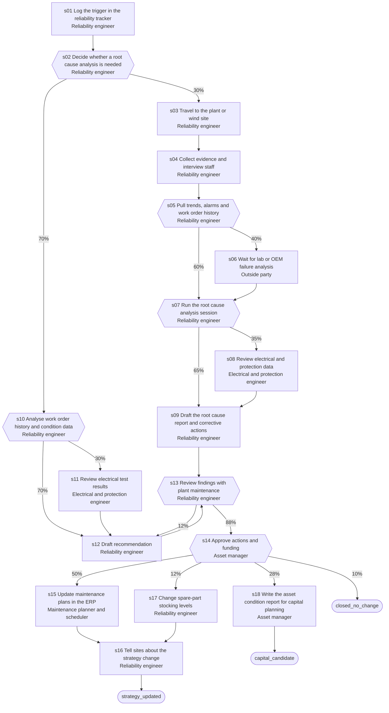

# Analyse equipment condition and failures

`gen-eng-reliability-analysis` · electric power generation · engineering and asset management · part of `power-generation-co`

Reliability engineers turn failures and condition data into changes that prevent the next failure. Each case starts from a forced outage report, an outage as-found report, a bad-actor list or a scheduled review; significant failures get a formal root cause analysis with site evidence, trend data and sometimes a lab report, and the rest get a work-history and condition review. Findings go through a monthly review with plant maintenance and an asset manager's approval, and end as a maintenance strategy change, a spares change or a capital candidate. Cases are slow because lab reports take weeks, reviews wait for the monthly meeting and site visits need travel and permits.

| | |
|---|---|
| Unit of work | one analysis or strategy update |
| Starts when | A forced outage condition report, an outage as-found report, a bad-actor list or a scheduled strategy review reaches a reliability engineer. |
| Done when | A maintenance strategy or spares change is issued, a capital candidate is sent to capital planning, or the case is closed with no change. |
| Organisation | An Alberta merchant generator with about 1,300 staff, three gas steam units converted from coal at the Wabamun-area sites, two cogeneration plants, 17 hydro plants and 12 wind farms, with a central engineering and asset management division of about 130 people. (1,300 employees, 2019-2022) |
| Volume | 30 cases a month (range 15 to 50) |

## Where it sits

- Starts with **asset_condition_report** from gas-respond-forced-outage (35% of cases)
- Starts with **asset_condition_report** from eng-execute-major-outage (15% of cases)
- Starts with **work_order_history** from gas-routine-maintenance (20% of cases)
- Starts with **work_order_history** from hyd-maintain-plants (10% of cases)
- Starts with **work_order_history** from wnd-troubleshoot-turbines (15% of cases)
- Starts with **work_order_history** from wnd-scheduled-service (5% of cases)
- Sends **maintenance_strategy** to gas-routine-maintenance (outcome: strategy_updated)
- Sends **maintenance_strategy** to wnd-scheduled-service (outcome: strategy_updated)
- Sends **maintenance_strategy** to hyd-maintain-plants (outcome: strategy_updated)
- Sends **material_request** to scm-manage-stores (outcome: strategy_updated)
- Sends **asset_condition_report** to eng-capital-planning (outcome: capital_candidate)

## Flow

## Roles

| Role | Department | Layer | FTE on this process | Loaded cost per hour | Evidence |
|---|---|---|---:|---:|---|
| Reliability engineer | Asset management and reliability | senior specialist | 9 | 98 CAD | C |
| Electrical and protection engineer | Asset management and reliability | senior specialist | 1.5 | 100 CAD | C |
| Asset manager | Asset management and reliability | manager | 0.6 | 125 CAD | C |
| Maintenance planner and scheduler | Thermal technical services | individual contributor | 0.8 | 66 CAD | C |

## Steps

Hands-on time and the wait before each step show the most common value. Evidence tier A is a sourced number, B a sourced description, C the author's estimate.

| Step | Who | Kind | Hands-on | Wait before | Control | Evidence |
|---|---|---|---:|---:|---|---|
| **s01 Log the trigger in the reliability tracker.** The reliability engineer for the fleet area logs the trigger (a forced outage condition report, an outage as-found report, a monthly bad-actor list, a condition monitoring alert or a scheduled strategy review) in the reliability tracking spreadsheet with the equipment ID, work order numbers, date and owner. | Reliability engineer | intake | 1.0 h | 2.0 d |  | B [ml_rca] |
| **s02 Decide whether a root cause analysis is needed.** The reliability engineer applies the triggers in the reliability procedure: did the failure cause a unit trip or derate, did critical equipment fail, did a component fail before its expected life, or is it a repeat failure. Significant failures get a formal root cause analysis; the rest get a condition or work-history review. | Reliability engineer | judgment | 1.0 h | 1.0 d |  | B [ml_rca] |
| **s03 Travel to the plant or wind site.** The reliability engineer drives a company truck from the engineering office to the plant, hydro site or wind farm where the failure happened, often two to four hours each way for southern Alberta wind farms and the Bow River plants. | Reliability engineer | travel | 4.0 h | 2.0 d |  | C |
| **s04 Collect evidence and interview staff.** On site the engineer examines and photographs the failed parts, collects samples (oil, debris, fractured pieces), and interviews the operators, mechanics and electricians who were there, under the permit for the isolated equipment. Wind turbine nacelles can only be reached when wind speed is below the climbing limit. | Reliability engineer | physical | 8.0 h | 1.0 d | Permit to work and lockout before inspecting isolated equipment (Alberta OHS Code Part 15) | B [ml_rca], [ohs15] |
| **s05 Pull trends, alarms and work order history.** Back at the office the engineer exports historian trends and DCS or SCADA alarm logs for the hours before the failure, and pulls the work order history for the asset from the ERP, looking for earlier symptoms, recent maintenance and repeat failures. | Reliability engineer | lookup | 8.0 h | 2.0 d |  | B [ml_rca] |
| **s06 Wait for lab or OEM failure analysis.** Failed parts or oil samples go to a metallurgical lab or the OEM, which returns a report on the failure mode (fatigue, creep, corrosion, lubrication loss) after several weeks. | Outside party | external wait | 1.0 h | 25.0 d |  | C |
| **s07 Run the root cause analysis session.** The reliability engineer leads a session with operations, maintenance and the OEM representative, builds a cause-and-effect or five-whys chart from the evidence and agrees the physical, human and organisational causes. | Reliability engineer | analysis | 12.0 h | 7.0 d |  | B [rew2008] |
| **s08 Review electrical and protection data.** The electrical and protection engineer reviews relay event records, generator and transformer test data (dissolved gas, insulation resistance, partial discharge) and protection settings to confirm or rule out electrical causes. | Electrical and protection engineer | analysis | 10.0 h | 5.0 d |  | C |
| **s09 Draft the root cause report and corrective actions.** The reliability engineer writes the report in plain language: equipment, failure dates, history, evidence, root causes and proposed corrective actions with owners and dates, with captioned photos and trend plots. | Reliability engineer | drafting | 14.0 h | 5.0 d |  | B [ml_rca] |
| **s10 Analyse work order history and condition data.** For a review the engineer pulls 12 to 36 months of work orders and condition data for the asset class, ranks bad actors by number of repair and emergency work orders, lost generation and cost, and looks for patterns such as failures after starts, which became more common when converted units began cycling. | Reliability engineer | analysis | 12.0 h | 5.0 d |  | B [rew2008] |
| **s11 Review electrical test results.** The electrical engineer reviews oil analysis, thermography and offline test trends for the transformers, generators, breakers or wind turbine converters in the review and grades each asset's condition. | Electrical and protection engineer | analysis | 6.0 h | 5.0 d |  | C |
| **s12 Draft recommendation.** The reliability engineer writes the recommendation: change a preventive maintenance task or interval, add condition monitoring, change spare-part stock, or propose a capital replacement, with the expected reduction in failures and cost. | Reliability engineer | drafting | 8.0 h | 3.0 d |  | C |
| **s13 Review findings with plant maintenance.** At the monthly reliability meeting the engineer presents the report or recommendation to plant managers, maintenance supervisors, planners and technicians, who challenge the causes and actions and agree owners and dates or send it back for more work. | Reliability engineer | review | 2.0 h | 15.0 d |  | B [ml_rca] |
| **s14 Approve actions and funding.** The asset manager reviews the agreed actions against the maintenance budget and risk, approves strategy and spares changes, sends capital-sized items to capital planning and closes recommendations that are not worth doing. | Asset manager | approval | 1.5 h | 5.0 d | Maintenance budget and asset management decision authority | C |
| **s15 Update maintenance plans in the ERP.** A maintenance planner edits the task lists and maintenance plans in the ERP plant maintenance module: new or changed tasks, intervals, crafts and parts, and reschedules the next due dates for every affected asset at each site. | Maintenance planner and scheduler | data entry | 6.0 h | 7.0 d |  | C |
| **s16 Tell sites about the strategy change.** The reliability engineer sends the revised strategy to the plant, hydro and wind maintenance supervisors with the reasons and the date it takes effect, and updates the maintenance strategy document in the document store. | Reliability engineer | communication | 1.0 h | 1.0 d |  | C |
| **s17 Change spare-part stocking levels.** The reliability engineer raises a material master change asking supply chain to add a critical spare or change minimum and maximum stock, with the failure history and lead time as justification, and follows up until stores confirms it. | Reliability engineer | data entry | 2.0 h | 5.0 d |  | C |
| **s18 Write the asset condition report for capital planning.** The asset manager writes up the asset's condition, failure history, risk and remaining life with a rough replacement cost, and adds it to the list of candidates for the next capital plan. | Asset manager | drafting | 6.0 h | 7.0 d |  | C |

## Exceptions

| Exception | Share of cases | What happens |
|---|---:|---|
| Lab or OEM failure analysis | 12% | Failed parts go to a lab or the OEM and the analysis waits weeks for the report. |
| Sent back at the review meeting | 12% | Plant maintenance does not accept the causes or actions and the engineer revises the recommendation for the next meeting. |
| No change justified | 10% | The asset manager closes the case because the change is not worth its cost. |

## Benchmarks

| Metric | Value | Unit | Population | Evidence |
|---|---|---|---|---|
| cycle_time_days | p50 50, p90 100 | calendar days from trigger to issued change | Reliability cases at an Alberta generator, 2019-2022 | C |
| bad_actor_shortlist | low 10, mode 10, high 15 | assets per review | Generating plant bad-actor programs | B [rew2008] |
| rca_review_meeting_attendance | low 10, mode 15, high 20 | people | Plant RCA review meetings | B [ml_rca] |

## Pain points

- Work orders are often closed without good failure codes or notes, so ranking bad actors from ERP history needs manual cleaning. (steps s05, s10; C)
- Lab and OEM failure analyses take weeks and hold the root cause report. (steps s06; C)
- Findings wait for the monthly review meeting, and rejected recommendations wait a further month. (steps s13; B [ml_rca])
- Strategy changes are re-keyed into ERP maintenance plans site by site, and some are applied to the wrong assets. (steps s15; C)

## Assumptions

- Shares of trigger sources are the author's estimate; the organisation file lists only forced outage reports as a trigger and work order history and outage condition reports as inputs.
- Corrective action effectiveness checks six to twelve months later are part of the ongoing program and are not in the simulated cycle.
- Spare-part stocking changes are sent to scm-manage-stores as a material request; the organisation file has no link for this.
- Loaded costs are taken from the organisation file (wage x 1.40).

## Sources

- [ml_rca] [Root Cause Analysis - A Practical Guide (J. Martinez)](https://www.machinerylubrication.com/Articles/Print/29975) (Machinery Lubrication (Noria), 2019). RCA triggers (failure before a set service life, failure of critical equipment); a tracking database of failures with work order numbers and owners; evidence collection by interviewing operators and inspecting failed parts; plain-language report with root cause, history, solution and owner; review meeting of 10 to 20 managers, engineers, supervisors and technicians; a reliability engineer tracks actions and follow-up.
- [rew2008] [Targeting Bad Actors to Pass the Generation Uptime Test (D. Abecunas)](https://www.renewableenergyworld.com/?p=8079833482) (Renewable Energy World, 2008). Bad-actor program at generating plants: the reliability engineer pulls the 15 assets with the most repair and emergency work orders from the asset management system and narrows them to 10 by production loss, safety and cost; simple failures are analysed by the engineer alone and complex ones by a cross-functional team; the program is kept up with quarterly updates.
- [ohs15] [Occupational Health and Safety Code, Part 15 Managing the Control of Hazardous Energy (Alberta Regulation 191/2021)](https://search-ohs-laws.alberta.ca/legislation/occupational-health-and-safety-code/part-15-managing-the-control-of-hazardous-energy/) (Government of Alberta, 2021). Part 15 requires isolation of machinery and equipment before work (s. 212), verification of isolation (s. 213), personal locks (s. 214) and rules for securing by individual workers and groups. The same Part existed in the earlier Code (AR 87/2009) in force in 2019 to 2021.

Written by claude-opus on 2026-11-24.
