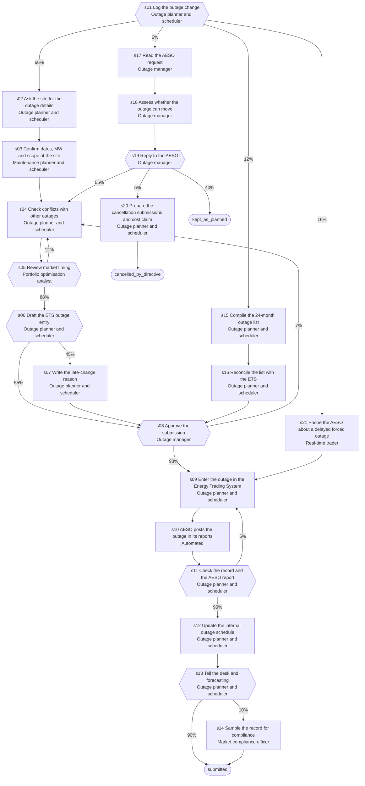

# Submit and update outage schedules with the AESO

`gen-eng-report-outages-aeso` · electric power generation · engineering and outage planning · part of `power-generation-co`

Alberta's system operator needs to know when every generating asset of 5 MW or more will be out of service so it can check there is enough supply. The outage planners collect planned outages and changes from the gas, hydro and wind sites, check them for conflicts and market timing, get them approved and enter them in the AESO Energy Trading System, refreshing the full 24-month list every month and explaining any change made less than 3 months ahead. They also answer AESO requests to move outages when supply is tight. The work is slow because site details, market reviews and approvals queue behind other work, and error-prone because the same outage is kept in several places.

| | |
|---|---|
| Unit of work | one outage submission or change |
| Starts when | A site or the major outage team sends a new or changed planned outage, the month-end 24-month refresh falls due, a repair needs a delayed forced outage, or the AESO asks for outages to be reviewed. |
| Done when | The outage is in the Energy Trading System, checked against the AESO reports and in the internal schedule sent to the desk; or the outage is kept after an AESO request; or a cancellation claim is filed. |
| Organisation | An Alberta merchant generator with about 30 separately offered gas, hydro, wind and battery assets that the AESO requires to report outages. (1,300 employees, 2019-2022) |
| Volume | 30 cases a month (range 15 to 60) |

## Where it sits

- Starts with **outage_plan** from eng-plan-major-outages (45% of cases)
- Starts with **outage_plan** from hyd-maintain-plants (15% of cases)
- Starts with **outage_plan** from wnd-scheduled-service (10% of cases)
- Starts with **outage_plan** from gas-routine-maintenance (24% of cases)
- Starts with **outage_coordination_notice** from aeso (6% of cases)
- Relies on **price_forecast** from mkt-market-analysis (a standing input; it does not start a case)
- Relies on **iso_rules** from aeso (a standing input; it does not start a case)
- Sends **outage_submission** to aeso (outcome: submitted)
- Sends **outage_schedule** to mkt-forecast-generation (outcome: submitted)
- Sends **outage_submission** to aeso (outcome: kept_as_planned)
- Sends **settlement_query** to aeso (outcome: cancelled_by_directive)

## Flow

## Roles

| Role | Department | Layer | FTE on this process | Loaded cost per hour | Evidence |
|---|---|---|---:|---:|---|
| Outage planner and scheduler | Outage planning | individual contributor | 1.3 | 75 CAD | B [src_aeso_306_5] |
| Outage manager | Outage planning | manager | 0.2 | 122 CAD | C |
| Maintenance planner and scheduler | Thermal technical services | individual contributor | 0.3 | 66 CAD | C |
| Portfolio optimisation analyst | Real-time desk | senior specialist | 0.15 | 100 CAD | B [src_ta_2021_ir] |
| Real-time trader | Real-time desk | individual contributor | 0.02 | 90 CAD | A [src_aeso_306_5] |
| Market compliance officer | Regulatory and market compliance | senior specialist | 0.03 | 98 CAD | C |

## Steps

Hands-on time and the wait before each step show the most common value. Evidence tier A is a sourced number, B a sourced description, C the author's estimate.

| Step | Who | Kind | Hands-on | Wait before | Control | Evidence |
|---|---|---|---:|---:|---|---|
| **s01 Log the outage change.** The outage planner receives an outage plan or change from a site, the major outage team or the AESO, logs it in the outage tracking spreadsheet with the asset, dates and MW, and decides which kind of submission it is. | Outage planner and scheduler | intake | 15 min | 4.0 h |  | B [src_aeso_306_5] |
| **s02 Ask the site for the outage details.** The planner emails or phones the site's maintenance planner for the exact start and end times, the MW that will be unavailable (whole unit or derate) and a plain description of the work, which the rule requires in the submission. | Outage planner and scheduler | communication | 20 min | 30 min |  | A [src_aeso_306_5] |
| **s03 Confirm dates, MW and scope at the site.** The site maintenance planner checks the work orders, crew bookings and contractor dates behind the outage and replies with the confirmed window, the MW impact and the work to be done. | Maintenance planner and scheduler | lookup | 30 min | 1.0 d |  | C |
| **s04 Check conflicts with other outages.** The planner places the outage in the outage scheduling software against other units' outages, specialist crew and crane bookings, transmission outages posted by the AESO and the same site's other units, and flags overlaps. | Outage planner and scheduler | analysis | 45 min | 1.0 h |  | C |
| **s05 Review market timing.** The portfolio optimisation analyst checks the forward price curve and the hedge position for the outage window and asks for a move when the outage falls in a high-price period that a nearby low-price window could avoid. | Portfolio optimisation analyst | judgment | 30 min | 8.0 h |  | B [src_ta_2021_ir] |
| **s06 Draft the ETS outage entry.** The planner prepares the entry: asset, Derate-Planned or Outage-Planned, start and end times, available MW during the outage and a short nature-of-work note, and checks whether the outage now starts within 3 months. | Outage planner and scheduler | drafting | 25 min | 30 min |  | A [src_aeso_306_5] |
| **s07 Write the late-change reason.** Because the change is submitted less than 3 months before the outage starts, the planner writes a statement of why the outage differs from the original submission or was not in the monthly list, such as a new defect or a contractor change. | Outage planner and scheduler | drafting | 20 min | 0 min | AESO ISO rule 306.5 s.3(4) (reasons for changes later than 3 months before the outage) | A [src_aeso_306_5] |
| **s08 Approve the submission.** The outage manager reviews the draft entry, the conflict check and the market timing view, and approves it or sends it back with questions. | Outage manager | approval | 10 min | 8.0 h | Internal review of regulatory submissions before filing | C |
| **s09 Enter the outage in the Energy Trading System.** The planner logs into the AESO Energy Trading System under the pool participant's account and enters or edits the outage record with its designation, times, MW and nature of work. | Outage planner and scheduler | data entry | 20 min | 1.0 h | AESO ISO rule 306.5 s.2(3) and s.3 (planned outage information through the ETS) | A [src_aeso_306_5], [src_aeso_2013_003r] |
| **s10 AESO posts the outage in its reports.** The Energy Trading System stores the record and the AESO's daily, monthly and 7-day available capability reports pick it up at their next update, usually within 5 to 10 minutes. | Automated | system auto | 0 min | 10 min |  | A [src_aeso_2013_003r] |
| **s11 Check the record and the AESO report.** The planner reopens the record on the ETS outage scheduling tab, compares it with the approved entry and checks the change shows in the AESO monthly or 7-day report. | Outage planner and scheduler | validation | 10 min | 30 min |  | B [src_aeso_2013_003r] |
| **s12 Update the internal outage schedule.** The planner updates the outage in the company outage scheduling software and the tracking spreadsheet, retyping the dates and MW so the internal schedule matches what the AESO now holds. | Outage planner and scheduler | data entry | 15 min | 30 min |  | C |
| **s13 Tell the desk and forecasting.** The planner emails the updated schedule to the real-time desk, the forecasting analysts and the site so offers, generation forecasts and hedges reflect the outage. | Outage planner and scheduler | communication | 10 min | 10 min |  | C |
| **s14 Sample the record for compliance.** The market compliance officer takes a sample of outage submissions, checks they were filed on time, with reasons where late, and match the plant logs, and files the evidence for a possible Market Surveillance Administrator review. | Market compliance officer | review | 40 min | 7.0 d | Company market compliance program over ISO rules enforced by the Market Surveillance Administrator | C |
| **s15 Compile the 24-month outage list.** Before the first day of the month the planner collects planned outages for the next 24 months from every gas, hydro, wind and battery asset of 5 MW or more, from the major outage plans and site maintenance plans. | Outage planner and scheduler | analysis | 4.0 h | 5.0 d | AESO ISO rule 306.5 s.3(2) (planned outages for the next 24 months by the 1st of each month) | A [src_aeso_306_5] |
| **s16 Reconcile the list with the ETS.** The planner compares the 24-month list line by line with the outage records already in the ETS and marks records to add, change or cancel. | Outage planner and scheduler | validation | 2.0 h | 1.0 h |  | C |
| **s17 Read the AESO request.** The outage manager reads the AESO notice or call: the AESO has posted a supply adequacy or reliability concern for a period and asks participants to review outages planned in it. | Outage manager | intake | 20 min | 2.0 h |  | A [src_aeso_306_5] |
| **s18 Assess whether the outage can move.** The outage manager and planner check what moving the outage would do to contractors, specialist crews, parts deliveries, manufacturer service agreements, the hedge position and equipment risk, and choose dates that could work. | Outage manager | analysis | 3.0 h | 4.0 h |  | C |
| **s19 Reply to the AESO.** The outage manager phones or emails the AESO with what the company can do: move the outage, shorten it or keep it, and why. | Outage manager | communication | 30 min | 1.0 h |  | A [src_aeso_306_5] |
| **s20 Prepare the cancellation submissions and cost claim.** After a cancellation directive the planner writes a detailed description of the cancelled work with the equipment involved and an estimate of incremental costs, then assembles the claim with invoices and calculations within 40 days of the settlement period. | Outage planner and scheduler | drafting | 8.0 h | 5.0 d | AESO ISO rule 306.5 s.8 and s.11 (cancellation submissions and incremental cost claims) | A [src_aeso_306_5] |
| **s21 Phone the AESO about a delayed forced outage.** When equipment must come out of service within the next day for a repair that cannot wait for a planned outage, the real-time trader calls the AESO's recorded line, then the planner follows with the ETS entry designated Derate-Forced or Outage-Forced. | Real-time trader | communication | 10 min | 30 min | AESO ISO rule 306.5 s.4 (delayed forced outage notification) | A [src_aeso_306_5], [src_aeso_2013_003r] |

## Exceptions

| Exception | Share of cases | What happens |
|---|---:|---|
| Late change | 30% | A change submitted less than 3 months before the outage needs a written reason in the submission. |
| Market timing move | 8% | The optimisation analyst asks to move an outage out of a high-price window and the planner re-checks conflicts. |
| AESO asks to review an outage | 6% | The AESO posts a supply adequacy concern and asks participants to review outages; the company moves, shortens or keeps its outage. |
| Cancellation directive | 0% | The AESO cancels the outage by directive; the company files the work description and an incremental cost claim. |
| Keying error | 5% | The ETS record does not match the approved entry and is corrected. |

## Benchmarks

| Metric | Value | Unit | Population | Evidence |
|---|---|---|---|---|
| cycle_time_days | p50 3, p90 9 | calendar days from request received to submission verified | Planned outage submissions and changes at an Alberta generator | C |
| planned_outage_horizon | 24 | months ahead covered by the monthly submission | Alberta generating source assets of 5 MW or more | A [src_aeso_306_5] |
| late_change_threshold | 3 | months before outage start after which a reason is required | Same | A [src_aeso_306_5] |

## Pain points

- The same outage is held in the site schedule, the outage scheduling software, a tracking spreadsheet and the ETS, and is re-keyed between them. (steps s09, s12, s16; C)
- Site replies and approvals queue behind other work, so changes often land inside the 3-month window and need a written reason. (steps s03, s07, s08; A [src_aeso_306_5])
- Moving an outage at the AESO's request ripples through contractor, crew and manufacturer bookings that were fixed months earlier. (steps s18, s19; C)

## Assumptions

- Hydro, wind and battery assets of 5 MW or more report outages under the same rule (wind since 2015), so planners also take requests from those sites; the thermal maintenance planner role stands in for all site planners.
- The ETS entry is made by the outage planner using the pool participant's ETS account; in some companies the real-time desk enters it instead.
- The mix of submission types (66 percent planned changes, 12 percent monthly refresh, 16 percent delayed forced, 6 percent AESO requests) is a tier C estimate.
- The 2026 AESO information document is cited only where it repeats rule text in force in 2019-2022 (submission through the ETS, telephone notice) and for how the AESO reports are updated.
- Loaded costs are taken from the organisation file (wage times 1.40).
- The simulated median (about 4 days) is above the 3-day benchmark mainly because the monthly refresh path waits for month-end and the AESO-request path waits on the AESO; for ordinary planned changes the simulated time is close to the benchmark.

## Sources

- [src_aeso_306_5] [ISO Rules Part 300, Section 306.5 Generation Outage Reporting and Coordination (effective 2023-01-01)](https://www.aeso.ca/assets/documents/306.5-Generation-Outage-Reporting-and-Coordination-2023-01-01.pdf) (Alberta Electric System Operator, 2022). Applies to pool participants with generating source assets of 5 MW or more (wind included since 2015); outage changes of 5 MW or more must be reported; submissions through the Energy Trading System; planned outages designated Derate-Planned or Outage-Planned with dates, times, MW impact and nature of work; by the first day of every month, all planned outages in the next 24 months; revisions as soon as reasonably practicable; a written reason when a change is submitted later than 3 months before the outage starts; delayed forced outages reported as soon as reasonably practicable and by recorded telephone line when less than 24 hours' notice; automatic forced outages reported by recorded telephone line and designated Derate-Forced or Outage-Forced; ISO outage cancellation directives only after posting an adequacy concern for at least 1 calendar week, contacting participants, CEO authorisation and no more than 90 days ahead; a cancelled participant submits a work description and incremental cost estimate and files a claim within 40 days. Revision history shows the 2020-09-16 version had the same requirements apart from one wording change in 2023.
- [src_aeso_2013_003r] [Information Document ID 2013-003R Outages (posted 2026-05-14)](https://www.aeso.ca/assets/Information-Documents/2013-003R-Outages-2026-05-14.pdf) (Alberta Electric System Operator, 2026). Generation planned outages are submitted through the Energy Trading System and forced outages by telephone to a recorded AESO line; long lead time assets should submit a non-zero available capability from the first interval they can produce; AESO publishes Daily Outage, Monthly Outage (24 months) and 7 Day Hourly Available Capability reports from ETS submissions, updated every 5 to 10 minutes and at most 20 minutes; participants check a missing outage on the ETS Outage Scheduling tab. A later version than the 2019-2022 period; used only where it repeats rule text that was already in force.
- [src_ta_2021_ir] [TransAlta Corporation 2021 Integrated Report (Form 6-K)](https://www.sec.gov/Archives/edgar/data/1144800/000114480022000006/tac2021integratedreportf.htm) (TransAlta Corporation via U.S. SEC EDGAR, 2022). Adjusted availability 90.0 (2019), 90.7 (2020) and 86.6 percent (2021); Sundance 6, Keephills 2 and Keephills 3 converted to gas in Q1, Q2 and Q4 2021; planned conversion outages lowered 2021 availability; Alberta Gas production 8,691, 7,732 and 7,281 GWh in 2019-2021; power dispatched by AESO merit order; the company manages its offers internally and optimised production toward high-price periods in 2021. Only the first 100,000 characters of the filing were read.

Written by claude-opus on 2026-11-24.
