# Convert a coal-fired boiler unit to natural gas

`gen-etr-convert-coal-units` · electric power generation · energy transition projects · part of `power-generation-co`

This process converts one coal-fired steam unit of about 400 MW to burn natural gas so it can keep running past the coal phase-out with roughly half the carbon intensity. A conversion project manager frames the scope, engineers fix a design basis, the regulatory group obtains amended AUC and environmental approvals, supply chain buys burners and controls, and the unit is converted during a planned outage that is combined with its major maintenance, then commissioned and tested. Most of the elapsed time is waiting: about a year for approvals, months of equipment lead time, and the wait for the unit's turn in the spring or fall outage calendar because units are converted one at a time.

| | |
|---|---|
| Unit of work | one unit conversion project |
| Starts when | The strategic plan names a coal unit for conversion to gas. |
| Done when | The unit runs commercially on gas, its capability and emissions are tested, it is handed to operations and the project is closed; or the conversion is deferred at the investment decision. |
| Organisation | An Alberta merchant generator converting three wholly owned coal units at two Wabamun-area plants to gas in 2020-2021, with a small energy transition project team, plant engineers and contracted boiler and controls vendors. (1,300 employees, 2019-2022) |
| Volume | 0.07 cases a month (range 0.05 to 0.1) |

## Where it sits

- Starts with **strategic_plan** from exec-strategy-planning (100% of cases)
- Relies on **regulatory_approval** from hse-regulatory-filings (a standing input; it does not start a case)
- Sends **filing_request** to hse-regulatory-filings (outcome: any)
- Sends **material_request** to scm-purchase-materials (outcome: any)
- Sends **service_order** to gas_pipeline (outcome: any)
- Sends **capital_plan** to eng-plan-major-outages (outcome: converted)
- Sends **test_request** to eng-performance-testing (outcome: converted)
- Sends **engineering_change** to gas-operate-units (outcome: converted)

## Flow

```mermaid
flowchart TD
    s01["s01 Frame conversion scope and business case<br/>Conversion and decommissioning project manager"]
    s02["s02 Wait for the feasibility study<br/>Outside party"]
    s03{{"s03 Review the study and fix the design basis<br/>Plant engineer"}}
    s04["s04 Prepare technical content for the regulatory amendments<br/>Conversion and decommissioning project manager"]
    s05["s05 File the amendment applications<br/>Regulatory affairs advisor"]
    s06{{"s06 Regulators review the applications<br/>Outside party"}}
    s07["s07 Answer information requests<br/>Conversion and decommissioning project manager"]
    s08["s08 Wait for final approvals<br/>Outside party"]
    s09{{"s09 Approve the investment and issue notice to proceed<br/>Director, energy transition"}}
    s10["s10 Tender and award burner, controls and construction contracts<br/>Supply contract specialist"]
    s11["s11 Wait for burner and controls supply<br/>Outside party"]
    s12["s12 Arrange firm gas service and the lateral tie-in<br/>Conversion and decommissioning project manager"]
    s13["s13 Wait for the pipeline lateral and meter station<br/>Outside party"]
    s14["s14 Review vendor design and run the hazard review<br/>Plant engineer"]
    s15["s15 Register the fuel gas piping design with ABSA<br/>Outside party"]
    s16["s16 Fit the conversion into the outage plan<br/>Outage manager"]
    s17["s17 Supervise pre-outage construction<br/>Project manager"]
    s18["s18 Shut the unit down and isolate the coal systems<br/>Shift supervisor  first-class power engineer"]
    s19["s19 Install gas burners, igniters, scanners and fuel trains<br/>Project manager"]
    s20["s20 Carry out the scheduled major maintenance in the same outage<br/>Specialist crew lead"]
    s21["s21 Install and loop-check the burner management and DCS changes<br/>Instrument and electrical technician"]
    s22["s22 ABSA inspection and pressure test sign-off<br/>Outside party"]
    s23["s23 Pre-start safety review and operator training<br/>Shift supervisor  first-class power engineer"]
    s24{{"s24 First fire on gas and tune the burners<br/>Plant engineer"}}
    s25["s25 Fix commissioning defects<br/>Project manager"]
    s26["s26 Run capability, emissions and federal performance tests<br/>Plant engineer"]
    s27["s27 Declare the unit available on gas and hand over<br/>Conversion and decommissioning project manager"]
    s28["s28 Close out the project<br/>Conversion and decommissioning project manager"]
    s01 --> s02
    s02 --> s03
    s03 -->|"90%"| s04
    s03 -->|"10%"| s02
    s04 --> s05
    s05 --> s06
    s06 -->|"60%"| s07
    s06 -->|"40%"| s08
    s07 --> s08
    s08 --> s09
    s09 -->|"92%"| s10
    s09 -->|"8%"| end0
    s10 --> s11
    s11 --> s12
    s12 --> s13
    s13 --> s14
    s14 --> s15
    s15 --> s16
    s16 --> s17
    s17 --> s18
    s18 --> s19
    s19 --> s20
    s20 --> s21
    s21 --> s22
    s22 --> s23
    s23 --> s24
    s24 -->|"70%"| s26
    s24 -->|"30%"| s25
    s25 --> s24
    s26 --> s27
    s27 --> s28
    s28 --> end1
    end0(["not_converted"])
    end1(["converted"])
```

## Roles

| Role | Department | Layer | FTE on this process | Loaded cost per hour | Evidence |
|---|---|---|---:|---:|---|
| Conversion and decommissioning project manager | Conversion and decommissioning projects | senior specialist | 1 | 110 CAD | C |
| Project manager | Capital projects | senior specialist | 0.5 | 105 CAD | C |
| Plant engineer | Thermal technical services | senior specialist | 0.6 | 92 CAD | C |
| Director, energy transition | Energy transition | director | 0.08 | 175 CAD | C |
| Regulatory affairs advisor | Regulatory and market compliance | senior specialist | 0.05 | 98 CAD | B [src4], [src5] |
| Supply contract specialist | Procurement | senior specialist | 0.12 | 76 CAD | C |
| Outage manager | Outage planning | manager | 0.1 | 122 CAD | B [src2], [src6] |
| Shift supervisor (first-class power engineer) | Wabamun-area converted units | supervisor | 0.06 | 92 CAD | C |
| Specialist crew lead | Specialist maintenance crews | supervisor | 0.2 | 85 CAD | B [src2] |
| Instrument and electrical technician | Wabamun-area converted units | individual contributor | 0.25 | 68 CAD | B [src5] |

## Steps

Hands-on time and the wait before each step show the most common value. Evidence tier A is a sourced number, B a sourced description, C the author's estimate.

| Step | Who | Kind | Hands-on | Wait before | Control | Evidence |
|---|---|---|---:|---:|---|---|
| **s01 Frame conversion scope and business case.** The conversion project manager takes the unit named in the strategic plan, gathers its boiler data, fan curves and remaining-life studies from the document store, and builds a spreadsheet case comparing gas cost, carbon cost and added unit life against the conversion capital. The output is a scope note and a request for a feasibility study. | Conversion and decommissioning project manager | analysis | 8.3 d | 21.0 d |  | B [src1], [src5] |
| **s02 Wait for the feasibility study.** An engineering consultant or the boiler manufacturer models gas firing in the existing furnace: burner count and size, heat absorption, steam temperatures, fan duty and flue gas temperature. The project waits for the study report. | Outside party | external wait | 0 min | 75.0 d |  | C |
| **s03 Review the study and fix the design basis.** The plant engineer checks the study against operating data from the historian, questions assumptions on steam temperatures and tube metal limits, and writes the design basis: number of burners, gas flow, minimum stable load and which coal equipment is left in place. If the study is unconvincing it goes back to the consultant. | Plant engineer | review | 6.7 d | 7.0 d |  | B [src5] |
| **s04 Prepare technical content for the regulatory amendments.** The project manager writes the technical sections for an amendment of the power plant approval at the Alberta Utilities Commission and of the environmental approval held under EPEA: fuel change, expected NOx and CO2 rates, noise and any new gas facilities. It is sent as a filing request to the regulatory group. | Conversion and decommissioning project manager | drafting | 6.2 d | 14.0 d |  | B [src4] |
| **s05 File the amendment applications.** The regulatory affairs advisor assembles the applications, checks them against the commission's power plant rules and the environmental approval conditions, files them through AUC eFiling and the Alberta Environment submission portal, and handles public notice. | Regulatory affairs advisor | communication | 3.3 d | 14.0 d | AUC approval of power plant amendments (Hydro and Electric Energy Act) and EPEA approval amendment | B [src4], [src5] |
| **s06 Regulators review the applications.** The AUC and Alberta Environment and Parks review the applications, post notice and decide whether to ask questions. The project waits; about six in ten conversions draw information requests. | Outside party | external wait | 0 min | 150.0 d |  | A [src4], [src5] |
| **s07 Answer information requests.** The project manager drafts answers to the regulators' questions with input from the plant engineer, for example on NOx emission rates during start-up or on the gas lateral, and the regulatory advisor files them. | Conversion and decommissioning project manager | drafting | 2.1 d | 3.0 d | AUC and AEP information request process | C |
| **s08 Wait for final approvals.** The project waits for the AUC approval and the amended EPEA approval to be issued, with conditions on emission limits and monitoring that the design must meet. | Outside party | external wait | 0 min | 100.0 d |  | A [src4], [src5] |
| **s09 Approve the investment and issue notice to proceed.** The director of energy transition presents the cost estimate, schedule and regulatory conditions to the executive team and, above the delegated limit, to the board, then issues the notice to proceed. Some units are deferred or dropped at this point. | Director, energy transition | approval | 1.2 d | 30.0 d | Delegation of authority: capital above the executive limit needs board approval | B [src5] |
| **s10 Tender and award burner, controls and construction contracts.** The supply contract specialist issues requests for proposals for gas burners and igniters, burner management and DCS changes, and construction labour, runs the bid evaluation with the project team and awards the contracts in the ERP. | Supply contract specialist | coordination | 8.3 d | 21.0 d | Competitive bidding and award approval under the procurement policy | B [src5] |
| **s11 Wait for burner and controls supply.** The burner maker designs, builds and ships the burners, igniters, flame scanners, valve trains and piping, and the controls supplier configures the new burner management logic. The project waits for delivery while engineering work proceeds. | Outside party | external wait | 0 min | 200.0 d |  | C |
| **s12 Arrange firm gas service and the lateral tie-in.** The project manager agrees gas delivery capacity, pressure and the plant tie-in point with the pipeline operator, signs the service order and coordinates the meter station design with the gas buyer in marketing. | Conversion and decommissioning project manager | coordination | 5.0 d | 2.0 d |  | B [src4], [src5] |
| **s13 Wait for the pipeline lateral and meter station.** The pipeline operator builds or extends the lateral and meter station to the plant fence. Most of this runs during the burner lead time; the wait here is only the part that runs past it. | Outside party | external wait | 0 min | 20.0 d |  | B [src5] |
| **s14 Review vendor design and run the hazard review.** The plant engineer reviews vendor drawings, logic diagrams and the gas piping design, leads a hazard and operability review with operations and the vendors, and raises the engineering change that updates drawings, procedures and alarm settings. | Plant engineer | review | 16.7 d | 7.0 d | Company management-of-change and process hazard analysis standard for new fuel systems | C |
| **s15 Register the fuel gas piping design with ABSA.** The plant engineer's package for the new gas piping and pressure parts is submitted to ABSA, the provincial pressure equipment authority, for design registration. The project waits for the registration number before fabrication of affected parts. | Outside party | external wait | 0 min | 30.0 d | Alberta Pressure Equipment Safety Regulation: design registration before construction | C |
| **s16 Fit the conversion into the outage plan.** The outage manager adds the conversion work packages to the unit's planned outage in the scheduling software, aligns them with the major maintenance scope and the crane plan, and confirms the outage window with the market and AESO outage reporting groups. | Outage manager | coordination | 5.0 d | 10.0 d |  | B [src2], [src6] |
| **s17 Supervise pre-outage construction.** While the unit still runs on coal, the capital project manager supervises contractors installing gas piping from the meter station to the boiler house, cable trays and new control cabinets, checking progress, safety and quality daily. | Project manager | coordination | 16.7 d | 30.0 d | Prime contractor and permit-to-work requirements under the Alberta OHS Act and Code | C |
| **s18 Shut the unit down and isolate the coal systems.** At the start of the planned outage window the shift supervisor brings the unit off line, isolates and locks out the coal mills, feeders and conveyors (left in place), and issues the permits that let contractors enter the boiler. | Shift supervisor (first-class power engineer) | physical | 2.0 d | 120.0 d | Permit-to-work and lockout (Alberta OHS Code Part 15) | B [src2], [src5] |
| **s19 Install gas burners, igniters, scanners and fuel trains.** The project manager directs the boiler contractor removing coal burners and fitting gas burners, igniters, flame scanners, valve trains and windbox changes, tracks the critical path daily and resolves interferences found when the boiler is opened. The unit stays off line throughout. | Project manager | physical | 25.0 d | 1.0 d | Confined space entry and hot work permits (Alberta OHS Code) | B [src5], [src2] |
| **s20 Carry out the scheduled major maintenance in the same outage.** The specialist crew lead runs the turbine, valve and generator inspections booked for the same outage, using the turbine hall crane, so that the unit returns with both the new fuel system and its overhaul done. | Specialist crew lead | physical | 18.8 d | 0 min | Permit-to-work and lockout (Alberta OHS Code Part 15) | B [src2], [src3] |
| **s21 Install and loop-check the burner management and DCS changes.** Instrument and electrical technicians wire the new flame scanners, valves and transmitters, load the new burner management logic with the controls vendor, and check every loop from field device to control room screen. | Instrument and electrical technician | physical | 14.6 d | 1.0 d | Burner management practice under NFPA 85 as adopted in company standards | B [src5] |
| **s22 ABSA inspection and pressure test sign-off.** An ABSA-authorised inspector witnesses the pressure test of the new gas piping and reviews the inspection records before the system may be put into service. The project waits for the inspector's visit and sign-off. | Outside party | external wait | 0 min | 3.0 d | Alberta Safety Codes Act and Pressure Equipment Safety Regulation inspection before operation | C |
| **s23 Pre-start safety review and operator training.** The shift supervisor walks down the new system against the HAZOP actions and checklists, confirms isolations are removed, and trains each operating crew on the new start-up sequence and trips before first fire. | Shift supervisor (first-class power engineer) | review | 3.3 d | 2.0 d | Pre-startup safety review in the company process safety standard | C |
| **s24 First fire on gas and tune the burners.** The plant engineer leads first fire with the burner vendor, raises load in steps, and tunes air and fuel ratios against flame scanner signals, steam temperatures and CEMS NOx readings. About three in ten units hit a problem that needs fixing before tuning can finish. | Plant engineer | physical | 7.5 d | 2.0 d |  | C |
| **s25 Fix commissioning defects.** The project manager gets the vendor or contractor to correct the defect found at first fire, such as a scanner position, a valve trip setting or a leaking flange, and arranges the re-test. | Project manager | coordination | 2.5 d | 4.0 d |  | C |
| **s26 Run capability, emissions and federal performance tests.** The plant engineer runs the capacity test needed to declare the unit's gas capability to the market operator, checks the CEMS against reference tests, and plans the federal initial performance test that an independent verifier must witness within twelve months. | Plant engineer | analysis | 2.5 d | 5.0 d | SOR/2018-261 ss. 5 and 22: initial performance test within 12 months with independent verifier | A [src7] |
| **s27 Declare the unit available on gas and hand over.** The project manager hands the unit to plant operations with the updated drawings, procedures and engineering change closed, and confirms the new capability and emission rates for the market and emissions teams. | Conversion and decommissioning project manager | communication | 1.3 d | 2.0 d |  | B [src1] |
| **s28 Close out the project.** The project manager reconciles final costs against budget in the ERP, settles contractor claims, archives as-built drawings and records lessons for the next unit's conversion, then closes the project. | Conversion and decommissioning project manager | drafting | 5.0 d | 45.0 d |  | C |

## Exceptions

| Exception | Share of cases | What happens |
|---|---:|---|
| Information requests from regulators | 60% | The AUC or AEP asks questions on emissions, noise or gas facilities, adding a response round before approval. |
| Commissioning defect | 30% | First fire reveals a scanner, trip-setting or valve problem that the vendor must fix before tuning can finish, holding the unit off line longer. |
| Study revision | 10% | The plant engineer rejects the feasibility study's assumptions and it goes back to the consultant. |
| Deferred at investment decision | 8% | The executive team or board defers the unit, as happened with units that stayed under evaluation. |

## Benchmarks

| Metric | Value | Unit | Population | Evidence |
|---|---|---|---|---|
| cycle_time_days | p50 1150, p90 1300 | calendar days from the strategic decision to handover on gas | Three Alberta 395-463 MW coal-to-gas boiler conversions, 2018-2021 | B [src4], [src5], [src2], [src1] |
| conversion_outage_duration | low 45, mode 60, high 90 | calendar days | Simple boiler conversions to gas firing | B [src5] |
| capital_cost_per_unit | conversion_only {'low': 31.5, 'high': 35}, with_upgrades_and_maintenance {'low': 85, 'high': 96} | million CAD | Sundance 6 and Keephills 2 | A [src2], [src3] |
| carbon_intensity_after_conversion | before 1.05, after 0.52 | t CO2e/MWh | Sundance 6 (Keephills 2: 1.04 to 0.51; Keephills 3: 0.86 to 0.43) | A [src1] |

## Pain points

- Approvals from two regulators take about a year and set the earliest date for the investment decision. (steps s06, s08; A [src4], [src5])
- Units must wait for a planned outage window and are converted one at a time to keep capacity in the market and spread crews, so later units wait more than a year after their equipment arrives. (steps s18; B [src2])
- Seven to eight hundred extra workers on site at peak make the outage a contractor safety and coordination load for a small project team. (steps s17, s19, s20; A [src2], [src3])
- COVID-19 restrictions in 2020-2021 put outage staffing and schedules at risk. (steps s19; B [src2])

## Assumptions

- One case is one unit conversion project from the strategic decision to close-out. The organisation file counts 'project-months' (1 to 5 a month); this file counts projects (three in 2019-2022), so its volume is about 0.07 a month.
- Touch time on long project steps is the role's total hands-on hours over that phase. Because the simulator adds touch time to elapsed time as round-the-clock minutes, wait times on long phases (vendor lead time, outage calendar) were reduced so that wait plus touch roughly matches the dates in the sources. Concurrent outage steps (s19 to s21) are summed by the simulator, which approximates a 60 to 90 day outage.
- The converted_gas_unit resource is listed without a running cost because the unit burns no fuel while it is off line for conversion; the economic cost of the outage is lost market margin, which is not modelled here.
- Contractor craft labour (700 to 800 workers at peak) and vendor engineers are outside parties and appear only as waits or as the work the project manager and crew lead supervise.
- The regulatory filing itself is documented in hse-regulatory-filings; this file includes only the project's share (technical content, filing and answers) and the waits on the regulators. The regulatory approval is listed as an input, not a trigger, because it arrives in the middle of a case.
- ABSA design registration and inspection, NFPA 85 burner management practice and the OHS Code permit rules are named from general knowledge; those sources were not opened, so those steps are tier C or B on other grounds.
- The simulated median (about 1,230 days) is about 7 percent above the 1,150-day benchmark built from three conversions, inside the spread between Sundance 6 and Keephills 2; the dates of Keephills 3's applications were not found. Staffing stated (3.0 FTE across roles) is above the 2.2 FTE implied by touch time because project staff also carry coordination time not written as steps.

## Sources

- [src1] [TransAlta Corporation Annual Information Form for the year ended December 31, 2021 (Exhibit 13.1 to Form 40-F)](https://www.sec.gov/Archives/edgar/data/1144800/000114480022000004/a20211231tacex131aif.htm) (TransAlta Corporation via U.S. SEC EDGAR, 2022). Sundance 6 conversion announced complete 1 Feb 2021, Keephills 2 on 19 Jul 2021, all three (KH2 395 MW, KH3 463 MW, Sun6 401 MW) by 29 Dec 2021; intensity falls from about 1.04-1.05 to 0.51-0.52 t CO2e/MWh (KH3 0.86 to 0.43); 8 to 10 years of added life; Sheerness 2 converted 4 Apr 2020 and Sheerness 1 on 31 Mar 2021 (partner-operated); federal standard of 0.420 t CO2e/MWh for gas units above 150 MW.
- [src2] [TransAlta Completes First Off-Coal Conversion and Achieves Major Milestone in Phase Out of Coal](https://www.newswire.ca/news-releases/transalta-completes-first-off-coal-conversion-and-achieves-major-milestone-in-phase-out-of-coal-867148397.html) (TransAlta Corporation via Cision Newswire, 2021). Sundance 6: 35 million CAD boiler conversion plus 50 million CAD DCS upgrade and scheduled major maintenance (85 million total); nearly 700 extra jobs at peak; Keephills 2 expected mid-June 2021 and Keephills 3 mid-December 2021; COVID-19 named as a schedule risk.
- [src3] [TransAlta Completes Second Off-Coal Conversion - Another Major Milestone in its Phase Out of Coal](https://www.newswire.ca/news-releases/transalta-completes-second-off-coal-conversion-another-major-milestone-in-its-phase-out-of-coal-820703561.html) (TransAlta Corporation via Cision Newswire, 2021). Keephills 2: 31.5 million CAD conversion plus 64.7 million CAD system upgrades, gas infrastructure and maintenance (over 96 million total); nearly 800 extra jobs at peak; nameplate unchanged at 395 MW.
- [src4] [TransAlta Completes Second Coal-to-Gas Conversion](https://www.powermag.com/transalta-completes-second-coal-to-gas-conversion/) (POWER Magazine, 2021). Amendment applications filed with the AUC and Alberta Environment and Parks in summer 2018; AEP final approvals July 2019; Pioneer Pipeline built with Tidewater supplies gas to both plants and was later sold to ATCO for 255 million CAD.
- [src5] [Gas breathes new life into aging coal plants](https://gasturbineworld.com/?p=1590) (Gas Turbine World, 2020). AUC approved basic conversions of Sundance 3-6 and Keephills 1-2 in December 2018 and Keephills 3 in February 2019; Final Notice to Proceed for Sundance 6 in July 2019 with the outage in the second half of 2020; a simple boiler conversion is a turnaround of 'just a couple of months'; scope is new gas burners, igniters, scanners, piping and valves with modified fans, boiler and controls; coal handling decommissioned in place; Emerson reconfiguring the burner management system; no heat-rate improvement; Pioneer pipeline delivering gas from May 2019.
- [src6] [Capital Power accelerates plans for natural gas capability at the Genesee facility](https://www.capitalpower.com/media/media_releases/capital-power-accelerates-plans-for-natural-gas-capability-at-the-genesee-facility/) (Capital Power Corporation, 2019). A peer Alberta generator converts Genesee 1 and 2 to dual fuel during regularly scheduled maintenance outages for about 50 million CAD over 2019-2021, subject to regulatory approvals, with on-site gas pipeline infrastructure and boiler modifications.
- [src7] [Regulations Limiting Carbon Dioxide Emissions from Natural Gas-fired Generation of Electricity (SOR/2018-261)](https://laws-lois.justice.gc.ca/eng/regulations/SOR-2018-261/FullText.html) (Government of Canada, Justice Laws Website, 2018). Applies to boiler units converted from coal from 1 January of the year after coal firing stops (s. 3(4)); initial performance test within 12 months (s. 5) of at least two hours; performance test report within 60 days with an independent verifier's report for the initial test (s. 22); limit of 420 t CO2/GWh deferred according to the initial test result (s. 4(2)).

Written by claude-opus on 2026-11-24.
