# Close the books each month

`gen-fin-close-month` · electric power generation · finance · part of `power-generation-co`

At the end of every month the controllership team turns the month's activity into a trial balance and results that management can rely on. Accountants settle maintenance and project costs, accrue costs not yet invoiced, book pool revenue from the company's own meter data before the system operator's statements arrive, value hedges at month-end prices with the risk group, reconcile every balance sheet account and explain variances. The work is slow because many pieces wait on outside statements, estimates must later be trued up, and each review can send entries back for correction before the controller locks the period.

| | |
|---|---|
| Unit of work | one monthly close |
| Starts when | The calendar month ends. |
| Done when | The period is locked and the trial balance and monthly results are released to reporting, planning and tax. |
| Organisation | An Alberta merchant power generator listed on the TSX and NYSE, with an ERP general ledger, a trading and risk system for hedges and a controllership group of about 40 including AP. (1,300 employees, 2019-2022) |
| Volume | 1 cases a month (range 1 to 1) |

## Where it sits

- Starts with **journal_entries** from mkt-settle-aeso (20% of cases)
- Starts with **journal_entries** from mkt-settle-trades (15% of cases)
- Starts with **journal_entries** from mkt-bill-customers (10% of cases)
- Starts with **journal_entries** from fin-pay-suppliers (20% of cases)
- Starts with **journal_entries** from fin-commodity-risk (10% of cases)
- Starts with **journal_entries** from fin-treasury (10% of cases)
- Starts with **journal_entries** from hr-run-payroll (15% of cases)
- Relies on **emissions_data** from hse-report-emissions-tier (a standing input; it does not start a case)
- Relies on **gas_nomination** from mkt-procure-gas (a standing input; it does not start a case)
- Relies on **approved_budget** from fin-budget-forecast (a standing input; it does not start a case)
- Sends **trial_balance** to fin-quarterly-reporting (outcome: closed)
- Sends **trial_balance** to fin-budget-forecast (outcome: closed)
- Sends **trial_balance** to fin-tax (outcome: closed)

## Flow

```mermaid
flowchart TD
    s01["s01 Confirm sub-ledger cut-offs<br/>Accountant"]
    s02["s02 Settle work orders to cost centres and projects<br/>Automated"]
    s03["s03 Review work order settlement and capital allocations<br/>Accountant"]
    s04["s04 Accrue goods and services received but not invoiced<br/>Accountant"]
    s05["s05 Accrue pool revenue from metered generation<br/>Settlement analyst"]
    s06["s06 Book true-up from the AESO final statement<br/>Settlement analyst"]
    s07["s07 Reconcile and accrue trade settlements<br/>Settlement analyst"]
    s08["s08 Value derivatives at month-end forward prices<br/>Risk analyst  middle office"]
    s09["s09 Post unrealised gains and hedge entries<br/>Accountant"]
    s10["s10 Accrue fuel, carbon and customer revenue<br/>Accountant"]
    s11["s11 Accrue payroll, incentives and partner costs<br/>Accountant"]
    s12["s12 Run depreciation and reclamation accretion<br/>Accountant"]
    s13["s13 Record treasury entries and bank reconciliations<br/>Treasury analyst"]
    s14["s14 Reconcile balance sheet accounts<br/>Accountant"]
    s15{{"s15 Review and sign off reconciliations<br/>Manager, accounting and reporting"}}
    s16{{"s16 Run preliminary trial balance and flux analysis<br/>Accountant"}}
    s17["s17 Investigate variances and post corrections<br/>Accountant"]
    s18{{"s18 Consolidate entities and eliminate intercompany balances<br/>Manager, accounting and reporting"}}
    s19["s19 Prepare quarter-end tax provision<br/>Tax specialist"]
    s20["s20 Prepare results package and commentary<br/>Financial planning analyst"]
    s21{{"s21 Controller reviews results<br/>Corporate controller"}}
    s22["s22 Lock period and release trial balance<br/>Corporate controller"]
    s23["s23 Publish trial balance and management reports<br/>Automated"]
    s01 --> s02
    s02 --> s03
    s03 --> s04
    s04 --> s05
    s05 --> s06
    s06 --> s07
    s07 --> s08
    s08 --> s09
    s09 --> s10
    s10 --> s11
    s11 --> s12
    s12 --> s13
    s13 --> s14
    s14 --> s15
    s15 -->|"85%"| s16
    s15 -->|"15%"| s14
    s16 -->|"75%"| s18
    s16 -->|"25%"| s17
    s17 --> s16
    s18 -->|"33%"| s19
    s18 -->|"67%"| s20
    s19 --> s20
    s20 --> s21
    s21 -->|"80%"| s22
    s21 -->|"20%"| s17
    s22 --> s23
    s23 --> end0
    end0(["closed"])
```

## Roles

| Role | Department | Layer | FTE on this process | Loaded cost per hour | Evidence |
|---|---|---|---:|---:|---|
| Accountant | Controllership and accounts payable | individual contributor | 5 | 68 CAD | C |
| Manager, accounting and reporting | Controllership and accounts payable | manager | 1.5 | 125 CAD | C |
| Corporate controller | Finance | director | 0.3 | 170 CAD | C |
| Settlement analyst | Settlement and contract administration | individual contributor | 1 | 64 CAD | C |
| Risk analyst (middle office) | Commodity risk and credit | individual contributor | 0.5 | 78 CAD | C |
| Treasury analyst | Treasury and tax | individual contributor | 0.3 | 74 CAD | C |
| Financial planning analyst | Planning and investor relations | individual contributor | 0.6 | 74 CAD | C |
| Tax specialist | Treasury and tax | senior specialist | 0.2 | 88 CAD | C |

## Steps

Hands-on time and the wait before each step show the most common value. Evidence tier A is a sourced number, B a sourced description, C the author's estimate.

| Step | Who | Kind | Hands-on | Wait before | Control | Evidence |
|---|---|---|---:|---:|---|---|
| **s01 Confirm sub-ledger cut-offs.** On the first working day the close lead accountant checks the close calendar, confirms with AP, payroll, settlement and treasury that their month's postings are complete, and opens the next period for operational postings while keeping the closing period open for finance only. | Accountant | coordination | 1.0 h | 12.0 h |  | C |
| **s02 Settle work orders to cost centres and projects.** The ERP's overnight settlement run moves labour, materials and contractor costs collected on maintenance work orders and capital or outage projects to their cost centres and asset-under-construction accounts. | Automated | system auto | 0 min | 0 min |  | C |
| **s03 Review work order settlement and capital allocations.** An accountant works through the settlement error log, adds missing settlement rules, and checks that outage and conversion project costs are split correctly between maintenance expense and capital under the capitalisation policy. | Accountant | validation | 3.0 h | 4.0 h | IFRS capitalisation policy reviewed under internal control over financial reporting | C |
| **s04 Accrue goods and services received but not invoiced.** An accountant runs the received-not-invoiced report, asks plant and outage managers for contractor work done but not yet billed, and books accruals with reversal for the next month. | Accountant | analysis | 4.0 h | 0 min |  | C |
| **s05 Accrue pool revenue from metered generation.** The settlement analyst totals each asset's metered or dispatched output for the month from the historian and the AESO trading system, prices it at the hourly pool price, adds ancillary service revenue and books the revenue accrual before the AESO's statements arrive. | Settlement analyst | analysis | 5.0 h | 0 min |  | C |
| **s06 Book true-up from the AESO final statement.** The settlement analyst compares the AESO final statement for the earlier month, received during the closing month, with the accrual booked at that close and posts the difference, explaining any large gap. | Settlement analyst | data entry | 2.0 h | 0 min |  | C |
| **s07 Reconcile and accrue trade settlements.** The settlement analyst matches physical and financial power and gas trades in the trading system with counterparty invoices and exchange clearing statements as they arrive, and accrues the trades whose statements are not yet in. | Settlement analyst | validation | 6.0 h | 12.0 h |  | C |
| **s08 Value derivatives at month-end forward prices.** The risk analyst loads month-end forward curves, checks broker quotes against them, runs the mark-to-market valuation of open power, gas and emissions hedges in the trading system and sends the valuation report with changes explained to accounting. | Risk analyst (middle office) | analysis | 6.0 h | 0 min | Independent price verification of derivative valuations by the middle office | C |
| **s09 Post unrealised gains and hedge entries.** An accountant reviews the mark-to-market report, posts unrealised gains and losses and hedge accounting entries by portfolio, and reconciles the derivative asset and liability balances to the report. | Accountant | data entry | 2.0 h | 4.0 h |  | C |
| **s10 Accrue fuel, carbon and customer revenue.** An accountant books gas cost from nominations and supplier estimates, the carbon compliance cost on the month's emissions at the carbon price in force, and customer and cogeneration revenue from the billing system. | Accountant | analysis | 5.0 h | 0 min |  | C |
| **s11 Accrue payroll, incentives and partner costs.** An accountant accrues wages for days worked since the last pay day, vacation and incentive plans, and the company's share of partner-operated plant costs from the operator's estimate until its billing arrives. | Accountant | analysis | 3.0 h | 0 min |  | C |
| **s12 Run depreciation and reclamation accretion.** An accountant runs depreciation in the fixed asset module, transfers completed projects into service, and books accretion on decommissioning and mine reclamation provisions. | Accountant | data entry | 2.0 h | 0 min |  | C |
| **s13 Record treasury entries and bank reconciliations.** The treasury analyst accrues interest on debt, revalues US dollar balances at the month-end rate, and reconciles each bank account to the bank statement downloaded from the bank portal. | Treasury analyst | data entry | 4.0 h | 0 min |  | C |
| **s14 Reconcile balance sheet accounts.** Accountants reconcile each balance sheet account in their area to its sub-ledger, schedule or third-party statement in standard reconciliation templates, explain and clear reconciling items, and attach support. | Accountant | validation | 15.0 h | 0 min | Internal control over financial reporting: periodic account reconciliation | C |
| **s15 Review and sign off reconciliations.** The accounting manager reviews the reconciliations for key and high-risk accounts, checks that reconciling items are explained and aged, and signs them off or returns them with questions. | Manager, accounting and reporting | review | 6.0 h | 4.0 h | Review and sign-off of reconciliations supporting CEO and CFO certification of internal control | C |
| **s16 Run preliminary trial balance and flux analysis.** An accountant runs the preliminary trial balance and compares each line with the prior month, the same month last year and the forecast, flagging variances above set thresholds for explanation. | Accountant | analysis | 4.0 h | 4.0 h |  | C |
| **s17 Investigate variances and post corrections.** The responsible accountant traces each unexplained variance to its entries, finds misposted or missing items, and books correcting journals with support after review by a second accountant. | Accountant | data entry | 4.0 h | 2.0 h | Manual journals prepared and approved by different people | C |
| **s18 Consolidate entities and eliminate intercompany balances.** The accounting manager runs consolidation of the operating partnerships and subsidiaries, eliminates intercompany sales, loans and management fees, and checks that intercompany balances agree on both sides. | Manager, accounting and reporting | analysis | 4.0 h | 4.0 h |  | C |
| **s19 Prepare quarter-end tax provision.** In quarter-end months the tax specialist computes current and deferred income tax for each entity from the consolidated results, updates temporary differences for capital and decommissioning items and books the provision. | Tax specialist | analysis | 16.0 h | 12.0 h |  | C |
| **s20 Prepare results package and commentary.** The planning analyst builds the monthly results package from the consolidated trial balance: gross margin by segment, operating costs and capital spending against budget and forecast, with written explanations gathered from business unit leads. | Financial planning analyst | drafting | 6.0 h | 4.0 h |  | C |
| **s21 Controller reviews results.** The corporate controller reviews the trial balance, the flux analysis and the results package, questions unusual movements and judgement areas such as accruals and provisions, and either accepts the results or asks for adjustments. | Corporate controller | review | 2.0 h | 12.0 h | Management review control over monthly results | C |
| **s22 Lock period and release trial balance.** The controller approves the final adjustments, locks the period in the ERP so that no further postings can be made without controller approval, and releases the trial balance to reporting, planning and tax. | Corporate controller | approval | 30 min | 1.0 h | Period lock and controller approval of post-close entries | C |
| **s23 Publish trial balance and management reports.** The reporting system refreshes from the locked ledger and publishes the trial balance, segment reports and dashboards to executives, planning, tax and the quarterly reporting team. | Automated | system auto | 0 min | 1.0 h |  | C |

## Exceptions

| Exception | Share of cases | What happens |
|---|---:|---|
| Reconciliations returned | 15% | The accounting manager returns reconciliations with unexplained items for rework. |
| Corrections after flux review | 25% | The preliminary trial balance shows variances caused by misposted or missing entries, which are corrected before the trial balance is rerun. |
| Controller adjustments | 20% | The controller questions an accrual or provision and asks for an adjustment, sending the close back through the flux review. |
| Quarter-end tax provision | 33% | In March, June, September and December the tax provision is added before results are reviewed. |

## Benchmarks

| Metric | Value | Unit | Population | Evidence |
|---|---|---|---|---|
| cycle_time_days | p50 6.4, p90 10 | calendar days from running the trial balance to completed consolidated monthly statements | APQC General Accounting Open Standards Benchmarking, 2,300 organisations (published 2018) | A [apqc_close] |
| close_cycle_top_quartile | 4.8 | calendar days | APQC, as above | A [apqc_close] |

## Pain points

- Pool revenue, trade settlements and partner costs are booked on estimates because outside statements arrive after the close, and each month's close also has to absorb true-ups for earlier months. (steps s05, s06, s07, s11; C)
- Work order settlement errors and capital versus expense splits on outage and conversion projects take manual review every month. (steps s02, s03; C)
- Reconciliations and flux reviews send entries back for rework, and the controller's review often triggers another round. (steps s14, s15, s16, s17, s21; C)

## Assumptions

- Loaded costs come from the organisation file (wage x 1.40). The accounting manager role is added with not_in_org_file.
- The close starts at midnight on the last day of the month and ends when the controller releases the trial balance; the APQC benchmark starts later, at the first trial balance run.
- Steps that run at the same time in practice (pool revenue, AP accruals, treasury entries, derivative valuation) are listed in sequence with near-zero waits and named in concurrent_with.
- Validator check: simulated median cycle time is about 11.5 calendar days (p90 15.4), roughly the seventh or eighth working day. The first preliminary trial balance (step s16) comes after a median of about 7.4 days, so the stretch comparable with the APQC measure (trial balance to final results) is about 4 days, between APQC's top quartile (4.8) and median (6.4). Listing parallel steps in sequence adds about a day to the simulated total.
- Staffing check (warning left on purpose): roles state 9.4 FTE but hands-on time implies about 0.9 FTE. Step touch times follow the critical path so that the simulated cycle stays realistic: the reconciliation step shows one accountant's share of about 300 accounts, and much close work (journal preparation during the month, supporting schedules, audit requests, reviewers' questions) is not itemised. Stated FTE reflect how much of the 18 accountants' and the analysts' time the close takes in a typical month.

## Sources

- [apqc_close] [Metric of the Month: Cycle Time for Monthly Close](https://www.cfo.com/news/metric-of-the-month-cycle-time-for-monthly-close/659297/) (CFO.com (APQC General Accounting Open Standards Benchmarking), 2018). Calendar days from running the trial balance to completing the consolidated monthly financial statements, 2,300 organisations: median 6.4 days, top quartile 4.8 days or less, bottom quartile 10 days or more; includes waiting time.

Written by claude-opus on 2026-11-24.
