# Measure and report trading risk

`gen-fin-commodity-risk` · electric power generation · finance (commodity risk) · part of `power-generation-co`

Each business day the independent commodity risk group, which reports to finance rather than to trading, values every open power, gas and environmental position at the previous day's market prices, works out the day's profit and loss, calculates value at risk and checks every exposure against the limits the board's committee approved. The result is a daily risk report for the trading director, the traders and the chief financial officer, with weekly and monthly reviews and month-end valuation entries for accounting. The work is slow and error-prone because forward prices for Alberta power are thin and must be checked by hand, new trades must be reconciled to exchange and broker records, and profit and loss differences must be agreed with traders before the report goes out.

| | |
|---|---|
| Unit of work | one daily risk report |
| Starts when | Trading closes for the day and the day's new trades and contracts are in the trading system. |
| Done when | The daily risk report is signed off and distributed, any limit breach is escalated with a remediation plan, and on weekly and month-end days the review package or valuation entries are delivered. |
| Organisation | An Alberta merchant generator of about 1,300 staff with a trading desk and a separate commodity risk and credit team of about 15 in finance. (1,300 employees, 2019-2022) |
| Volume | 21 cases a month (range 20 to 23) |

## Where it sits

- Starts with **hedge_trade** from mkt-execute-hedges (80% of cases)
- Starts with **customer_contract** from mkt-originate-customer-contracts (20% of cases)
- Relies on **board_resolution** from exec-board-governance (a standing input; it does not start a case)
- Relies on **exchange_statement** from energy_exchange (a standing input; it does not start a case)
- Relies on **hedge_trade** from mkt-procure-gas (a standing input; it does not start a case)
- Sends **risk_limits** to mkt-execute-hedges (outcome: reported)
- Sends **risk_report** to exec-enterprise-risk (outcome: reported)
- Sends **journal_entries** to fin-close-month (outcome: month_end_reported)
- Sends **risk_report** to exec-enterprise-risk (outcome: month_end_reported)

## Flow

```mermaid
flowchart TD
    s01{{"s01 Load end-of-day prices overnight<br/>Automated"}}
    s02["s02 Hold Friday positions over the weekend<br/>Automated"]
    s03["s03 Check weekend price moves<br/>Risk analyst  middle office"]
    s04{{"s04 Validate forward curves<br/>Risk analyst  middle office"}}
    s05["s05 Correct curve points<br/>Risk analyst  middle office"]
    s06{{"s06 Reconcile new trades with exchange and broker records<br/>Risk analyst  middle office"}}
    s07{{"s07 Trader explains or corrects deal break<br/>Term trader"}}
    s08["s08 Run valuation and position reports<br/>Automated"]
    s09["s09 Calculate and explain daily profit and loss<br/>Risk analyst  middle office"]
    s10{{"s10 Agree daily profit and loss with the desk<br/>Term trader"}}
    s11["s11 Investigate profit and loss dispute<br/>Risk analyst  middle office"]
    s12["s12 Run value at risk and stress tests<br/>Automated"]
    s13["s13 Review risk results<br/>Risk analyst  middle office"]
    s14{{"s14 Check exposures against limits<br/>Risk analyst  middle office"}}
    s15["s15 Escalate limit breach<br/>Manager, commodity risk"]
    s16{{"s16 Propose remediation for the breach<br/>Director, Alberta portfolio and trading"}}
    s17["s17 Approve temporary limit increase<br/>Executive vice-president  finance, operations, trading, legal, people, transition"]
    s18["s18 Draft daily risk report<br/>Risk analyst  middle office"]
    s19{{"s19 Review and sign off report<br/>Manager, commodity risk"}}
    s20{{"s20 Distribute daily risk report<br/>Risk analyst  middle office"}}
    s21["s21 Present at weekly trading risk review<br/>Manager, commodity risk"]
    s22["s22 Prepare month-end valuation entries<br/>Risk analyst  middle office"]
    s23["s23 Prepare monthly committee package<br/>Manager, commodity risk"]
    s24["s24 Hold monthly commodity risk committee<br/>Executive vice-president  finance, operations, trading, legal, people, transition"]
    s01 -->|"80%"| s04
    s01 -->|"20%"| s02
    s02 --> s03
    s03 --> s04
    s04 -->|"85%"| s06
    s04 -->|"15%"| s05
    s05 --> s06
    s06 -->|"80%"| s08
    s06 -->|"20%"| s07
    s07 -->|"90%"| s08
    s07 -->|"10%"| s06
    s08 --> s09
    s09 --> s10
    s10 -->|"90%"| s12
    s10 -->|"10%"| s11
    s11 --> s12
    s12 --> s13
    s13 --> s14
    s14 -->|"93%"| s18
    s14 -->|"7%"| s15
    s15 --> s16
    s16 -->|"70%"| s18
    s16 -->|"30%"| s17
    s17 --> s18
    s18 --> s19
    s19 -->|"95%"| s20
    s19 -->|"5%"| s18
    s20 -->|"75%"| end0
    s20 -->|"20%"| s21
    s20 -->|"5%"| s22
    s21 --> end0
    s22 --> s23
    s23 --> s24
    s24 --> end1
    end0(["reported"])
    end1(["month_end_reported"])
```

## Roles

| Role | Department | Layer | FTE on this process | Loaded cost per hour | Evidence |
|---|---|---|---:|---:|---|
| Risk analyst (middle office) | Commodity risk and credit | individual contributor | 3 | 78 CAD | B [w1], [w2] |
| Manager, commodity risk | Commodity risk and credit | manager | 0.3 | 145 CAD | B [w2] |
| Term trader | Commercial and trading | senior specialist | 0.2 | 125 CAD | C |
| Director, Alberta portfolio and trading | Energy marketing and trading | director | 0.05 | 210 CAD | C |
| Executive vice-president (finance, operations, trading, legal, people, transition) | Executive office | executive | 0.03 | 260 CAD | B [w2] |

## Steps

Hands-on time and the wait before each step show the most common value. Evidence tier A is a sourced number, B a sourced description, C the author's estimate.

| Step | Who | Kind | Hands-on | Wait before | Control | Evidence |
|---|---|---|---:|---:|---|---|
| **s01 Load end-of-day prices overnight.** After the close the trading and risk system loads exchange settlement prices from NGX and ICE and broker forward curves, and pulls the day's new deals into the overnight valuation batch. | Automated | system auto | 0 min | 10.0 h |  | C |
| **s02 Hold Friday positions over the weekend.** Friday's positions and prices wait in the system until the risk analysts return on Monday morning; nothing is reported on weekends unless a large price move prompts a call to the risk manager. | Automated | system auto | 0 min | 2.0 d |  | C |
| **s03 Check weekend price moves.** On Monday the risk analyst first checks whether any weekend event, such as a pool price spike or an outage announcement, needs a note in the report before the normal run. | Risk analyst (middle office) | lookup | 10 min | 0 min |  | C |
| **s04 Validate forward curves.** The risk analyst compares the system's forward curves for Alberta power, AECO gas and emission credits with NGX settlements, independent broker quotes and the previous day, and flags points that are stale, illiquid or moved without reason. | Risk analyst (middle office) | validation | 1.0 h | 1.5 h | Independent price verification by the risk group, not by traders | B [w1] |
| **s05 Correct curve points.** The risk analyst overrides the flagged points with a documented source, such as an interpolation between liquid months or the average of broker quotes, and records the override for audit. | Risk analyst (middle office) | data entry | 30 min | 10 min | Documented price overrides for fair value measurement of derivatives | C |
| **s06 Reconcile new trades with exchange and broker records.** The risk analyst compares the previous day's new and amended deals in the trading system with the NGX and ICE trade reports and broker recaps, checking counts, volumes, prices and delivery periods. | Risk analyst (middle office) | validation | 1.2 h | 10 min | Trade validation by the independent risk group | B [w1] |
| **s07 Trader explains or corrects deal break.** The term trader looks at each break, checks the screen history or calls the broker, and amends the deal or explains why the record differs. | Term trader | data entry | 20 min | 1.5 h |  | C |
| **s08 Run valuation and position reports.** The trading and risk system revalues all positions on the validated curves and produces mark-to-market and position reports by book, tenor and commodity. | Automated | system auto | 0 min | 30 min |  | C |
| **s09 Calculate and explain daily profit and loss.** The risk analyst splits the day's change in value into new deals, price moves, volume changes and settled deliveries, and writes a short explanation for each book whose result looks unusual. | Risk analyst (middle office) | analysis | 1.8 h | 10 min |  | C |
| **s10 Agree daily profit and loss with the desk.** The traders compare the risk group's profit and loss with their own estimate and reply that they agree or raise a dispute about a price, a missing deal or a timing difference. | Term trader | review | 15 min | 1.0 h |  | C |
| **s11 Investigate profit and loss dispute.** The risk analyst traces the disputed amount to a curve point, a deal attribute or a settlement, corrects the system if the desk is right, and records the outcome. | Risk analyst (middle office) | analysis | 45 min | 30 min |  | C |
| **s12 Run value at risk and stress tests.** The system calculates three-day value at risk at 95 percent confidence by the historical variance-covariance method for the trading books, gross margin at risk for the generation portfolio, and the periodic stress scenarios. | Automated | system auto | 0 min | 30 min |  | A [w2] |
| **s13 Review risk results.** The risk analyst compares today's value at risk, margin at risk and stress results with yesterday's, and traces any large jump to a position change, a curve move or a volatility update before the numbers are reported. | Risk analyst (middle office) | analysis | 45 min | 10 min |  | B [w1], [w2] |
| **s14 Check exposures against limits.** The risk analyst compares each book's positions by tenor, value at risk, risk capital use and stop-loss with the approved limits and marks any breach or any limit above 90 percent use. | Risk analyst (middle office) | validation | 30 min | 10 min | Commodity and Financial Exposure Management policy approved by the board's Audit, Finance and Risk Committee | B [w1], [w2] |
| **s15 Escalate limit breach.** The manager of commodity risk notifies the trader, the trading director and the chief financial officer of the breach, its size and cause, and asks for a remediation plan by a set time. | Manager, commodity risk | communication | 40 min | 30 min | Breach notification and escalation under the Commodity and Financial Exposure Management policy | C |
| **s16 Propose remediation for the breach.** The trading director decides whether to cut the position back inside the limit or to ask for a temporary limit increase and sends the plan to the risk manager. | Director, Alberta portfolio and trading | judgment | 30 min | 2.0 h |  | C |
| **s17 Approve temporary limit increase.** The chief financial officer, as chair of the commodity risk and compliance committee, approves or refuses a temporary limit increase with an expiry date. | Executive vice-president (finance, operations, trading, legal, people, transition) | approval | 20 min | 8.0 h | Limit changes approved above the trading line, by the committee chair | B [w2] |
| **s18 Draft daily risk report.** The risk analyst fills the daily report template with positions, mark-to-market, profit and loss, value at risk against limits, hedge percentages and any breaches with their status. | Risk analyst (middle office) | drafting | 45 min | 10 min |  | C |
| **s19 Review and sign off report.** The manager of commodity risk reads the draft, checks the big movements and the breach section, and signs it off or sends it back for correction. | Manager, commodity risk | review | 20 min | 45 min | Daily risk reporting by the independent risk group | A [w2] |
| **s20 Distribute daily risk report.** The risk analyst publishes the report to the reporting site and emails it to the trading director, the traders, the chief financial officer and the credit team. | Risk analyst (middle office) | communication | 10 min | 5 min |  | C |
| **s21 Present at weekly trading risk review.** The manager of commodity risk walks the commercial managers and the chief financial officer through the week's positions, limit use, breaches and upcoming risks. | Manager, commodity risk | communication | 1.0 h | 2.0 h | Weekly trading risk management review | A [w2] |
| **s22 Prepare month-end valuation entries.** On the last business day the risk analyst produces the month-end fair value of all derivatives by book and level of the fair value hierarchy and drafts the journal entries and support for accounting. | Risk analyst (middle office) | drafting | 7.0 h | 10.0 h | Fair value support for derivatives under IFRS, reviewed by the external auditor | C |
| **s23 Prepare monthly committee package.** The manager of commodity risk assembles the monthly package for the commodity risk and compliance committee: limit use, breaches, value at risk back-testing, hedge levels and compliance items. | Manager, commodity risk | drafting | 5.0 h | 1.0 d |  | B [w2] |
| **s24 Hold monthly commodity risk committee.** The committee, chaired by the chief financial officer with at least three senior managers, reviews the package, decides on standing limit changes to recommend and records actions. | Executive vice-president (finance, operations, trading, legal, people, transition) | review | 1.5 h | 3.0 d | Commodity Risk and Compliance Committee oversight of trading risk and compliance | A [w2] |

## Exceptions

| Exception | Share of cases | What happens |
|---|---:|---|
| Limit breach | 7% | A position or VaR limit is breached; the risk manager escalates, the director proposes a plan and the CFO may approve a temporary increase. |
| Deal break | 20% | New deals in the system do not match exchange or broker records and must be corrected by the trader before valuation. |
| Curve correction | 15% | Stale or illiquid curve points are overridden with a documented source. |
| Month-end | 5% | Month-end valuation entries and the monthly committee package follow the daily report. |

## Benchmarks

| Metric | Value | Unit | Population | Evidence |
|---|---|---|---|---|
| cycle_time_days | p50 1.0, p90 3.0 | calendar days from trading close to distributed report | Daily risk report at an energy trading desk; Friday positions are reported on Monday | C |
| var_method | 95 | percent confidence, three-day holding period, calculated daily | TransAlta trading portfolio, 2021 | A [w2] |
| trading_var_year_end | 2 | million CAD at Dec. 31, 2021 | TransAlta proprietary trading | A [w2] |
| production_under_contracts_and_hedges_2021 | 78 | percent of production | TransAlta, 2021 (90 percent in 2020) | A [w2] |

## Pain points

- Alberta forward power trades thinly, so curve points beyond the prompt months must be checked and overridden by hand each day. (steps s04, s05; C)
- Deal reconciliation to exchange and broker records is manual and breaks delay valuation until traders respond. (steps s06, s07; C)
- Profit and loss must be agreed with traders before the report goes out, and disputes take analyst time. (steps s09, s10, s11; C)
- Month-end valuation and the committee package fall on the same days as the daily report. (steps s22, s23; C)

## Assumptions

- The daily report covers all books held in the trading and risk system: Alberta hedges, customer contracts and short-term trading.
- Weekly and monthly reviews are modelled as branches after the daily report on one day in five and one day in 21.
- Credit exposure and collateral are in fin-credit-collateral; this process only passes the report to the credit team.
- No plant, vehicle or crew is held and no field work, weather or site access applies.
- Term trader, trading director and the executive (CFO) take part but are not listed in the organisation file's process roles.
- The simulation adds curve validation, deal reconciliation and profit and loss work in sequence although two or three analysts do them in parallel, so the simulated median (about 1.25 days) sits above the 1.0-day benchmark.
- Loaded costs come from the organisation file (wage x 1.40).

## Sources

- [w1] [TransAlta Corporation Annual Information Form for the year ended December 31, 2021 (Exhibit 13.1 to Form 40-F)](https://www.sec.gov/Archives/edgar/data/1144800/000114480022000004/a20211231tacex131aif.htm) (TransAlta Corporation via U.S. SEC EDGAR, 2022). Energy Marketing secures fuel supply and handles procurement of gas, transport and storage for the gas fleet; it trades power, natural gas and environmental products; the company regularly hedges portions of uncontracted merchant positions with physical and financial contracts; about 50 percent of capacity contracted in 2022 and 2023; an independent Risk Management group applies risk capital limits, value at risk, gross margin at risk, tail risk scenarios and position limits; the Pioneer Pipeline was integrated into NGTL and ATCO systems to supply Sundance and Keephills; long-term NGTL transportation agreements for 400 TJ per day; 1,282 employees at end 2021.
- [w2] [TransAlta Corporation Management's Discussion and Analysis for the year ended December 31, 2021 (Exhibit 13.2 to Form 40-F)](https://www.sec.gov/Archives/edgar/data/1144800/000114480022000004/a20211231tacex132mda.htm) (TransAlta Corporation via U.S. SEC EDGAR, 2022). VaR is calculated and reported daily, over a three-day holding period at 95 percent confidence, by the historical variance/covariance method, with periodic stress tests; VaR on proprietary trading was 2 million CAD at Dec. 31, 2021 (1 million in 2020); the Audit, Finance and Risk Committee approves the Commodity and Financial Exposure Management policies; trading risk is reviewed monthly by the Commodity Risk and Compliance Committee chaired by the EVP Finance and Trading and CFO and weekly by the commodity risk team, commercial managers and the CFO; Energy Trading Code of Conduct; about 78 percent of 2021 production under contracts and hedges; 70 percent of 2021 gas consumption contractually fixed or passed through; gas supply risk managed with at least two pipelines, firm delivery and supply contracts, gas hedges and monitoring of pipeline maintenance; 2022 Alberta hedges of 6,278 GWh at 75 CAD/MWh and 50 million GJ of gas at 2.75 CAD/GJ; credit limits by counterparty with collateral when exceeded.

Written by claude-opus on 2026-11-24.
