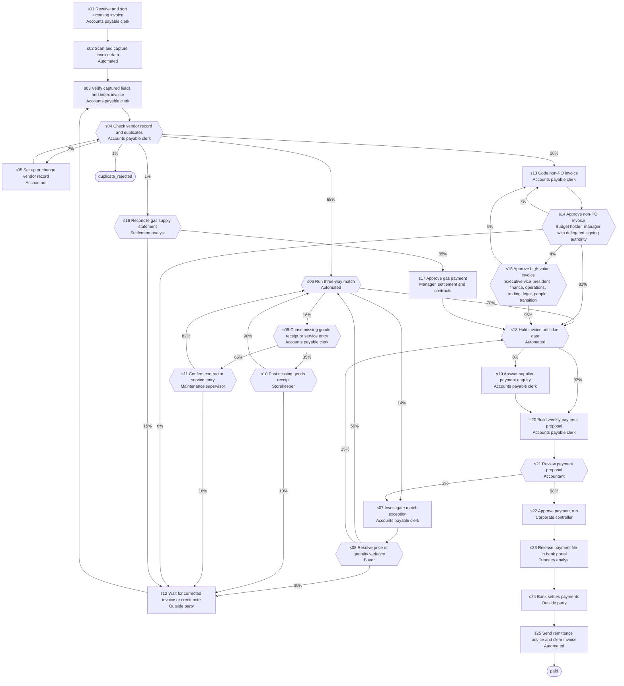

# Process supplier invoices and payments

`gen-fin-pay-suppliers` · electric power generation · finance · part of `power-generation-co`

Accounts payable turns supplier invoices into payments: contractors, parts suppliers, equipment makers, gas suppliers and landowners send invoices or payment requests, and the company pays them on their due date in a weekly run. Most invoices are matched automatically to a purchase order and a goods receipt, but about a quarter stop for a missing receipt, a price difference or a missing approval, and those wait days for buyers, plant supervisors and managers who are busy elsewhere. Contractor invoices during the spring and fall outage seasons are numerous and large, and their field tickets must be checked against crew time before they can be paid. Controls separate who sets up suppliers, who approves invoices and who releases money.

| | |
|---|---|
| Unit of work | one supplier invoice |
| Starts when | A supplier invoice, gas supply statement or land lease payment request arrives in the AP mailbox or mail tray. |
| Done when | The invoice is paid into the supplier's account and cleared in the ERP, or rejected as a duplicate. |
| Organisation | An Alberta merchant power generator with about 1,300 employees, an ERP with purchasing and plant maintenance modules, an OCR invoice capture add-on and a central AP team in the Calgary head office. (1,300 employees, 2019-2022) |
| Volume | 3,500 cases a month (range 2,500 to 5,500) |

## Where it sits

- Starts with **supplier_invoice** from contractors (40% of cases)
- Starts with **supplier_invoice** from material_suppliers (40% of cases)
- Starts with **supplier_invoice** from oem_providers (14% of cases)
- Starts with **payment_request** from lgl-manage-land-leases (5% of cases)
- Starts with **supplier_invoice** from gas_suppliers (1% of cases)
- Relies on **purchase_order** from scm-purchase-materials (a standing input; it does not start a case)
- Relies on **goods_receipt** from scm-manage-stores (a standing input; it does not start a case)
- Relies on **gas_nomination** from mkt-procure-gas (a standing input; it does not start a case)
- Relies on **contractor_agreement** from scm-contractor-management (a standing input; it does not start a case)
- Sends **vendor_payment** to contractors (outcome: paid)
- Sends **vendor_payment** to material_suppliers (outcome: paid)
- Sends **vendor_payment** to oem_providers (outcome: paid)
- Sends **vendor_payment** to gas_suppliers (outcome: paid)
- Sends **lease_payment** to landowners (outcome: paid)
- Sends **payment_proposal** to fin-treasury (outcome: paid)
- Sends **journal_entries** to fin-close-month (outcome: paid)

## Flow

## Roles

| Role | Department | Layer | FTE on this process | Loaded cost per hour | Evidence |
|---|---|---|---:|---:|---|
| Accounts payable clerk | Controllership and accounts payable | individual contributor | 8.5 | 43 CAD | C |
| Accountant | Controllership and accounts payable | individual contributor | 1 | 68 CAD | C |
| Buyer | Procurement | individual contributor | 2 | 62 CAD | C |
| Storekeeper | Warehouses | individual contributor | 0.3 | 46 CAD | C |
| Maintenance supervisor | Wabamun-area converted units | supervisor | 1 | 95 CAD | C |
| Budget holder (manager with delegated signing authority) | All divisions | manager | 1 | 130 CAD | C |
| Executive vice-president (finance, operations, trading, legal, people, transition) | Executive office | executive | 0.05 | 260 CAD | C |
| Settlement analyst | Settlement and contract administration | individual contributor | 0.4 | 64 CAD | C |
| Manager, settlement and contracts | Settlement and contract administration | manager | 0.02 | 120 CAD | C |
| Corporate controller | Finance | director | 0.1 | 170 CAD | C |
| Treasury analyst | Treasury and tax | individual contributor | 0.1 | 74 CAD | C |

## Steps

Hands-on time and the wait before each step show the most common value. Evidence tier A is a sourced number, B a sourced description, C the author's estimate.

| Step | Who | Kind | Hands-on | Wait before | Control | Evidence |
|---|---|---|---:|---:|---|---|
| **s01 Receive and sort incoming invoice.** The AP clerk opens the shared AP mailbox, where most suppliers email PDF invoices, and the tray of paper invoices mailed to head office or forwarded by internal mail from the plants. The clerk removes statements and duplicates sent to several addresses, stamps paper invoices with the received date and sorts them into the scanning batch. | Accounts payable clerk | intake | 1 min | 8.0 h |  | C |
| **s02 Scan and capture invoice data.** The capture tool reads the scanned image or PDF overnight and extracts the supplier, invoice number, date, purchase order number, GST and total. It creates a work item in the AP workflow queue with the image attached and flags fields it read with low confidence. | Automated | system auto | 0 min | 2.0 h |  | C |
| **s03 Verify captured fields and index invoice.** The AP clerk opens the work item, compares each captured field with the image, corrects misread values, keys line details where the tool could not read them and checks that the invoice shows the GST registration number and a valid purchase order or contract reference. Invoices without a PO or contract reference are tagged for coding. | Accounts payable clerk | data entry | 4 min | 1.0 d |  | C |
| **s04 Check vendor record and duplicates.** The AP clerk confirms the supplier exists in the ERP vendor master with the remit-to address on the invoice and runs the duplicate check on supplier, invoice number, date and amount. The clerk then routes the invoice by type: purchase-order invoice, non-PO invoice or land lease payment request, or gas supply statement. | Accounts payable clerk | lookup | 2 min | 0 min | Internal control over financial reporting: duplicate payment check before posting | C |
| **s05 Set up or change vendor record.** A controllership accountant who does not enter invoices or release payments reviews the supplier setup form, checks the GST number and business registration, and calls the supplier back on a number already on file or from a public source to confirm any bank account change before updating the vendor master. | Accountant | validation | 30 min | 2.0 d | Vendor master maintained apart from invoice entry and payment release; bank changes verified by call-back | C |
| **s06 Run three-way match.** The ERP matches each invoice line against the purchase order price and the quantity on the goods receipt or service entry sheet, within tolerance limits set by finance. Matched invoices are posted and released for payment on their due date; the rest are parked in the exception queue with a reason code. | Automated | system auto | 0 min | 1.0 h | Three-way match of invoice, purchase order and receipt before payment | B [ardent_ap_2021], [ardent_bic_2021] |
| **s07 Investigate match exception.** The AP clerk opens the parked invoice, compares the invoice lines with the purchase order history and the receipts, works out whether the difference is price, quantity, freight or tax, and emails the buyer with the variance and a copy of the invoice. | Accounts payable clerk | analysis | 10 min | 1.0 d |  | C |
| **s08 Resolve price or quantity variance.** The buyer compares the invoice with the purchase order terms, the supplier quote and any agreed change, then either amends the purchase order, accepts the difference within the buyer's tolerance authority, or asks the supplier for a corrected invoice or credit note. | Buyer | judgment | 20 min | 2.0 d | Price changes approved by procurement, not by AP | C |
| **s09 Chase missing goods receipt or service entry.** The AP clerk looks up who requested the purchase order, then emails the warehouse for materials or the contract owner for contractor services, attaching the invoice and asking them to post the receipt or service entry sheet. The clerk diarises a follow-up and chases again if nothing happens within a week. | Accounts payable clerk | communication | 6 min | 1.0 d |  | C |
| **s10 Post missing goods receipt.** The storekeeper finds the packing slip or delivery record for the order, checks the quantity received and its condition against the purchase order, and posts the goods receipt in the ERP so the invoice can match. | Storekeeper | data entry | 6 min | 1.0 d | Receipt confirmed by stores, not by AP or the buyer | C |
| **s11 Confirm contractor service entry.** The contract owner, usually a plant maintenance supervisor or outage lead, compares the contractor's invoice and field tickets with crew timesheets and work order records, checks the rates against the service contract and enters a service entry sheet for the accepted amount. | Maintenance supervisor | approval | 15 min | 3.0 d | Delegation of authority: receipt of services confirmed by the person who supervised the work | C |
| **s12 Wait for corrected invoice or credit note.** The supplier receives the dispute or variance note, reviews its own records and sends a corrected invoice or credit note. AP keeps the original parked and adds a note to the work item. | Outside party | external wait | 0 min | 5.0 d | Prompt Payment and Construction Lien Act (Alberta): notice of dispute within 14 days of a proper invoice, for construction contracts made from August 29, 2022 | B [ab_prompt_payment] |
| **s13 Code non-PO invoice.** The AP clerk looks up the contract or the last invoice from the same supplier, enters the general ledger account, cost centre or work order and GST code, and routes the invoice in the workflow to the budget holder named on the contract or cost centre. | Accounts payable clerk | data entry | 6 min | 4.0 h |  | C |
| **s14 Approve non-PO invoice.** The budget holder gets a workflow email, opens the invoice image and coding, checks that the service was received and the amount agrees with the contract, and approves, rejects or sends it back for recoding. Approvals above the budget holder's signing limit route to the next level. | Budget holder (manager with delegated signing authority) | approval | 4 min | 1.0 d | Delegation of authority: budget holder approval within signing limit | C |
| **s15 Approve high-value invoice.** A vice-president or executive reviews invoices above the senior manager limit, such as major outage contractor progress claims or large legal and engineering fees, against the approved budget and contract value, and signs or asks questions. | Executive vice-president (finance, operations, trading, legal, people, transition) | approval | 10 min | 3.0 d | Board-approved delegation of financial authority | C |
| **s16 Reconcile gas supply statement.** The settlement analyst compares the supplier's monthly gas statement with the confirmed nominations, the pipeline's allocated volumes and the contract or index price recorded in the trading system, and resolves differences above a small tolerance with the supplier by email. | Settlement analyst | validation | 1.0 h | 3.0 d | Reconciliation of commodity purchases to confirmed volumes and contract prices | C |
| **s17 Approve gas payment.** The settlement manager reviews the reconciled gas statement and the variance note, checks it against the month's expected gas cost, and approves it for payment on the contractual due date. | Manager, settlement and contracts | approval | 10 min | 1.0 d | Reconciler and approver are different people | C |
| **s18 Hold invoice until due date.** The ERP holds the approved invoice and selects it for the payment run that falls before its due date, which is computed from the invoice date and the supplier's payment terms, commonly net 30 days. | Automated | system auto | 0 min | 13.0 d |  | B [ab_prompt_payment] |
| **s19 Answer supplier payment enquiry.** The AP clerk takes the supplier's call or email, looks up the invoice status in the ERP and workflow, explains when it will be paid or which approval or receipt it is waiting on, and escalates to the approver when the supplier threatens to stop work. | Accounts payable clerk | communication | 10 min | 1.0 d |  | C |
| **s20 Build weekly payment proposal.** On the weekly run day the AP clerk runs the payment proposal in the ERP for invoices due before the next run, removes items on hold, adds urgent manual payments, and exports the proposal with the cash total by currency for treasury. | Accounts payable clerk | coordination | 1 min | 2.5 d |  | C |
| **s21 Review payment proposal.** A controllership accountant reviews the proposal: large payments, first payments to new or changed bank accounts, duplicate-risk report and payments to suppliers with open credit notes, and pulls any item that needs a question answered. | Accountant | review | 0.5 min | 4.0 h | Payment proposal reviewed by someone other than the preparer | C |
| **s22 Approve payment run.** The corporate controller reviews the payment run summary and the largest payments, compares the total with the cash forecast and approves the run in the ERP as the authorised signer. | Corporate controller | approval | 0.2 min | 8.0 h | Bank signing authorities: two authorised signers for each payment run | C |
| **s23 Release payment file in bank portal.** The treasury analyst transfers funds to the disbursement account, uploads the EFT and wire file generated by the ERP to the bank portal, checks that the file total and item count agree with the approved run, and releases it with a second authorisation in the portal. | Treasury analyst | approval | 0.2 min | 4.0 h | Payments released by treasury, separate from AP entry and vendor master | C |
| **s24 Bank settles payments.** The bank processes EFT payments through the clearing system and pays them into supplier accounts on the value date; the few remaining cheques are printed and mailed. | Outside party | external wait | 0 min | 1.0 d |  | C |
| **s25 Send remittance advice and clear invoice.** The ERP emails remittance advice to each supplier listing the invoices paid, clears the open items against the payment and posts the cash entries that feed bank reconciliation and the month-end close. | Automated | system auto | 0 min | 0 min |  | C |

## Exceptions

| Exception | Share of cases | What happens |
|---|---:|---|
| Missing contractor service entry | 7% | The contractor invoices before the contract owner has confirmed the field tickets; AP chases the supervisor, who may dispute hours. |
| Price or quantity variance | 10% | Invoice price or quantity differs from the purchase order; the buyer amends the order or asks for a credit note. |
| Corrected invoice needed | 6% | The supplier must reissue the invoice or send a credit note; the case starts again at indexing. |
| Vendor setup or bank change | 2% | A new supplier or a changed bank account is verified by call-back before the invoice can proceed. |
| Duplicate invoice | 1% | The same invoice was emailed and mailed, or sent to several people; it is rejected at the duplicate check. |

## Benchmarks

| Metric | Value | Unit | Population | Evidence |
|---|---|---|---|---|
| cycle_time_days | p50 25, p90 42 | calendar days from invoice receipt to payment | Supplier invoices at an Alberta generator paying on net 30 terms in weekly runs | C |
| invoice_processing_cycle_time | 10 | days from receipt to approval for payment (average) | Ardent Partners survey of AP organisations, 2020 data | A [ardent_ap_2021] |
| invoice_exception_rate | 0.25 | share of invoices | Ardent Partners survey, 2020 data; best-in-class 10.1 percent | A [ardent_ap_2021], [ardent_bic_2021] |
| cost_per_invoice | ardent_average_usd 10.89, apqc_median_usd 3.17 | USD per invoice | Ardent Partners average (2020 data, labour, overhead and technology); APQC median of 190 companies in the Americas (published 2016) | A [ardent_ap_2021], [apqc_invoice_cost] |

## Pain points

- Contractor invoices wait for plant supervisors to confirm field tickets and enter service entries, and this peaks during outage seasons when supervisors are busiest. (steps s09, s11; C)
- About a quarter of invoices drop out of automatic matching and need manual investigation and buyer action. (steps s06, s07, s08; A [ardent_ap_2021])
- Non-PO invoices depend on email approvals by managers who travel between sites; reminders and re-routing add days. (steps s13, s14; C)
- Paper invoices mailed to plant sites reach AP days late, which shortens the time left to pay on terms. (steps s01; C)

## Assumptions

- Loaded costs come from the organisation file (wage x 1.40). The budget holder role is added with not_in_org_file and a cost between the plant manager and asset manager rates.
- Per-step touch times are per invoice. Batch steps (payment proposal, review, approval and release) show the run's effort divided by the invoices in it.
- The hold-until-due-date wait is drawn independently of earlier delays; in practice it shrinks when processing runs long, so the simulated p90 overstates the tail somewhat.
- Routing shares (68 percent PO, 28 percent non-PO and lease, 1 percent gas, 2 percent vendor setup, 1 percent duplicates) and exception rates are estimates chosen to give an overall exception rate near the 25 percent Ardent average.
- The Alberta prompt payment rules (28 days to pay, 14 days to dispute) bind only construction contracts made after August 29, 2022, so for most of the reference period payment timing followed contract terms.
- Gas supply statements are few but large; they are reconciled by the settlement group because AP cannot check volumes and index prices.
- No physical resources, travel or shift work are involved; plant-based roles keep the shift patterns of the organisation file.
- Validator check: simulated cycle time median 24 days and p90 34 days against the tier C benchmark of 25 and 42. Simulated receipt-to-approval time (to step s18) has a median of about 4.6 days and a mean of about 6.7 days, faster than the Ardent average of 10 days and slower than its best-in-class group (73 percent faster), which fits a company with OCR capture but email approvals.
- Simulated labour cost is about 33 CAD per invoice, above the Ardent average of 10.89 USD, because it counts the time of buyers, supervisors, managers and executives outside AP who resolve exceptions and approve invoices, which AP cost surveys usually leave out.
- Staffing check: roles state 14.5 FTE and hands-on time implies about 14.8 FTE at 130 productive hours a month; the AP clerk share (8.5 stated, about 8.8 implied) agrees with the 9 clerks in the organisation file.

## Sources

- [ardent_ap_2021] [Latest A/P benchmarks to help measure your efficiency](https://www.resourcefulfinancepro.com/articles/ap-benchmarks-2021/) (Resourceful Finance Pro (reporting Ardent Partners, Accounts Payable Metrics that Matter in 2021), 2021). Ardent Partners figures for 2020: average cost per invoice 10.89 USD (labour, overhead and technology), average invoice processing cycle time 10 days, about 25 percent of invoices are exceptions.
- [ardent_bic_2021] [Best-in-Class Accounts Payable Performance](https://cporising.com/2021/09/10/best-in-class-accounts-payable-performance/) (CPO Rising (Ardent Partners), 2021). Best-in-class AP groups (top 20 percent on cost and cycle time) have 80 percent lower invoice processing cost, 73 percent faster processing and an average exception rate of 10.1 percent, 60 percent lower than other organisations.
- [apqc_invoice_cost] [Metric of the Month: The Cost of an Invoice](https://www.cfo.com/news/metric-of-the-month-the-cost-of-an-invoice/661701/) (CFO.com (APQC data), 2016). APQC total cost to process accounts payable per invoice for 190 companies in the Americas: top quartile 0.71 USD or less, median 3.17 USD, bottom quartile 11.50 USD or more.
- [ab_prompt_payment] [Prompt payment rules for the construction industry](https://www.alberta.ca/prompt-payment-rules-for-construction-industry) (Government of Alberta, 2022). Prompt Payment and Construction Lien Act: owners pay a proper invoice within 28 calendar days and give notice of dispute within 14 days; required content of a proper invoice; applies to new construction contracts from August 29, 2022, existing contracts must comply by August 29, 2024.

Written by claude-opus on 2026-11-24.
