# Issue permits to work and lock out equipment

`gen-gas-issue-work-permits` · electric power generation · plant operations (safety) · part of `power-generation-co`

Before anyone works on plant equipment that could move, energise or release pressure, operations isolate it, lock it and issue a signed work permit. A permit coordinator prepares the isolation list, the shift supervisor verifies it, field and control room operators stop and isolate the equipment, test for zero energy and lock the keys in a group box, and the supervisor briefs the crew and issues the permit. When the work ends the crew removes its locks, the permit is cancelled and operators restore the equipment. The work is slowed by the morning queue at the permit desk, by isolation lists that must be written from drawings, and by locks left on by workers who have gone home.

| | |
|---|---|
| Unit of work | one work permit |
| Starts when | A permit request arrives in the permit system from routine maintenance or an outage. |
| Done when | The permit is cancelled, isolations are removed, the equipment is back in service and the record is closed, or the request is deferred. |
| Organisation | An Alberta merchant generator with three converted gas steam units at two Wabamun-area sites run by power engineers on rotating shifts, using an electronic permit-to-work system with paper isolation records. (1,300 employees, 2019-2022) |
| Volume | 1,250 cases a month (range 900 to 2,000) |

## Where it sits

- Starts with **permit_request** from gas-routine-maintenance (85% of cases)
- Starts with **permit_request** from eng-execute-major-outage (15% of cases)
- Relies on **safety_standard** from hse-safety-programs (a standing input; it does not start a case)
- Relies on **training_record** from hr-training-certification (a standing input; it does not start a case)
- Sends **work_permit** to gas-routine-maintenance (outcome: closed)
- Sends **work_permit** to eng-execute-major-outage (outcome: closed)

## Flow

```mermaid
flowchart TD
    s01{{"s01 Review permit request for the next day<br/>Permit coordinator  power engineer, day shift"}}
    s02["s02 Write a new isolation list<br/>Permit coordinator  power engineer, day shift"]
    s03["s03 Prepare isolation list from template<br/>Permit coordinator  power engineer, day shift"]
    s04{{"s04 Verify and authorise the isolation list<br/>Shift supervisor  first-class power engineer"}}
    s05["s05 Take equipment out of service from the control room<br/>Control room operator  second-class power engineer"]
    s06["s06 Collect locks and walk to the equipment<br/>Field operator  third- or fourth-class power engineer"]
    s07{{"s07 Apply isolations, locks and tags<br/>Field operator  third- or fourth-class power engineer"}}
    s08["s08 Rack out breaker and prove dead<br/>Instrument and electrical technician"]
    s09["s09 Lock keys in box and post isolation record<br/>Field operator  third- or fourth-class power engineer"]
    s10{{"s10 Test for zero energy<br/>Field operator  third- or fourth-class power engineer"}}
    s11["s11 Issue permit and brief the crew<br/>Shift supervisor  first-class power engineer"]
    s12["s12 Crew signs on and locks onto the lock box<br/>Millwright"]
    s13{{"s13 Permit stays open while work proceeds<br/>Automated"}}
    s14["s14 Revalidate permit at shift change<br/>Shift supervisor  first-class power engineer"]
    s15["s15 Crew removes personal locks and signs off<br/>Millwright"]
    s16{{"s16 Confirm all workers clear and cancel permit<br/>Shift supervisor  first-class power engineer"}}
    s17["s17 Trace a lock left on and authorise removal<br/>Shift supervisor  first-class power engineer"]
    s18["s18 Remove isolations and restore the line-up<br/>Field operator  third- or fourth-class power engineer"]
    s19["s19 Return equipment to service from the control room<br/>Control room operator  second-class power engineer"]
    s20{{"s20 Return locks and close the permit record<br/>Field operator  third- or fourth-class power engineer"}}
    s21["s21 Audit a sample of closed permits<br/>Safety advisor"]
    s01 -->|"4%"| end0
    s01 -->|"12%"| s02
    s01 -->|"84%"| s03
    s02 --> s04
    s03 --> s04
    s04 -->|"92%"| s05
    s04 -->|"8%"| s03
    s05 --> s06
    s06 --> s07
    s07 -->|"75%"| s09
    s07 -->|"25%"| s08
    s08 --> s09
    s09 --> s10
    s10 -->|"95%"| s11
    s10 -->|"5%"| s07
    s11 --> s12
    s12 --> s13
    s13 -->|"45%"| s14
    s13 -->|"55%"| s15
    s14 --> s15
    s15 --> s16
    s16 -->|"94%"| s18
    s16 -->|"6%"| s17
    s17 --> s18
    s18 --> s19
    s19 --> s20
    s20 -->|"95%"| end1
    s20 -->|"5%"| s21
    s21 --> end1
    end0(["deferred"])
    end1(["closed"])
```

## Roles

| Role | Department | Layer | FTE on this process | Loaded cost per hour | Evidence |
|---|---|---|---:|---:|---|
| Permit coordinator (power engineer, day shift) | Wabamun-area converted units | individual contributor | 5 | 64 CAD | B [ta_permit_post] |
| Shift supervisor (first-class power engineer) | Wabamun-area converted units | supervisor | 5 | 92 CAD | C |
| Field operator (third- or fourth-class power engineer) | Wabamun-area converted units | individual contributor | 20 | 60 CAD | C |
| Control room operator (second-class power engineer) | Wabamun-area converted units | individual contributor | 2 | 70 CAD | C |
| Instrument and electrical technician | Wabamun-area converted units | individual contributor | 1.5 | 68 CAD | C |
| Millwright | Wabamun-area converted units | individual contributor | 2 | 66 CAD | C |
| Safety advisor | Health and safety | senior specialist | 0.2 | 80 CAD | C |

## Steps

Hands-on time and the wait before each step show the most common value. Evidence tier A is a sourced number, B a sourced description, C the author's estimate.

| Step | Who | Kind | Hands-on | Wait before | Control | Evidence |
|---|---|---|---:|---:|---|---|
| **s01 Review permit request for the next day.** The permit coordinator opens the day's permit requests in the permit system, checks each against the unit run plan and other open permits for conflicting isolations, and decides whether a stored isolation list can be reused or a new one is needed. Requests that need the unit offline are deferred. | Permit coordinator (power engineer, day shift) | judgment | 6 min | 8.0 h |  | B [ta_permit_post] |
| **s02 Write a new isolation list.** The coordinator traces the equipment on piping and instrument diagrams and electrical single-line drawings, lists every valve, breaker, drain and vent to operate with its required position and lock, and notes stored energy such as pressure, heat or springs. The list is saved for reuse. | Permit coordinator (power engineer, day shift) | drafting | 1.0 h | 8.0 h |  | C |
| **s03 Prepare isolation list from template.** The coordinator copies the stored isolation list for the equipment, checks recent engineering changes and temporary modifications that might change it, and attaches it to the permit with the job hazards from the work order. | Permit coordinator (power engineer, day shift) | drafting | 15 min | 4.0 h |  | C |
| **s04 Verify and authorise the isolation list.** The shift supervisor, a first-class power engineer, checks the isolation list against the drawings and the current plant line-up, confirms the unit can run with the equipment out, and authorises operators to isolate. Errors go back to the coordinator. | Shift supervisor (first-class power engineer) | review | 8 min | 4.0 h | Alberta OHS Code Part 15 s.215.1(2): separate activation and verification roles in complex group control | A [ohs15] |
| **s05 Take equipment out of service from the control room.** The control room operator starts the standby pump or fan, stops the equipment to be worked on from the DCS, puts it in local or out-of-service mode and confirms that the unit is stable before field isolation starts. | Control room operator (second-class power engineer) | coordination | 5 min | 1.0 h |  | C |
| **s06 Collect locks and walk to the equipment.** The field operator prints the isolation list, collects the numbered locks and tags from the lock board and walks or drives within the plant to the equipment, which can be several floors up in the boiler house. | Field operator (third- or fourth-class power engineer) | travel | 15 min | 1.0 h |  | C |
| **s07 Apply isolations, locks and tags.** The field operator closes and chains valves, opens drains and vents, opens low-voltage disconnects and attaches a numbered lock and tag to each isolation point in the order on the list, ticking each one off. | Field operator (third- or fourth-class power engineer) | physical | 25 min | 0 min | Alberta OHS Code Part 15 s.212: energy isolated with secured energy-isolating devices before work | A [ohs15] |
| **s08 Rack out breaker and prove dead.** An instrument and electrical technician in arc-flash clothing racks out the 4,160 V or 480 V breaker at the switchgear, locks the cubicle and proves the motor circuit dead with a tester before handing the key to the operator. | Instrument and electrical technician | physical | 30 min | 2.0 h | Alberta OHS Code Part 15 s.212 and s.213: isolation and verification of electrical energy | C |
| **s09 Lock keys in box and post isolation record.** The operator puts the keys of all isolation locks in the group lock box, locks it, and posts the signed isolation record at the work site and in the permit system so the crew can see what is isolated. | Field operator (third- or fourth-class power engineer) | data entry | 8 min | 0 min | Alberta OHS Code Part 15 s.215(3): group control, keys secured and report posted at the work site | A [ohs15] |
| **s10 Test for zero energy.** The operator tries to start the equipment locally, reads pressure and temperature gauges, bleeds residual pressure and confirms that nothing moves or flows. A passing valve or a live circuit sends the isolation back for correction. | Field operator (third- or fourth-class power engineer) | validation | 10 min | 0 min | Alberta OHS Code Part 15 s.213: test that the equipment is inoperative before work | A [ohs15] |
| **s11 Issue permit and brief the crew.** The shift supervisor reviews the verified isolation, signs the permit, and holds a short pre-job briefing with the crew lead on hazards, isolations, gas testing and emergency arrangements. In the morning several crews queue at the permit desk at once. | Shift supervisor (first-class power engineer) | approval | 12 min | 1.5 h | Alberta OHS Code Part 15 s.215.1(2): work permit or master tag system in PEng-certified complex group procedures | A [ohs15] |
| **s12 Crew signs on and locks onto the lock box.** Each crew member signs the permit and puts a personal lock on the group lock box, so the isolations cannot be removed until they take it off. Contractors do the same with company-issued locks. | Millwright | physical | 5 min | 10 min | Alberta OHS Code Part 15 s.214 and s.215(4): personal locks on the key-securing system | A [ohs15] |
| **s13 Permit stays open while work proceeds.** The permit and isolations stay in place while the crew does the work under gas-routine-maintenance or the outage; no permit work is done in this interval, but the isolated equipment is unavailable to operations. | Automated | external wait | 0 min | 8.0 h |  | C |
| **s14 Revalidate permit at shift change.** At shift change the outgoing and incoming shift supervisors walk through open permits, confirm isolations are intact and transfer control of locks for workers who have gone home, recording the handover on the permit. | Shift supervisor (first-class power engineer) | review | 5 min | 0 min | Alberta OHS Code Part 15 s.214.1(4): lock control handed to a supervisor at shift change or reassignment | A [ohs15] |
| **s15 Crew removes personal locks and signs off.** When the job is finished and tools are cleared, each crew member removes their personal lock from the lock box and the crew lead signs the permit off as work complete, stating whether the equipment is ready to test. | Millwright | physical | 5 min | 30 min | Alberta OHS Code Part 15 s.215.3(1): only the worker who placed a lock removes it | A [ohs15] |
| **s16 Confirm all workers clear and cancel permit.** The shift supervisor checks the lock box is empty and every signed-on worker is accounted for, then cancels the permit so the isolations can be removed. A lock left on blocks cancellation. | Shift supervisor (first-class power engineer) | approval | 6 min | 1.0 h | Alberta OHS Code Part 15 s.215.3(3): isolation removed only when each worker is accounted for | A [ohs15] |
| **s17 Trace a lock left on and authorise removal.** The supervisor phones the worker whose lock is still on, or their supervisor or contractor, and if the worker cannot return, confirms they are off site, records the reason and authorises cutting the lock. | Shift supervisor (first-class power engineer) | coordination | 30 min | 4.0 h | Alberta OHS Code Part 15 s.215.3(2): removal by a designated supervisor when the worker is unavailable | A [ohs15] |
| **s18 Remove isolations and restore the line-up.** A field operator removes the locks and tags in reverse order, opens and closes valves to the normal line-up, closes drains and vents and racks breakers back in where operators are allowed to, ticking each point off. | Field operator (third- or fourth-class power engineer) | physical | 20 min | 1.0 h |  | C |
| **s19 Return equipment to service from the control room.** The control room operator returns the equipment to auto or standby on the DCS, starts it if required for the post-maintenance test, and confirms flows, pressures and alarms are normal. | Control room operator (second-class power engineer) | coordination | 5 min | 30 min |  | C |
| **s20 Return locks and close the permit record.** The field operator hangs the locks and tags back on the lock board, records the time of restoration in the permit system and files the paper isolation record with the permit for audit. | Field operator (third- or fourth-class power engineer) | data entry | 6 min | 30 min |  | C |
| **s21 Audit a sample of closed permits.** A safety advisor picks a sample of closed and open permits each week, checks signatures, isolation records and lock lists against the procedure, and visits open jobs to check locks in the field. Findings go to the plant manager. | Safety advisor | review | 30 min | 3.0 d | Company permit-to-work procedure: periodic permit audits | C |

## Exceptions

| Exception | Share of cases | What happens |
|---|---:|---|
| New isolation list | 12% | No stored isolation list exists, so the coordinator writes one from drawings. |
| Isolation list rejected | 8% | The shift supervisor finds an error and returns the list. |
| Zero-energy test fails | 5% | A passing valve or residual pressure means more isolation is needed. |
| Multi-shift job | 45% | The permit is revalidated and lock control handed over at shift change. |
| Lock left on | 6% | A worker left a personal lock on; the supervisor traces them or authorises removal. |
| Deferred request | 4% | The job needs the unit offline or conflicts with other open permits. |

## Benchmarks

| Metric | Value | Unit | Population | Evidence |
|---|---|---|---|---|
| cycle_time_days | p50 3, p90 9 | calendar days from permit request to permit record closed | Routine permits at a thermal generating plant, 2019-2022 | C |

## Pain points

- Several crews queue at the permit desk at the start of day shift while one supervisor issues and briefs permits, so craft time is lost before work starts. (steps s11; C)
- Writing isolation lists from drawings takes an experienced operator an hour or more, and outdated drawings or templates are a source of missed isolation points. (steps s02, s03, s04; C)
- Locks left on by workers who have gone home hold equipment out of service until the worker is traced or a supervisor authorises removal. (steps s16, s17; A [ohs15])
- Outage seasons multiply the number of open permits and isolations that operators must track while also running the other units. (steps s01, s07, s14; C)

## Assumptions

- Isolation is under complex group control (OHS Code s.215.1) with a work permit and group lock box, the usual method for multi-point steam plant isolations; simple single-lock jobs are not separated out.
- A day-shift permit coordinator is added as a role the organisation file lacks; without it, isolation list preparation would fall on shift supervisors and field operators, adding about 5 FTE to their load.
- The control room operator takes part in isolation and return to service although the organisation file does not list that role for this process.
- Step s13 is the time the permit stays open while the work happens in another process; it holds no labour here.
- Crew sign-on (s12) and sign-off (s15) duplicate time counted in gen-gas-routine-maintenance s15 and s17.
- Field operator touch counts one operator; on large isolations two operators work together and the minutes would double.
- The simulated 90th percentile (about 5 days) is narrower than the estimate of 9 days because triangular job durations at s13 understate the long tail of multi-week jobs held under one permit.

## Sources

- [ohs15] [Occupational Health and Safety Code, Part 15: Managing the Control of Hazardous Energy (consolidated text)](https://search-ohs-laws.alberta.ca/legislation/occupational-health-and-safety-code/part-15-managing-the-control-of-hazardous-energy/) (Government of Alberta, 2023). s.212 equipment must be stopped and energy isolated with secured energy-isolating devices before work; s.213 worker tests and confirms the equipment is inoperative before starting; s.214 personal locks with unique identification and a written list of lock holders; s.214.1 each worker secures with own lock, control handed to a supervisor at shift change or reassignment; s.215 group control: supervisor or designated worker secures devices and keys, verifies isolation and posts a report at the work site, each worker locks onto the key-securing system; s.215.1 complex group control procedures certified by a professional engineer, including a work permit or master tag system and separate activation and verification roles; s.215.3 locks removed only by the worker who placed them or a designated supervisor, and only once each worker is accounted for. The text opened is the current consolidation (amended in 2023); the 2019-2022 text had the same section structure.
- [ta_permit_post] [Permit Coordinator job details (Wabamun, AB)](https://jobs.transalta.com/job/Wabuman-Permit-Coordinator-AB/1406543200/) (TransAlta careers site, 2026). TransAlta has advertised a role titled Permit Coordinator at its Wabamun-area plant. The page opened shows only the title and that the position is filled; it does not show the duties, and it dates from after the reference period.

Written by claude-opus on 2026-11-24.
