# Operate gas units around the clock

`gen-gas-operate-units` · electric power generation · plant operations · part of `power-generation-co`

Crews of certified power engineers run the converted gas-fired steam units around the clock on rotating 12-hour shifts. In each plant-shift the crew takes over from the previous shift, follows the dispatch targets passed on by the real-time desk, watches the unit on the control system, walks rounds, runs routine tests, isolates equipment for maintenance, answers alarms and writes up defects, then hands over. The work is slow to learn and error-prone at the handover, during alarms and when the unit trips; since the units became merchant gas units they change load and cycle more often, which adds alarms, ramps and wear.

| | |
|---|---|
| Unit of work | one plant-shift (12 hours of one plant site's operating crew) |
| Starts when | A 12-hour shift begins at the plant site (06:00 or 18:00), with dispatch instructions arriving from the real-time desk through it. |
| Done when | The shift log is signed, timesheets are entered, unit status is sent and the next crew has taken over; or the unit has tripped and the crew has moved into the forced outage response. |
| Organisation | An Alberta merchant generator running three coal units converted to gas-fired steam (about 400 to 460 MW each) on two plant sites. (1,300 employees, 2019-2022) |
| Volume | 122 cases a month (range 116 to 124) |

## Where it sits

- Starts with **dispatch_instruction** from mkt-respond-dispatch (100% of cases)
- Relies on **gas_nomination** from mkt-procure-gas (a standing input; it does not start a case)
- Relies on **chemistry_results** from gas-water-chemistry (a standing input; it does not start a case)
- Relies on **engineering_change** from eng-manage-engineering-changes (a standing input; it does not start a case)
- Relies on **engineering_change** from etr-convert-coal-units (a standing input; it does not start a case)
- Relies on **coal_delivery** from etr-mine-coal (a standing input; it does not start a case)
- Relies on **system_release** from it-ot-cyber (a standing input; it does not start a case)
- Sends **delivered_energy** to aeso (outcome: any)
- Sends **unit_status** to mkt-forecast-generation (outcome: shift_completed)
- Sends **work_request** to gas-routine-maintenance (outcome: any)
- Sends **unit_trip** to gas-respond-forced-outage (outcome: unit_tripped)
- Sends **unit_status** to gas-water-chemistry (outcome: shift_completed)
- Sends **unit_status** to gas-run-cems (outcome: shift_completed)
- Sends **release_report** to hse-report-releases (outcome: any)
- Sends **timesheet** to hr-run-payroll (outcome: any)

## Flow

```mermaid
flowchart TD
    s01["s01 Hold pre-shift safety meeting<br/>Shift supervisor  first-class power engineer"]
    s02["s02 Take over the control room<br/>Control room operator  second-class power engineer"]
    s03["s03 Walk down the plant with the outgoing field operators<br/>Field operator  third- or fourth-class power engineer"]
    s04["s04 Review the shift plan<br/>Shift supervisor  first-class power engineer"]
    s05["s05 Confirm unit capability with the real-time desk<br/>Real-time trader"]
    s06["s06 Follow dispatch instructions<br/>Control room operator  second-class power engineer"]
    s07["s07 Monitor and control the unit from the DCS<br/>Control room operator  second-class power engineer"]
    s08["s08 Do the first field rounds<br/>Field operator  third- or fourth-class power engineer"]
    s09["s09 Record the round readings<br/>Field operator  third- or fourth-class power engineer"]
    s10["s10 Run routine tests and equipment changeovers<br/>Field operator  third- or fourth-class power engineer"]
    s11{{"s11 Adjust chemical feed to the water chemistry results<br/>Field operator  third- or fourth-class power engineer"}}
    s12["s12 Isolate equipment for maintenance crews<br/>Field operator  third- or fourth-class power engineer"]
    s13{{"s13 Respond to alarms<br/>Control room operator  second-class power engineer"}}
    s14{{"s14 Check the fault in the field<br/>Field operator  third- or fourth-class power engineer"}}
    s15["s15 Raise a work request<br/>Control room operator  second-class power engineer"]
    s16["s16 Do the second field rounds<br/>Field operator  third- or fourth-class power engineer"]
    s17{{"s17 Check emissions against the approval limits<br/>Control room operator  second-class power engineer"}}
    s18{{"s18 Declare the trip or derate to the desk<br/>Shift supervisor  first-class power engineer"}}
    s19["s19 Restate the unit's available capability<br/>Real-time trader"]
    s20["s20 Report a spill or release<br/>Shift supervisor  first-class power engineer"]
    s21["s21 Complete the shift log and timesheets<br/>Shift supervisor  first-class power engineer"]
    s22["s22 Send end-of-shift unit status<br/>Shift supervisor  first-class power engineer"]
    s23["s23 Hand over to the next crew<br/>Control room operator  second-class power engineer"]
    s01 --> s02
    s02 --> s03
    s03 --> s04
    s04 --> s05
    s05 --> s06
    s06 --> s07
    s07 --> s08
    s08 --> s09
    s09 --> s10
    s10 --> s11
    s11 -->|"55%"| s12
    s11 -->|"45%"| s13
    s12 --> s13
    s13 -->|"52%"| s14
    s13 -->|"40%"| s16
    s13 -->|"8%"| s18
    s14 -->|"60%"| s15
    s14 -->|"40%"| s16
    s15 --> s16
    s16 --> s17
    s17 -->|"2%"| s20
    s17 -->|"98%"| s21
    s18 -->|"35%"| end0
    s18 -->|"65%"| s19
    s19 --> s16
    s20 --> s21
    s21 --> s22
    s22 --> s23
    s23 --> end1
    end0(["unit_tripped"])
    end1(["shift_completed"])
```

## Roles

| Role | Department | Layer | FTE on this process | Loaded cost per hour | Evidence |
|---|---|---|---:|---:|---|
| Shift supervisor (first-class power engineer) | Wabamun-area converted units | supervisor | 10 | 92 CAD | B [src_alis_power_engineer] |
| Control room operator (second-class power engineer) | Wabamun-area converted units | individual contributor | 22 | 70 CAD | B [src_alis_power_engineer] |
| Field operator (third- or fourth-class power engineer) | Wabamun-area converted units | individual contributor | 34 | 60 CAD | B [src_alis_power_engineer] |
| Real-time trader | Real-time desk | individual contributor | 0.3 | 90 CAD | C |

## Steps

Hands-on time and the wait before each step show the most common value. Evidence tier A is a sourced number, B a sourced description, C the author's estimate.

| Step | Who | Kind | Hands-on | Wait before | Control | Evidence |
|---|---|---|---:|---:|---|---|
| **s01 Hold pre-shift safety meeting.** The shift supervisor gathers the incoming crew in the control room before relief, reads out the hazards of the day (open permits, equipment out of service, weather, any start or stop planned), assigns rounds and checks everyone is fit for duty. Each person signs the meeting record. | Shift supervisor (first-class power engineer) | communication | 1.7 h | 5 min | Alberta OHS Code Part 2 hazard assessment, applied as a pre-shift hazard review | C |
| **s02 Take over the control room.** The incoming control room operators read the outgoing shift log, the DCS alarm summary and the list of equipment out of service, and talk through the dispatch target, any derates and abnormal settings with the operators they relieve. They sign the log to accept the unit. | Control room operator (second-class power engineer) | communication | 45 min | 0 min | Site shift turnover procedure: written log and verbal handover before relief | B [src_alis_power_engineer] |
| **s03 Walk down the plant with the outgoing field operators.** Each incoming field operator meets the operator they relieve on their area (boiler, turbine hall, water treatment and balance of plant) and walks past equipment running abnormally, tagged out or under repair, noting anything to watch. | Field operator (third- or fourth-class power engineer) | physical | 1.2 h | 0 min |  | C |
| **s04 Review the shift plan.** The shift supervisor reviews the log, open permits and lockouts, the maintenance work planned for the shift, the gas nomination and any pipeline notices, the latest water chemistry results and the emissions monitor status, and decides the order of work for the crew. | Shift supervisor (first-class power engineer) | lookup | 30 min | 10 min |  | C |
| **s05 Confirm unit capability with the real-time desk.** The real-time trader on shift calls the plant, confirms the available capability, ramp rate and minimum stable level the desk has offered for each unit, and tells the supervisor what dispatches to expect from the merit order for the next hours. | Real-time trader | communication | 10 min | 15 min |  | B [src_ta_2021_ir] |
| **s06 Follow dispatch instructions.** Through the shift the control room operator receives each new dispatch for the unit from the real-time desk, acknowledges it and sets the unit load demand on the DCS so the unit starts moving within 10 minutes and ramps at the offered rate. | Control room operator (second-class power engineer) | data entry | 25 min | 0 min | AESO ISO rule 203.4 s.4 (begin ramping within 10 minutes of the dispatch time) | A [src_aeso_203_4] |
| **s07 Monitor and control the unit from the DCS.** The control room operators watch drum level, steam pressure and temperature, furnace pressure, burner flames, turbine vibration and emissions on the DCS screens, adjust setpoints and switch loops to manual when automatic control misbehaves, and coordinate the field operators by radio. | Control room operator (second-class power engineer) | judgment | 18.3 h | 0 min |  | B [src_alis_power_engineer] |
| **s08 Do the first field rounds.** Each field operator walks a fixed route through the boiler, turbine, condensate and feedwater, cooling water and gas supply areas, reads local gauges and tank levels, listens for leaks and abnormal noise, and checks lube oil and seal systems on running pumps and fans. | Field operator (third- or fourth-class power engineer) | physical | 7.0 h | 15 min |  | C |
| **s09 Record the round readings.** The field operators type the readings from their round sheets or handhelds into the operating log and data historian and flag any reading outside its normal band for the control room. | Field operator (third- or fourth-class power engineer) | data entry | 45 min | 0 min |  | B [src_alis_power_engineer] |
| **s10 Run routine tests and equipment changeovers.** Field operators carry out the shift's scheduled tests and changeovers: rotating standby pumps and fans, testing the fire pumps and emergency lube oil pump, blowing down level gauges and checking burner and igniter condition. | Field operator (third- or fourth-class power engineer) | physical | 2.0 h | 30 min |  | C |
| **s11 Adjust chemical feed to the water chemistry results.** A field operator reads the latest results from the chemistry technician and adjusts the boiler chemical feed pumps and continuous blowdown to bring pH, phosphate or oxygen scavenger back into the ranges set in the chemistry procedure. | Field operator (third- or fourth-class power engineer) | physical | 30 min | 30 min |  | C |
| **s12 Isolate equipment for maintenance crews.** For each permit request approved for the shift, a field operator closes and locks valves and breakers on the isolation list, hangs locks and tags, and proves zero energy with the maintenance worker before the permit is handed over. | Field operator (third- or fourth-class power engineer) | physical | 2.5 h | 1.0 h | Alberta OHS Code Part 15 control of hazardous energy (lockout) | B [src_alis_power_engineer] |
| **s13 Respond to alarms.** The control room operator acknowledges each DCS alarm, reads the trend behind it and decides whether it is a nuisance, something to watch, a fault for a field operator to check, or a unit upset that needs immediate action. | Control room operator (second-class power engineer) | judgment | 1.0 h | 0 min |  | C |
| **s14 Check the fault in the field.** A field operator goes to the equipment named by the alarm, looks for leaks, trips or failed instruments, resets what can be reset under the operating procedure and reports back by radio. | Field operator (third- or fourth-class power engineer) | physical | 45 min | 10 min |  | C |
| **s15 Raise a work request.** The control room operator writes a work request in the maintenance module of the ERP with the equipment tag, symptom and priority, so the maintenance planner and supervisor see it in the next morning's review. | Control room operator (second-class power engineer) | data entry | 15 min | 15 min |  | C |
| **s16 Do the second field rounds.** Late in the shift the field operators repeat their rounds, compare readings with the first round and pay extra attention to equipment flagged earlier, isolated equipment and anything the control room asked them to watch. | Field operator (third- or fourth-class power engineer) | physical | 5.8 h | 30 min |  | C |
| **s17 Check emissions against the approval limits.** The control room operator checks the emissions monitor readings for NOx and the monitor's own health and calibration status, and tells the supervisor if a rolling average is approaching its limit or the monitor is out of service. | Control room operator (second-class power engineer) | lookup | 15 min | 0 min | EPEA approval emission limits and Alberta CEMS Code | C |
| **s18 Declare the trip or derate to the desk.** The shift supervisor calls the real-time desk to say the unit has tripped or must run below its offered capability, gives the MW now available and the expected duration, and opens the forced outage response. | Shift supervisor (first-class power engineer) | communication | 10 min | 2 min |  | A [src_aeso_203_4] |
| **s19 Restate the unit's available capability.** The real-time trader enters the reduced available capability for the unit in the Energy Trading System with the reason, which removes the top offer blocks from the merit order until the unit is restated back up. | Real-time trader | data entry | 10 min | 5 min | AESO ISO rule 203.4 s.5 (restate within 20 minutes of an operational deviation) | A [src_aeso_203_4], [src_aeso_2012_009r] |
| **s20 Report a spill or release.** When a chemical, oil or water release or an emissions exceedance happens on shift, the shift supervisor stops it where safe, records what, where and how much in the incident and environmental system, and phones the environment specialist who decides whether the regulator must be told. | Shift supervisor (first-class power engineer) | drafting | 1.0 h | 10 min | EPEA release reporting duty, applied through the company incident procedure | C |
| **s21 Complete the shift log and timesheets.** The shift supervisor finishes the shift log (dispatches, trips, alarms, work requests, permits and readings out of band), enters crew hours and overtime in the time and attendance system and signs the log. | Shift supervisor (first-class power engineer) | data entry | 30 min | 0 min |  | B [src_alis_power_engineer] |
| **s22 Send end-of-shift unit status.** The shift supervisor emails the real-time desk, the forecasting analyst, the chemistry technician and the emissions team a short unit status: MW capability, equipment out of service, derates expected and work planned on the next shift. | Shift supervisor (first-class power engineer) | communication | 10 min | 0 min |  | C |
| **s23 Hand over to the next crew.** The outgoing control room operators brief the incoming crew on dispatch, alarms, isolations and open work, answer their questions and leave once the relief has signed the log. | Control room operator (second-class power engineer) | communication | 30 min | 0 min |  | C |

## Exceptions

| Exception | Share of cases | What happens |
|---|---:|---|
| Unit trip during the shift | 3% | The unit trips; the supervisor declares it to the desk and the crew moves into the forced outage response, so the normal second rounds and end-of-shift steps happen inside that process. |
| Derate restated and run through | 5% | Equipment trouble forces the unit below its offered capability; the desk restates the capability in ETS within 20 minutes and the crew runs the rest of the shift at reduced output. |
| Spill or release | 2% | An oil, chemical or water release or an emissions exceedance is contained and written up for the environment team. |

## Benchmarks

| Metric | Value | Unit | Population | Evidence |
|---|---|---|---|---|
| cycle_time_days | p50 0.53, p90 0.55 | calendar days from start of shift to completed handover | One 12-hour shift plus about 15 to 30 minutes of overlap at each end | C |
| crew_size_per_plant_shift | low 5, mode 6.5, high 8 | people on shift at one plant site | Converted gas-fired steam units of about 400 MW, one or two units per site | C |
| forced_outages_or_derates_per_plant_shift | 0.08 | events per plant-shift | This organisation's converted units | C |

## Pain points

- Handover quality depends on what the outgoing operator remembers to say; bypassed alarms and temporary settings get lost between crews. (steps s02, s23; C)
- More frequent load changes and starts since the units became merchant gas units add alarms, ramps and thermal stress, and cycling is linked to tube and header failures. (steps s06, s07, s13; B [src_powermag_forced], [src_ta_2021_ir])
- Round readings are written on paper and typed in later, so a reading out of band can sit unnoticed for hours. (steps s08, s09; C)
- A derate must be restated within 20 minutes, but it depends on the supervisor reaching the desk quickly by phone. (steps s18, s19; A [src_aeso_203_4])

## Assumptions

- touch_min on crew steps (meeting, rounds, monitoring) is person-minutes summed over everyone on that step, so labour cost and the staffing check are right. The simulator adds every step's touch time in sequence, so its cycle time (about 2 to 3 days) is far longer than the real 12.5-hour shift in which the control room, field rounds and tests run at the same time; the concurrent_with fields mark this overlap.
- One case is one plant-shift at one of two plant sites; the Keephills site runs two units and Sundance one, so a case holds on average 1.5 converted units for the 12 hours (converted_gas_unit occupied 720 to 1,440 minutes).
- Crew size (one supervisor, about two control room operators and three to four field operators per plant-shift) and FTE on this process are tier C estimates for converted units; they are well below the organisation file headcounts, which fit the larger coal-era fleet.
- Dispatches are received and acknowledged by the real-time desk (mkt-respond-dispatch) and passed to the plant; at plants with an ETS screen in the control room the operator may see them directly. Restatements during derates are shown here because they interrupt the shift, and are also counted in mkt-restate-offers.
- Permit issue is in gas-issue-work-permits; only the field operator's isolation work during the shift is shown here.
- Loaded costs are taken from the organisation file (wage times 1.40).
- The steps account for about 45 of the roughly 80 person-hours a crew of six to seven spends on a 12.5-hour shift; the rest is breaks, training, housekeeping and standby time not tied to a step.
- Job requisitions to hr-recruit-hire are listed in the organisation file as an output of this process but are not a per-shift output; they are left out of interfaces.

## Sources

- [src_alis_power_engineer] [Power engineer: occupational profile](https://alis.alberta.ca/occinfo/occupations-in-alberta/occupation-profiles/power-engineer) (Government of Alberta, alis, 2026). Power engineers monitor alarms, gauges and instruments, keep a daily log of operation, maintenance and safety activities, start and stop boilers, isolate and lock out equipment for repair, troubleshoot failures and switch to manual control; shift work including nights, weekends and emergency overtime; an ABSA certificate is needed to supervise a power plant and assistants may work under a certified engineer. Publication year not shown; year is the access year.
- [src_aeso_203_4] [ISO Rules Part 200, Section 203.4 Delivery Requirements for Energy (effective 2023-03-31)](https://www.aeso.ca/assets/documents/203.4-Delivery-Requirements-for-Energy-Admin-Amendments-2023-03-31.pdf) (Alberta Electric System Operator, 2023). Pool participants deliver energy only under a dispatch or directive; must use dispatch protocols, personnel and software to detect and address errors; must start moving toward a dispatched MW level within 10 minutes; ramp time limits from the submitted ramp rate; an operational deviation of 20 minutes or longer requires an available capability or MW restatement no later than 20 minutes after it starts; exceptions for units synchronising or going off line at minimum stable generation, with a verbal ramp plan to the ISO updated for deviations over 30 minutes or 50 MW. Revision history: 2023 change was drafting alignment only; 2020-09-16 version in force during 2020-2022.
- [src_aeso_2012_009r] [Information Document ID 2012-009R Restatements (posted 2017-05-11)](https://www.aeso.ca/assets/Uploads/2012-009R-Restatements-2017-05-11.pdf) (Alberta Electric System Operator, 2017). Available capability restatements for an acceptable operational reason remove the highest-priced offer blocks from the merit order; price restatements are allowed up to two hours before the settlement interval without a reason; MW restatements only under defined operating conditions.
- [src_ta_2021_ir] [TransAlta Corporation 2021 Integrated Report (Form 6-K)](https://www.sec.gov/Archives/edgar/data/1144800/000114480022000006/tac2021integratedreportf.htm) (TransAlta Corporation via U.S. SEC EDGAR, 2022). Adjusted availability 90.0 (2019), 90.7 (2020) and 86.6 percent (2021); Sundance 6, Keephills 2 and Keephills 3 converted to gas in Q1, Q2 and Q4 2021; planned conversion outages lowered 2021 availability; Alberta Gas production 8,691, 7,732 and 7,281 GWh in 2019-2021; power dispatched by AESO merit order; the company manages its offers internally and optimised production toward high-price periods in 2021. Only the first 100,000 characters of the filing were read.
- [src_powermag_forced] [Fending off forced power plant outages](https://www.powermag.com/fending-off-forced-power-plant-outages/) (POWER magazine, None). Cites NERC's 2020 State of Reliability (2019 fleet WEFOR 6.97 percent; gas outages spike in extreme winter weather) and NETL (August 2020, GADS data: boiler tube leaks cause more than half of coal-unit forced outages; balance of plant 15, steam turbine 13, generator 12, human error 4 percent; cycling stresses steam piping, headers and tubes) and an Intertek note that a base-load plant moving from 3-6 to 50 starts a year can see component failures within 2-6 years. Publication year not shown on the page as read.

Written by claude-opus on 2026-11-24.
