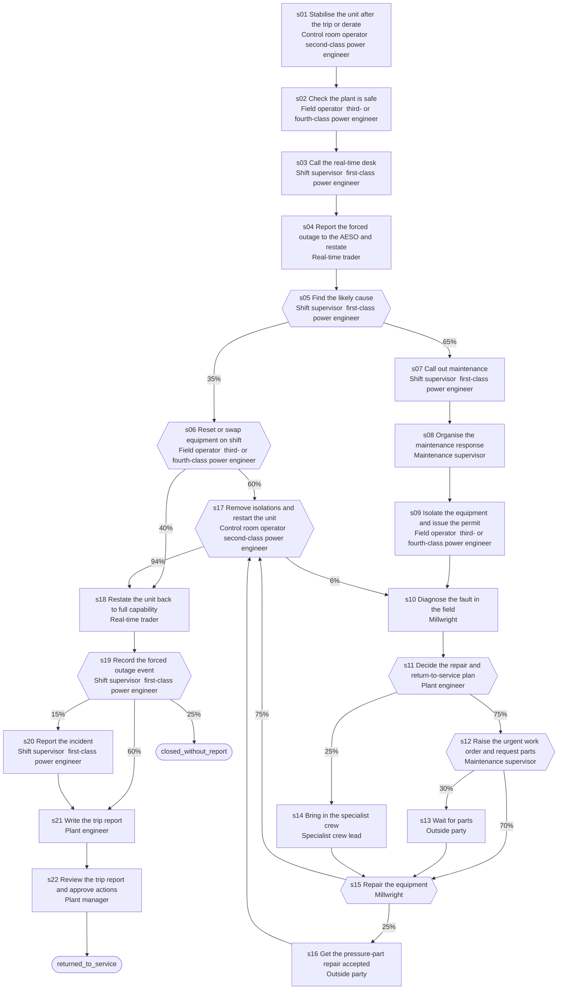

# Respond to unit trips and forced outages

`gen-gas-respond-forced-outage` · electric power generation · plant operations and maintenance · part of `power-generation-co`

When a converted gas-fired steam unit trips or must run below its offered capability, the shift crew makes the plant safe, the real-time desk reports the forced outage to the AESO and restates the unit's capability, and operators decide whether they can fix it on shift or need maintenance. Repairs need isolations and permits, often a cool-down before anyone can enter the boiler, sometimes parts, a specialist crew or an inspector's acceptance. Every hour out in a high-price period costs margin, so the slow parts are waiting for people, parts and cool-down, not the repair itself.

| | |
|---|---|
| Unit of work | one forced outage or derate |
| Starts when | A unit trips or must be derated (a unit trip alarm from the plant shift). |
| Done when | The unit is back at full capability, the outage is recorded and, for most events, the trip report and its actions are approved. |
| Organisation | An Alberta merchant generator running three coal units converted to gas-fired steam (about 400 to 460 MW each). (1,300 employees, 2019-2022) |
| Volume | 12 cases a month (range 6 to 25) |

## Where it sits

- Starts with **unit_trip** from gas-operate-units (90% of cases)
- Starts with **unit_trip** from gas-start-stop-units (10% of cases)
- Sends **availability_change** to mkt-restate-offers (outcome: any)
- Sends **work_request** to gas-routine-maintenance (outcome: any)
- Sends **asset_condition_report** to eng-reliability-analysis (outcome: returned_to_service)
- Sends **incident_report** to hse-manage-incidents (outcome: any)
- Sends **material_request** to scm-purchase-materials (outcome: any)
- Sends **crew_request** to eng-dispatch-specialist-crews (outcome: any)

## Flow

## Roles

| Role | Department | Layer | FTE on this process | Loaded cost per hour | Evidence |
|---|---|---|---:|---:|---|
| Control room operator (second-class power engineer) | Wabamun-area converted units | individual contributor | 0.8 | 70 CAD | B [src_alis_power_engineer] |
| Field operator (third- or fourth-class power engineer) | Wabamun-area converted units | individual contributor | 0.5 | 60 CAD | B [src_alis_power_engineer] |
| Shift supervisor (first-class power engineer) | Wabamun-area converted units | supervisor | 0.4 | 92 CAD | B [src_alis_power_engineer] |
| Real-time trader | Real-time desk | individual contributor | 0.1 | 90 CAD | A [src_aeso_306_5], [src_aeso_203_4] |
| Maintenance supervisor | Wabamun-area converted units | supervisor | 0.4 | 95 CAD | C |
| Millwright | Wabamun-area converted units | individual contributor | 2 | 66 CAD | C |
| Plant engineer | Thermal technical services | senior specialist | 0.6 | 92 CAD | C |
| Specialist crew lead | Specialist maintenance crews | supervisor | 0.1 | 85 CAD | C |
| Plant manager | Wabamun-area converted units | manager | 0.05 | 135 CAD | C |

## Steps

Hands-on time and the wait before each step show the most common value. Evidence tier A is a sourced number, B a sourced description, C the author's estimate.

| Step | Who | Kind | Hands-on | Wait before | Control | Evidence |
|---|---|---|---:|---:|---|---|
| **s01 Stabilise the unit after the trip or derate.** The control room operator reads the DCS first-out alarm and sequence of events, confirms the unit tripped safely or is holding at reduced load, checks that the turbine is on turning gear, the boiler is purged and drum level and auxiliary power are under control. | Control room operator (second-class power engineer) | judgment | 15 min | 0 min |  | B [src_alis_power_engineer] |
| **s02 Check the plant is safe.** Field operators go to the area named by the trip, look for fire, steam or gas leaks and injured people, close isolating valves the emergency procedure calls for and report what they find to the control room. | Field operator (third- or fourth-class power engineer) | physical | 1.0 h | 2 min |  | C |
| **s03 Call the real-time desk.** The shift supervisor phones the real-time desk with the MW now available, whether it is a full trip or a derate, the first known cause and a rough return time. | Shift supervisor (first-class power engineer) | communication | 5 min | 5 min |  | C |
| **s04 Report the forced outage to the AESO and restate.** The real-time trader calls the AESO's recorded line to report the forced outage, designates it Outage-Forced or Derate-Forced and restates the unit's available capability in the Energy Trading System within 20 minutes. | Real-time trader | data entry | 15 min | 5 min | AESO ISO rules 306.5 s.5 (automatic forced outage notification) and 203.4 s.5 (restatement within 20 minutes) | A [src_aeso_306_5], [src_aeso_203_4] |
| **s05 Find the likely cause.** The shift supervisor and control room operator pull the DCS sequence of events and historian trends around the trip, compare them with the field report and decide whether operators can fix it on shift or maintenance is needed. | Shift supervisor (first-class power engineer) | analysis | 45 min | 5 min |  | C |
| **s06 Reset or swap equipment on shift.** Field operators reset tripped equipment, start the standby pump or fan, or bypass a failed instrument under the operating procedure, and the control room confirms the unit can return to full capability. | Field operator (third- or fourth-class power engineer) | physical | 1.0 h | 10 min |  | C |
| **s07 Call out maintenance.** The shift supervisor phones the on-call maintenance supervisor and, after hours, the on-call millwright or instrument technician, describes the fault and agrees who comes in. | Shift supervisor (first-class power engineer) | communication | 10 min | 5 min |  | C |
| **s08 Organise the maintenance response.** The maintenance supervisor arrives or works from home, reads the shift report, decides which trades are needed and whether the work can start now or waits for day shift, and asks the shift supervisor for isolations. | Maintenance supervisor | coordination | 40 min | 1.5 h |  | C |
| **s09 Isolate the equipment and issue the permit.** The shift supervisor issues a work permit and field operators apply locks and tags on the isolation points, drain and vent where needed, and prove zero energy with the trades before work starts. | Field operator (third- or fourth-class power engineer) | physical | 1.0 h | 15 min | Alberta OHS Code Part 15 control of hazardous energy and the site permit-to-work procedure | B [src_alis_power_engineer] |
| **s10 Diagnose the fault in the field.** A millwright or instrument and electrical technician inspects the failed equipment: opens covers, checks wiring and transmitters, measures vibration, or, for a boiler tube leak, waits for the boiler to cool and enters to find the leak. | Millwright | physical | 3.0 h | 1.0 h |  | B [src_powermag_forced] |
| **s11 Decide the repair and return-to-service plan.** The plant engineer reviews the diagnosis, trends and history of the equipment, decides between a temporary and a permanent repair, whether the manufacturer or the specialist crew is needed and what tests are needed before return. | Plant engineer | judgment | 1.5 h | 2.0 h |  | C |
| **s12 Raise the urgent work order and request parts.** The maintenance supervisor creates an emergency work order in the ERP maintenance module, books the trades, and checks stores for the parts, raising a rush purchase request when they are not on the shelf. | Maintenance supervisor | data entry | 25 min | 30 min |  | C |
| **s13 Wait for parts.** The work waits while the supplier ships a valve, motor, tube material or electronic card, often by courier from Edmonton or Calgary or from the manufacturer. | Outside party | external wait | 0 min | 1.0 d |  | C |
| **s14 Bring in the specialist crew.** The plant engineer asks engineering for the turbine, valve or rigging crew, or calls the manufacturer's service team, and agrees the scope; the crew lead mobilises people and tools to site, using the turbine hall crane when casings must be lifted. | Specialist crew lead | coordination | 1.0 h | 12.0 h |  | C |
| **s15 Repair the equipment.** The trades repair or replace the failed part: weld a tube, replace a pump seal or motor, change a transmitter or card, or open a valve. Larger jobs run day and night with two crews. | Millwright | physical | 15.0 h | 30 min |  | C |
| **s16 Get the pressure-part repair accepted.** For a weld repair on boiler tubes or headers, the plant's pressure equipment inspector or ABSA's authorized inspector reviews the welding procedure and records and witnesses the hydrostatic test before the boiler may be returned to service. | Outside party | external wait | 2.0 h | 8.0 h | Alberta Pressure Equipment Safety Regulation: repairs to pressure equipment inspected before return to service | C |
| **s17 Remove isolations and restart the unit.** Field operators remove locks and tags once the permit is signed off, and the control room runs the start-up procedure to bring the unit back to its dispatch level; long restarts follow the separate start-up process. | Control room operator (second-class power engineer) | physical | 5.0 h | 30 min |  | C |
| **s18 Restate the unit back to full capability.** The real-time trader restates the unit's available capability back up in the Energy Trading System, ends the forced outage with the AESO and tells the trading and forecasting teams. | Real-time trader | data entry | 10 min | 5 min | AESO ISO rule 203.3 energy restatements for an acceptable operational reason | A [src_aeso_2012_009r] |
| **s19 Record the forced outage event.** The shift supervisor records the event in the shift log and in the ERP outage record with start and end times, MW lost, the equipment and a cause code, so availability statistics and lost margin can be reported. | Shift supervisor (first-class power engineer) | data entry | 25 min | 1.0 h |  | B [src_ta_2021_ir] |
| **s20 Report the incident.** When the trip involved an injury, fire, release or serious near miss, the shift supervisor enters it in the incident system with photos and witness names so the safety or environment team can investigate. | Shift supervisor (first-class power engineer) | drafting | 1.0 h | 1.0 h | Alberta OHS Act incident reporting, applied through the company incident procedure | C |
| **s21 Write the trip report.** The plant engineer writes a short trip report: sequence of events, cause, repair, whether it is a repeat failure and actions to stop a repeat, and sends it to reliability engineering. | Plant engineer | drafting | 3.0 h | 2.0 d |  | C |
| **s22 Review the trip report and approve actions.** The plant manager reads the trip report at the weekly reliability meeting, challenges the cause, approves the corrective actions and owners, and asks for a full root cause analysis when the event was costly or repeated. | Plant manager | review | 30 min | 2.0 d |  | C |

## Exceptions

| Exception | Share of cases | What happens |
|---|---:|---|
| Operator fix on shift | 35% | A failed instrument or tripped auxiliary with a standby is reset or swapped by operators, and the unit restarts or the derate clears within hours. |
| Boiler tube leak | 16% | The boiler must cool before entry; the leak is found, the tube welded and the repair accepted by the pressure equipment inspector after a hydrostatic test. The unit is out for several days. |
| Parts not in stores | 15% | The repair waits for parts to be bought and shipped. |
| Specialist crew or manufacturer needed | 16% | Turbine, generator or large valve work needs the company's specialist crew or the manufacturer, who may be committed elsewhere. |
| Repeat trip on restart | 5% | The unit trips again on return and the diagnosis starts over. |

## Benchmarks

| Metric | Value | Unit | Population | Evidence |
|---|---|---|---|---|
| cycle_time_days | p50 8, p90 16 | calendar days from trip to approved trip report | Forced outages and derates on converted gas-fired steam units | C |
| time_to_return_to_service_days | p50 1.5, p90 6 | calendar days from trip to unit back at capability | Same | C |
| fleet_weighted_forced_outage_rate | 6.97 | percent (WEFOR, all conventional generation, 2019) | NERC-reporting North American fleet | A [src_powermag_forced] |

## Pain points

- Boiler entry waits a day or more for cool-down, so even a small tube leak costs days of output. (steps s10, s16; B [src_powermag_forced])
- Trips at night or on weekends wait for the office-hours maintenance supervisor and engineer, or for callouts. (steps s08, s11; C)
- Parts and specialist crews are shared with planned outages, so a forced outage during outage season waits longest. (steps s13, s14; C)
- Cause codes are typed in after the event and are often vague, which weakens reliability analysis. (steps s19, s21; C)

## Assumptions

- The millwright role stands for all site trades on the repair (millwrights, instrument and electrical technicians, welders); touch_min on repair steps is person-minutes summed over the trades.
- The converted unit is shown as occupied only while it burns fuel (stabilising after the trip and restarting). It is unavailable for the whole outage, but the organisation file's available_hours_per_month already deducts outage time and its cost_per_hour is a running cost, so holding it through the repair would double count. The real cost of the outage is lost margin: at the 2021 average pool price of about 102 CAD/MWh a 400 MW unit gives up roughly 40,000 CAD of revenue an hour.
- Volume (about 12 a month including derates) is the organisation file estimate; it implies about 4 events per unit per month, which is high for full trips and should be checked against the operator's outage records.
- The AESO report and restatement are made by the real-time desk as pool participant and are also part of mkt-restate-offers.
- Long outages that are converted into a planned outage and reported under ISO rule 306.5 as such are handled in eng-report-outages-aeso.
- Loaded costs are taken from the organisation file (wage times 1.40).

## Sources

- [src_aeso_306_5] [ISO Rules Part 300, Section 306.5 Generation Outage Reporting and Coordination (effective 2023-01-01)](https://www.aeso.ca/assets/documents/306.5-Generation-Outage-Reporting-and-Coordination-2023-01-01.pdf) (Alberta Electric System Operator, 2022). Applies to pool participants with generating source assets of 5 MW or more (wind included since 2015); outage changes of 5 MW or more must be reported; submissions through the Energy Trading System; planned outages designated Derate-Planned or Outage-Planned with dates, times, MW impact and nature of work; by the first day of every month, all planned outages in the next 24 months; revisions as soon as reasonably practicable; a written reason when a change is submitted later than 3 months before the outage starts; delayed forced outages reported as soon as reasonably practicable and by recorded telephone line when less than 24 hours' notice; automatic forced outages reported by recorded telephone line and designated Derate-Forced or Outage-Forced; ISO outage cancellation directives only after posting an adequacy concern for at least 1 calendar week, contacting participants, CEO authorisation and no more than 90 days ahead; a cancelled participant submits a work description and incremental cost estimate and files a claim within 40 days. Revision history shows the 2020-09-16 version had the same requirements apart from one wording change in 2023.
- [src_aeso_203_4] [ISO Rules Part 200, Section 203.4 Delivery Requirements for Energy (effective 2023-03-31)](https://www.aeso.ca/assets/documents/203.4-Delivery-Requirements-for-Energy-Admin-Amendments-2023-03-31.pdf) (Alberta Electric System Operator, 2023). Pool participants deliver energy only under a dispatch or directive; must use dispatch protocols, personnel and software to detect and address errors; must start moving toward a dispatched MW level within 10 minutes; ramp time limits from the submitted ramp rate; an operational deviation of 20 minutes or longer requires an available capability or MW restatement no later than 20 minutes after it starts; exceptions for units synchronising or going off line at minimum stable generation, with a verbal ramp plan to the ISO updated for deviations over 30 minutes or 50 MW. Revision history: 2023 change was drafting alignment only; 2020-09-16 version in force during 2020-2022.
- [src_aeso_2012_009r] [Information Document ID 2012-009R Restatements (posted 2017-05-11)](https://www.aeso.ca/assets/Uploads/2012-009R-Restatements-2017-05-11.pdf) (Alberta Electric System Operator, 2017). Available capability restatements for an acceptable operational reason remove the highest-priced offer blocks from the merit order; price restatements are allowed up to two hours before the settlement interval without a reason; MW restatements only under defined operating conditions.
- [src_alis_power_engineer] [Power engineer: occupational profile](https://alis.alberta.ca/occinfo/occupations-in-alberta/occupation-profiles/power-engineer) (Government of Alberta, alis, 2026). Power engineers monitor alarms, gauges and instruments, keep a daily log of operation, maintenance and safety activities, start and stop boilers, isolate and lock out equipment for repair, troubleshoot failures and switch to manual control; shift work including nights, weekends and emergency overtime; an ABSA certificate is needed to supervise a power plant and assistants may work under a certified engineer. Publication year not shown; year is the access year.
- [src_ta_2021_ir] [TransAlta Corporation 2021 Integrated Report (Form 6-K)](https://www.sec.gov/Archives/edgar/data/1144800/000114480022000006/tac2021integratedreportf.htm) (TransAlta Corporation via U.S. SEC EDGAR, 2022). Adjusted availability 90.0 (2019), 90.7 (2020) and 86.6 percent (2021); Sundance 6, Keephills 2 and Keephills 3 converted to gas in Q1, Q2 and Q4 2021; planned conversion outages lowered 2021 availability; Alberta Gas production 8,691, 7,732 and 7,281 GWh in 2019-2021; power dispatched by AESO merit order; the company manages its offers internally and optimised production toward high-price periods in 2021. Only the first 100,000 characters of the filing were read.
- [src_powermag_forced] [Fending off forced power plant outages](https://www.powermag.com/fending-off-forced-power-plant-outages/) (POWER magazine, None). Cites NERC's 2020 State of Reliability (2019 fleet WEFOR 6.97 percent; gas outages spike in extreme winter weather) and NETL (August 2020, GADS data: boiler tube leaks cause more than half of coal-unit forced outages; balance of plant 15, steam turbine 13, generator 12, human error 4 percent; cycling stresses steam piping, headers and tubes) and an Intertek note that a base-load plant moving from 3-6 to 50 starts a year can see component failures within 2-6 years. Publication year not shown on the page as read.

Written by claude-opus on 2026-11-24.
