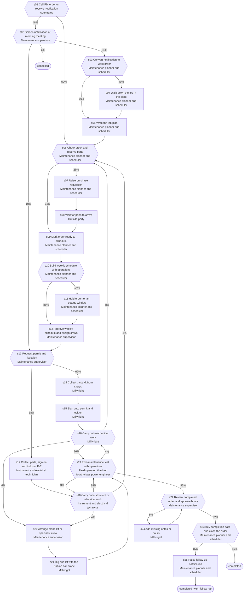

# Carry out preventive and corrective maintenance on gas units

`gen-gas-routine-maintenance` · electric power generation · plant maintenance · part of `power-generation-co`

Plant maintenance keeps the converted gas steam units and cogeneration plants available between major outages. Preventive maintenance orders come out of the ERP plan each night and corrective requests come from operators; planners scope the job, reserve parts and schedule it weekly with operations, then millwrights or instrument and electrical technicians lock on under a permit, do the work and hand the equipment back for a test. Work is slowed by parts that are not in stock, by jobs that must wait for a unit outage, by the permit queue in outage seasons, and by poor completion notes that weaken the equipment history.

| | |
|---|---|
| Unit of work | one work order |
| Starts when | A preventive maintenance order falls due in the ERP maintenance plan, or an operator raises a notification for a defect. |
| Done when | The work order is technically complete in the ERP with notes and failure codes, or the notification is cancelled as a duplicate. |
| Organisation | An Alberta merchant generator with three 400 to 460 MW coal units converted to gas in 2021 and two cogeneration plants, maintained by an in-house unionised craft workforce with an ERP plant maintenance module. (1,300 employees, 2019-2022) |
| Volume | 1,400 cases a month (range 1,000 to 2,200) |

## Where it sits

- Starts with **maintenance_strategy** from eng-reliability-analysis (52% of cases)
- Starts with **work_request** from gas-operate-units (38% of cases)
- Starts with **work_request** from gas-operate-cogeneration (6% of cases)
- Starts with **work_request** from gas-respond-forced-outage (2% of cases)
- Starts with **work_request** from gas-inspect-pressure-equipment (2% of cases)
- Relies on **work_permit** from gas-issue-work-permits (a standing input; it does not start a case)
- Relies on **issued_parts** from scm-manage-stores (a standing input; it does not start a case)
- Relies on **crew_assignment** from eng-dispatch-specialist-crews (a standing input; it does not start a case)
- Sends **permit_request** to gas-issue-work-permits (outcome: any)
- Sends **material_request** to scm-purchase-materials (outcome: any)
- Sends **material_request** to scm-manage-stores (outcome: any)
- Sends **crew_request** to eng-dispatch-specialist-crews (outcome: any)
- Sends **work_order_history** to eng-reliability-analysis (outcome: completed)
- Sends **work_order_history** to eng-reliability-analysis (outcome: completed_with_follow_up)
- Sends **timesheet** to hr-run-payroll (outcome: any)
- Sends **incident_report** to hse-manage-incidents (outcome: any)

## Flow

## Roles

| Role | Department | Layer | FTE on this process | Loaded cost per hour | Evidence |
|---|---|---|---:|---:|---|
| Maintenance planner and scheduler | Thermal technical services | individual contributor | 12 | 66 CAD | B [palmer] |
| Maintenance supervisor | Wabamun-area converted units | supervisor | 4 | 95 CAD | C |
| Millwright | Wabamun-area converted units | individual contributor | 27 | 66 CAD | C |
| Instrument and electrical technician | Wabamun-area converted units | individual contributor | 13 | 68 CAD | C |
| Field operator (third- or fourth-class power engineer) | Wabamun-area converted units | individual contributor | 5 | 60 CAD | C |

## Steps

Hands-on time and the wait before each step show the most common value. Evidence tier A is a sourced number, B a sourced description, C the author's estimate.

| Step | Who | Kind | Hands-on | Wait before | Control | Evidence |
|---|---|---|---:|---:|---|---|
| **s01 Call PM order or receive notification.** Each night the ERP maintenance scheduling run calls preventive maintenance orders that fall due from the maintenance plans, with task list and parts list attached. Corrective work arrives instead as a notification raised by operators on shift. This step only routes the case. | Automated | system auto | 0 min | 0 min |  | C |
| **s02 Screen notification at morning meeting.** At the daily work-screening meeting the maintenance supervisor reads each new notification with the shift supervisor, checks it is not a duplicate, confirms the equipment and sets a priority from one (emergency) to four. Urgent jobs go straight to a crew; duplicates and non-jobs are closed. | Maintenance supervisor | judgment | 4 min | 16.0 h |  | C |
| **s03 Convert notification to work order.** The planner opens the accepted notification in the ERP, creates a work order against the functional location, sets the work centre (mechanical or instrument and electrical), the priority date and the cost centre, and decides whether the job needs a walk-down before it can be planned. | Maintenance planner and scheduler | data entry | 12 min | 1.0 d |  | C |
| **s04 Walk down the job in the plant.** The planner walks to the equipment, often with the operator who raised the problem, looks at access, scaffolding needs, isolation points and the condition of the part, takes photos and nameplate details, and notes any special tools or lifting needed. | Maintenance planner and scheduler | analysis | 30 min | 1.0 d |  | B [palmer] |
| **s05 Write the job plan.** The planner writes the job steps, crafts and hours, special tools, scaffolding and lifting needs, and the isolation points and hazards for the permit, copying from earlier orders on the same equipment where they exist. The plan is attached to the work order in the ERP. | Maintenance planner and scheduler | drafting | 30 min | 12.0 h |  | B [palmer] |
| **s06 Check stock and reserve parts.** The planner looks up each part on the bill of materials or by catalogue number in the ERP, checks stock on hand and open orders, and creates reservations against the work order. Non-stock or short parts go to purchasing. | Maintenance planner and scheduler | lookup | 10 min | 4.0 h |  | B [rweb_store] |
| **s07 Raise purchase requisition.** The planner creates a purchase requisition in the ERP for each non-stock or short item, with the part number, supplier if known, required date and the work order as the account. The requisition goes to purchasing for approval and sourcing. | Maintenance planner and scheduler | data entry | 15 min | 1.0 h |  | C |
| **s08 Wait for parts to arrive.** The work order sits in the backlog with status waiting for material while purchasing sources the part and the supplier ships it. The planner sees the receipt in the ERP when stores post the goods receipt. | Outside party | external wait | 0 min | 14.0 d |  | B [rweb_store], [aif2021] |
| **s09 Mark order ready to schedule.** When all parts are in stock or reserved, the planner changes the order status to ready, checks the plan hours, and sends a kitting request so stores can pick and stage the parts for the scheduled day. | Maintenance planner and scheduler | data entry | 5 min | 4.0 h |  | C |
| **s10 Build weekly schedule with operations.** Each Thursday the planner loads ready orders into the next week's schedule against craft hours available, then agrees it with the operations shift supervisor so that equipment can be released. Jobs that need the unit offline or derated are held for an outage or low-load window. | Maintenance planner and scheduler | coordination | 8 min | 3.0 d |  | B [palmer] |
| **s11 Hold order for an outage window.** The planner tags the order for the next planned or opportunity outage and reviews it when the unit comes offline or the market desk agrees a derate. Work on the boiler, main steam valves and generator mostly falls here. | Maintenance planner and scheduler | coordination | 10 min | 28.0 d |  | C |
| **s12 Approve weekly schedule and assign crews.** The maintenance supervisor reviews the draft schedule, checks overtime, vacations and contractor support, assigns named millwrights and technicians to each job and freezes the schedule for the week. | Maintenance supervisor | approval | 3 min | 12.0 h |  | C |
| **s13 Request permit and isolation.** The day before the job the maintenance supervisor enters a permit request in the permit system, naming the equipment, the work, the crew and the isolation points from the job plan, so operations can prepare the isolations. Break-in jobs are requested by phone and entered at once. | Maintenance supervisor | data entry | 8 min | 4.0 h | Alberta OHS Code Part 15 ss.212-215 (isolation, verification, personal and group locks) applied through the plant permit-to-work procedure | A [ohs15] |
| **s14 Collect parts kit from stores.** The lead millwright drives a service truck to the warehouse, signs for the staged kit and any free-issue consumables, checks the parts against the work order, and takes them and the tools to the job. | Millwright | travel | 25 min | 4.0 h |  | C |
| **s15 Sign onto permit and lock on.** The millwright crew attends the pre-job briefing at the permit desk, reads the permit and isolation list, adds personal locks to the group lock box and tries the start button or checks gauges to confirm the equipment is dead before touching it. | Millwright | physical | 15 min | 4.0 h | Alberta OHS Code Part 15 ss.212-215 (isolation, verification, personal and group locks) applied through the plant permit-to-work procedure | A [ohs15] |
| **s16 Carry out mechanical work.** Millwrights do the repair or PM task: dismantle, inspect, replace bearings, seals or packing, align and reassemble, following the job plan and OEM manuals. Time is person-minutes for the crew (usually two). If the scope grows or a part is wrong, the order goes back to planning. | Millwright | physical | 1.3 h | 30 min |  | B [reliamag_staff] |
| **s17 Collect parts, sign on and lock on (I&E).** The instrument and electrical technician collects the staged parts and test equipment, attends the permit briefing, adds a personal lock and proves the circuit dead with a tester before starting. | Instrument and electrical technician | physical | 30 min | 4.0 h | Alberta OHS Code Part 15 ss.212-215 (isolation, verification, personal and group locks) applied through the plant permit-to-work procedure | A [ohs15] |
| **s18 Carry out instrument or electrical work.** The technician replaces or calibrates transmitters, positioners, analysers, motor starters or protection relays, checks loop readings against the DCS with the control room, and notes as-found and as-left values. | Instrument and electrical technician | physical | 1.2 h | 30 min |  | C |
| **s19 Post-maintenance test with operations.** After the crew signs off the permit, a field operator restores the equipment and runs it, checking vibration, temperatures, leaks and DCS readings. A failed test sends the job back to the crew. | Field operator (third- or fourth-class power engineer) | validation | 20 min | 2.0 h |  | C |
| **s20 Arrange crane lift or specialist crew.** The maintenance supervisor asks the outage group for a specialist crew or a crane operator, agrees the date and writes or requests a lift plan for heavy components such as pump casings or fan motors. | Maintenance supervisor | coordination | 20 min | 8.0 h |  | C |
| **s21 Rig and lift with the turbine hall crane.** Millwrights and the specialist crew rig the load, hold a lift meeting, and move the component with the turbine hall crane under the lift plan. The crane is tied up for rigging, the lift and landing. | Millwright | physical | 3.0 h | 3.0 d | Critical lift plan and pre-lift meeting under the plant lifting procedure | C |
| **s22 Review completed order and approve hours.** The maintenance supervisor reads the crew's notes, checks the hours booked in timekeeping against the plan, and passes the order to the planner for close-out, or sends it back when the notes are missing or unclear. | Maintenance supervisor | review | 5 min | 1.0 d |  | C |
| **s23 Key completion data and close the order.** The planner types the crew's notes, failure codes, actual parts and measurements into the ERP, updates the equipment history and technically completes the order. History feeds reliability analysis. | Maintenance planner and scheduler | data entry | 10 min | 1.0 d |  | C |
| **s24 Add missing notes or hours.** The millwright or technician who did the job is found on the next shift, writes the missing as-found condition, parts used or hours on the order, and returns it to the supervisor. | Millwright | drafting | 10 min | 1.0 d |  | C |
| **s25 Raise follow-up notification.** Where the crew found further defects that were not fixed, the planner raises a new notification for the deferred work, linked to the closed order, so it enters screening as a new case. | Maintenance planner and scheduler | data entry | 10 min | 1.0 h |  | C |

## Exceptions

| Exception | Share of cases | What happens |
|---|---:|---|
| Parts not in stock | 26% | Non-stock or short parts are requisitioned and the order waits in the backlog for delivery. |
| Outage-dependent job | 14% | The equipment cannot be released while the unit runs, so the order waits for a planned or forced outage. |
| Priority 1 break-in | 5% | An urgent defect skips planning and scheduling and goes straight to a permit and a crew. |
| Scope growth | 8% | The crew finds extra damage or the wrong part, and the order goes back to planning for parts. |
| Crane or specialist needed | 5% | Heavy components need the turbine hall crane and a specialist crew, which are shared with outage work. |

## Benchmarks

| Metric | Value | Unit | Population | Evidence |
|---|---|---|---|---|
| cycle_time_days | p50 14, p90 60 | calendar days from PM call or notification to technical completion | Routine work orders at a thermal generating plant, 2019-2022 | C |
| craft_per_planner | low 20, high 30 | craftspersons per planner | Maintenance organisations generally (practitioner recommendation) | B [palmer], [reliamag_staff] |
| wrench_time_share | low 0.35, high 0.55 | share of paid craft time spent on hands-on work | Illustrative before and after planning (Palmer) | B [reliamag_staff] |

## Pain points

- Orders wait for parts that were not stocked or whose stock record was wrong, and planners stop planning to chase them. (steps s06, s07, s08; B [rweb_store])
- Outage-dependent work accumulates between outage seasons and then floods planners, permits and stores in spring and fall. (steps s11, s15; C)
- Crews wait at the permit desk in the morning because operators issue permits one at a time. (steps s15, s17; C)
- Completion notes and failure codes are thin, so equipment history is hard to use for reliability analysis. (steps s22, s23; C)

## Assumptions

- touch_min for craft steps counts person-minutes for the whole crew, so a two-person job of two hours is 240.
- Volume is set at 1,400 orders a month rather than the organisation file's 2,000 because 60 plant crafts cannot deliver 2,000 orders at the hands-on times here; if contractors did a large share of routine work, the higher figure could hold, but contractors are not in the process roles.
- Permit preparation, isolation and return are counted in gen-gas-issue-work-permits. Steps s15 and s17 here are the crew's sign-on, the same activity as s12 there; a whole-organisation model should count it once.
- The converted gas unit resource is not tied up by routine work: jobs that need the unit offline wait for an outage at s11, and the outage itself belongs to eng-execute-major-outage or gas-respond-forced-outage.
- Specialist crew and crane waits (s20, s21) are counted here; the crew's own labour belongs to eng-dispatch-specialist-crews except the millwrights' rigging time.
- Incident reports are produced by a very small share of orders (well under 1 percent) and are not modelled as a branch.
- Partner-operated Sheerness units are maintained by the partner (aif2021) and are outside this workflow.
- Waits for office-hours roles (planner, supervisor) include nights and weekends.

## Sources

- [palmer] [What is the right ratio of planners to craftspersons for my manufacturing plant?](https://www.plantservices.com/planned-maintenance/planning-and-scheduling/article/55090375/what-is-the-right-ratio-of-planners-to-craftspersons-for-my-manufacturing-plant) (Plant Services (Doc Palmer), 2024). One planner per 20 to 30 craftspersons as the base recommendation, assuming about 30 percent of pre-planned work is preventive maintenance needing little planner attention; tighter ratios of 1:5 to 1:15 still beneficial; good companies still have a fair amount of reactive work.
- [reliamag_staff] [Maintenance staffing ratios: planner, supervisor, and technician benchmarks](https://reliamag.com/guides/maintenance-staffing-ratios/) (Reliable Media (reliamag.com), None). Undated guide. Planner-to-craft 1:20 to 1:30 (Palmer); supervisor span commonly cited as 1:10 to 1:20 with no accepted maintenance-specific target; wrench time raised from 35 to 55 percent by planning and scheduling as Palmer's illustrative example; states these ranges are not SMRP targets.
- [rweb_store] [Reliability vs the capricious MRO storeroom](https://reliabilityweb.com/articles/entry/reliability_vs_the_capricious_mro_storeroom) (Reliabilityweb, None). Undated practitioner article on typical MRO storerooms: fill rates of stocked SKUs under 80 percent (out of stock 20 percent of the time); only 50 to 70 percent of planned work orders are filled from stores and 30 to 50 percent cause reactive, emergency purchases; inaccurate inventory quantities disrupt reservations; planners, purchasing and engineers stop their work to chase parts.
- [ohs15] [Occupational Health and Safety Code, Part 15: Managing the Control of Hazardous Energy (consolidated text)](https://search-ohs-laws.alberta.ca/legislation/occupational-health-and-safety-code/part-15-managing-the-control-of-hazardous-energy/) (Government of Alberta, 2023). s.212 equipment must be stopped and energy isolated with secured energy-isolating devices before work; s.213 worker tests and confirms the equipment is inoperative before starting; s.214 personal locks with unique identification and a written list of lock holders; s.214.1 each worker secures with own lock, control handed to a supervisor at shift change or reassignment; s.215 group control: supervisor or designated worker secures devices and keys, verifies isolation and posts a report at the work site, each worker locks onto the key-securing system; s.215.1 complex group control procedures certified by a professional engineer, including a work permit or master tag system and separate activation and verification roles; s.215.3 locks removed only by the worker who placed them or a designated supervisor, and only once each worker is accounted for. The text opened is the current consolidation (amended in 2023); the 2019-2022 text had the same section structure.
- [aif2021] [TransAlta Corporation Annual Information Form for the year ended December 31, 2021 (Exhibit 13.1 to Form 40-F)](https://www.sec.gov/Archives/edgar/data/1144800/000114480022000004/a20211231tacex131aif.htm) (TransAlta Corporation via U.S. SEC EDGAR, 2022). Forward-looking risk list names disruptions to supply chains, including the ability to secure necessary equipment, and equipment failure and the ability to complete repairs cost-effectively; the partner (Heartland) operates and maintains the Sheerness units; Sundance 4 stopped firing coal from January 1, 2022; Highvale mining ended at the end of 2021; many employees have more than 20 years of service.

Written by claude-opus on 2026-11-24.
