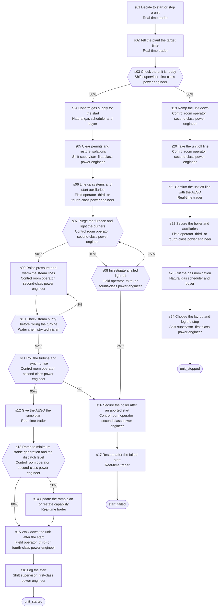

# Start up and shut down gas units

`gen-gas-start-stop-units` · electric power generation · plant operations · part of `power-generation-co`

When prices or a dispatch call for it, the real-time desk decides to bring a converted gas-fired steam unit on line or take it off, and the plant shift crew carries it out. A start means confirming gas supply, clearing permits, lining up systems, purging and lighting the boiler, warming the steam lines, checking steam purity, rolling and synchronising the turbine and ramping to the dispatch level while the desk keeps the AESO informed. Starts take hours and fail now and then on burner or turbine trips, which must be restated to the AESO. Stops are shorter but need the gas nomination cut and the boiler laid up.

| | |
|---|---|
| Unit of work | one unit start or stop |
| Starts when | The real-time desk decides to commit or decommit a unit because of a dispatch, a long lead time requirement or the price outlook. |
| Done when | The unit is synchronised and at its dispatch level with the start logged, or it is off line and secured with the stop logged, or the start has been abandoned and the capability restated. |
| Organisation | An Alberta merchant generator with three coal units converted to gas-fired steam (about 400 to 460 MW each) that cycle with pool prices. (1,300 employees, 2019-2022) |
| Volume | 20 cases a month (range 8 to 45) |

## Where it sits

- Starts with **dispatch_instruction** from mkt-respond-dispatch (100% of cases)
- Relies on **gas_nomination** from mkt-procure-gas (a standing input; it does not start a case)
- Relies on **chemistry_results** from gas-water-chemistry (a standing input; it does not start a case)
- Sends **availability_change** to mkt-restate-offers (outcome: start_failed)
- Sends **availability_change** to mkt-restate-offers (outcome: unit_stopped)
- Sends **unit_status** to mkt-respond-dispatch (outcome: unit_started)
- Sends **unit_status** to mkt-respond-dispatch (outcome: unit_stopped)
- Sends **unit_trip** to gas-respond-forced-outage (outcome: start_failed)

## Flow

## Roles

| Role | Department | Layer | FTE on this process | Loaded cost per hour | Evidence |
|---|---|---|---:|---:|---|
| Real-time trader | Real-time desk | individual contributor | 0.3 | 90 CAD | C |
| Shift supervisor (first-class power engineer) | Wabamun-area converted units | supervisor | 0.4 | 92 CAD | B [src_alis_power_engineer] |
| Control room operator (second-class power engineer) | Wabamun-area converted units | individual contributor | 1.5 | 70 CAD | B [src_alis_power_engineer] |
| Field operator (third- or fourth-class power engineer) | Wabamun-area converted units | individual contributor | 1 | 60 CAD | B [src_alis_power_engineer] |
| Natural gas scheduler and buyer | Commercial and trading | individual contributor | 0.2 | 80 CAD | C |
| Water chemistry technician | Thermal technical services | individual contributor | 0.1 | 60 CAD | C |

## Steps

Hands-on time and the wait before each step show the most common value. Evidence tier A is a sourced number, B a sourced description, C the author's estimate.

| Step | Who | Kind | Hands-on | Wait before | Control | Evidence |
|---|---|---|---:|---:|---|---|
| **s01 Decide to start or stop a unit.** The real-time trader compares the price forecast and the merit order with the unit's start cost, minimum run time and minimum stable level, and with any dispatch already received, and decides to commit the unit or take it off line. For a long lead time start the decision is made hours before the dispatch is expected. | Real-time trader | judgment | 20 min | 0 min |  | B [src_ta_2021_ir], [src_aeso_2013_003r] |
| **s02 Tell the plant the target time.** The trader phones the plant shift supervisor with the target synchronisation or shutdown time, the MW expected after start and the ramp plan, and records the call in the desk log. | Real-time trader | communication | 10 min | 5 min |  | C |
| **s03 Check the unit is ready.** The shift supervisor checks open permits and lockouts on the unit, equipment out of service, staffing on the next shifts and the last chemistry results, and confirms to the desk that the unit can meet the target time or gives a later one. | Shift supervisor (first-class power engineer) | lookup | 30 min | 10 min |  | C |
| **s04 Confirm gas supply for the start.** The gas scheduler checks the plant's gas nomination on the pipeline customer portal and, if the start needs more gas than nominated, submits an intraday nomination change and tells the desk which pipeline cycle it will flow in. | Natural gas scheduler and buyer | data entry | 20 min | 1.0 h |  | C |
| **s05 Clear permits and restore isolations.** The shift supervisor closes or suspends permits that conflict with the start, and a field operator removes locks and tags from equipment returned to service after checking the work party has signed off. | Shift supervisor (first-class power engineer) | coordination | 40 min | 30 min | Alberta OHS Code Part 15 control of hazardous energy (removal of locks) | B [src_alis_power_engineer] |
| **s06 Line up systems and start auxiliaries.** Field operators walk the boiler and turbine start-up checklist: fill and vent the boiler, line up feedwater, condensate and cooling water, start lube oil, seal and turning gear systems, and start the forced and induced draft fans when the control room asks. | Field operator (third- or fourth-class power engineer) | physical | 3.3 h | 2.0 h |  | B [src_alis_power_engineer] |
| **s07 Purge the furnace and light the burners.** The control room operator runs the burner management purge, then lights the igniters and the first gas burners in sequence, watching the flame scanners and furnace pressure, and holds the firing rate low while the boiler warms. | Control room operator (second-class power engineer) | physical | 40 min | 10 min | Burner management system purge and flame-proving interlocks (NFPA 85 practice) | C |
| **s08 Investigate a failed light-off.** A field operator checks the igniters, gas valves, flame scanners and burner management alarms named in the trip message, fixes what operators may fix, and tells the control room whether a retry is safe. | Field operator (third- or fourth-class power engineer) | physical | 1.0 h | 5 min |  | C |
| **s09 Raise pressure and warm the steam lines.** The control room operator raises firing at the rate set by the boiler and turbine metal-temperature limits, opens drains and warms the main and reheat steam lines, and watches drum level swell and stress margins. A hot start takes a few hours; a cold start most of a shift. | Control room operator (second-class power engineer) | judgment | 4.0 h | 0 min |  | C |
| **s10 Check steam purity before rolling the turbine.** The chemistry technician samples steam and feedwater, measures cation conductivity, silica and sodium, and tells the control room whether steam meets the turbine maker's limits or more blowdown is needed. | Water chemistry technician | validation | 30 min | 30 min | Turbine maker's steam purity limits before rolling | C |
| **s11 Roll the turbine and synchronise.** The control room operator rolls the turbine through its speed holds, heat-soaks it, checks vibration and eccentricity, and closes the generator breaker to synchronise to the grid. | Control room operator (second-class power engineer) | physical | 1.5 h | 5 min |  | C |
| **s12 Give the AESO the ramp plan.** The real-time trader tells the AESO system controller the unit is synchronised and gives a verbal plan for ramping to minimum stable generation, with the expected time, as the rule requires for a unit below its minimum stable level. | Real-time trader | communication | 10 min | 5 min | AESO ISO rule 203.4 s.6(1)(b)(iii) (verbal plan for ramping to minimum stable generation) | A [src_aeso_203_4] |
| **s13 Ramp to minimum stable generation and the dispatch level.** The control room operator brings more burners in, transfers to coordinated control and ramps the unit to minimum stable generation and then to the dispatched MW at the offered ramp rate, while field operators put feedwater heaters in service. | Control room operator (second-class power engineer) | physical | 1.0 h | 0 min |  | A [src_aeso_203_4] |
| **s14 Update the ramp plan or restate capability.** When the ramp falls behind plan, the real-time trader calls the AESO with an updated ramp estimate or restates the unit's available capability in the Energy Trading System until it can reach the dispatched level. | Real-time trader | data entry | 10 min | 5 min | AESO ISO rule 203.4 s.5 and s.6(1)(b)(iii) | A [src_aeso_203_4] |
| **s15 Walk down the unit after the start.** Field operators walk the unit after it reaches load, look for steam and water leaks at drains, flanges and expansion joints, check heater levels and pump temperatures, and report anything that needs a work request. | Field operator (third- or fourth-class power engineer) | physical | 1.5 h | 15 min |  | C |
| **s16 Secure the boiler after an aborted start.** The control room operator shuts the burners, lets the fans purge the furnace and brings the boiler back to a safe hold while the supervisor decides whether the cause can be fixed on shift or needs maintenance. | Control room operator (second-class power engineer) | physical | 1.0 h | 5 min |  | C |
| **s17 Restate after the failed start.** The real-time trader restates the unit's available capability to the new expected time it can produce, tells the AESO, and passes the failure to the plant so a work request or forced outage record is opened. | Real-time trader | data entry | 10 min | 5 min | AESO ISO rule 203.4 s.5 (restatement after an operational deviation) | A [src_aeso_203_4], [src_aeso_2013_003r] |
| **s18 Log the start.** The shift supervisor records the start in the shift log with its type (hot, warm or cold), times and problems, and adds it to the start counter used by engineering to track fatigue on boiler headers and the turbine. | Shift supervisor (first-class power engineer) | data entry | 15 min | 15 min |  | B [src_powermag_forced] |
| **s19 Ramp the unit down.** At the dispatched time the control room operator lowers load at the offered ramp rate to minimum stable generation, takes burners out of service in sequence and removes feedwater heaters. | Control room operator (second-class power engineer) | physical | 1.0 h | 2.0 h | AESO ISO rule 203.4 s.4 ramping compliance | A [src_aeso_203_4] |
| **s20 Take the unit off line.** The control room operator opens the generator breaker, trips the turbine, shuts the last burners and lets the fans purge the furnace, then puts the turbine on turning gear. | Control room operator (second-class power engineer) | physical | 30 min | 0 min |  | B [src_alis_power_engineer] |
| **s21 Confirm the unit off line with the AESO.** The real-time trader confirms to the AESO system controller that the unit is off line and sets its available capability for the hours ahead to match how long a restart would take. | Real-time trader | communication | 10 min | 5 min |  | B [src_aeso_2013_003r] |
| **s22 Secure the boiler and auxiliaries.** Field operators shut down fans and pumps no longer needed, close steam and drain valves for a hot hold or open them for lay-up, isolate the gas supply to the burners and leave lube oil and turning gear running. | Field operator (third- or fourth-class power engineer) | physical | 2.5 h | 10 min |  | B [src_alis_power_engineer] |
| **s23 Cut the gas nomination.** The gas scheduler lowers the plant's nomination on the pipeline portal for the next available cycle and records the change so the gas position and balancing exposure are right. | Natural gas scheduler and buyer | data entry | 15 min | 1.0 h |  | C |
| **s24 Choose the lay-up and log the stop.** The shift supervisor decides, with the desk's view of when the unit may be needed again, whether to keep the boiler in hot standby or lay it up wet or dry, and records the stop and the lay-up state in the shift log. | Shift supervisor (first-class power engineer) | judgment | 20 min | 10 min |  | C |

## Exceptions

| Exception | Share of cases | What happens |
|---|---:|---|
| Failed light-off | 5% | Burners fail to light or the burner management system trips during light-off; operators investigate and retry, or abort and restate. |
| Start abandoned | 2% | Repeated light-off failure or a turbine trip during roll; the boiler is secured, capability restated and the fault passed to the forced outage process. |
| Chemistry hold | 4% | Steam purity is outside the turbine maker's limits, so the unit holds at low fire and blows down before rolling. |
| Late ramp | 9% | The unit cannot follow the planned ramp; the desk updates the AESO or restates capability. |

## Benchmarks

| Metric | Value | Unit | Population | Evidence |
|---|---|---|---|---|
| cycle_time_days | p50 0.4, p90 0.75 | calendar days from the desk's decision to unit at load (start) or secured (stop) | Converted gas-fired drum boiler units of about 400 MW; starts and stops together | C |
| failed_start_share | 0.05 | share of starts abandoned | Same units | C |

## Pain points

- Starts take hours, so the desk must commit units on a price forecast long before the price is known; a wrong call means running at a loss or an early stop. (steps s01, s09; B [src_aeso_2013_003r], [src_ta_2021_ir])
- Each start stresses headers, tubes and the turbine; more frequent cycling raises later forced outage risk. (steps s09, s11, s18; B [src_powermag_forced])
- The rule's ramp plan and restatement calls depend on phone calls between plant, desk and AESO, which are slow at shift change. (steps s12, s14, s17; A [src_aeso_203_4])

## Assumptions

- Starts and stops are one case each and split about evenly; the share of starts that fail is a tier C estimate.
- touch_min on field steps is person-minutes for two to three operators. Control room steps count the operator's attention time, which during warming is most of the elapsed time.
- Start durations (hot start of a few hours, cold start of most of a shift) are tier C estimates; no published start curves for the converted Sundance or Keephills units were found.
- The decision and AESO calls are made by the real-time desk as pool participant; the same calls are also part of mkt-respond-dispatch and mkt-restate-offers.
- Volume reflects 2021-2022 merchant gas operation; under coal and power purchase arrangements in 2019-2020 starts were rarer.
- Loaded costs are taken from the organisation file (wage times 1.40).
- The simulated median (about 0.7 days) is above the 0.4-day benchmark because the simulator adds the person-minutes of two to three field operators in sequence and adds steps that in practice overlap (gas nomination, permit clearing and system line-up run side by side during the notice period).

## Sources

- [src_alis_power_engineer] [Power engineer: occupational profile](https://alis.alberta.ca/occinfo/occupations-in-alberta/occupation-profiles/power-engineer) (Government of Alberta, alis, 2026). Power engineers monitor alarms, gauges and instruments, keep a daily log of operation, maintenance and safety activities, start and stop boilers, isolate and lock out equipment for repair, troubleshoot failures and switch to manual control; shift work including nights, weekends and emergency overtime; an ABSA certificate is needed to supervise a power plant and assistants may work under a certified engineer. Publication year not shown; year is the access year.
- [src_aeso_203_4] [ISO Rules Part 200, Section 203.4 Delivery Requirements for Energy (effective 2023-03-31)](https://www.aeso.ca/assets/documents/203.4-Delivery-Requirements-for-Energy-Admin-Amendments-2023-03-31.pdf) (Alberta Electric System Operator, 2023). Pool participants deliver energy only under a dispatch or directive; must use dispatch protocols, personnel and software to detect and address errors; must start moving toward a dispatched MW level within 10 minutes; ramp time limits from the submitted ramp rate; an operational deviation of 20 minutes or longer requires an available capability or MW restatement no later than 20 minutes after it starts; exceptions for units synchronising or going off line at minimum stable generation, with a verbal ramp plan to the ISO updated for deviations over 30 minutes or 50 MW. Revision history: 2023 change was drafting alignment only; 2020-09-16 version in force during 2020-2022.
- [src_aeso_2013_003r] [Information Document ID 2013-003R Outages (posted 2026-05-14)](https://www.aeso.ca/assets/Information-Documents/2013-003R-Outages-2026-05-14.pdf) (Alberta Electric System Operator, 2026). Generation planned outages are submitted through the Energy Trading System and forced outages by telephone to a recorded AESO line; long lead time assets should submit a non-zero available capability from the first interval they can produce; AESO publishes Daily Outage, Monthly Outage (24 months) and 7 Day Hourly Available Capability reports from ETS submissions, updated every 5 to 10 minutes and at most 20 minutes; participants check a missing outage on the ETS Outage Scheduling tab. A later version than the 2019-2022 period; used only where it repeats rule text that was already in force.
- [src_ta_2021_ir] [TransAlta Corporation 2021 Integrated Report (Form 6-K)](https://www.sec.gov/Archives/edgar/data/1144800/000114480022000006/tac2021integratedreportf.htm) (TransAlta Corporation via U.S. SEC EDGAR, 2022). Adjusted availability 90.0 (2019), 90.7 (2020) and 86.6 percent (2021); Sundance 6, Keephills 2 and Keephills 3 converted to gas in Q1, Q2 and Q4 2021; planned conversion outages lowered 2021 availability; Alberta Gas production 8,691, 7,732 and 7,281 GWh in 2019-2021; power dispatched by AESO merit order; the company manages its offers internally and optimised production toward high-price periods in 2021. Only the first 100,000 characters of the filing were read.
- [src_powermag_forced] [Fending off forced power plant outages](https://www.powermag.com/fending-off-forced-power-plant-outages/) (POWER magazine, None). Cites NERC's 2020 State of Reliability (2019 fleet WEFOR 6.97 percent; gas outages spike in extreme winter weather) and NETL (August 2020, GADS data: boiler tube leaks cause more than half of coal-unit forced outages; balance of plant 15, steam turbine 13, generator 12, human error 4 percent; cycling stresses steam piping, headers and tubes) and an Intertek note that a base-load plant moving from 3-6 to 50 starts a year can see component failures within 2-6 years. Publication year not shown on the page as read.

Written by claude-opus on 2026-11-24.
