# Run payroll

`gen-hr-run-payroll` · electric power generation · human resources · part of `power-generation-co`

Every two weeks the payroll team pays about 1,300 employees, a third of them unionised plant, mine and field workers on rotating shifts whose pay includes shift, weekend, call-out and double-time overtime premiums. Supervisors approve their crews' time, payroll imports and checks it against collective agreement rules, enters HR changes, reviews the register and sends the direct deposit file two banking days before pay day. After pay day the team remits source deductions to the CRA on the accelerated schedule, pays union dues and posts labour costs to work orders and projects. Late timesheet approvals, premium coding errors and retroactive pay after late bargaining settlements cause most of the rework.

| | |
|---|---|
| Unit of work | one biweekly payroll run |
| Starts when | The biweekly pay period ends and time and attendance locks the period. |
| Done when | Net pay is deposited, statements are published, source deductions and dues are remitted, and labour costs are posted and reconciled in the general ledger. |
| Organisation | An Alberta merchant power generator with about 1,300 employees under 11 collective agreements, a time and attendance system feeding an HR and payroll system, and a six-person payroll team in human resources. (1,300 employees, 2019-2022) |
| Volume | 2 cases a month (range 2 to 3) |

## Where it sits

- Starts with **timesheet** from gas-operate-units (25% of cases)
- Starts with **timesheet** from gas-routine-maintenance (15% of cases)
- Starts with **timesheet** from hyd-maintain-plants (10% of cases)
- Starts with **timesheet** from wnd-troubleshoot-turbines (5% of cases)
- Starts with **timesheet** from eng-execute-major-outage (10% of cases)
- Starts with **timesheet** from etr-mine-coal (15% of cases)
- Starts with **employee_record** from hr-recruit-hire (12% of cases)
- Starts with **employee_record** from hr-workforce-transition (8% of cases)
- Relies on **collective_agreement** from hr-labour-relations (a standing input; it does not start a case)
- Sends **pay_deposit** to employees (outcome: paid_and_posted)
- Sends **payroll_remittance** to cra (outcome: paid_and_posted)
- Sends **payroll_remittance** to unions (outcome: paid_and_posted)
- Sends **journal_entries** to fin-close-month (outcome: paid_and_posted)

## Flow

```mermaid
flowchart TD
    s01["s01 Close pay period in time and attendance<br/>Automated"]
    s02["s02 Approve crew timesheets and code exceptions<br/>Shift supervisor  first-class power engineer"]
    s03["s03 Chase missing timesheet approvals<br/>Payroll specialist"]
    s04["s04 Import approved time into payroll<br/>Payroll specialist"]
    s05["s05 Clear interface rejects and premium flags<br/>Payroll specialist"]
    s06["s06 Enter employee changes from HR<br/>Payroll specialist"]
    s07{{"s07 Key one-time payments and deductions<br/>Payroll specialist"}}
    s08["s08 Calculate retroactive pay after a settlement<br/>Payroll specialist"]
    s09["s09 Run preliminary payroll calculation<br/>Automated"]
    s10{{"s10 Review payroll register and variance report<br/>Payroll specialist"}}
    s11["s11 Correct errors and recalculate<br/>Payroll specialist"]
    s12{{"s12 Independent review of payroll register<br/>Payroll specialist"}}
    s13{{"s13 Approve payroll and funding<br/>Director, human resources"}}
    s14["s14 Fund payroll account and approve bank file<br/>Treasury analyst"]
    s15["s15 Transmit direct deposit file to bank<br/>Payroll specialist"]
    s16["s16 Bank deposits net pay on pay day<br/>Outside party"]
    s17{{"s17 Publish pay statements in employee self-service<br/>Automated"}}
    s18{{"s18 Remit source deductions to CRA<br/>Payroll specialist"}}
    s19["s19 Remit union dues and pension contributions<br/>Payroll specialist"]
    s20["s20 Post payroll costs to the general ledger<br/>Payroll specialist"]
    s21["s21 Reconcile payroll clearing accounts<br/>Accountant"]
    s22["s22 Handle pay queries and issue off-cycle payments<br/>Payroll specialist"]
    s01 --> s02
    s02 --> s03
    s03 --> s04
    s04 --> s05
    s05 --> s06
    s06 --> s07
    s07 -->|"8%"| s08
    s07 -->|"92%"| s09
    s08 --> s09
    s09 --> s10
    s10 -->|"70%"| s12
    s10 -->|"30%"| s11
    s11 --> s09
    s12 -->|"95%"| s13
    s12 -->|"5%"| s11
    s13 -->|"98%"| s14
    s13 -->|"2%"| s11
    s14 --> s15
    s15 --> s16
    s16 --> s17
    s17 -->|"50%"| s22
    s17 -->|"50%"| s18
    s18 -->|"50%"| s19
    s18 -->|"50%"| s20
    s19 --> s20
    s20 --> s21
    s21 --> end0
    s22 --> s18
    end0(["paid_and_posted"])
```

## Roles

| Role | Department | Layer | FTE on this process | Loaded cost per hour | Evidence |
|---|---|---|---:|---:|---|
| Payroll specialist | Human resources | individual contributor | 2 | 48 CAD | C |
| Shift supervisor (first-class power engineer) | Wabamun-area converted units | supervisor | 0.35 | 92 CAD | B [hrr_ibew254] |
| Director, human resources | Human resources | director | 0.02 | 160 CAD | C |
| Treasury analyst | Treasury and tax | individual contributor | 0.03 | 74 CAD | C |
| Accountant | Controllership and accounts payable | individual contributor | 0.1 | 68 CAD | C |

## Steps

Hands-on time and the wait before each step show the most common value. Evidence tier A is a sourced number, B a sourced description, C the author's estimate.

| Step | Who | Kind | Hands-on | Wait before | Control | Evidence |
|---|---|---|---:|---:|---|---|
| **s01 Close pay period in time and attendance.** At the end of the biweekly pay period the time and attendance system locks the period, fills scheduled hours for shift workers from their rotation and lists timesheets that still have missing punches, unapproved overtime or unexplained absences. | Automated | system auto | 0 min | 0 min |  | C |
| **s02 Approve crew timesheets and code exceptions.** Each front-line supervisor opens the timesheets for their crew, adds overtime, call-outs, shift trades, standby and acting-up pay with the right premium codes from the collective agreement, checks them against the shift log and approves them before the payroll deadline, usually the first working morning after the period ends. | Shift supervisor (first-class power engineer) | approval | 20.0 h | 18.0 h | Supervisor approval of hours worked; pay codes defined by the collective agreements | B [hrr_ibew254] |
| **s03 Chase missing timesheet approvals.** The payroll specialist runs the unapproved-timesheet report, emails or phones supervisors and their backups for the missing approvals, and for crews whose supervisor is off rotation asks the plant manager to approve. | Payroll specialist | communication | 1.0 h | 2.0 h |  | C |
| **s04 Import approved time into payroll.** The payroll specialist runs the interface that sends approved hours and pay codes from time and attendance to the HR and payroll system, and checks that the record count and total hours agree between the two systems. | Payroll specialist | data entry | 30 min | 1.0 h |  | C |
| **s05 Clear interface rejects and premium flags.** The payroll specialist works through the error report: invalid pay codes, employees missing in payroll, hours on closed cost centres, and flags for collective agreement rules such as minimum call-out pay, double time after scheduled hours and statutory holiday premiums, correcting entries after checking with supervisors. | Payroll specialist | validation | 7.0 h | 0 min | Pay provisions of the company's 11 collective agreements | B [hrr_ibew254] |
| **s06 Enter employee changes from HR.** The payroll specialist keys or checks the period's new hires, terminations, transfers, pay rate and step changes, leaves and benefit enrolments received from HR, confirming effective dates against signed offer letters and change forms. | Payroll specialist | data entry | 8.0 h | 0 min |  | C |
| **s07 Key one-time payments and deductions.** The payroll specialist enters bonuses, retention and severance payments, garnishments, union dues changes, savings plan elections and expense reimbursements paid through payroll, each from an approved form. | Payroll specialist | data entry | 2.0 h | 0 min |  | C |
| **s08 Calculate retroactive pay after a settlement.** After a collective agreement is ratified late, the payroll specialist recalculates every affected employee's pay for each past period at the new rates, including overtime and premiums tied to the base rate, checks samples by hand and loads the differences as retroactive earnings. | Payroll specialist | analysis | 1.7 d | 1.0 d | Retroactive wage terms of the ratified collective agreement | B [hrr_ibew254] |
| **s09 Run preliminary payroll calculation.** The payroll system calculates gross pay, taxes, CPP and EI, union dues, pension and benefit deductions and net pay for every employee and produces the preliminary register and variance reports. | Automated | system auto | 0 min | 30 min |  | C |
| **s10 Review payroll register and variance report.** The payroll specialist compares each employee's gross and net pay with the previous period, investigates swings above a threshold, negative or zero net pay, missing employees and unusually large overtime, and checks totals by union and cost centre. | Payroll specialist | analysis | 5.0 h | 4.0 h |  | C |
| **s11 Correct errors and recalculate.** The payroll specialist fixes the time or employee data behind each flagged item, after checking with the supervisor or HR where needed, and reruns the calculation for the affected employees. | Payroll specialist | data entry | 1.0 h | 1.0 h |  | C |
| **s12 Independent review of payroll register.** A second payroll specialist who did not prepare the run reviews the register totals, the largest payments, new employees' bank details and all one-time payments against their approval forms, and signs the checklist. | Payroll specialist | review | 1.0 h | 2.0 h | Payroll preparer and reviewer are different people | C |
| **s13 Approve payroll and funding.** The HR director reviews the register summary, headcount and gross pay against the last run and the budget, asks about large changes and approves the payroll and the funding amount. | Director, human resources | approval | 20 min | 4.0 h | Delegation of authority: payroll approval by the HR director | C |
| **s14 Fund payroll account and approve bank file.** The treasury analyst moves the net pay amount into the payroll bank account, confirms the total in the direct deposit file matches the approved payroll and approves the file in the bank portal. | Treasury analyst | approval | 15 min | 4.0 h | Payroll funds released by treasury, not payroll | C |
| **s15 Transmit direct deposit file to bank.** The payroll specialist generates the direct deposit file and sends it to the bank by the bank's cut-off two banking days before pay day, then checks the bank's acknowledgement of file total and count. | Payroll specialist | data entry | 15 min | 1.0 h |  | C |
| **s16 Bank deposits net pay on pay day.** The bank processes the direct deposit file and credits each employee's account on the pay date, which falls within ten days after the pay period ends as Alberta employment standards require. | Outside party | external wait | 0 min | 2.0 d | Alberta Employment Standards Code: wages paid within 10 consecutive days after the end of the pay period | A [ab_pay_earnings] |
| **s17 Publish pay statements in employee self-service.** The payroll system publishes each employee's statement of earnings online, showing hours, regular and overtime rates, itemised earnings and every deduction, as Alberta employment standards require each pay period. | Automated | system auto | 0 min | 0 min | Alberta Employment Standards Code: statement of earnings each pay period | A [ab_pay_earnings] |
| **s18 Remit source deductions to CRA.** The payroll specialist totals the income tax, CPP and EI withheld plus the employer's CPP and EI share for the run and pays it to the Canada Revenue Agency through the bank portal before the accelerated remitter due date, the third working day after the remitting period that contains the pay date. | Payroll specialist | data entry | 30 min | 1.0 d | Income Tax Act source deduction remittance: threshold 2 accelerated remitter due dates | A [cra_remit] |
| **s19 Remit union dues and pension contributions.** Once a month the payroll specialist prepares the union dues listing for each of the bargaining units and the pension contribution file, sends them to the unions and the pension plan administrator and pays the amounts. | Payroll specialist | data entry | 1.5 h | 1.0 d | Union dues remittance terms of the collective agreements | C |
| **s20 Post payroll costs to the general ledger.** The payroll specialist runs the cost distribution that spreads pay and employer costs across cost centres, maintenance work orders and capital or outage projects according to the hours charged, reviews the suspense lines for closed work orders and posts the journal to the ERP. | Payroll specialist | data entry | 1.5 h | 12.0 h |  | C |
| **s21 Reconcile payroll clearing accounts.** A controllership accountant reconciles the payroll clearing, withholding and benefit liability accounts to the register and the remittances, clears suspense postings to the right cost objects and signs off the reconciliation. | Accountant | review | 1.5 h | 12.0 h | Internal control over financial reporting: account reconciliation and review | C |
| **s22 Handle pay queries and issue off-cycle payments.** The payroll specialist answers employees whose statements show missing overtime, premiums or a wrong rate, checks the approved timesheets, and when the company owes money issues an off-cycle direct deposit or manual cheque rather than waiting for the next run. | Payroll specialist | communication | 2.5 h | 1.0 d |  | C |

## Exceptions

| Exception | Share of cases | What happens |
|---|---:|---|
| Retroactive pay after a late settlement | 8% | A collective agreement is ratified months after its term began, so every affected employee's past periods are recalculated at the new rates. |
| Register corrections | 30% | The variance review finds miscoded premiums, wrong rates or missing employees; data is fixed and the payroll recalculated. |
| Off-cycle payments | 50% | Employees report missing overtime or premiums after pay day and receive a separate payment. |

## Benchmarks

| Metric | Value | Unit | Population | Evidence |
|---|---|---|---|---|
| cycle_time_days | p50 9, p90 13 | calendar days from pay period end to costs posted and reconciled | Biweekly payroll runs at an Alberta employer of about 1,300 staff | C |
| max_days_period_end_to_pay | 10 | calendar days | Employers under the Alberta Employment Standards Code | A [ab_pay_earnings] |
| cra_remittance_due | 3 | working days after each weekly remitting period | Threshold 2 accelerated remitters | A [cra_remit] |

## Pain points

- Supervisors on rotating shifts approve time late or not at all, so payroll chases approvals every run. (steps s02, s03; C)
- Shift, weekend, call-out and overtime premiums under several collective agreements are coded by hand and often wrong, causing register corrections and off-cycle payments. (steps s02, s05, s11, s22; B [hrr_ibew254])
- Collective agreements ratified long after their start date force retroactive recalculation of many past periods. (steps s08; B [hrr_ibew254])

## Assumptions

- Loaded costs come from the organisation file (wage x 1.40).
- Supervisor time approval is shown as one step with the combined time of about 60 supervisors; because they work in parallel, the simulated cycle time overstates elapsed time by up to a day.
- Payroll specialist fte_on_process covers only work on the run; benefits, pension, year-end, records of employment and enquiries outside the run are other processes.
- Pay day is assumed to be the Friday after a period ending on Saturday or Sunday, inside the 10-day limit.
- The pension plan administrator receives contributions but is not an external party in the organisation file, so only the union remittance is listed in interfaces.
- Validator check: simulated median cycle time is about 11.4 days (p90 14) against the tier C benchmark of 9; pay day is reached after a median of about 6.8 days, inside the 10-day legal limit. The gap to the benchmark comes from the supervisors' combined approval time counted serially (about 20 hours) and from off-cycle payments in half the runs.
- Staffing check: roles state 2.5 FTE while hands-on time implies about 1.0 FTE. The stated payroll specialist time includes run-related work the steps do not itemise (answering supervisor questions during the run, preparing audit and union reports, checking garnishment and benefit setups), so the gap is left rather than inflating step times that would lengthen the simulated cycle.

## Sources

- [ab_pay_earnings] [Payment of earnings](https://www.alberta.ca/payment-earnings) (Government of Alberta (Employment Standards), 2024). Wages must be paid at least monthly and within 10 consecutive days after the end of each pay period; each pay period the employee receives a statement of earnings showing hours, regular and overtime rates, itemised earnings and each deduction; electronic statements are allowed.
- [cra_remit] [When to remit (pay) source deductions](https://www.canada.ca/en/revenue-agency/services/tax/businesses/topics/payroll/remitting-source-deductions/how-when-remit-due-dates.html) (Canada Revenue Agency, 2024). Threshold 2 accelerated remitters (average monthly withholding of 100,000 CAD or more two years earlier) remit up to four times a month, for the 1st-7th, 8th-14th, 15th-21st and 22nd-end of month, each due the third working day after the period ends.
- [hrr_ibew254] [TransAlta Generation Partnership and IBEW Local 254 collective agreement summary](https://www.hrreporter.com/chrr-plus/labour-relations/transalta-generation-partnership/296191) (Canadian HR Reporter, 2018). Agreement covering 285 production employees, term January 1, 2017 to December 31, 2019, ratified January 22, 2018 and signed March 23, 2018, more than a year after the term began; 3.3 percent increase; evening and night shift premium 2.79 CAD per hour rising to 2.84; weekend premium of one hour's pay for maintenance staff and hydro operator-maintainers; overtime at double time.

Written by claude-opus on 2026-11-24.
