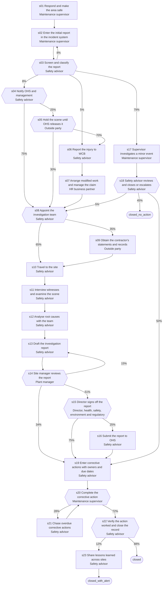

# Report and investigate safety incidents

`gen-hse-manage-incidents` · electric power generation · health and safety · part of `power-generation-co`

Every injury, near miss, hazard or damage event at the company's gas, hydro and wind sites, the coal mine and the outage worksites is reported by the supervisor, classified by a safety advisor and investigated to a depth that matches its severity and potential. Serious events go to Alberta OHS as soon as possible with the scene held, injuries go to WCB within 72 hours, and serious or high-potential events get a full root cause investigation reviewed by the site manager and the HSE director. Most of the elapsed time sits in queues for team meetings, manager review and especially in completing corrective actions that need parts, crews or an outage. Contractor-heavy outage seasons raise the volume.

| | |
|---|---|
| Unit of work | one incident report |
| Starts when | A worker or contractor reports an injury, near miss, hazard, process safety event or damage to a supervisor. |
| Done when | The report is classified, notified to OHS and WCB where required, investigated, its corrective actions are done and verified, and the record is closed. |
| Organisation | An Alberta generator of about 1,300 employees plus outage and mine contractors, with 14 safety advisors and an incident management system, recording about 4 million exposure hours a year. (1,300 employees, 2019-2022) |
| Volume | 45 cases a month (range 25 to 80) |

## Where it sits

- Starts with **incident_report** from gas-routine-maintenance (30% of cases)
- Starts with **incident_report** from eng-execute-major-outage (25% of cases)
- Starts with **incident_report** from etr-mine-coal (15% of cases)
- Starts with **incident_report** from hyd-maintain-plants (12% of cases)
- Starts with **incident_report** from wnd-troubleshoot-turbines (11% of cases)
- Starts with **incident_report** from gas-respond-forced-outage (7% of cases)
- Sends **incident_notification** to alberta_ohs (outcome: any)
- Sends **injury_claim** to wcb (outcome: any)
- Sends **corrective_action** to hse-safety-programs (outcome: closed)
- Sends **corrective_action** to hse-safety-programs (outcome: closed_with_alert)

## Flow

## Roles

| Role | Department | Layer | FTE on this process | Loaded cost per hour | Evidence |
|---|---|---|---:|---:|---|
| Maintenance supervisor | Wabamun-area converted units | supervisor | 1.8 | 95 CAD | C |
| Safety advisor | Health and safety | senior specialist | 2.6 | 80 CAD | B [src1] |
| HR business partner | Human resources | senior specialist | 0.15 | 80 CAD | B [src2] |
| Plant manager | Wabamun-area converted units | manager | 0.12 | 135 CAD | C |
| Director, health, safety, environment and regulatory | Health, safety, environment and regulatory | director | 0.05 | 165 CAD | C |

## Steps

Hands-on time and the wait before each step show the most common value. Evidence tier A is a sourced number, B a sourced description, C the author's estimate.

| Step | Who | Kind | Hands-on | Wait before | Control | Evidence |
|---|---|---|---:|---:|---|---|
| **s01 Respond and make the area safe.** The supervisor on shift goes to the scene, makes sure first aid or an ambulance is arranged, stops the work and puts barriers or isolations in place so nobody else is hurt. For a near miss or hazard this is a brief check that the area is safe. | Maintenance supervisor | physical | 20 min | 5 min | Alberta OHS Code first aid requirements and company emergency response plan | B [src1] |
| **s02 Enter the initial report in the incident system.** Usually at the end of the shift, the supervisor types the event into the incident system: what happened, where, who was involved, the injury or damage, and an initial guess at severity, attaching photos and witness names. | Maintenance supervisor | data entry | 20 min | 4.0 h |  | C |
| **s03 Screen and classify the report.** A safety advisor reads each new record, checks the injury against the WCB and OHS definitions, sets the severity and potential, and decides the path: regulator notification, claim reporting, full investigation, supervisor-level review, or back to the supervisor for missing details. | Safety advisor | validation | 20 min | 12.0 h |  | A [src3] |
| **s04 Notify OHS and management.** For a serious injury or dangerous occurrence the safety advisor phones the OHS Contact Centre as soon as possible; for a potentially serious near miss it files the OHS notification as the 2019-2021 rules required. The advisor then informs the director of HSE, the site manager and, for contractor events, the contractor's management. | Safety advisor | communication | 30 min | 15 min | Alberta OHS Act s. 33: report serious injuries and incidents as soon as possible | B [src1] |
| **s05 Hold the scene until OHS releases it.** The scene stays untouched and the area stays out of service until an OHS officer inspects it or gives permission by phone to disturb it. | Outside party | external wait | 0 min | 8.0 h | Alberta OHS Act s. 33(2): do not disturb the scene without officer permission | B [src1] |
| **s06 Report the injury to WCB.** The safety advisor completes the employer report of injury on the WCB portal with the injury details, time lost and modified work offered, within 72 hours of learning of the injury. | Safety advisor | data entry | 40 min | 1.0 d | WCB Alberta: employer report of injury within 72 hours | A [src2] |
| **s07 Arrange modified work and manage the claim.** The HR business partner talks with the worker, the supervisor and the doctor's notes to set up modified duties, answers WCB's questions on the claim and tracks the return to full work. | HR business partner | coordination | 2.5 h | 1.0 d |  | B [src2] |
| **s08 Appoint the investigation team.** The safety advisor picks an investigation lead and members (supervisor, worker representative from the joint health and safety committee, an engineer for equipment events) and books the site visit. | Safety advisor | coordination | 45 min | 1.0 d |  | B [src1] |
| **s09 Obtain the contractor's statements and records.** The project waits for the contractor company to send its workers' statements, training and qualification records, and its own hazard assessment for the job. | Outside party | external wait | 0 min | 3.0 d |  | C |
| **s10 Travel to the site.** Safety advisors work from the Wabamun plants and Calgary, so for hydro, wind or remote events the advisor drives to the site in a company truck, often booked for the next working day. | Safety advisor | travel | 1.5 h | 12.0 h |  | C |
| **s11 Interview witnesses and examine the scene.** The advisor interviews the injured worker and witnesses, photographs and measures the scene, collects the permit, lockout and hazard assessment forms, and pulls control system or historian records for equipment events. | Safety advisor | physical | 5.0 h | 30 min |  | C |
| **s12 Analyse root causes with the team.** The team meets to build a timeline and root cause analysis, such as a causal tree, separating direct causes from gaps in procedures, training, design or supervision, and agrees corrective actions. | Safety advisor | analysis | 6.0 h | 3.0 d |  | C |
| **s13 Draft the investigation report.** The advisor writes the report in the incident system: what happened, why, and the corrective actions with owners and due dates, as the OHS rules require. | Safety advisor | drafting | 4.0 h | 1.0 d | Alberta OHS Act s. 33: investigation report on circumstances and preventive steps | B [src1] |
| **s14 Site manager reviews the report.** The plant or area manager reads the report, challenges the causes and actions, and either accepts it or sends it back. Serious and high-potential reports then go to the director. | Plant manager | review | 45 min | 3.0 d |  | C |
| **s15 Director signs off the report.** The director of health, safety, environment and regulatory reviews serious and high-potential investigations, checks the actions are strong enough and signs off before the report is issued. | Director, health, safety, environment and regulatory | approval | 30 min | 3.0 d | Company incident management standard: director approval of serious and high-potential investigations | C |
| **s16 Submit the report to OHS.** For an OHS-reportable incident the advisor sends the investigation report to OHS when required, gives it to the joint health and safety committee and files a copy for at least two years. | Safety advisor | communication | 40 min | 1.0 d | Alberta OHS Act s. 33: report to the committee, to OHS on request, retain 2 years | A [src1] |
| **s17 Supervisor investigates a minor event.** For first aid cases, minor near misses, hazards and minor damage the supervisor talks to the people involved, works out a simple cause and records it with any fix in the incident system. | Maintenance supervisor | analysis | 45 min | 2.0 d |  | C |
| **s18 Safety advisor reviews and closes or escalates.** The safety advisor reads the supervisor's investigation, closes it if no action is needed, asks for corrective actions, or escalates it to a full investigation if the potential was higher than first thought. | Safety advisor | review | 15 min | 3.0 d |  | C |
| **s19 Enter corrective actions with owners and due dates.** The advisor creates each corrective action in the incident system, assigns an owner and due date, and links engineering or maintenance actions to a work request. | Safety advisor | data entry | 20 min | 4.0 h |  | C |
| **s20 Complete the corrective action.** The action owner, usually a supervisor, carries out the fix: a guard or label installed through a work order, a procedure rewritten, or a crew briefed. Physical fixes wait for parts, crews or an outage. | Maintenance supervisor | coordination | 3.0 h | 10.0 d |  | C |
| **s21 Chase overdue corrective actions.** The advisor runs the weekly overdue report from the incident system, emails and calls owners, and raises overdue actions at the site safety meeting. | Safety advisor | communication | 20 min | 10.0 d |  | C |
| **s22 Verify the action worked and close the record.** The advisor checks the evidence, often by visiting the work area, confirms the fix is in place and effective, and closes the record. | Safety advisor | validation | 30 min | 5.0 d |  | C |
| **s23 Share lessons learned across sites.** For serious, high-potential or repeated events the advisor writes a one-page safety alert, presents it at the monthly safety meeting and passes changes to standards and training to the safety programs team. | Safety advisor | drafting | 2.0 h | 5.0 d |  | C |

## Exceptions

| Exception | Share of cases | What happens |
|---|---:|---|
| Serious incident reportable to OHS | 2% | A hospital admission, fire, crane upset or structural failure: OHS is called at once, the scene is held, a full investigation follows and the report goes to OHS. |
| Contractor involved | 35% | Among fully investigated events, about a third involve contractor workers, adding a wait for the contractor's statements and records. |
| Overdue corrective action | 15% | An action waiting for parts, a crew or an outage passes its due date and is chased, sometimes repeatedly. |
| Incomplete initial report | 8% | The advisor sends the record back for missing details or a wrong severity before it can be classified. |
| Minor event escalated | 4% | A supervisor-level review reveals higher potential and the event gets a full investigation. |

## Benchmarks

| Metric | Value | Unit | Population | Evidence |
|---|---|---|---|---|
| cycle_time_days | p50 30, p90 90 | calendar days from report to closed record | All incident reports at a large industrial employer | C |
| total_recordable_injury_frequency | 2019 0.73, 2020 0.81, 2021 0.82 | recordable injuries per 200,000 exposure hours (employees and contractors) | Modelled company, whole fleet | A [src3] |
| lost_time_injuries | 2019 5, 2020 5, 2021 3 | incidents per year | Modelled company, whole fleet | A [src3] |

## Pain points

- Corrective actions that need a work order, parts or an outage window sit open for weeks and are chased repeatedly. (steps s20, s21; C)
- Getting the investigation team together across rotating shifts and remote sites delays root cause analysis. (steps s10, s12; C)
- Initial records are often incomplete or mis-graded, so classification is redone and high-potential events can be missed. (steps s02, s03; C)
- Outage seasons double the report volume while the same advisors also cover contractor safety on site. (steps s03, s08, s11; C)

## Assumptions

- maintenance_supervisor stands for every front-line supervisor who receives reports (shift, hydro, wind, mine and specialist crew supervisors, and contractor supervisors under the prime contractor). They work around the clock, so the end-of-shift wait at s02 is used instead of office hours.
- plant_manager_gas stands for the site or area manager who reviews investigations at any site.
- Path shares: about 3 percent of reports are recordable injuries (from TRIF), 2 percent serious OHS-reportable events, 6 percent high-potential near misses, and the rest minor; only the recordable share rests on published data.
- Under the 2018-2021 OHS Act, potentially serious incidents were also notified to OHS, so high-potential near misses pass through s04 without a scene hold; a December 2021 change moved that notice to after the investigation. This rests on general knowledge because the government bulletin could not be opened.
- Corrective-action work itself (repairs, procedure rewrites) is counted only as the supervisor's coordination time; the trade work sits in the maintenance processes.
- Simulated median cycle time is driven by the share of minor reports that close without action (about two weeks) versus those that carry a corrective action (six to ten weeks).

## Sources

- [src1] [Report serious injuries, illnesses or incidents](https://www.alberta.ca/report-serious-injuries-incident) (Government of Alberta (Occupational Health and Safety), 2024). Deaths, hospital admissions, unplanned explosions, fires or floods with serious potential, crane or hoist collapse and structural failure must be reported to the OHS Contact Centre as soon as possible by the prime contractor or employer; scene must not be disturbed (OHS Act s. 33(2)) except to help the injured or prevent further harm; the prime contractor or employer investigates with the joint health and safety committee, writes a report on circumstances and preventive steps, gives it to the committee, provides it to OHS when required and keeps it at least 2 years.
- [src2] [Report an injury: for employers](https://www.wcb.ab.ca/claims/report-an-injury/for-employers.html) (Workers' Compensation Board of Alberta, 2024). Employers must submit the employer report of injury within 72 hours of becoming aware of an injury that causes lost time, modified work beyond the day of the accident, medical treatment beyond first aid, or other listed outcomes; reports go through myWCB, the app or fax.
- [src3] [TransAlta Corporation 2021 Integrated Report (Form 6-K), Sustainability Performance Indicators: health and safety](https://www.sec.gov/Archives/edgar/data/1144800/000114480022000006/tac2021integratedreportf.htm) (TransAlta Corporation via U.S. SEC EDGAR, 2022). Employee and contractor TRIF 0.73 (2019), 0.81 (2020), 0.82 (2021); lost-time injuries 5, 5 and 3; zero fatalities; exposure hours 4,108,000, 3,948,000 and 4,134,000; safety performance 'relatively static in 2021'.

Written by claude-opus on 2026-11-24.
