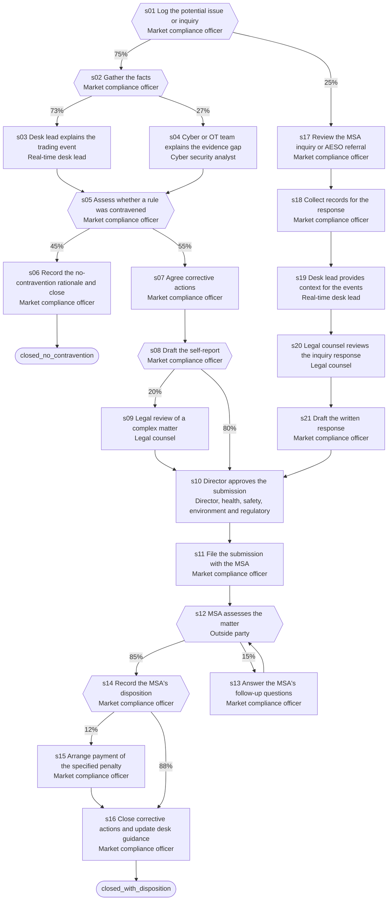

# Monitor market rule compliance and respond to the MSA

`gen-hse-market-compliance` · electric power generation · regulatory compliance · part of `power-generation-co`

Alberta generators must follow the AESO's ISO rules on offers, restatements, dispatch and outages and the Alberta reliability standards, and the Market Surveillance Administrator (MSA) enforces them. The market compliance officers review possible breaches found by daily checks, traders or the cyber team, decide whether a rule was broken, self-report contraventions with corrective actions to win forbearance, and answer MSA inquiries and AESO referrals with legal help. The work turns on judgment about the rule wording and offer reasons, a 30-day window for self-reports, and MSA decisions that take weeks to months.

| | |
|---|---|
| Unit of work | one compliance review or inquiry |
| Starts when | A possible contravention is flagged by the daily offer checks, a trader, operator or the cyber team, or the MSA or AESO sends an inquiry or referral. |
| Done when | The matter is closed internally with a documented no-contravention rationale, or closed after an MSA disposition with any penalty paid and corrective actions complete. |
| Organisation | An Alberta merchant generator with several pool participant entities and a small market compliance team in its regulatory department. (1,300 employees, 2019-2022) |
| Volume | 20 cases a month (range 10 to 40) |

## Where it sits

- Starts with **offer_record** from mkt-restate-offers (35% of cases)
- Starts with **offer_record** from mkt-submit-energy-offers (25% of cases)
- Starts with **cip_evidence** from it-ot-cyber (15% of cases)
- Starts with **msa_inquiry** from msa (25% of cases)
- Relies on **iso_rules** from aeso (a standing input; it does not start a case)
- Relies on **dispatch_log** from mkt-respond-dispatch (a standing input; it does not start a case)
- Sends **compliance_guidance** to mkt-submit-energy-offers (outcome: any)
- Sends **inquiry_response** to msa (outcome: closed_with_disposition)
- Sends **payment_request** to fin-pay-suppliers (outcome: closed_with_disposition)

## Flow

## Roles

| Role | Department | Layer | FTE on this process | Loaded cost per hour | Evidence |
|---|---|---|---:|---:|---|
| Market compliance officer | Regulatory and market compliance | senior specialist | 2.4 | 98 CAD | B [msa_cr2021] |
| Real-time desk lead | Real-time desk | supervisor | 0.1 | 120 CAD | C |
| Legal counsel | Legal and land | senior specialist | 0.15 | 140 CAD | C |
| Director, health, safety, environment and regulatory | Health, safety, environment and regulatory | director | 0.04 | 165 CAD | C |
| Cyber security analyst | Operational technology and cyber security | senior specialist | 0.08 | 92 CAD | C |

## Steps

Hands-on time and the wait before each step show the most common value. Evidence tier A is a sourced number, B a sourced description, C the author's estimate.

| Step | Who | Kind | Hands-on | Wait before | Control | Evidence |
|---|---|---|---:|---:|---|---|
| **s01 Log the potential issue or inquiry.** The market compliance officer logs the item in the compliance tracker: a possible contravention flagged by the daily offer and restatement exception report, a trader or operator, a reliability standard evidence gap from the cyber team, or a letter from the MSA or the AESO, and assigns an owner. | Market compliance officer | intake | 20 min | 4.0 h |  | B [msa_cr2021] |
| **s02 Gather the facts.** The officer pulls the offer and restatement history and dispatch acknowledgements from the AESO Energy Trading System, the dispatch log, historian trends and desk logbooks or chat, and builds a timeline of what happened against the rule's deadlines. | Market compliance officer | lookup | 2.0 h | 1.0 d |  | B [msa_cr2021] |
| **s03 Desk lead explains the trading event.** The real-time desk lead reviews the timeline with the trader or control room operator involved, explains why an offer was restated late, a dispatch was missed or a unit under-delivered, and identifies what in the tools or procedures allowed it. | Real-time desk lead | communication | 45 min | 12.0 h |  | C |
| **s04 Cyber or OT team explains the evidence gap.** A cyber security analyst explains why reliability standard evidence is missing or late, for example an access review, patch assessment or configuration baseline for a plant control system that was not done on schedule, and what was affected. | Cyber security analyst | communication | 1.0 h | 1.0 d |  | B [msa_cr2021] |
| **s05 Assess whether a rule was contravened.** The officer compares the facts with the exact wording of the ISO rule or reliability standard, its compliance exceptions and past MSA dispositions, and decides whether a contravention occurred and whether it is part of a recurring problem. | Market compliance officer | judgment | 1.5 h | 1.0 d |  | C |
| **s06 Record the no-contravention rationale and close.** The officer writes a short rationale citing the rule and the facts, attaches the evidence to the tracker so it can be shown to an auditor or the MSA later, and closes the item. | Market compliance officer | drafting | 30 min | 12.0 h |  | C |
| **s07 Agree corrective actions.** The officer agrees with the desk lead, plant or cyber team what will prevent a repeat, such as coaching, a new alarm in the offer tool or a changed procedure, and for reliability standard matters drafts a mitigation plan with dates. | Market compliance officer | coordination | 1.0 h | 2.0 d |  | B [msa_cp2020] |
| **s08 Draft the self-report.** The officer completes the MSA self-report form with the rule section, timeline, impact on the market or system, root cause, mitigating circumstances and corrective actions, aiming to file within 30 days of the contravention to keep forbearance available. | Market compliance officer | drafting | 2.0 h | 1.0 d | MSA Compliance Process sections 3.1, 4.1 and 5.3: self-report on the MSA form within 30 days to qualify for forbearance; duty to comply under Electric Utilities Act section 20.8 | B [msa_cp2020] |
| **s09 Legal review of a complex matter.** Legal counsel reviews self-reports and responses that could lead to an administrative penalty or an AUC proceeding, checks the wording of admissions and privilege, and advises on what to disclose. | Legal counsel | review | 3.0 h | 3.0 d |  | B [msa_cp2020] |
| **s10 Director approves the submission.** The director of health, safety, environment and regulatory reads the self-report or inquiry response, confirms the facts and corrective actions with the business owner, and approves it for filing. | Director, health, safety, environment and regulatory | approval | 20 min | 1.0 d | Market compliance program: director sign-off on submissions to regulators | C |
| **s11 File the submission with the MSA.** The officer emails the self-report or response to compliance@albertamsa.ca with a copy to the AESO compliance mailbox, or uses a secure channel for sensitive CIP information, and records the filing in the tracker. | Market compliance officer | communication | 15 min | 2.0 h | MSA Compliance Process sections 3.1 and 3.2: submissions to compliance@albertamsa.ca copying the AESO; sensitive CIP information by an agreed channel | A [msa_cp2020] |
| **s12 MSA assesses the matter.** The MSA acknowledges the filing with a file number, reviews the information and any AESO referral material, and either asks the company further questions or issues a disposition. | Outside party | external wait | 0 min | 21.0 d |  | B [msa_cr2021], [msa_cp2020] |
| **s13 Answer the MSA's follow-up questions.** The officer gathers the extra data or explanation the MSA requested, has the desk or cyber team check it, and sends a written answer, usually within two weeks. | Market compliance officer | drafting | 1.5 h | 1.0 d | Alberta Utilities Commission Act: MSA information requests must be answered | B [msa_cp2020] |
| **s14 Record the MSA's disposition.** The officer records the disposition (forbearance, conditional forbearance, no contravention or notice of specified penalty) in the tracker, tells the business owner and updates the count used for repeat-contravention escalation. | Market compliance officer | data entry | 20 min | 12.0 h |  | A [msa_cr2021] |
| **s15 Arrange payment of the specified penalty.** The officer confirms with the director that the company will pay rather than dispute, raises a payment request with accounts payable for the amount set under AUC Rule 019 or 027, and files proof of payment. | Market compliance officer | data entry | 30 min | 3.0 d | Alberta Utilities Commission Act section 52 and AUC Rules 019 and 027: specified penalties paid or disputed before the AUC | B [msa_cr2021], [msa_cp2020] |
| **s16 Close corrective actions and update desk guidance.** The officer checks that the corrective actions or mitigation plan are complete, reports completion to the MSA within five business days where a mitigation plan applies, updates the desk's compliance guidance or training, and closes the file. | Market compliance officer | coordination | 1.0 h | 5.0 d | MSA Compliance Process section 6.4.2: completed mitigation plan form within five business days of completion | B [msa_cp2020] |
| **s17 Review the MSA inquiry or AESO referral.** The officer reads the MSA's letter or the AESO's referral notice, identifies the conduct, period and records requested and the response deadline, and plans who must provide what. | Market compliance officer | analysis | 1.0 h | 12.0 h |  | B [msa_cp2020] |
| **s18 Collect records for the response.** The officer extracts offers, restatements, dispatches, outage records, emails and chat for the period from the ETS, the ETRM and archives, and checks them for completeness before legal review. | Market compliance officer | lookup | 5.0 h | 1.0 d |  | C |
| **s19 Desk lead provides context for the events.** The real-time desk lead explains the offer strategy or operating decisions in the period, such as the reasons recorded for restatements or outages, and identifies the traders and operators involved. | Real-time desk lead | communication | 1.5 h | 2.0 h |  | C |
| **s20 Legal counsel reviews the inquiry response.** Legal counsel reviews the record set and desk statement for privilege and exposure, advises on positions such as whether an offer reason was acceptable, and sets the line the response will take. | Legal counsel | review | 3.0 h | 2.0 d |  | C |
| **s21 Draft the written response.** The officer drafts the written response or additional submission with the facts, records and mitigating circumstances, aiming to file within two weeks of a referral unless the MSA agrees an extension. | Market compliance officer | drafting | 4.0 h | 1.0 d | MSA Compliance Process section 3.3: additional submissions within two weeks of a referral | B [msa_cp2020] |

## Exceptions

| Exception | Share of cases | What happens |
|---|---:|---|
| AESO referral | 5% | The AESO's monitoring finds a suspected contravention first and refers it to the MSA; the company loses the self-report discount and a penalty is far more likely (77 percent of referred ISO rules matters in 2021). |
| MSA follow-up questions | 8% | The MSA asks for more data or explanation before deciding. |
| Specified penalty | 6% | The MSA issues a notice of specified penalty, which the company pays. |

## Benchmarks

| Metric | Value | Unit | Population | Evidence |
|---|---|---|---|---|
| cycle_time_days | p50 40, p90 110 | calendar days from logging the item to closure | Market rule compliance reviews and MSA matters of an Alberta generator | B [msa_cr2021] |
| iso_rules_matters_addressed_market_wide | 462 | matters in 2021 | All Alberta market participants | A [msa_cr2021] |
| self_reported_share | 0.91 | share of ISO rules matters addressed in 2021 | All Alberta market participants | A [msa_cr2021] |

## Pain points

- Deciding whether a restatement reason or a delivery shortfall breaks the rule needs experience with the rule wording and past MSA decisions, and only a few officers have it. (steps s05; B [msa_cr2021])
- Fact gathering spans the ETS, historian, desk logs and chat, and must finish quickly to self-report within 30 days. (steps s02, s03, s08; B [msa_cp2020])
- Matters wait weeks to months at the MSA, so corrective actions and repeat-contravention counts must be tracked across many open files. (steps s12, s16; B [msa_cr2021])

## Assumptions

- Self-identified issues from offer and restatement monitoring are modelled as case triggers; the organisation file lists offer records only as standing inputs.
- MSA inquiries include AESO referrals, because after a referral the MSA has sole carriage of the matter and contacts the company.
- The penalty payment request is routed to accounts payable (fin-pay-suppliers); the organisation file has no such link.
- The MSA Compliance Process of December 2020 governed the reference period; it was later revoked and replaced, which does not change this 2019-2022 description.
- No physical resources, travel or field wait causes apply to this office process.

## Sources

- [msa_cr2021] [MSA Compliance Review 2021](https://www.albertamsa.ca/assets/Documents/Compliance-Review-2021.pdf) (Market Surveillance Administrator (Alberta), 2022). 462 ISO rules matters addressed in 2021 (437 in 2020), 91 percent self-reported; outcomes 341 forbearance, 75 notices of specified penalty, 44 no contravention; 56 matters unresolved at end of 2021; 10 percent of self-reported and 77 percent of AESO-referred matters received a specified penalty; most matters under sections 203.3 (restatements), 203.4, 201.7, 205.5 and 205.6; TransAlta Generation Partnership 8 penalty matters (19,500 CAD), TA Alberta Hydro LP 5 (8,000 CAD), TransAlta Corporation 1 (500 CAD) and TransAlta Generation Partnership 1 O&P ARS matter (2,250 CAD); 80 O&P ARS and 294 CIP ARS matters addressed; O&P ARS counts vary with the three-year audit cycle; no penalty disputed.
- [msa_cp2020] [MSA Compliance Process: ISO Rules and Reliability Standards (effective December 4, 2020, since revoked)](https://www.albertamsa.ca/assets/Documents/2020-12-04-MSA-Compliance-Process.pdf) (Market Surveillance Administrator (Alberta), 2020). Self-report forms sent to compliance@albertamsa.ca copying the AESO; AESO referrals give the MSA sole carriage; additional submissions within two weeks of a referral; dispositions of forbearance, no contravention or notice of specified penalty under AUC Rules 019 and 027; forbearance criteria including a self-report within 30 days of the contravention and a compliance program with corrective actions; mitigation plans for reliability standards with completion reported within five business days; unpaid or disputed penalties go to the AUC.

Written by claude-opus on 2026-11-24.
