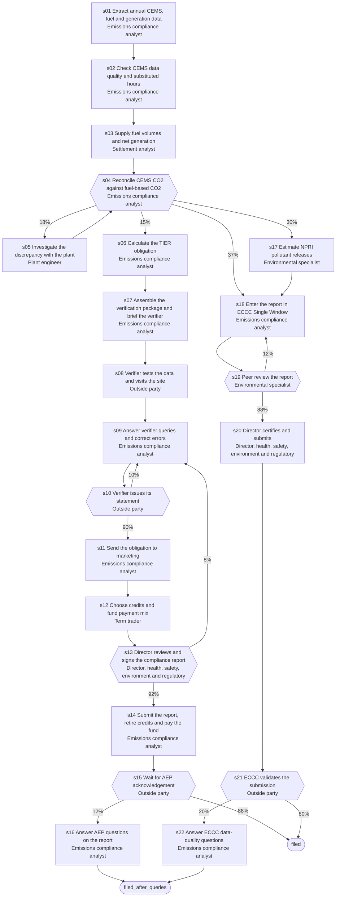

# Prepare TIER and federal emissions reports

`gen-hse-report-emissions-tier` · electric power generation · environment and emissions compliance · part of `power-generation-co`

Each spring the emissions team turns a year of continuous emissions monitoring, fuel and generation data into the facility reports that set the company's carbon bill and meet federal reporting rules. For each large thermal facility it calculates the Alberta TIER obligation against the 0.370 t/MWh electricity benchmark, has the report verified by a third party, settles the obligation with credits or fund payments chosen by the marketing desk and files by June 30; for every reporting facility it files federal greenhouse gas, pollutant inventory and gas-generation regulation reports by June 1. The work is slow because all reports fall due in the same few months, because the CEMS and fuel records must be reconciled, and because verification and sign-off queues sit between a small team and fixed deadlines.

| | |
|---|---|
| Unit of work | one compliance report (one facility, one program, one year) |
| Starts when | The reporting year closes and validated CEMS data for the facility is available. |
| Done when | The report is filed with AEP or ECCC, any TIER obligation is settled by credits or fund payment, and regulator questions are closed. |
| Organisation | An Alberta generator with about four TIER-regulated thermal facilities, about seven federally reporting facilities and a four-person emissions team, paying 160 to 205 million CAD a year in carbon compliance company-wide. (1,300 employees, 2019-2022) |
| Volume | 1.8 cases a month (range 1.2 to 2.2) |

## Where it sits

- Starts with **emissions_data** from gas-run-cems (100% of cases)
- Relies on **emission_credits** from mkt-manage-environmental-credits (a standing input; it does not start a case)
- Sends **tier_compliance_report** to aep (outcome: any)
- Sends **federal_emissions_report** to eccc (outcome: any)
- Sends **compliance_obligation** to mkt-manage-environmental-credits (outcome: any)

## Flow

## Roles

| Role | Department | Layer | FTE on this process | Loaded cost per hour | Evidence |
|---|---|---|---:|---:|---|
| Emissions compliance analyst | Environment and emissions | senior specialist | 1.2 | 82 CAD | B [src1], [src3] |
| Environmental specialist | Environment and emissions | senior specialist | 0.35 | 82 CAD | C |
| Director, health, safety, environment and regulatory | Health, safety, environment and regulatory | director | 0.04 | 165 CAD | C |
| Settlement analyst | Settlement and contract administration | individual contributor | 0.03 | 64 CAD | C |
| Plant engineer | Thermal technical services | senior specialist | 0.03 | 92 CAD | C |
| Term trader | Commercial and trading | senior specialist | 0.04 | 125 CAD | B [src2] |

## Steps

Hands-on time and the wait before each step show the most common value. Evidence tier A is a sourced number, B a sourced description, C the author's estimate.

| Step | Who | Kind | Hands-on | Wait before | Control | Evidence |
|---|---|---|---:|---:|---|---|
| **s01 Extract annual CEMS, fuel and generation data.** After year-end and the last quarterly CEMS audits, the emissions analyst pulls hourly CO2, NOx and SO2 data from the CEMS data system, fuel gas flows and gross and net generation from the plant historian into the facility quantification workbook. Reports are worked in deadline order, so federal ones wait behind TIER packages. | Emissions compliance analyst | lookup | 8.0 h | 70.0 d |  | C |
| **s02 Check CEMS data quality and substituted hours.** The analyst checks each hour flagged as missing or out of control, confirms the substitution method used, compares results with the year's relative accuracy test and calibration records, and notes any hours that need correction. | Emissions compliance analyst | validation | 10.0 h | 2.0 d | Alberta CEMS Code and SOR/2018-261 s. 16 CEMS quality assurance | B [src5] |
| **s03 Supply fuel volumes and net generation.** A settlement analyst in marketing sends the year's metered fuel gas volumes from pipeline statements and net-to-grid energy from AESO settlement, which the emissions team uses as an independent check. | Settlement analyst | lookup | 2.0 h | 5.0 d |  | C |
| **s04 Reconcile CEMS CO2 against fuel-based CO2.** The analyst calculates CO2 from fuel volumes and gas composition and compares it with the CEMS total. A gap above the analyst's tolerance goes to the plant; otherwise the work moves to the report it is for. | Emissions compliance analyst | analysis | 10.0 h | 2.0 d |  | C |
| **s05 Investigate the discrepancy with the plant.** The plant engineer checks meter calibrations, CEMS probe faults and unit events in the historian to explain the gap and tells the analyst which source to correct. | Plant engineer | analysis | 5.0 h | 7.0 d |  | C |
| **s06 Calculate the TIER obligation.** For a TIER facility the analyst multiplies net generation by the 0.370 t/MWh benchmark, subtracts it from total emissions and prices the shortfall at the year's fund price, writing up the compliance report form with all quantification methods. | Emissions compliance analyst | analysis | 16.0 h | 3.0 d | TIER Regulation: facility benchmark and compliance obligation | A [src2], [src1] |
| **s07 Assemble the verification package and brief the verifier.** The analyst gathers the workbook, CEMS audit reports, meter calibration records and procedures into a shared folder, holds a kickoff call with the third-party verifier and books the site visit. | Emissions compliance analyst | coordination | 16.0 h | 14.0 d |  | B [src1] |
| **s08 Verifier tests the data and visits the site.** The external verifier samples hours and meters, re-performs calculations, interviews plant staff and visits the facility, then sends a list of queries and findings. | Outside party | external wait | 0 min | 28.0 d | TIER Regulation: third-party assurance of compliance reports | B [src1] |
| **s09 Answer verifier queries and correct errors.** The analyst answers each query, pulls the records the verifier asks for, corrects misstatements in the workbook and the draft report, and re-sends the revised figures with evidence. | Emissions compliance analyst | data entry | 12.0 h | 2.0 d |  | C |
| **s10 Verifier issues its statement.** The verifier completes its review and issues the verification report and statement. If a material misstatement remains, it goes back to the analyst for another round. | Outside party | external wait | 0 min | 12.0 d |  | C |
| **s11 Send the obligation to marketing.** The analyst sends the verified tonnes owed for the facility to the environmental credits desk in marketing so it can choose which credits to use. | Emissions compliance analyst | communication | 2.0 h | 1.0 d |  | C |
| **s12 Choose credits and fund payment mix.** The term trader compares the cost of offsets and emission performance credits in inventory (many from the company's own hydro and wind) with the fund price, reserves the credits to retire and confirms the fund payment amount. | Term trader | judgment | 4.0 h | 7.0 d |  | B [src1], [src2] |
| **s13 Director reviews and signs the compliance report.** The director of health, safety, environment and regulatory reviews the verified report, the obligation and its cost, and signs it for submission, or sends it back with questions. | Director, health, safety, environment and regulatory | approval | 2.0 h | 4.0 d | TIER compliance report signed by the person responsible for the facility | C |
| **s14 Submit the report, retire credits and pay the fund.** Before June 30 the analyst uploads the report and verification statement to the Alberta submission system, retires the chosen credits in the registry and requests the fund payment from treasury. | Emissions compliance analyst | data entry | 4.0 h | 3.0 d | TIER Regulation: verified compliance report due June 30 | A [src1] |
| **s15 Wait for AEP acknowledgement.** Alberta Environment and Parks logs the report and the credit retirement. In some years it follows up with questions on methods or credits. | Outside party | external wait | 0 min | 2.0 d |  | C |
| **s16 Answer AEP questions on the report.** Weeks or months after filing, the analyst answers AEP's questions on methods or credits, sends supporting records from the verification file and, if needed, files a corrected report. | Emissions compliance analyst | communication | 6.0 h | 45.0 d |  | C |
| **s17 Estimate NPRI pollutant releases.** For the pollutant inventory the environmental specialist estimates NOx, SO2, particulate, mercury and other listed substances from CEMS, stack tests and emission factors, and checks each against the reporting thresholds. | Environmental specialist | analysis | 12.0 h | 14.0 d |  | C |
| **s18 Enter the report in ECCC Single Window.** The analyst keys the facility's emissions, production and methods into the federal Single Window system, which feeds the federal greenhouse gas program, the pollutant inventory and the Alberta greenhouse gas reporting that shares the system, and attaches required auditor reports. | Emissions compliance analyst | data entry | 6.0 h | 10.0 d |  | B [src3], [src4] |
| **s19 Peer review the report.** The environmental specialist compares the draft with last year's report and the workbook, checks large year-on-year changes have an explanation, and returns it if anything is wrong. | Environmental specialist | review | 2.0 h | 3.0 d | Department four-eyes review of regulatory submissions | C |
| **s20 Director certifies and submits.** The director, as the certifying official, reviews the summary and submits the report in Single Window before June 1, making the legal certification of accuracy. | Director, health, safety, environment and regulatory | approval | 1.0 h | 3.0 d | GHGRP and NPRI notices under CEPA and SOR/2018-261 s. 21: report and certify by June 1 | A [src3], [src5] |
| **s21 ECCC validates the submission.** ECCC's system and staff check the report for completeness and unusual values. Most reports are accepted; some come back with data-quality questions. | Outside party | external wait | 0 min | 3.0 d |  | C |
| **s22 Answer ECCC data-quality questions.** Over the summer the analyst looks up each value ECCC flagged, explains it from the workbook or corrects it, and resubmits the report in Single Window. | Emissions compliance analyst | communication | 3.0 h | 60.0 d |  | C |

## Exceptions

| Exception | Share of cases | What happens |
|---|---:|---|
| CEMS and fuel records disagree | 18% | The CEMS total and the fuel-based CO2 differ by more than tolerance and the plant must find the cause before the report can proceed. |
| Material misstatement at verification | 2% | About one in ten TIER reports needs a second round of corrections before the verifier signs. |
| Regulator questions after filing | 18% | AEP or ECCC asks about methods, credits or unusual values weeks after filing and the analyst must answer or refile. |
| Federal report returned at peer review | 8% | The peer reviewer finds a keying error or unexplained change and sends the draft back. |

## Benchmarks

| Metric | Value | Unit | Population | Evidence |
|---|---|---|---|---|
| cycle_time_days | p50 145, p90 178 | calendar days from year-end to filing | Facility emissions reports filed to statutory deadlines | B [src1], [src3], [src5] |
| carbon_compliance_cost | 2019 205, 2020 163, 2021 178 | million CAD per year | Modelled company, all jurisdictions | A [src6] |
| tier_electricity_benchmark | 0.37 | t CO2e/MWh | Alberta electricity generation under TIER | A [src2] |

## Pain points

- Every report falls due within a four-week window, so a four-person team works reports in deadline order and federal reports wait behind TIER verification. (steps s01, s07; A [src1], [src3])
- Verifiers are booked by many facilities in the same spring weeks, so the site visit date sets the timeline. (steps s07, s08; C)
- CEMS data, fuel meter records and settlement volumes sit in different systems and must be pulled and reconciled by hand in spreadsheets. (steps s01, s03, s04, s05; C)
- Errors carry a direct cost: at 30 to 50 CAD a tonne, a 1 percent error on a 3 Mt facility is 0.9 to 1.5 million CAD. (steps s04, s06; B [src2], [src6])

## Assumptions

- One case is one report for one facility and one program. Report types share the data and reconciliation steps (s01-s05), then split: TIER (s06-s16), and federal GHGRP, NPRI and coal or gas-generation regulation reports (s17-s22). The split probabilities at s04 are applied after any reconciliation loop.
- The organisation file's mode of 1 report a month is low: the facility list implies about 20 to 24 reports a year (1.8 a month), all prepared in January to June.
- The organisation file has no external party for the third-party GHG verifier, so verifier steps use the role 'external'. ECCC Single Window and the Alberta credit registry are added as systems because the organisation file lacks them.
- Emission credits arrive mid-case from marketing (s12), so they are listed as an input rather than a trigger.
- TIER replaced the Carbon Competitiveness Incentive Regulation on 1 January 2020; the 2019 compliance year was reported in 2020 under similar verification and June 30 rules. This continuity rests on general knowledge.
- Converted units first fall under SOR/2018-261 annual reporting only once its limits apply; in 2019-2022 the federal coal-fired regulations applied to the coal units, and their reports are treated the same as other federal reports here.
- The simulated 90th percentile (about 220 days) exceeds the 178-day benchmark because the simulation includes regulator questions answered after filing (s16, s22) while the benchmark stops at filing.
- Alberta CEMS Code and the TIER signing requirement are named from general knowledge; those documents were not opened. The TIER verification standard could not be opened (server error), so verification steps are tier B or C.

## Sources

- [src1] [Technology Innovation and Emissions Reduction Regulation](https://www.alberta.ca/technology-innovation-and-emissions-reduction-regulation) (Government of Alberta, 2025). TIER applies to facilities emitting 100,000 t CO2e or more a year in 2016 or later; verified annual compliance reports are due by June 30 of the following year; compliance and benchmark reports need third-party assurance; obligations met by on-site reductions, emission offsets, emission performance credits or TIER fund credits.
- [src2] [TransAlta Corporation Annual Information Form for the year ended December 31, 2021 (Exhibit 13.1 to Form 40-F)](https://www.sec.gov/Archives/edgar/data/1144800/000114480022000004/a20211231tacex131aif.htm) (TransAlta Corporation via U.S. SEC EDGAR, 2022). TIER price set at 50 CAD/t CO2e for 2022; electricity performance benchmark 0.370 t CO2e/MWh; facilities above the benchmark pay into the fund, reduce on site or remit EPCs or offsets; the company receives offsets and EPCs for renewable facilities; converted units' intensities of 0.43 to 0.52 t CO2e/MWh.
- [src3] [About the Greenhouse Gas Reporting Program](https://www.canada.ca/en/environment-climate-change/services/climate-change/greenhouse-gas-emissions/facility-reporting/about.html) (Environment and Climate Change Canada, 2025). Facilities emitting 10,000 t CO2e or more a year must report their emissions by June 1.
- [src4] [Reporting to the National Pollutant Release Inventory](https://www.canada.ca/en/environment-climate-change/services/national-pollutant-release-inventory/report.html) (Environment and Climate Change Canada, 2025). Owners or operators of facilities meeting the requirements must report through Single Window; failing to report, reporting late or false information carries penalties under CEPA ss. 272-273.
- [src5] [Regulations Limiting Carbon Dioxide Emissions from Natural Gas-fired Generation of Electricity (SOR/2018-261)](https://laws-lois.justice.gc.ca/eng/regulations/SOR-2018-261/FullText.html) (Government of Canada, Justice Laws Website, 2018). Annual report due on or before June 1 (s. 21); records kept seven years (s. 25); CEMS certified and audited by an independent auditor whose report accompanies the annual report (s. 16).
- [src6] [TransAlta Corporation 2021 Integrated Report (Form 6-K)](https://www.sec.gov/Archives/edgar/data/1144800/000114480022000006/tac2021integratedreportf.htm) (TransAlta Corporation via U.S. SEC EDGAR, 2022). Carbon compliance costs of 205, 163 and 178 million CAD in 2019-2021; Alberta carbon compliance cost about 16 CAD/MWh each year; total GHG emissions 20.6, 16.4 and 12.5 Mt CO2e in 2019-2021; selected 2021 indicators given limited assurance by Ernst & Young.

Written by claude-opus on 2026-11-24.
