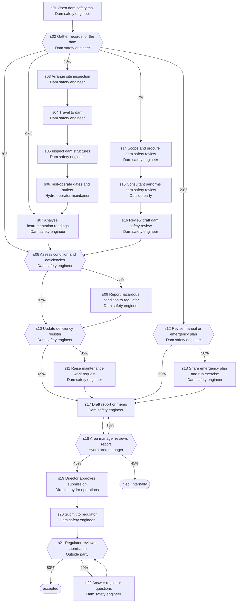

# Run the dam safety program (one dam safety task)

`gen-hyd-dam-safety` · electric power generation · hydro generation · part of `power-generation-co`

As owner of about two dozen dams, dikes and canals behind its seventeen hydro plants, the company must keep each dam's consequence classification, operation and surveillance manual and emergency plan current, inspect the dams, analyse instrument readings, track deficiencies, commission periodic dam safety reviews from qualified consultants and report to the provincial dam safety regulator. A small team of dam safety engineers does this with help from the area operator-maintainers, and the area manager and director review what goes to the regulator. Tasks are slow because inspections depend on season, reservoir level and site access, reports queue behind other work, emergency plan exercises depend on municipalities' calendars, and dam safety reviews take months with consultants.

| | |
|---|---|
| Unit of work | one dam safety task |
| Starts when | A task falls due on the dam safety compliance calendar, or site staff report a condition at a dam. |
| Done when | The task's report is filed internally, or it has been submitted to and accepted by the regulator, with any maintenance work requested. |
| Organisation | An Alberta merchant generator with seventeen hydro plants on the Bow, North Saskatchewan and Oldman rivers run from one Calgary control centre, alongside converted gas units and wind farms. (1,300 employees, 2019-2022) |
| Volume | 8 cases a month (range 4 to 15) |

## Where it sits

- Starts with **dam_safety_directive** from aep (85% of cases)
- Starts with **asset_condition_report** from hyd-maintain-plants (15% of cases)
- Relies on **flow_data** from hyd-operate-plants (a standing input; it does not start a case)
- Sends **dam_safety_report** to aep (outcome: accepted)
- Sends **work_request** to hyd-maintain-plants (outcome: any)
- Sends **service_order** to contractors (outcome: any)

## Flow

## Roles

| Role | Department | Layer | FTE on this process | Loaded cost per hour | Evidence |
|---|---|---|---:|---:|---|
| Dam safety engineer | Hydro generation | senior specialist | 3 | 105 CAD | C |
| Hydro area manager | Hydro generation | manager | 0.15 | 128 CAD | C |
| Director, hydro operations | Hydro generation | director | 0.05 | 165 CAD | C |
| Hydro operator-maintainer | Bow River plants | individual contributor | 0.3 | 64 CAD | C |

## Steps

Hands-on time and the wait before each step show the most common value. Evidence tier A is a sourced number, B a sourced description, C the author's estimate.

| Step | Who | Kind | Hands-on | Wait before | Control | Evidence |
|---|---|---|---:|---:|---|---|
| **s01 Open dam safety task.** A dam safety engineer opens the next task from the dam safety compliance calendar (annual inspection, instrumentation review, manual or emergency plan review, dam safety review) or from a condition reported by site staff, and logs it in the task tracker with the dam, the due date and the requirement it meets. | Dam safety engineer | intake | 20 min | 1.0 d |  | B [s1], [s2] |
| **s02 Gather records for the dam.** The engineer pulls the dam's consequence classification, last inspection and dam safety review reports, open deficiencies, drawings, the operation, maintenance and surveillance manual and the instrumentation data from the historian. | Dam safety engineer | lookup | 2.0 h | 1.0 d |  | B [s1], [s8] |
| **s03 Arrange site inspection.** The engineer books a date with the area operator-maintainers, picks a time when reservoir level and weather expose the features to be seen, and arranges boat or ice access and any gate tests with the control centre. | Dam safety engineer | coordination | 30 min | 5.0 d |  | C |
| **s04 Travel to dam.** The engineer drives from Calgary to the dam, up to three hours each way for the North Saskatchewan plants, and meets the operator-maintainer at site. | Dam safety engineer | travel | 2.5 h | 0 min |  | B [s6] |
| **s05 Inspect dam structures.** The engineer walks the crest, faces, abutments, spillway, outlet works and toe, compares cracks, seepage, settlement and erosion with the last report, photographs changes and notes deficiencies on the checklist. | Dam safety engineer | physical | 5.0 h | 0 min | Alberta Dam and Canal Safety Directive: surveillance and periodic assessment by qualified professionals | B [s1], [s8] |
| **s06 Test-operate gates and outlets.** While the engineer inspects, the operator-maintainer runs each spillway gate, low-level outlet and backup power supply through its test, with the control centre watching levels, and records opening times and any binding or alarms. | Hydro operator-maintainer | physical | 2.0 h | 0 min | OMS manual under the Alberta Dam and Canal Safety Directive (annual test operation of gates and outlets, as in BC Dam Safety Regulation Schedule 2) | B [s8] |
| **s07 Analyse instrumentation readings.** The engineer plots piezometer levels, seepage weir flows, survey monument movement and inclinometer readings against reservoir level and alarm thresholds, and looks for trends that differ from past years. | Dam safety engineer | analysis | 3.0 h | 1.0 d |  | B [s8], [s9] |
| **s08 Assess condition and deficiencies.** The engineer judges the dam's condition from the inspection, gate tests and instrument trends, rates each deficiency by its safety effect, and decides whether any finding is a hazardous condition that must go to the regulator now. | Dam safety engineer | judgment | 2.0 h | 1.0 d |  | C |
| **s09 Report hazardous condition to regulator.** The engineer phones and then writes to the provincial dam safety regulator describing the condition, the actions taken (lower the reservoir, increase surveillance) and next steps, after informing the area manager and director. | Dam safety engineer | communication | 2.0 h | 1.0 h | Water (Ministerial) Regulation Part 6: report hazardous conditions to the Director | A [s1] |
| **s10 Update deficiency register.** The engineer enters new and closed deficiencies in the register with rating, owner and target date, and decides which need maintenance work and which need engineering study or capital. | Dam safety engineer | data entry | 40 min | 0 min | Alberta Dam and Canal Safety Directive: owners track and address deficiencies and report them | B [s1], [s2] |
| **s11 Raise maintenance work request.** The engineer raises a work request in the ERP for each deficiency the area crew can fix (vegetation, riprap, drains, gate seals, instrument repairs) with the priority and target date. | Dam safety engineer | data entry | 30 min | 0 min |  | C |
| **s12 Revise manual or emergency plan.** The engineer updates the operation, maintenance and surveillance manual or the emergency management plan: contact lists, inundation maps, surveillance frequencies, gate procedures and notification charts, and marks changes for review. | Dam safety engineer | drafting | 10.0 h | 3.0 d | Alberta Dam and Canal Safety Directive: OMS manuals and emergency management plans kept current | B [s1], [s8] |
| **s13 Share emergency plan and run exercise.** The engineer sends the updated emergency plan to downstream municipalities and emergency services, and organises a tabletop or notification exercise with them, then records lessons and fixes. | Dam safety engineer | coordination | 8.0 h | 21.0 d | Alberta Dam and Canal Safety Directive: emergency plans shared with stakeholders and tested | B [s1], [s2], [s4] |
| **s14 Scope and procure dam safety review.** The engineer writes the scope for the periodic dam safety review, gets quotes from qualified engineering firms through supply chain, and issues the service order to the chosen consultant. | Dam safety engineer | drafting | 16.0 h | 7.0 d |  | B [s1], [s8] |
| **s15 Consultant performs dam safety review.** The consultant reviews design, construction and performance records, inspects the dam, checks flood and earthquake capacity against current guidelines and writes a draft report with recommendations. | Outside party | external wait | 0 min | 120.0 d |  | C |
| **s16 Review draft dam safety review.** The engineer checks the draft against the scope and records, challenges recommendations that rest on wrong data, and agrees the final report and the owner's action plan with the consultant. | Dam safety engineer | review | 16.0 h | 5.0 d |  | C |
| **s17 Draft report or memo.** The engineer writes the inspection report, annual performance review, instrumentation memo or covering letter, with photos, plots, deficiency table and recommendations, and authenticates it as a professional engineer where it goes to the regulator. | Dam safety engineer | drafting | 5.0 h | 5.0 d | APEGA authentication of engineering documents; Directive requires qualified professionals | B [s9] |
| **s18 Area manager reviews report.** The hydro area manager reads the report for operational effects (reservoir restrictions, gate limits, work that needs outages or budget) and agrees the action dates. | Hydro area manager | review | 45 min | 3.0 d |  | C |
| **s19 Director approves submission.** The director of hydro operations, as the owner's accountable person, reads the summary and signs the covering letter for submissions to the regulator. | Director, hydro operations | approval | 30 min | 2.0 d | Owner accountability for dam safety: submissions signed by the accountable director | B [s1] |
| **s20 Submit to regulator.** The engineer uploads the report and covering letter through the provincial submission portal or by email to the dam safety regulator and files the confirmation. | Dam safety engineer | communication | 30 min | 4.0 h | Water (Ministerial) Regulation Part 6 compliance reporting | B [s2], [s9] |
| **s21 Regulator reviews submission.** Provincial dam safety staff carry out a technical review of the submission against the Directive and either accept it or send questions and requests for more analysis or work. | Outside party | external wait | 0 min | 30.0 d |  | B [s2] |
| **s22 Answer regulator questions.** The engineer prepares answers, extra analysis or a revised report, gets the area manager's agreement on any new commitments and resubmits. | Dam safety engineer | drafting | 5.0 h | 5.0 d |  | C |

## Exceptions

| Exception | Share of cases | What happens |
|---|---:|---|
| Hazardous condition found | 3% | A finding is reported to the regulator at once, with reservoir restrictions or extra surveillance. |
| Dam safety review | 7% | A consultant review takes several months and its recommendations feed the deficiency register. |
| Regulator questions | 9% | The regulator asks for more information or work before accepting a submission. |

## Benchmarks

| Metric | Value | Unit | Population | Evidence |
|---|---|---|---|---|
| cycle_time_days | p50 45, p90 150 | calendar days from task opening to filing or regulator acceptance | Dam safety tasks at a hydro owner with about 25 regulated structures | C |
| dam_safety_review_interval | p50 10, p90 10 | years between dam safety reviews (very high and high consequence dams; 7 for extreme) | British Columbia regulated dams, used as a comparable Canadian rule | A [s8] |
| consequence_classes | 5 | consequence classes in Alberta (low to extreme) | Alberta regulated dams | A [s1] |

## Pain points

- Inspections must wait for a season, reservoir level and access window, so a missed window pushes a task by months. (steps s03, s04; C)
- Reports queue behind field work and flood season for a team of four, and wait again for area manager and director review. (steps s17, s18, s19; C)
- Deficiency register and task calendar are kept in spreadsheets, so closing items and proving compliance to the regulator takes manual reconciliation. (steps s01, s10; B [s1], [s2])

## Assumptions

- Alberta's Dam and Canal Safety Directive text could not be opened (the PDF was not readable), so frequencies of inspections, gate tests, instrument reviews and dam safety reviews are taken from British Columbia's Dam Safety Regulation as a comparable Canadian rule and marked as such.
- The process map gives this process no trigger; the workflow treats the provincial requirements (dam_safety_directive) as the calendar trigger and condition reports from maintenance crews (asset_condition_report) as event triggers.
- Structure count (about 25 dams, dikes and canals) is an estimate from the 17 plants; several Bow River plants have more than one dam or canal.
- Cycle time includes the regulator's review only for the 45 percent of tasks that are submitted; internal tasks end at the area manager's review.

## Sources

- [s1] [Dam and canal safety regulatory framework](https://www.alberta.ca/dam-and-canal-safety-regulatory-framework) (Government of Alberta, 2024). Water (Ministerial) Regulation Part 6 and the Alberta Dam and Canal Safety Directive; five consequence classes (low, significant, high, very high, extreme) assessed by qualified professionals, accepted by the regulator and reviewed periodically; owners must keep operation, maintenance and surveillance (OMS) manuals and emergency management plans prepared by qualified people, reviewed and tested periodically and shared with key stakeholders; periodic safety assessments by qualified professionals reported to the regulator; owners must track deficiencies and report hazardous conditions and significant changes in operation or surveillance to the Director.
- [s2] [Dam and canal safety: regulatory processes](https://www.alberta.ca/dam-and-canal-safety-regulatory-processes) (Government of Alberta, 2024). Mandatory compliance reporting by owners on plans, operation, safety assessments and evaluations, with technical review by the regulator; yearly regulator audit inspections scheduled by consequence class; owners document and report deficiencies and the regulator follows up until remediated; owners hold regular emergency exercises with downstream stakeholders.
- [s4] [Hydro safety](https://transalta.com/our-operations/safety/hydro-safety) (TransAlta Corporation, 2024). Water levels near Bearspaw Dam can rise or fall up to 2 metres in a short time; hydro operations support flood control, drought mitigation and irrigation and convey water to licence holders including irrigation districts and municipalities; buffer zones, signs, booms and barriers; regular patrols, inspections, safety audits and infrastructure maintenance; coordination with regulators, police and emergency responders.
- [s6] [TransAlta Corporation Annual Information Form for the year ended December 31, 2021 (Exhibit 13.1 to Form 40-F)](https://www.sec.gov/Archives/edgar/data/1144800/000114480022000004/a20211231tacex131aif.htm) (TransAlta Corporation via U.S. SEC EDGAR, 2022). Alberta hydro facilities: Bow River system 11 plants (338 MW: Barrier, Bearspaw, Cascade, Ghost, Horseshoe, Interlakes, Kananaskis, Pocaterra, Rundle, Spray, Three Sisters), North Saskatchewan system 2 plants (Bighorn 120 MW, Brazeau 355 MW), Oldman system 4 small plants (21 MW); merchant sale into the Alberta spot market after PPA expiry; value from capacity, energy and ancillary services; Belly River operates April to October.
- [s8] [Dam Safety Regulation, B.C. Reg. 40/2016, Schedule 2](https://www.bclaws.gov.bc.ca/civix/document/id/complete/statreg/40_2016) (Province of British Columbia (BC Laws), 2016). Comparable Canadian regulation used for frequencies: weekly site surveillance for high to extreme dams, annual formal inspection (semi-annual for extreme), annual test operation of spillway gates, outlets and equipment, annual instrumentation analysis, annual review of emergency contacts, OMS manual and emergency plan review every 7 to 10 years, dam safety review every 7 years (extreme) or 10 years (very high, high); prompt notice of hazardous conditions and a written report within 30 days of rectification.
- [s9] [Dam safety (AER web page on dams it regulates)](https://www.aer.ca/node/4393) (Alberta Energy Regulator, 2024). Regulatory submissions reviewed include annual performance reviews, dam safety reviews and emergency management plans under Part 6 of the Water (Ministerial) Regulation and the Alberta Dam and Canal Safety Directive; owners must continuously monitor and assess structural integrity and report dam-related incidents and emergencies; inspection frequency set by consequence classification.

Written by claude-opus on 2026-11-24.
