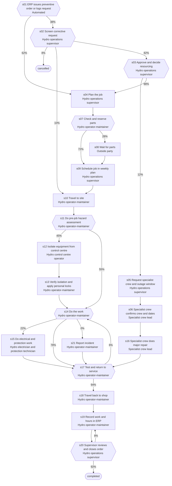

# Maintain hydro plants and dams (one work order)

`gen-hyd-maintain-plants` · electric power generation · hydro generation · part of `power-generation-co`

Operator-maintainers and electricians based at area shops keep seventeen mostly unstaffed hydro plants and their dams, gates and canals working. Each work order is either a preventive task released by the ERP from a maintenance plan or a repair requested by the control centre, site staff or dam safety engineers; the supervisor plans and schedules it, the crew drives to site, isolates the equipment with the control centre, does the work and records it. Larger jobs need a specialist crew from engineering and a unit outage timed to low flows. Work is slowed by weekly scheduling backlogs, parts lead times, long drives to remote sites, winter weather and the wait for specialist crews.

| | |
|---|---|
| Unit of work | one work order |
| Starts when | A preventive work order falls due in the ERP, or a corrective work request is submitted. |
| Done when | The work is done, the equipment is back in service and the work order is closed with hours and failure codes, or the request is cancelled. |
| Organisation | An Alberta merchant generator with seventeen hydro plants on the Bow, North Saskatchewan and Oldman rivers run from one Calgary control centre, alongside converted gas units and wind farms. (1,300 employees, 2019-2022) |
| Volume | 550 cases a month (range 400 to 800) |

## Where it sits

- Starts with **work_request** from hyd-operate-plants (30% of cases)
- Starts with **work_request** from hyd-dam-safety (5% of cases)
- Starts with **maintenance_strategy** from eng-reliability-analysis (62% of cases)
- Starts with **crew_assignment** from eng-dispatch-specialist-crews (3% of cases)
- Relies on **issued_parts** from scm-manage-stores (a standing input; it does not start a case)
- Relies on **water_schedule** from hyd-plan-water-schedule (a standing input; it does not start a case)
- Sends **material_request** to scm-manage-stores (outcome: completed)
- Sends **work_order_history** to eng-reliability-analysis (outcome: completed)
- Sends **timesheet** to hr-run-payroll (outcome: completed)
- Sends **incident_report** to hse-manage-incidents (outcome: completed)
- Sends **crew_request** to eng-dispatch-specialist-crews (outcome: completed)

## Flow

## Roles

| Role | Department | Layer | FTE on this process | Loaded cost per hour | Evidence |
|---|---|---|---:|---:|---|
| Hydro operator-maintainer | Bow River plants | individual contributor | 26 | 64 CAD | C |
| Hydro electrician and protection technician | North Saskatchewan plants | individual contributor | 9 | 68 CAD | C |
| Hydro operations supervisor | Hydro generation | supervisor | 4 | 92 CAD | C |
| Hydro control centre operator | Hydro control centre | individual contributor | 0.4 | 68 CAD | C |
| Specialist crew lead | Specialist maintenance crews | supervisor | 0.4 | 85 CAD | C |

## Steps

Hands-on time and the wait before each step show the most common value. Evidence tier A is a sourced number, B a sourced description, C the author's estimate.

| Step | Who | Kind | Hands-on | Wait before | Control | Evidence |
|---|---|---|---:|---:|---|---|
| **s01 ERP issues preventive order or logs request.** The ERP plant maintenance module releases preventive work orders from the maintenance plans when they fall due (inspections, lubrication, gate exercising, protection tests), and records corrective work requests raised by operators, operator-maintainers or the dam safety engineers. | Automated | system auto | 0 min | 0 min |  | B [s11] |
| **s02 Screen corrective request.** The hydro operations supervisor reads the request, checks for duplicates and recent work on the same equipment, and judges how urgent it is from the effect on the unit, the dam or safety. | Hydro operations supervisor | judgment | 10 min | 1.0 d |  | C |
| **s03 Approve and decide resourcing.** The supervisor approves the work order, sets the priority, and decides whether the area crew can do it or whether it needs a specialist crew from engineering and a planned unit outage. | Hydro operations supervisor | approval | 10 min | 0 min | Maintenance work order approval authority | C |
| **s04 Plan the job.** The supervisor writes or copies the job plan: task steps, crew size, estimated hours, parts and tools, isolation points and permits, and links any standard job plan. Preventive orders mostly reuse the standard plan. | Hydro operations supervisor | drafting | 30 min | 2.0 d |  | C |
| **s05 Request specialist crew and outage window.** The supervisor sends a crew request to engineering's specialist crews, asks Hydro Scheduling and the trading desk for a unit outage in low-flow or low-price weeks, and enters the planned outage so it can be reported to the AESO. | Hydro operations supervisor | coordination | 2.0 h | 1.0 d |  | C |
| **s06 Specialist crew confirms crew and dates.** The specialist crew lead fits the job into the crews' outage season schedule, confirms the crew, cranes and tools, and agrees the start date with the hydro supervisor, often months later in the autumn or winter low-flow season. | Specialist crew lead | coordination | 1.0 h | 42.0 d |  | C |
| **s07 Check and reserve parts.** An operator-maintainer looks up the parts on the job plan in the ERP stores catalogue, reserves what is in stock at the warehouse, and raises a material request for anything that must be bought. | Hydro operator-maintainer | lookup | 20 min | 4.0 h |  | C |
| **s08 Wait for parts.** The supplier ships the purchased parts to the warehouse, the storekeeper receives them and they are sent to the area shop. Special parts for older units can take weeks. | Outside party | external wait | 0 min | 10.0 d |  | C |
| **s09 Schedule job in weekly plan.** At the weekly scheduling meeting the supervisor slots the job by due date and priority, and agrees with the control centre and Hydro Scheduling when a unit or gate can come out of service without spilling water or missing high-price hours. | Hydro operations supervisor | coordination | 20 min | 5.0 d |  | C |
| **s10 Travel to site.** The crew loads the truck at the area shop and drives to the plant or dam. One trip usually covers several work orders at the same site, so the minutes are each order's share; winter roads and storms delay trips. | Hydro operator-maintainer | travel | 25 min | 1.0 h |  | B [s6] |
| **s11 Do pre-job hazard assessment.** The crew walks the job, fills in the field-level hazard assessment for the task (water, confined spaces, working at heights, energised equipment) and holds a short tailboard before starting. | Hydro operator-maintainer | validation | 15 min | 0 min | Alberta OHS Code hazard assessment requirements and the company field-level hazard assessment | C |
| **s12 Isolate equipment from control centre.** On the crew's request the control centre operator opens breakers and closes gates remotely, places SCADA tags and issues the isolation to the permit holder in the permit system. | Hydro control centre operator | coordination | 20 min | 30 min | Alberta OHS Code Part 15 (isolation, verification, personal locks, group control) and the company permit-to-work procedure | B [s5], [s10] |
| **s13 Verify isolation and apply personal locks.** The permit holder tests that the equipment is de-energised and gates cannot move, every worker applies a personal lock to the group lock box, and the permit is signed on. | Hydro operator-maintainer | validation | 20 min | 0 min | Alberta OHS Code Part 15 (isolation, verification, personal locks, group control) and the company permit-to-work procedure | B [s10] |
| **s14 Do the work.** The operator-maintainers carry out the inspection, lubrication, filter or seal change, gate or hoist repair, or other task on the job plan, take readings, and note any further defects they find. Minutes are person-minutes for the crew. | Hydro operator-maintainer | physical | 1.5 h | 0 min |  | B [s11] |
| **s15 Do electrical and protection work.** The hydro electrician tests protection relays, services breakers, exciters, station batteries or control wiring, and records test results against settings. | Hydro electrician and protection technician | physical | 2.5 h | 1.0 h | Alberta compulsory trade certification for electricians | B [s11] |
| **s16 Specialist crew does major repair.** The specialist crew lead runs the major job (wicket gates, runner or seal repair, generator work, spillway gate hoist) with turbine and rigging technicians under a group lockout, using a mobile crane where needed. Minutes are the crew lead's own hours. | Specialist crew lead | physical | 1.2 d | 1.0 d | Alberta OHS Code Part 15 (isolation, verification, personal locks, group control) and the company permit-to-work procedure | C |
| **s17 Test and return to service.** The crew runs the equipment or unit under the control centre's watch, checks readings, removes personal locks, signs off the permit and asks the control centre to restore the unit. | Hydro operator-maintainer | validation | 30 min | 0 min | Alberta OHS Code Part 15 (isolation, verification, personal locks, group control) and the company permit-to-work procedure | C |
| **s18 Travel back to shop.** The crew drives back to the area shop or on to the next site; as with the outbound trip, the minutes are this order's share of a shared trip. | Hydro operator-maintainer | travel | 25 min | 0 min |  | C |
| **s19 Record work and hours in ERP.** The lead operator-maintainer enters actual hours, failure and cause codes, parts used and readings on the work order, and the crew's time goes into the time and attendance system for payroll. | Hydro operator-maintainer | data entry | 20 min | 1.0 d |  | C |
| **s20 Supervisor reviews and closes order.** The supervisor checks the work order record for completeness, approves the hours and closes the order, raising a follow-up order for defects found and flagging repeat failures for the reliability engineers. | Hydro operations supervisor | review | 10 min | 3.0 d |  | C |
| **s21 Report incident.** After first aid or making the site safe, the crew lead enters the injury, near miss or equipment damage in the incident management system and notifies the supervisor and safety advisor, then the job resumes or is re-planned. | Hydro operator-maintainer | drafting | 1.0 h | 30 min | Alberta OHS Act and Code incident reporting duties and the company incident standard | C |

## Exceptions

| Exception | Share of cases | What happens |
|---|---:|---|
| Specialist crew and unit outage | 4% | A major repair waits months for a specialist crew and a low-flow outage window. |
| Parts not in stock | 27% | Parts must be bought and the job waits for delivery. |
| Urgent repair | 4% | A fault that threatens a unit, gate or safety goes straight to a crew without planning. |
| Failed test | 6% | The equipment fails its return-to-service test and the crew repeats the repair. |

## Benchmarks

| Metric | Value | Unit | Population | Evidence |
|---|---|---|---|---|
| cycle_time_days | p50 21, p90 55 | calendar days from order release or request to closure | Hydro maintenance work orders at a multi-site generator | C |

## Pain points

- Long drives to remote mountain and foothill plants eat crew time, so jobs are bundled by site and wait for the next trip. (steps s09, s10, s18; C)
- Major repairs wait months for a specialist crew shared with the thermal fleet and for a low-flow outage window. (steps s05, s06; C)
- Work order records are completed days later and often lack failure codes, which weakens reliability analysis. (steps s19, s20; C)

## Assumptions

- The organisation file has no hydro maintenance planner; supervisors plan and schedule, which is common in small hydro groups. A planner role would shorten the planning backlog.
- Touch minutes for crew work are person-minutes for the whole crew; travel is the order's share of a trip that serves several orders.
- The process map triggers this process from operations, stores, specialist crews and dam safety, but preventive orders from maintenance plans (about 62 percent) are not linked; they are shown here as coming from eng-reliability-analysis (maintenance_strategy). Issued parts are treated as an input, not a trigger.
- Hands-on time is about 10 to 11 hours per order on average, which at 550 orders a month implies about 45 FTE against about 40 stated and 56 operator-maintainers and electricians in the organisation file.

## Sources

- [s5] [Hydro Generation Operator I (Calgary) job posting](https://jobs.transalta.com/job/Calgary-Hydro-Generation-Operator-I-AB/1451367700/) (TransAlta Corporation, 2026). Operators in the Calgary Hydro System Control Centre remotely monitor and operate the hydro fleet through SCADA on rotating 12-hour day and night shifts; execute AESO dispatches, ancillary services directives and voltage instructions and monitor AGC; manage reservoirs, forebays, canals and river flows within operating constraints; acknowledge and respond to alarms; coordinate switching, isolations, equipment status and after-hours response with site operations, maintenance and Hydro Scheduling; keep electronic operating logs and shift handovers. Posted November 2026, after the reference period.
- [s6] [TransAlta Corporation Annual Information Form for the year ended December 31, 2021 (Exhibit 13.1 to Form 40-F)](https://www.sec.gov/Archives/edgar/data/1144800/000114480022000004/a20211231tacex131aif.htm) (TransAlta Corporation via U.S. SEC EDGAR, 2022). Alberta hydro facilities: Bow River system 11 plants (338 MW: Barrier, Bearspaw, Cascade, Ghost, Horseshoe, Interlakes, Kananaskis, Pocaterra, Rundle, Spray, Three Sisters), North Saskatchewan system 2 plants (Bighorn 120 MW, Brazeau 355 MW), Oldman system 4 small plants (21 MW); merchant sale into the Alberta spot market after PPA expiry; value from capacity, energy and ancillary services; Belly River operates April to October.
- [s10] [Occupational Health and Safety Code, Part 15: Managing the control of hazardous energy](https://search-ohs-laws.alberta.ca/legislation/occupational-health-and-safety-code/part-15-managing-the-control-of-hazardous-energy/) (Government of Alberta, 2023). Part 15 sections on isolation of machinery and equipment (s. 212), verifying isolation (s. 213), assigning personal locks (s. 214), securing by individual workers (s. 214.1) and securing by group control procedures (s. 215).
- [s11] [Asset management strategies: HEPs move from reactive to proactive O&M practices](https://powerline.net.in/2024/07/30/asset-management-strategies-heps-move-from-reactive-to-proactive-om-practices/) (Power Line magazine, 2024). Hydro O&M practice: approved maintenance schedules following manufacturer guidance; annual work on underwater turbine parts; periodic inspections of water conductor systems; generator insulation and winding tests; protection system testing; vibration monitoring; move from reactive and fixed-interval maintenance to condition-based work.

Written by claude-opus on 2026-11-24.
