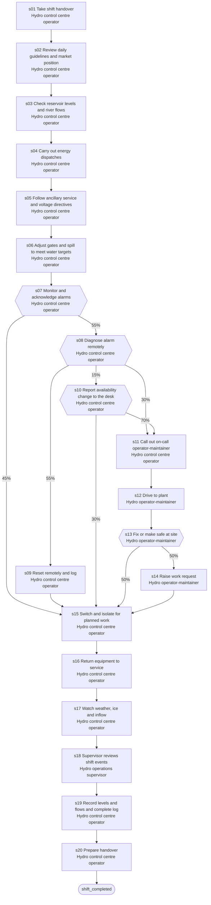

# Operate hydro plants (one control centre shift)

`gen-hyd-operate-plants` · electric power generation · hydro generation · part of `power-generation-co`

The company's seventeen hydro plants and their dams are run remotely from a control centre in Calgary staffed around the clock by two operators on 12-hour shifts. In each shift the operators follow the AESO's dispatches and reserve directives, move gates to keep river flows and reservoir levels inside licence limits, handle alarms from unstaffed plants, call out operator-maintainers when something needs hands at site, and isolate equipment for the day's maintenance. The work is error-prone because it is continuous, spread over many remote sites, and mixes market, water and safety rules, and because availability changes must be passed to the trading desk by phone.

| | |
|---|---|
| Unit of work | one control centre shift |
| Starts when | A 12-hour shift starts at the hydro control centre (day or night). |
| Done when | The shift is handed over with the log, equipment status, isolations and flow records up to date. |
| Organisation | An Alberta merchant generator with seventeen hydro plants on the Bow, North Saskatchewan and Oldman rivers run from one Calgary control centre, alongside converted gas units and wind farms. (1,300 employees, 2019-2022) |
| Volume | 61 cases a month (range 60 to 62) |

## Where it sits

- Starts with **dispatch_instruction** from mkt-respond-dispatch (60% of cases)
- Starts with **water_schedule** from hyd-plan-water-schedule (35% of cases)
- Starts with **water_schedule** from hyd-flood-operations (5% of cases)
- Sends **availability_change** to mkt-restate-offers (outcome: shift_completed)
- Sends **delivered_energy** to aeso (outcome: shift_completed)
- Sends **work_request** to hyd-maintain-plants (outcome: shift_completed)
- Sends **flow_data** to hyd-water-licence-reporting (outcome: shift_completed)

## Flow

## Roles

| Role | Department | Layer | FTE on this process | Loaded cost per hour | Evidence |
|---|---|---|---:|---:|---|
| Hydro control centre operator | Hydro control centre | individual contributor | 10 | 68 CAD | B [s5] |
| Hydro operations supervisor | Hydro generation | supervisor | 0.8 | 92 CAD | C |
| Hydro operator-maintainer | Bow River plants | individual contributor | 2.5 | 64 CAD | C |

## Steps

Hands-on time and the wait before each step show the most common value. Evidence tier A is a sourced number, B a sourced description, C the author's estimate.

| Step | Who | Kind | Hands-on | Wait before | Control | Evidence |
|---|---|---|---:|---:|---|---|
| **s01 Take shift handover.** The incoming pair of control centre operators read the electronic operating log, the equipment status list and the active isolations and permits, then go through open issues with the outgoing operators face to face before taking the desk. | Hydro control centre operator | intake | 30 min | 0 min | Control centre shift turnover procedure | B [s5] |
| **s02 Review daily guidelines and market position.** The operators read the day's operating guidelines from Hydro Scheduling, the current AESO dispatch levels and ancillary services commitments for each hydro asset, and the inflow outlook, and note the hours when large changes are expected. | Hydro control centre operator | lookup | 20 min | 0 min |  | B [s5] |
| **s03 Check reservoir levels and river flows.** Several times a shift an operator steps through the SCADA screens for every reservoir, forebay, canal and downstream gauge and compares levels and flows with licence limits, minimum flows and any provincial target elevation, flagging anything trending towards a limit. | Hydro control centre operator | validation | 45 min | 0 min | Water Act licence conditions (minimum flows and elevation limits) and Bow River agreement target elevations | B [s5], [s3] |
| **s04 Carry out energy dispatches.** When the AESO issues a dispatch for a hydro asset, relayed through the energy trading system and the real-time desk, the operator starts, stops or loads units through SCADA, confirms output settles within the allowed tolerance and logs the time. A shift sees roughly five to twenty-five dispatches. | Hydro control centre operator | coordination | 2.0 h | 0 min | AESO ISO rules: dispatched assets must follow dispatches within the allowed time and tolerance | B [s5] |
| **s05 Follow ancillary service and voltage directives.** The operator watches automatic generation control on the units providing regulating reserve, responds to contingency reserve directives by loading spinning units, and adjusts voltage set points when the system operator asks. | Hydro control centre operator | coordination | 45 min | 0 min | AESO ISO rules for operating reserve and voltage control | B [s5], [s6] |
| **s06 Adjust gates and spill to meet water targets.** The operator changes gate openings and plant flows remotely to hold minimum flows below dams, follow the reservoir trajectory in the plan and avoid spill, and logs each change with the reason. | Hydro control centre operator | judgment | 30 min | 0 min |  | B [s4] |
| **s07 Monitor and acknowledge alarms.** The operators acknowledge the alarms that arrive from seventeen plants and their dams through the shift, sort the nuisance alarms from real ones, and pick out the ones that need diagnosis. | Hydro control centre operator | validation | 1.0 h | 0 min |  | B [s5] |
| **s08 Diagnose alarm remotely.** The operator pulls trends from SCADA and the historian for the affected unit or gate, checks recent work on the equipment, and decides whether a remote reset is safe, whether the unit must be declared unavailable, or whether someone has to go to site. | Hydro control centre operator | analysis | 20 min | 5 min |  | C |
| **s09 Reset remotely and log.** The operator resets the trip or alarm through SCADA following the plant's remote operating procedure, watches the unit return to normal and records the event in the log. | Hydro control centre operator | coordination | 10 min | 0 min |  | C |
| **s10 Report availability change to the desk.** The operator phones or messages the real-time trader with the asset, the megawatts now available and the expected return time, so the desk can restate the offer with the AESO, and logs the call. | Hydro control centre operator | communication | 10 min | 0 min | AESO ISO rules: available capability must be restated promptly and outages reported (Section 306.5) | C |
| **s11 Call out on-call operator-maintainer.** The operator phones the on-call operator-maintainer for that plant area from the callout list, describes the alarm and the plant state, and agrees what will be isolated before they arrive. | Hydro control centre operator | communication | 10 min | 0 min |  | B [s5] |
| **s12 Drive to plant.** The on-call operator-maintainer gets ready and drives a company truck from home or the area shop to the plant, which can mean an hour or more on mountain or forestry roads to sites such as Brazeau or the Kananaskis plants, slower in winter. | Hydro operator-maintainer | travel | 1.2 h | 30 min |  | B [s6] |
| **s13 Fix or make safe at site.** The operator-maintainer inspects the equipment, isolates it with the control centre if needed, resets or repairs what can be done alone, and either returns the unit or leaves it safely out of service for the day crew. | Hydro operator-maintainer | physical | 1.5 h | 0 min | Alberta OHS Code Part 15 hazardous energy control and the company working-alone procedure | B [s10] |
| **s14 Raise work request.** The operator-maintainer enters a work request in the ERP plant maintenance module with the equipment number, the symptom, what was done and a suggested priority, so the area supervisor can plan the repair. | Hydro operator-maintainer | data entry | 15 min | 30 min |  | C |
| **s15 Switch and isolate for planned work.** For maintenance on the day's schedule the operator opens breakers and closes gates remotely, places SCADA tags, records the isolation in the permit system and hands it to the site permit holder, who verifies it and applies personal locks. Some shifts have none. | Hydro control centre operator | coordination | 30 min | 0 min | Alberta OHS Code Part 15 (isolation, verification, personal locks, group control) and the company permit-to-work procedure | B [s5], [s10] |
| **s16 Return equipment to service.** When a permit holder reports work complete and locks removed, the operator checks the permit is cleared, removes tags, restores the unit or gate, tells the desk the asset is available again and logs it. | Hydro control centre operator | coordination | 20 min | 0 min | Alberta OHS Code Part 15 (isolation, verification, personal locks, group control) and the company permit-to-work procedure | B [s5], [s10] |
| **s17 Watch weather, ice and inflow.** The operator checks weather warnings and inflow trends, and in winter watches for frazil ice at intakes, calling the hydro scheduler or area manager when inflows or ice threaten the plan. | Hydro control centre operator | analysis | 20 min | 0 min |  | C |
| **s18 Supervisor reviews shift events.** The hydro operations supervisor reads the significant events in the log, approves any departure from the water plan, decides on overtime or callouts for the next shift and follows up on unresolved alarms with the area teams. | Hydro operations supervisor | review | 20 min | 30 min |  | C |
| **s19 Record levels and flows and complete log.** The operator checks the hourly levels and flows that the historian recorded, enters manual gauge readings from site staff, fills gaps and completes the daily flow summary used for licence reporting. | Hydro control centre operator | data entry | 30 min | 0 min |  | C |
| **s20 Prepare handover.** The outgoing operators update the equipment status list, list open alarms, isolations and expected dispatches, and write the shift summary for the next crew and the supervisor. | Hydro control centre operator | drafting | 15 min | 0 min |  | B [s5] |

## Exceptions

| Exception | Share of cases | What happens |
|---|---:|---|
| Callout to site | 21% | An alarm cannot be reset remotely and an on-call operator-maintainer drives to the plant. |
| Capability lost | 8% | A unit trips or is restricted and the desk must restate the offer to the AESO. |

## Benchmarks

| Metric | Value | Unit | Population | Evidence |
|---|---|---|---|---|
| cycle_time_days | p50 0.5, p90 0.5 | calendar days per shift | TransAlta Hydro System Control Centre | B [s5] |

## Pain points

- Availability changes are passed to the trading desk by phone or chat and re-entered in the AESO system, so a slow or missed call leaves an offer wrong. (steps s10, s16; C)
- Nuisance alarms from seventeen remote plants take operator attention from real ones. (steps s07; B [s5])
- Callouts to remote mountain plants take one to three hours before anyone is at the equipment. (steps s11, s12; C)

## Assumptions

- One case is a 12-hour shift worked by two operators; their active work is listed as one sequence of steps although much of it happens in parallel or repeatedly, so simulated cycle time can run past 12 hours on busy shifts. Passive monitoring is not counted as hands-on time, which is why stated FTE (13.3) is about three times the hands-on implied FTE.
- The organisation file gives the operator-maintainers an extended-hours pattern; in this process they act on call after hours, so the role is marked on_call here.
- Dispatch counts, alarm rates and callout shares are tier C estimates scaled to a 17-plant fleet; AESO rule details are from general knowledge because the rule documents could not be read.
- Flood operations that override the plan are a separate process; their schedules arrive here as a 5 percent share of triggers.

## Sources

- [s3] [Bow River Basin: TransAlta operations](https://www.alberta.ca/bow-river-basin-transalta-operations) (Government of Alberta, 2026). Agreement since May 2016 (extended to April 1, 2031): from May 16 to July 7 the province may set target elevations for Ghost Reservoir (up to 65 million m3 for flood mitigation) and year-round volume targets for the Kananaskis-area reservoirs (up to 40 million m3 for drought mitigation); TransAlta decides how to meet the targets; the province and TransAlta assess elevations together each year; compensation 5.5 million CAD per year.
- [s4] [Hydro safety](https://transalta.com/our-operations/safety/hydro-safety) (TransAlta Corporation, 2024). Water levels near Bearspaw Dam can rise or fall up to 2 metres in a short time; hydro operations support flood control, drought mitigation and irrigation and convey water to licence holders including irrigation districts and municipalities; buffer zones, signs, booms and barriers; regular patrols, inspections, safety audits and infrastructure maintenance; coordination with regulators, police and emergency responders.
- [s5] [Hydro Generation Operator I (Calgary) job posting](https://jobs.transalta.com/job/Calgary-Hydro-Generation-Operator-I-AB/1451367700/) (TransAlta Corporation, 2026). Operators in the Calgary Hydro System Control Centre remotely monitor and operate the hydro fleet through SCADA on rotating 12-hour day and night shifts; execute AESO dispatches, ancillary services directives and voltage instructions and monitor AGC; manage reservoirs, forebays, canals and river flows within operating constraints; acknowledge and respond to alarms; coordinate switching, isolations, equipment status and after-hours response with site operations, maintenance and Hydro Scheduling; keep electronic operating logs and shift handovers. Posted November 2026, after the reference period.
- [s6] [TransAlta Corporation Annual Information Form for the year ended December 31, 2021 (Exhibit 13.1 to Form 40-F)](https://www.sec.gov/Archives/edgar/data/1144800/000114480022000004/a20211231tacex131aif.htm) (TransAlta Corporation via U.S. SEC EDGAR, 2022). Alberta hydro facilities: Bow River system 11 plants (338 MW: Barrier, Bearspaw, Cascade, Ghost, Horseshoe, Interlakes, Kananaskis, Pocaterra, Rundle, Spray, Three Sisters), North Saskatchewan system 2 plants (Bighorn 120 MW, Brazeau 355 MW), Oldman system 4 small plants (21 MW); merchant sale into the Alberta spot market after PPA expiry; value from capacity, energy and ancillary services; Belly River operates April to October.
- [s10] [Occupational Health and Safety Code, Part 15: Managing the control of hazardous energy](https://search-ohs-laws.alberta.ca/legislation/occupational-health-and-safety-code/part-15-managing-the-control-of-hazardous-energy/) (Government of Alberta, 2023). Part 15 sections on isolation of machinery and equipment (s. 212), verifying isolation (s. 213), assigning personal locks (s. 214), securing by individual workers (s. 214.1) and securing by group control procedures (s. 215).

Written by claude-opus on 2026-11-24.
