# Plan reservoir levels and water releases (weekly water plan)

`gen-hyd-plan-water-schedule` · electric power generation · hydro generation · part of `power-generation-co`

Each week a hydro scheduler turns weather forecasts, snowpack and current reservoir levels into a plan for how much water each of the seventeen hydro plants will release, hour by hour, over the coming week. The plan must keep every water licence limit and, from mid-May to early July, the Ghost Reservoir elevation the province sets for flood protection, while placing as much generation as possible in the highest-price hours that the trading desk expects. The scheduler, the desk's portfolio optimisation analyst, a hydro area manager and the control centre all touch the plan. It is slow and error-prone because inflow forecasts are uncertain in spring, constraints are kept in spreadsheets, and the plan is re-keyed into the desk's offer tools and revised mid-week when weather changes.

| | |
|---|---|
| Unit of work | one weekly water plan |
| Starts when | The weekly planning cycle starts when new weather forecasts arrive midweek for the following operating week. |
| Done when | The approved plan has been run for its week, any mid-week revisions have been issued, and planned versus actual results are recorded. |
| Organisation | An Alberta merchant generator with seventeen hydro plants on the Bow, North Saskatchewan and Oldman rivers run from one Calgary control centre, alongside converted gas units and wind farms. (1,300 employees, 2019-2022) |
| Volume | 4.3 cases a month (range 4 to 5) |

## Where it sits

- Starts with **weather_forecast** from weather_provider (100% of cases)
- Relies on **water_licence** from aep (a standing input; it does not start a case)
- Relies on **price_forecast** from mkt-forecast-generation (a standing input; it does not start a case)
- Relies on **outage_schedule** from eng-plan-major-outages (a standing input; it does not start a case)
- Sends **water_schedule** to mkt-submit-energy-offers (outcome: plan_executed)
- Sends **water_schedule** to mkt-forecast-generation (outcome: plan_executed)
- Sends **water_schedule** to hyd-operate-plants (outcome: plan_executed)

## Flow

```mermaid
flowchart TD
    s01["s01 Gather weather and snowpack data<br/>Hydro scheduler  water resources engineer"]
    s02["s02 Pull last week's levels and flows<br/>Automated"]
    s03["s03 Update inflow forecast by basin<br/>Hydro scheduler  water resources engineer"]
    s04{{"s04 Check forecast against observed inflow<br/>Hydro scheduler  water resources engineer"}}
    s05["s05 Compile licence and agreement constraints<br/>Hydro scheduler  water resources engineer"]
    s06["s06 Collect planned unit outages and capability<br/>Hydro scheduler  water resources engineer"]
    s07["s07 Provide hourly price and market view<br/>Portfolio optimisation analyst"]
    s08["s08 Run weekly release optimisation<br/>Hydro scheduler  water resources engineer"]
    s09{{"s09 Check schedule against limits<br/>Hydro scheduler  water resources engineer"}}
    s10["s10 Send Ghost elevation plan to the province<br/>Hydro scheduler  water resources engineer"]
    s11{{"s11 Province confirms or changes Ghost target<br/>Outside party"}}
    s12["s12 Draft weekly water plan<br/>Hydro scheduler  water resources engineer"]
    s13{{"s13 Desk reviews plan<br/>Portfolio optimisation analyst"}}
    s14{{"s14 Area manager reviews and approves plan<br/>Hydro area manager"}}
    s15["s15 Publish plan to desk and control centre<br/>Hydro scheduler  water resources engineer"]
    s16["s16 Key plan into offer and forecast tools<br/>Portfolio optimisation analyst"]
    s17["s17 Control centre turns plan into daily guidelines<br/>Hydro control centre operator"]
    s18{{"s18 Track plan against actual each day<br/>Hydro scheduler  water resources engineer"}}
    s19["s19 Issue mid-week revision<br/>Hydro scheduler  water resources engineer"]
    s20["s20 Review week and archive<br/>Hydro scheduler  water resources engineer"]
    s01 --> s02
    s02 --> s03
    s03 --> s04
    s04 -->|"88%"| s05
    s04 -->|"12%"| s03
    s05 --> s06
    s06 --> s07
    s07 --> s08
    s08 --> s09
    s09 -->|"13%"| s10
    s09 -->|"72%"| s12
    s09 -->|"15%"| s08
    s10 --> s11
    s11 -->|"75%"| s12
    s11 -->|"25%"| s08
    s12 --> s13
    s13 -->|"85%"| s14
    s13 -->|"15%"| s12
    s14 -->|"90%"| s15
    s14 -->|"10%"| s12
    s15 --> s16
    s16 --> s17
    s17 --> s18
    s18 -->|"35%"| s19
    s18 -->|"65%"| s20
    s19 --> s20
    s20 --> end0
    end0(["plan_executed"])
```

## Roles

| Role | Department | Layer | FTE on this process | Loaded cost per hour | Evidence |
|---|---|---|---:|---:|---|
| Hydro scheduler (water resources engineer) | Hydro generation | senior specialist | 0.75 | 92 CAD | B [s5] |
| Portfolio optimisation analyst | Real-time desk | senior specialist | 0.3 | 100 CAD | C |
| Hydro area manager | Hydro generation | manager | 0.08 | 128 CAD | C |
| Hydro control centre operator | Hydro control centre | individual contributor | 0.05 | 68 CAD | C |

## Steps

Hands-on time and the wait before each step show the most common value. Evidence tier A is a sourced number, B a sourced description, C the author's estimate.

| Step | Who | Kind | Hands-on | Wait before | Control | Evidence |
|---|---|---|---:|---:|---|---|
| **s01 Gather weather and snowpack data.** The hydro scheduler opens the weather providers' seven- to ten-day forecasts of precipitation and freezing levels for the Bow, North Saskatchewan and Oldman headwaters, the latest provincial water supply outlook and the snow pillow readings, and saves them to the weekly planning folder. | Hydro scheduler (water resources engineer) | lookup | 45 min | 2.0 h |  | B [s7] |
| **s02 Pull last week's levels and flows.** A scheduled historian report exports last week's hourly reservoir elevations, plant flows, spill and gauge flows into the planning workbook so the scheduler starts from actual storage, without anyone keying the numbers. | Automated | system auto | 0 min | 0 min |  | C |
| **s03 Update inflow forecast by basin.** The scheduler runs the inflow models for each storage system (Spray and Kananaskis lakes, Ghost and Bearspaw on the Bow, Bighorn and Brazeau on the North Saskatchewan, and the small Oldman plants), feeding in the weather, snowpack and observed flows, and produces daily inflow volumes for the next one to four weeks. | Hydro scheduler (water resources engineer) | analysis | 3.0 h | 30 min |  | B [s6], [s7] |
| **s04 Check forecast against observed inflow.** The scheduler compares the model's back-cast for the last seven days with the observed inflows calculated from storage change and outflow. Where they diverge by more than about ten percent the scheduler adjusts snowmelt or loss parameters and re-runs the model. | Hydro scheduler (water resources engineer) | validation | 40 min | 0 min |  | C |
| **s05 Compile licence and agreement constraints.** The scheduler lists the week's limits in the workbook: water licence minimum flows and reservoir elevation ranges, ramping limits, deliveries owed to irrigation districts and municipalities, and from May 16 to July 7 the Ghost Reservoir target elevation set by the province, plus the Kananaskis drought volume target. | Hydro scheduler (water resources engineer) | lookup | 1.0 h | 30 min | Water Act licence conditions and the Alberta-TransAlta Bow River agreement (Ghost flood-season targets, Kananaskis drought targets) | A [s3], [s4] |
| **s06 Collect planned unit outages and capability.** The scheduler checks the outage schedule in the ERP and the control centre's equipment status log for units that will be out or derated during the week, and emails the hydro supervisors to confirm dates that are still moving. | Hydro scheduler (water resources engineer) | lookup | 30 min | 2.0 h |  | C |
| **s07 Provide hourly price and market view.** The portfolio optimisation analyst sends the expected hourly price shape for the coming week, the ancillary services the desk plans to sell from hydro and the hedged positions the hydro output should cover, so the water can be placed in the highest-value hours. | Portfolio optimisation analyst | analysis | 1.5 h | 4.0 h |  | B [s6] |
| **s08 Run weekly release optimisation.** The scheduler runs the weekly optimisation workbook or model, which spreads each reservoir's usable water over the week's hours so that more is generated in the expected high-price hours while keeping all limits, and produces hourly release and MW ranges by plant group with end-of-week reservoir levels. | Hydro scheduler (water resources engineer) | analysis | 3.0 h | 1.0 h |  | C |
| **s09 Check schedule against limits.** The scheduler checks every reservoir trajectory and river flow in the draft against the constraint table, looks for hours that break a minimum flow or ramp limit, and decides whether the result is feasible and sensible or needs another run. | Hydro scheduler (water resources engineer) | validation | 45 min | 0 min | Water Act licence conditions: minimum flows and elevation limits | B [s3] |
| **s10 Send Ghost elevation plan to the province.** During the flood-control window the scheduler emails the planned Ghost Reservoir elevations and outflows to the provincial river forecasters and water managers, with the inflow forecast behind them, and asks them to confirm or change the target elevation. | Hydro scheduler (water resources engineer) | communication | 40 min | 0 min | Alberta-TransAlta Bow River agreement: province may set Ghost target elevations May 16 to July 7 | A [s3] |
| **s11 Province confirms or changes Ghost target.** Provincial forecasters review the plan against their own flood forecast for Calgary and reply with the target elevation for the coming days, which may be lower than planned when heavy rain is forecast. | Outside party | external wait | 0 min | 1.0 d |  | B [s3] |
| **s12 Draft weekly water plan.** The scheduler writes the weekly water plan: daily energy and volume by plant group, hourly MW ranges, planned spill, reservoir trajectories with limits, and notes on inflow risk and outages, in the standard workbook and a one-page summary. | Hydro scheduler (water resources engineer) | drafting | 1.2 h | 1.0 h |  | C |
| **s13 Desk reviews plan.** The portfolio optimisation analyst checks that the plan's hourly energy fits the offer strategy, the ancillary services commitments and the hedges, and either accepts it or asks for water to be moved between days or plant groups. | Portfolio optimisation analyst | review | 45 min | 8.0 h |  | C |
| **s14 Area manager reviews and approves plan.** The hydro area manager checks the plan for site issues the model does not see, such as crews working below a dam, public events on a river, ice conditions or a landowner complaint, and approves the plan or sends it back with changes. | Hydro area manager | approval | 30 min | 8.0 h | Hydro operating procedures: weekly plan approved by the accountable area manager | B [s4] |
| **s15 Publish plan to desk and control centre.** The scheduler saves the approved plan to the shared folder and emails it to the real-time desk, the portfolio optimisation team and the hydro control centre, with a short note on what changed from last week. | Hydro scheduler (water resources engineer) | communication | 15 min | 30 min |  | C |
| **s16 Key plan into offer and forecast tools.** The portfolio optimisation analyst re-keys the daily energy limits and hourly MW ranges by plant group into the generation forecast and offer-building spreadsheets used by the real-time traders. | Portfolio optimisation analyst | data entry | 30 min | 2.0 h |  | C |
| **s17 Control centre turns plan into daily guidelines.** A hydro control centre operator reads the plan at the start of shift, checks it against current equipment status and gate settings, and asks the scheduler about anything that cannot be run, such as a unit already out or a gate restricted. | Hydro control centre operator | review | 30 min | 6.0 h |  | B [s5] |
| **s18 Track plan against actual each day.** Each weekday morning the scheduler compares actual inflow, generation and reservoir levels with the plan and the latest weather, and decides whether the deviation is large enough to revise the rest of the week. The minutes shown are the total for the week. | Hydro scheduler (water resources engineer) | analysis | 1.8 h | 3.0 d |  | C |
| **s19 Issue mid-week revision.** The scheduler re-runs the optimisation for the remaining days with the new inflow or price view, checks limits, and emails revised daily volumes to the desk and control centre, phoning the real-time desk lead if the change affects offers already submitted. | Hydro scheduler (water resources engineer) | drafting | 1.5 h | 4.0 h |  | C |
| **s20 Review week and archive.** At the end of the planning week the scheduler records planned versus actual generation, spill and end-of-week levels by reservoir, notes forecast errors and their causes, and files the plan for the licence reporting and for next season's calibration. | Hydro scheduler (water resources engineer) | analysis | 40 min | 2.0 d |  | C |

## Exceptions

| Exception | Share of cases | What happens |
|---|---:|---|
| Province changes the Ghost target | 3% | During the flood-control window the province lowers the Ghost target because heavy rain is forecast, and the week is re-optimised around less storage. |
| Mid-week revision | 35% | Inflow or prices move enough that the rest of the week is re-planned and re-sent. |
| Forecast does not track observed inflow | 12% | The back-cast misses last week's inflow and the inflow model is recalibrated before planning. |

## Benchmarks

| Metric | Value | Unit | Population | Evidence |
|---|---|---|---|---|
| cycle_time_days | p50 9, p90 11 | calendar days from start of preparation to end-of-week review | Weekly hydro plans at a multi-reservoir merchant hydro fleet | C |
| flood_control_window_days | 53 | days a year (May 16 to July 7) when the province may set Ghost target elevations | Bow River system | A [s3] |

## Pain points

- Inflow forecasts are least reliable in exactly the weeks when the plan matters most (snowmelt and June rain), so plans are revised mid-week and offers restated. (steps s03, s18, s19; C)
- Licence limits, agreement targets and outage dates are kept in spreadsheets and copied by hand into the model, and a wrong limit is caught only at the check step or not at all. (steps s05, s06, s09; C)
- The approved plan is re-keyed into the desk's offer and forecast tools, a second copy that can drift from the plan. (steps s16; C)

## Assumptions

- The organisation file lists no hydro scheduling role, although TransAlta's control centre coordinates with a Hydro Scheduling function (s5). A hydro scheduler is added with not_in_org_file; in the organisation file the portfolio optimisation analyst would otherwise have to do this work.
- The planning week starts with data gathering midweek and the plan runs Saturday to Friday; cycle time includes the operating week, so most of it is calendar time, not work.
- Loaded costs follow the organisation file (wage x 1.40). The hydro scheduler is costed like a plant engineer.
- Flood events themselves are handled in hyd-flood-operations; this file covers only ordinary weekly planning, including the routine Ghost target exchange with the province.
- Hands-on time is about 23 hours a plan (median), mostly the scheduler; the remaining scheduler time goes to daily scheduling and reporting not modelled here.

## Sources

- [s3] [Bow River Basin: TransAlta operations](https://www.alberta.ca/bow-river-basin-transalta-operations) (Government of Alberta, 2026). Agreement since May 2016 (extended to April 1, 2031): from May 16 to July 7 the province may set target elevations for Ghost Reservoir (up to 65 million m3 for flood mitigation) and year-round volume targets for the Kananaskis-area reservoirs (up to 40 million m3 for drought mitigation); TransAlta decides how to meet the targets; the province and TransAlta assess elevations together each year; compensation 5.5 million CAD per year.
- [s4] [Hydro safety](https://transalta.com/our-operations/safety/hydro-safety) (TransAlta Corporation, 2024). Water levels near Bearspaw Dam can rise or fall up to 2 metres in a short time; hydro operations support flood control, drought mitigation and irrigation and convey water to licence holders including irrigation districts and municipalities; buffer zones, signs, booms and barriers; regular patrols, inspections, safety audits and infrastructure maintenance; coordination with regulators, police and emergency responders.
- [s5] [Hydro Generation Operator I (Calgary) job posting](https://jobs.transalta.com/job/Calgary-Hydro-Generation-Operator-I-AB/1451367700/) (TransAlta Corporation, 2026). Operators in the Calgary Hydro System Control Centre remotely monitor and operate the hydro fleet through SCADA on rotating 12-hour day and night shifts; execute AESO dispatches, ancillary services directives and voltage instructions and monitor AGC; manage reservoirs, forebays, canals and river flows within operating constraints; acknowledge and respond to alarms; coordinate switching, isolations, equipment status and after-hours response with site operations, maintenance and Hydro Scheduling; keep electronic operating logs and shift handovers. Posted November 2026, after the reference period.
- [s6] [TransAlta Corporation Annual Information Form for the year ended December 31, 2021 (Exhibit 13.1 to Form 40-F)](https://www.sec.gov/Archives/edgar/data/1144800/000114480022000004/a20211231tacex131aif.htm) (TransAlta Corporation via U.S. SEC EDGAR, 2022). Alberta hydro facilities: Bow River system 11 plants (338 MW: Barrier, Bearspaw, Cascade, Ghost, Horseshoe, Interlakes, Kananaskis, Pocaterra, Rundle, Spray, Three Sisters), North Saskatchewan system 2 plants (Bighorn 120 MW, Brazeau 355 MW), Oldman system 4 small plants (21 MW); merchant sale into the Alberta spot market after PPA expiry; value from capacity, energy and ancillary services; Belly River operates April to October.
- [s7] [Drought: current conditions (water supply outlook, snowpack and reservoir storage)](https://www.alberta.ca/drought-current-conditions) (Government of Alberta, 2026). Water supply outlook published in the second week of each month from January to August, estimating runoff volume at 20 locations; mountain snow surveys monthly February 1 to June 1 and automated snow pillow data at 18 sites; storage in major irrigation and hydroelectric reservoirs updated each weekday in the Provincial Reservoir Storage Summary.

Written by claude-opus on 2026-11-24.
