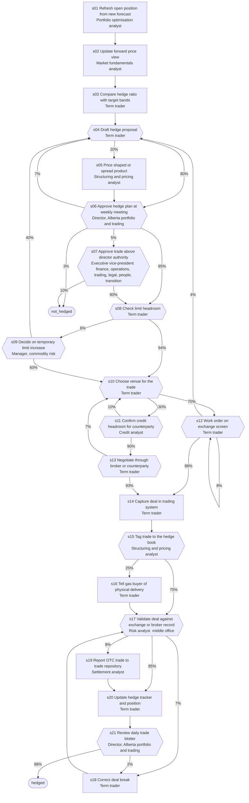

# Hedge merchant output with forward trades

`gen-mkt-execute-hedges` · electric power generation · energy marketing and trading · part of `power-generation-co`

Term traders sell Alberta power forward and buy or sell gas forward so that part of the merchant plants' expected output earns a known price instead of the hourly pool price. Each trade starts from the latest generation forecast and price view, is sized against hedge targets that the director approves within board-approved policy, and is checked against risk and credit limits before it is done on the NGX exchange screen or with a counterparty through a broker. After the trade the trader keys it into the trading system, a structuring analyst tags it to the hedge book, and the independent risk group checks it against the exchange or broker record the next morning. Waiting for the weekly hedge meeting and for thin forward liquidity in Alberta makes trades slow, and mis-keyed deal shapes are the common error.

| | |
|---|---|
| Unit of work | one hedge trade (a forward power sale or a forward gas purchase or sale) |
| Starts when | A new generation forecast, a change in the price view or a new customer contract changes the open (unhedged) position so that the hedge ratio for some month falls outside its target range. |
| Done when | The trade is done, captured in the trading system, tagged to the hedge book, validated by the risk group and on the director's daily blotter; or the proposal is dropped. |
| Organisation | An Alberta merchant generator of about 1,300 staff whose trading desk hedges converted gas, hydro and wind output while a separate real-time desk offers the plants into the AESO pool. (1,300 employees, 2019-2022) |
| Volume | 120 cases a month (range 60 to 250) |

## Where it sits

- Starts with **generation_forecast** from mkt-forecast-generation (60% of cases)
- Starts with **price_forecast** from mkt-market-analysis (25% of cases)
- Starts with **customer_contract** from mkt-originate-customer-contracts (15% of cases)
- Relies on **risk_limits** from fin-commodity-risk (a standing input; it does not start a case)
- Relies on **credit_limits** from fin-credit-collateral (a standing input; it does not start a case)
- Relies on **board_resolution** from exec-board-governance (a standing input; it does not start a case)
- Sends **hedge_trade** to energy_exchange (outcome: hedged)
- Sends **hedge_trade** to trading_counterparties (outcome: hedged)
- Sends **hedge_trade** to mkt-settle-trades (outcome: hedged)
- Sends **hedge_trade** to fin-commodity-risk (outcome: hedged)
- Sends **hedge_trade** to mkt-procure-gas (outcome: hedged)

## Flow

## Roles

| Role | Department | Layer | FTE on this process | Loaded cost per hour | Evidence |
|---|---|---|---:|---:|---|
| Term trader | Commercial and trading | senior specialist | 3 | 125 CAD | C |
| Director, Alberta portfolio and trading | Energy marketing and trading | director | 0.15 | 210 CAD | C |
| Structuring and pricing analyst | Commercial and trading | senior specialist | 0.6 | 98 CAD | C |
| Portfolio optimisation analyst | Real-time desk | senior specialist | 0.4 | 100 CAD | C |
| Market fundamentals analyst | Commercial and trading | senior specialist | 0.15 | 88 CAD | C |
| Executive vice-president (finance, operations, trading, legal, people, transition) | Executive office | executive | 0.02 | 260 CAD | C |
| Manager, commodity risk | Commodity risk and credit | manager | 0.03 | 145 CAD | C |
| Risk analyst (middle office) | Commodity risk and credit | individual contributor | 0.3 | 78 CAD | B [w1], [w2] |
| Credit analyst | Commodity risk and credit | individual contributor | 0.1 | 75 CAD | C |
| Settlement analyst | Settlement and contract administration | individual contributor | 0.03 | 64 CAD | C |

## Steps

Hands-on time and the wait before each step show the most common value. Evidence tier A is a sourced number, B a sourced description, C the author's estimate.

| Step | Who | Kind | Hands-on | Wait before | Control | Evidence |
|---|---|---|---:|---:|---|---|
| **s01 Refresh open position from new forecast.** The portfolio optimisation analyst loads the latest hourly generation forecast and all existing hedges from the trading system into the hedge position workbook and recalculates, month by month, how many MWh of expected merchant output and how many GJ of fuel are still unhedged. Time shown is the share of the weekly refresh that falls on one trade. | Portfolio optimisation analyst | analysis | 12 min | 2.0 h |  | C |
| **s02 Update forward price view.** The market fundamentals analyst sends the current Alberta power and AECO gas forward curves with a short note on supply additions, outages and weather that could move prices, so the trader can judge whether to hedge now or wait. | Market fundamentals analyst | lookup | 5 min | 30 min |  | C |
| **s03 Compare hedge ratio with target bands.** The term trader compares the hedged share of each month and quarter with the target bands set in the hedging strategy, for example a higher share for the prompt year than for later years, and lists the tenors that are under- or over-hedged given the price view. | Term trader | analysis | 20 min | 1.0 h |  | B [w2], [w3] |
| **s04 Draft hedge proposal.** The term trader writes the proposed trade or set of trades into the weekly hedge proposal: product, delivery months, MW or GJ per day, limit price and preferred venue, with a line on why now. Proposals that need a non-standard shape go to structuring first. | Term trader | drafting | 15 min | 30 min |  | C |
| **s05 Price shaped or spread product.** The structuring and pricing analyst prices a shaped trade such as on-peak blocks, a heat-rate or spark-spread trade, or a multi-year strip, using the forward curves, a shaping profile and volatility, and returns a fair value and a walk-away price. | Structuring and pricing analyst | analysis | 45 min | 8.0 h |  | C |
| **s06 Approve hedge plan at weekly meeting.** At the weekly commercial meeting the director of portfolio and trading reviews each proposal against the hedging strategy, the position and the price view, and approves the volume, tenor and limit price within the authority the trading policy gives the director. Larger or longer trades go up to the executive. | Director, Alberta portfolio and trading | approval | 6 min | 2.0 d | Commodity and Financial Exposure Management policy approved by the board's Audit, Finance and Risk Committee; trading delegation of authority | B [w2] |
| **s07 Approve trade above director authority.** The executive vice-president for finance and trading reviews a trade that exceeds the director's tenor or volume authority, usually a multi-year strip or a large customer back-to-back, and approves it by email or at the next commodity risk meeting. | Executive vice-president (finance, operations, trading, legal, people, transition) | approval | 20 min | 1.0 d | Trading delegation of authority under the Commodity and Financial Exposure Management policy | B [w2] |
| **s08 Check limit headroom.** Before trading the term trader opens the morning risk report and checks that the trade keeps the book inside its position limits by tenor, its value-at-risk limit and its risk capital limit, and notes the headroom used on the trade ticket. | Term trader | validation | 8 min | 30 min | Position, VaR and risk capital limits under the Commodity and Financial Exposure Management policy | B [w1], [w2] |
| **s09 Decide on temporary limit increase.** The manager of commodity risk reviews why the hedge needs more headroom, for example a large customer contract, and either grants a temporary limit increase with an expiry date or asks the desk to resize the trade. | Manager, commodity risk | approval | 30 min | 8.0 h | Limits set and changed by the independent risk group, not by traders | B [w1] |
| **s10 Choose venue for the trade.** The term trader decides whether to work the order on the NGX screen, where trades are cleared and need no bilateral credit, or to go to a broker or a counterparty for a size, tenor or shape the screen cannot fill. | Term trader | judgment | 5 min | 10 min |  | C |
| **s11 Confirm credit headroom for counterparty.** For a bilateral trade the credit analyst checks that a master agreement is in place, that the counterparty's credit limit and tenor limit have room for the new exposure, and whether a guarantee or letter of credit is needed. | Credit analyst | validation | 20 min | 2.0 h | Credit limits by counterparty set and monitored by the risk group independent of trading; formal sign-off of contracts | B [w2] |
| **s12 Work order on exchange screen.** The term trader places and adjusts bids or offers on the NGX Alberta power or AECO gas screen, watching for fills at or better than the limit price. Thin forward liquidity means a large order is often filled in pieces over several days. | Term trader | judgment | 25 min | 1.0 h |  | C |
| **s13 Negotiate through broker or counterparty.** The term trader asks a voice broker or a counterparty for a quote by phone or chat, negotiates price and volume, agrees the deal and receives the broker recap by email. | Term trader | communication | 20 min | 3.0 h |  | C |
| **s14 Capture deal in trading system.** The term trader opens a new deal ticket in the trading and risk system and types counterparty, product, delivery point, hourly shape, volume, price, broker and hedge book, normally within minutes of the trade. | Term trader | data entry | 10 min | 15 min | Energy Trading Code of Conduct and deal capture procedure: trades entered promptly by the trader | B [w2] |
| **s15 Tag trade to the hedge book.** The structuring analyst links the trade to the hedged exposure in the hedge tracker, records whether it is a cash-flow hedge or an economic hedge for reporting, and updates the hedge percentage by month. | Structuring and pricing analyst | analysis | 12 min | 1.0 h | Hedge documentation needed for financial reporting of derivatives | C |
| **s16 Tell gas buyer of physical delivery.** For a physical gas purchase or sale the term trader emails the gas scheduler the delivery months, daily volume and delivery point so the volumes are included in the daily nominations. | Term trader | communication | 8 min | 1.0 h |  | C |
| **s17 Validate deal against exchange or broker record.** The next morning a middle-office risk analyst compares each new deal ticket with the NGX trade report or the broker confirmation and flags any difference in volume, price, dates or counterparty. | Risk analyst (middle office) | validation | 6 min | 16.0 h | Trades validated by the independent risk management group, not by the trader | B [w1] |
| **s18 Correct deal break.** The term trader checks the break with the broker or the exchange record, amends the deal ticket with a reason, and sends it back for validation. | Term trader | data entry | 15 min | 3.0 h |  | C |
| **s19 Report OTC trade to trade repository.** Where the company is the reporting counterparty for a bilateral derivative, for example with another non-dealer that agreed it would report, the settlement analyst submits the creation data to the trade repository by the end of the next business day. | Settlement analyst | data entry | 10 min | 8.0 h | Multilateral Instrument 96-101 sections 25 and 31: creation data reported immediately or by the end of the next business day | A [w7] |
| **s20 Update hedge tracker and position.** The term trader updates the hedge summary that shows hedged MWh and GJ, average hedged price and hedge percentage by month, used in the next day's risk report and the director's blotter. | Term trader | data entry | 6 min | 1.0 h |  | C |
| **s21 Review daily trade blotter.** The director reads the day's trade blotter and hedge summary, checks each trade against the approved plan and limit price, and queries anything unexpected with the trader. | Director, Alberta portfolio and trading | review | 4 min | 4.0 h | Supervisory review of trading activity under the Energy Trading Code of Conduct | C |

## Exceptions

| Exception | Share of cases | What happens |
|---|---:|---|
| Order filled over several days | 8% | Thin forward liquidity on the screen means the trader works the order again the next day. |
| Limit headroom needed | 6% | The trade would breach a position or VaR limit; the risk manager grants a temporary increase or the trade is resized. |
| Deal break | 7% | The ticket differs from the exchange or broker record and is corrected before it is validated. |
| Above-authority trade | 5% | A long-dated or large trade needs the executive's approval, adding one to five days. |

## Benchmarks

| Metric | Value | Unit | Population | Evidence |
|---|---|---|---|---|
| cycle_time_days | p50 5, p90 12 | calendar days from position change to validated trade | Term hedge trades at an Alberta merchant generator, 2019-2022 | C |
| alberta_power_hedged_2022 | 6278 | GWh hedged for 2022 at an average 75 CAD/MWh | TransAlta Alberta portfolio, outlook given in early 2022 | A [w2] |
| alberta_gas_hedged_2022 | 50 | million GJ of gas hedged for 2022 at 2.75 CAD/GJ | TransAlta Alberta portfolio | A [w2] |
| gas_production_sold_forward_end_2021 | 75 | percent of Gas segment production sold forward | TransAlta Alberta Gas assets at Dec. 31, 2021 | A [w3] |
| trading_var_year_end_2021 | 2 | million CAD, three-day 95 percent VaR on proprietary trading | TransAlta at Dec. 31, 2021 | A [w2] |

## Pain points

- Hedge decisions wait for the weekly meeting, so the desk can miss a good price window. (steps s06; C)
- Alberta forward power is thinly traded, so large hedges are filled in pieces over days and need re-planning when prices move. (steps s12, s13; C)
- Deal tickets are keyed by hand from the screen or a broker recap, and shape or volume errors surface only at next-day validation. (steps s14, s17, s18; C)
- The open position is rebuilt in spreadsheets from the forecast and the trading system, so a missed customer contract or stale forecast distorts the hedge ratio. (steps s01, s03; C)

## Assumptions

- Volume is 60 to 250 hedge trades a month, below the organisation file's 400 to 1,500 trades, which count all desk trades including short-term and proprietary trading; see the volume note.
- About 70 percent of hedge trades are done on the NGX screen and cleared, 30 percent bilaterally or through brokers; no source gives this split.
- Confirmation, invoicing and payment of trades are in mkt-settle-trades; daily valuation and VaR are in fin-commodity-risk.
- Weekly planning and review time is spread over the trades it covers, so touch times are per-trade shares.
- No plant, vehicle or crew is held by this process, so steps list no resources; no travel or weather waits apply.
- The simulated median (about 6.5 days) is above the 5-day tier C benchmark because the weekly meeting wait, next-day fills and overnight validation add up in sequence; both rest on the same weekly meeting assumption, which no source confirms.
- Loaded costs come from the organisation file (wage x 1.40).
- Executive, risk manager, risk analyst, credit analyst, portfolio optimiser, market analyst and settlement analyst take part but are not listed in the organisation file's process roles.

## Sources

- [w1] [TransAlta Corporation Annual Information Form for the year ended December 31, 2021 (Exhibit 13.1 to Form 40-F)](https://www.sec.gov/Archives/edgar/data/1144800/000114480022000004/a20211231tacex131aif.htm) (TransAlta Corporation via U.S. SEC EDGAR, 2022). Energy Marketing secures fuel supply and handles procurement of gas, transport and storage for the gas fleet; it trades power, natural gas and environmental products; the company regularly hedges portions of uncontracted merchant positions with physical and financial contracts; about 50 percent of capacity contracted in 2022 and 2023; an independent Risk Management group applies risk capital limits, value at risk, gross margin at risk, tail risk scenarios and position limits; the Pioneer Pipeline was integrated into NGTL and ATCO systems to supply Sundance and Keephills; long-term NGTL transportation agreements for 400 TJ per day; 1,282 employees at end 2021.
- [w2] [TransAlta Corporation Management's Discussion and Analysis for the year ended December 31, 2021 (Exhibit 13.2 to Form 40-F)](https://www.sec.gov/Archives/edgar/data/1144800/000114480022000004/a20211231tacex132mda.htm) (TransAlta Corporation via U.S. SEC EDGAR, 2022). VaR is calculated and reported daily, over a three-day holding period at 95 percent confidence, by the historical variance/covariance method, with periodic stress tests; VaR on proprietary trading was 2 million CAD at Dec. 31, 2021 (1 million in 2020); the Audit, Finance and Risk Committee approves the Commodity and Financial Exposure Management policies; trading risk is reviewed monthly by the Commodity Risk and Compliance Committee chaired by the EVP Finance and Trading and CFO and weekly by the commodity risk team, commercial managers and the CFO; Energy Trading Code of Conduct; about 78 percent of 2021 production under contracts and hedges; 70 percent of 2021 gas consumption contractually fixed or passed through; gas supply risk managed with at least two pipelines, firm delivery and supply contracts, gas hedges and monitoring of pipeline maintenance; 2022 Alberta hedges of 6,278 GWh at 75 CAD/MWh and 50 million GJ of gas at 2.75 CAD/GJ; credit limits by counterparty with collateral when exceeded.
- [w3] [TransAlta Corporation 2021 Integrated Report (Form 6-K)](https://www.sec.gov/Archives/edgar/data/1144800/000114480022000006/tac2021integratedreportf.htm) (TransAlta Corporation via U.S. SEC EDGAR, 2022). A new team charged with optimising Alberta merchant market performance had its first year in 2021, delivering 864 million CAD of gross margin from hydro, wind, gas, coal and storage; the hedge program focuses on merchant Gas and Energy Transition generation; 75 percent of Gas production sold forward at end 2021 (100 percent at end 2020) at an average hedged power price of 72 CAD/MWh; AECO gas price 3.39 CAD/GJ in 2021. Only the first part of this long document was read.
- [w7] [Multilateral Instrument 96-101 Trade Repositories and Derivatives Data Reporting (consolidated to September 30, 2016)](https://fcnb.ca/sites/default/files/2024-12/96-101-MI-CONS-2016-09-30-E.pdf) (Canadian Securities Administrators (copy hosted by the Financial and Consumer Services Commission, New Brunswick), 2016). Section 25 sets the reporting counterparty (clearing agency for cleared trades, the derivatives dealer when one side is a dealer, otherwise as agreed in writing or both); section 31 requires creation data immediately after the transaction or no later than the end of the next business day; section 33 requires quarterly valuation data from non-dealers. Alberta adopted this multilateral instrument.

Written by claude-opus on 2026-11-24.
