# Forecast generation, availability and fuel needs

`gen-mkt-forecast-generation` · electric power generation · energy marketing and trading · part of `power-generation-co`

Every morning the portfolio optimisation team builds an hourly forecast of what each plant can and is likely to generate over the next week, with a longer monthly view for hedging. They combine weather forecasts, the AESO's central wind forecast, the converted gas units' status from the plants, the hydro water schedule, turbine availability from the renewables control centre and the accepted outage schedule, then derive the gas burn the plants will need. The forecast feeds the day's energy offers, gas buying and hedging, and must match the capability declared to the AESO. It is error-prone because wind and river flows are uncertain, inputs arrive by phone and email from several control rooms, and trips or derates during the day force updates.

| | |
|---|---|
| Unit of work | one daily portfolio forecast |
| Starts when | Overnight weather and wind forecasts arrive and the plants report their status for the morning. |
| Done when | The forecast is published to the offer desk, the gas scheduler and the term traders, updated during the day when needed, and the next morning the day's forecast error is recorded. |
| Organisation | An Alberta merchant generator of about 1,300 staff with converted gas units, cogeneration, wind, hydro and a battery, whose portfolio optimisation team sits beside a 24-hour real-time desk. (1,300 employees, 2019-2022) |
| Volume | 30 cases a month (range 28 to 31) |

## Where it sits

- Starts with **weather_forecast** from weather_provider (60% of cases)
- Starts with **unit_status** from gas-operate-units (20% of cases)
- Starts with **water_schedule** from hyd-plan-water-schedule (20% of cases)
- Relies on **outage_schedule** from eng-report-outages-aeso (a standing input; it does not start a case)
- Relies on **price_forecast** from mkt-market-analysis (a standing input; it does not start a case)
- Relies on **unit_status** from wnd-monitor-fleet (a standing input; it does not start a case)
- Sends **generation_forecast** to mkt-submit-energy-offers (outcome: forecast_closed)
- Sends **generation_forecast** to mkt-offer-ancillary (outcome: forecast_closed)
- Sends **generation_forecast** to mkt-execute-hedges (outcome: forecast_closed)
- Sends **generation_forecast** to mkt-procure-gas (outcome: forecast_closed)
- Sends **availability_change** to mkt-restate-offers (outcome: forecast_closed)

## Flow

```mermaid
flowchart TD
    s01["s01 Download weather and AESO wind forecasts<br/>Automated"]
    s02["s02 Pull overnight actuals from historian<br/>Automated"]
    s03{{"s03 Check data feeds and fill gaps<br/>Portfolio optimisation analyst"}}
    s04["s04 Rebuild missing inputs by hand<br/>Portfolio optimisation analyst"]
    s05["s05 Take gas unit status on morning call<br/>Shift supervisor  first-class power engineer"]
    s06["s06 Report wind turbine availability<br/>Renewables operations centre operator"]
    s07["s07 Send hydro water schedule and constraints<br/>Hydro control centre operator"]
    s08["s08 Check outage schedule for changes<br/>Portfolio optimisation analyst"]
    s09["s09 Forecast wind output by farm<br/>Portfolio optimisation analyst"]
    s10["s10 Forecast hydro output<br/>Portfolio optimisation analyst"]
    s11["s11 Forecast gas unit capability and dispatch<br/>Portfolio optimisation analyst"]
    s12["s12 Give short-term price and load view<br/>Market fundamentals analyst"]
    s13["s13 Assemble hourly portfolio forecast<br/>Portfolio optimisation analyst"]
    s14["s14 Derive fuel burn by plant<br/>Portfolio optimisation analyst"]
    s15{{"s15 Compare with yesterday and actuals<br/>Portfolio optimisation analyst"}}
    s16{{"s16 Desk lead reviews forecast<br/>Real-time desk lead"}}
    s17{{"s17 Check declared availability matches forecast<br/>Portfolio optimisation analyst"}}
    s18["s18 Restate available capability<br/>Real-time trader"]
    s19{{"s19 Publish forecast<br/>Portfolio optimisation analyst"}}
    s20["s20 Update medium-term forecast for hedging<br/>Portfolio optimisation analyst"]
    s21{{"s21 Monitor actuals against forecast<br/>Real-time trader"}}
    s22["s22 Issue intraday forecast update<br/>Real-time trader"]
    s23["s23 Record forecast error<br/>Portfolio optimisation analyst"]
    s01 --> s02
    s02 --> s03
    s03 -->|"90%"| s05
    s03 -->|"10%"| s04
    s04 --> s05
    s05 --> s06
    s06 --> s07
    s07 --> s08
    s08 --> s09
    s09 --> s10
    s10 --> s11
    s11 --> s12
    s12 --> s13
    s13 --> s14
    s14 --> s15
    s15 -->|"90%"| s16
    s15 -->|"10%"| s13
    s16 -->|"95%"| s17
    s16 -->|"5%"| s13
    s17 -->|"88%"| s19
    s17 -->|"12%"| s18
    s18 --> s19
    s19 -->|"85%"| s21
    s19 -->|"15%"| s20
    s20 --> s21
    s21 -->|"60%"| s23
    s21 -->|"40%"| s22
    s22 --> s23
    s23 --> end0
    end0(["forecast_closed"])
```

## Roles

| Role | Department | Layer | FTE on this process | Loaded cost per hour | Evidence |
|---|---|---|---:|---:|---|
| Portfolio optimisation analyst | Real-time desk | senior specialist | 1.6 | 100 CAD | B [w3] |
| Market fundamentals analyst | Commercial and trading | senior specialist | 0.1 | 88 CAD | C |
| Real-time trader | Real-time desk | individual contributor | 0.3 | 90 CAD | C |
| Real-time desk lead | Real-time desk | supervisor | 0.1 | 120 CAD | C |
| Shift supervisor (first-class power engineer) | Wabamun-area converted units | supervisor | 0.1 | 92 CAD | C |
| Renewables operations centre operator | Renewables operations centre | individual contributor | 0.08 | 62 CAD | C |
| Hydro control centre operator | Hydro control centre | individual contributor | 0.1 | 68 CAD | C |

## Steps

Hands-on time and the wait before each step show the most common value. Evidence tier A is a sourced number, B a sourced description, C the author's estimate.

| Step | Who | Kind | Hands-on | Wait before | Control | Evidence |
|---|---|---|---:|---:|---|---|
| **s01 Download weather and AESO wind forecasts.** Scheduled jobs download the overnight weather model runs for the plant locations and the AESO's central wind and solar forecast into the forecasting tools. | Automated | system auto | 0 min | 30 min |  | B [w5] |
| **s02 Pull overnight actuals from historian.** Scheduled jobs copy the previous day's hourly output, wind speeds, river flows and reservoir levels from the plant historian and SCADA into the forecast workbook. | Automated | system auto | 0 min | 10 min |  | C |
| **s03 Check data feeds and fill gaps.** The portfolio optimisation analyst, or the real-time trader at weekends, opens the forecast workbook, checks that every feed updated and looks for missing hours, frozen values or a weather run that did not arrive. | Portfolio optimisation analyst | validation | 20 min | 2.0 h |  | C |
| **s04 Rebuild missing inputs by hand.** The analyst downloads the missing forecast from the provider's website or copies values from SCADA screens into the workbook, and logs an IT ticket for the failed job. | Portfolio optimisation analyst | data entry | 40 min | 10 min |  | C |
| **s05 Take gas unit status on morning call.** On the morning call each converted unit's and cogeneration plant's shift supervisor reports current capability, derates, minimum stable load, equipment problems and expected return-to-service times. | Shift supervisor (first-class power engineer) | communication | 15 min | 30 min |  | C |
| **s06 Report wind turbine availability.** The renewables operations centre operator sends the number of turbines down at each wind farm, expected repair dates, icing and any transmission curtailment, and the battery's state. | Renewables operations centre operator | communication | 15 min | 10 min |  | C |
| **s07 Send hydro water schedule and constraints.** The hydro control centre operator sends the day's release plan by river system, minimum flow and reservoir level limits from the water licences, and any plant out of service. | Hydro control centre operator | communication | 20 min | 10 min |  | C |
| **s08 Check outage schedule for changes.** The analyst opens the accepted outage schedule, compares it with yesterday's copy and notes any planned outage that moved, started or was extended. | Portfolio optimisation analyst | lookup | 15 min | 10 min |  | C |
| **s09 Forecast wind output by farm.** The analyst blends the AESO central wind forecast with the company's own weather-based forecast for each wind farm, scales it for turbines out of service and adjusts for icing and curtailment. | Portfolio optimisation analyst | analysis | 30 min | 10 min |  | B [w5] |
| **s10 Forecast hydro output.** The analyst converts the water schedule into hourly MW for each hydro plant using flow-to-power tables, and checks it against reservoir limits and the flexibility kept for price peaks and ancillary services. | Portfolio optimisation analyst | analysis | 25 min | 10 min |  | C |
| **s11 Forecast gas unit capability and dispatch.** The analyst sets each gas unit's hourly capability from the status report and the temperature forecast, and estimates the likely dispatch level from the short-term price view and the units' costs. | Portfolio optimisation analyst | analysis | 40 min | 10 min |  | C |
| **s12 Give short-term price and load view.** The market fundamentals analyst sends the expected hourly Alberta load, supply and pool price range for the coming days, flagging hours when tight supply could make prices spike. | Market fundamentals analyst | communication | 15 min | 5 min |  | C |
| **s13 Assemble hourly portfolio forecast.** The analyst combines the wind, hydro, gas, cogeneration and battery forecasts into one hourly table for seven days with an expected value and a low and high case, and a monthly view for the rest of the year. | Portfolio optimisation analyst | analysis | 30 min | 10 min |  | C |
| **s14 Derive fuel burn by plant.** The analyst multiplies each gas unit's forecast hourly output by its heat-rate curve and adds start-up gas and the cogeneration hosts' steam load to give GJ per plant per gas day. | Portfolio optimisation analyst | analysis | 20 min | 5 min |  | C |
| **s15 Compare with yesterday and actuals.** The analyst compares today's forecast with yesterday's and with the latest actual output, and explains every change larger than a set threshold before the forecast is used. | Portfolio optimisation analyst | validation | 15 min | 5 min |  | C |
| **s16 Desk lead reviews forecast.** The real-time desk lead reads the forecast summary, questions large changes in availability or wind, and agrees the numbers the offers will be built on. | Real-time desk lead | review | 15 min | 30 min |  | C |
| **s17 Check declared availability matches forecast.** The analyst compares each asset's forecast capability with the available capability declared to the AESO in the Energy Trading System and lists any asset whose declaration must be restated. | Portfolio optimisation analyst | validation | 10 min | 5 min | AESO ISO rules section 203.3: available capability restated as soon as reasonably practicable after a change for an acceptable operational reason | A [w4] |
| **s18 Restate available capability.** The real-time trader enters the restated available capability and the operational reason for the affected hours in the Energy Trading System. | Real-time trader | data entry | 10 min | 15 min | AESO ISO rules section 203.3: restatement with reasons | A [w4] |
| **s19 Publish forecast.** The analyst saves the forecast to the shared folder and reporting site and emails a summary to the offer desk, the gas scheduler and the term traders before the offer and gas trading deadlines. | Portfolio optimisation analyst | communication | 10 min | 5 min |  | C |
| **s20 Update medium-term forecast for hedging.** Once a week the analyst extends the forecast month by month to the end of the next two years, using the outage plan, normal wind and water, and expected gas dispatch, for the hedge position. | Portfolio optimisation analyst | analysis | 2.0 h | 1.0 h |  | C |
| **s21 Monitor actuals against forecast.** Through the day the real-time trader watches actual output, wind ramps and unit alarms against the published forecast and decides whether a change is large enough to reissue it. | Real-time trader | analysis | 30 min | 4.0 h |  | C |
| **s22 Issue intraday forecast update.** The real-time trader updates the affected hours in the forecast, tells the gas scheduler and the offer desk of the change, and notes the cause. | Real-time trader | communication | 20 min | 15 min |  | C |
| **s23 Record forecast error.** The next morning the analyst compares the day's forecast with metered output by asset and records the error, so recurring bias in wind, hydro or gas dispatch can be corrected. | Portfolio optimisation analyst | analysis | 20 min | 14.0 h |  | C |

## Exceptions

| Exception | Share of cases | What happens |
|---|---:|---|
| Intraday update | 40% | A unit trip, derate or wind ramp makes the real-time desk reissue part of the forecast. |
| Capability restatement | 12% | The forecast shows capability different from the AESO declaration and the desk restates it. |
| Feed failure | 10% | A weather or historian feed fails and the analyst rebuilds the input by hand. |

## Benchmarks

| Metric | Value | Unit | Population | Evidence |
|---|---|---|---|---|
| cycle_time_days | p50 1.2, p90 1.4 | calendar days from overnight forecast download to recorded forecast error | Daily portfolio forecast at an Alberta generator | C |
| aeso_wind_forecast_refresh | 10 | minutes between updates of the AESO 12-hour wind forecast | AESO central wind and solar forecast | A [w5] |
| alberta_portfolio_gross_margin_2021 | 864 | million CAD | TransAlta Alberta merchant portfolio, first year of the optimisation team | A [w3] |

## Pain points

- Plant, wind and hydro inputs arrive by phone and email from three control rooms and are re-keyed into a spreadsheet. (steps s05, s06, s07, s13; C)
- Wind ramps and unit trips make about two days in five need an intraday update, which must reach the gas scheduler and the offer desk quickly. (steps s21, s22; C)
- Declared AESO capability can drift from the forecast, and a missed restatement is a market rule breach. (steps s17, s18; B [w4])
- Feed failures force manual rebuilding of inputs early in the morning before the offer deadline. (steps s03, s04; C)

## Assumptions

- On weekends and holidays the real-time trader runs a lighter version of steps s03 to s19; the step roles show the weekday case.
- The morning call inputs (s05 to s07) run in parallel; the simulation adds them in sequence, which slightly overstates the elapsed time; together with sequential hands-on time this puts the simulated median about 0.3 days above the 1.2-day timetable benchmark.
- No plant, vehicle or crew is held by forecasting, and no travel, weather wait or site access applies: weather affects the forecast content, not the wait.
- Real-time trader, real-time desk lead, gas shift supervisor, renewables operations centre operator and hydro control centre operator take part but are not listed in the organisation file's process roles.
- Loaded costs come from the organisation file (wage x 1.40).

## Sources

- [w3] [TransAlta Corporation 2021 Integrated Report (Form 6-K)](https://www.sec.gov/Archives/edgar/data/1144800/000114480022000006/tac2021integratedreportf.htm) (TransAlta Corporation via U.S. SEC EDGAR, 2022). A new team charged with optimising Alberta merchant market performance had its first year in 2021, delivering 864 million CAD of gross margin from hydro, wind, gas, coal and storage; the hedge program focuses on merchant Gas and Energy Transition generation; 75 percent of Gas production sold forward at end 2021 (100 percent at end 2020) at an average hedged power price of 72 CAD/MWh; AECO gas price 3.39 CAD/GJ in 2021. Only the first part of this long document was read.
- [w4] [ISO Rules Section 203.3 Energy Restatements (effective 2014-07-02)](https://www.aeso.ca/assets/documents/Section-203-3-Energy-Restatements-July-2-2014.pdf) (Alberta Electric System Operator, 2014). A pool participant must submit an available capability restatement as soon as reasonably practicable when capability changes for an acceptable operational reason, with the reason; price and MW restatements only up to two hours before the settlement interval. In force through the 2019 to 2022 period.
- [w5] [Wind and Solar Power Forecasting](https://www.aeso.ca/grid/forecasting/wind-power-forecasting) (Alberta Electric System Operator, 2024). The AESO publishes a centralised wind and solar power forecast: a 12-hour forecast updated every 10 minutes and a 7-day-ahead forecast updated hourly, downloadable as CSV files.

Written by claude-opus on 2026-11-24.
