# Offer ancillary services

`gen-mkt-offer-ancillary` · electric power generation · energy marketing and trading · part of `power-generation-co`

The AESO buys operating reserves (regulating, spinning and supplemental, active and standby) a day ahead in short open auctions on the Watt-Ex platform each weekday morning, and the company's hydro units, battery and converted gas units are among the main sellers. Portfolio analysts list the reserve-capable MW and estimate the energy margin given up, the real-time trader offers MW and a premium or discount to pool price for each product and block, watches the open book until each auction closes, designates delivering assets and reshapes the energy offers before the noon energy deadline. The session is short but tightly timed, and an award that is not reflected in the energy offers or not planned in the plants turns into a delivery failure later.

| | |
|---|---|
| Unit of work | one Watt-Ex trading session of reserve offers (one or more delivery days) |
| Starts when | The AESO posts its reserve requirements and bid prices for the next delivery day or days on Watt-Ex ahead of the 9:00 weekday session. |
| Done when | Reserve offers have cleared or lapsed, delivering assets are designated, next-day energy offers exclude the reserved MW, plants have the reserve schedule and the awards are booked. |
| Organisation | An Alberta merchant generator whose reservoir hydro, 10 MW battery and converted gas units sell operating reserves through a 24-hour real-time desk. (1,300 employees, 2019-2022) |
| Volume | 21 cases a month (range 20 to 23) |

## Where it sits

- Starts with **as_procurement_notice** from aeso (100% of cases)
- Relies on **generation_forecast** from mkt-forecast-generation (a standing input; it does not start a case)
- Relies on **price_forecast** from mkt-market-analysis (a standing input; it does not start a case)
- Relies on **water_schedule** from hyd-plan-water-schedule (a standing input; it does not start a case)
- Relies on **iso_rules** from aeso (a standing input; it does not start a case)
- Sends **ancillary_offer** to aeso (outcome: any)
- Sends **ancillary_award** to mkt-respond-dispatch (outcome: awards_booked)
- Sends **ancillary_award** to mkt-settle-aeso (outcome: awards_booked)
- Sends **ancillary_award** to mkt-submit-energy-offers (outcome: awards_booked)

## Flow

```mermaid
flowchart TD
    s01["s01 AESO posts reserve requirements<br/>Outside party"]
    s02{{"s02 List reserve-capable MW by asset<br/>Portfolio optimisation analyst"}}
    s03["s03 Extend the plan over the weekend<br/>Portfolio optimisation analyst"]
    s04["s04 Confirm water limits for holding reserve<br/>Hydro control centre operator"]
    s05["s05 Estimate the opportunity cost of reserves<br/>Portfolio optimisation analyst"]
    s06["s06 Choose reserve volumes and prices<br/>Real-time trader"]
    s07{{"s07 Lead approves the reserve plan<br/>Real-time desk lead"}}
    s08["s08 Enter active regulating reserve offers<br/>Real-time trader"]
    s09["s09 Enter spinning and supplemental offers<br/>Real-time trader"]
    s10["s10 Watch the open book and adjust<br/>Real-time trader"]
    s11{{"s11 Auctions close and clear<br/>Outside party"}}
    s12["s12 Enter standby reserve offers<br/>Real-time trader"]
    s13["s13 Standby auctions clear<br/>Outside party"]
    s14["s14 Designate assets for the awards<br/>Real-time trader"]
    s15["s15 Reshape next-day energy offers<br/>Real-time trader"]
    s16["s16 Send the reserve schedule to the plants<br/>Real-time trader"]
    s17{{"s17 Plan hydro units to hold reserve<br/>Hydro control centre operator"}}
    s18["s18 Plan the battery state of charge<br/>Renewables operations centre operator"]
    s19["s19 Book the awards<br/>Real-time trader"]
    s01 --> s02
    s02 -->|"25%"| s03
    s02 -->|"75%"| s04
    s03 --> s04
    s04 --> s05
    s05 --> s06
    s06 --> s07
    s07 -->|"92%"| s08
    s07 -->|"8%"| s06
    s08 --> s09
    s09 --> s10
    s10 --> s11
    s11 -->|"65%"| s12
    s11 -->|"30%"| s14
    s11 -->|"5%"| s19
    s12 --> s13
    s13 --> s14
    s14 --> s15
    s15 --> s16
    s16 --> s17
    s17 -->|"40%"| s18
    s17 -->|"60%"| s19
    s18 --> s19
    s19 --> end0
    end0(["awards_booked"])
```

## Roles

| Role | Department | Layer | FTE on this process | Loaded cost per hour | Evidence |
|---|---|---|---:|---:|---|
| Real-time trader | Real-time desk | individual contributor | 0.5 | 90 CAD | C |
| Portfolio optimisation analyst | Real-time desk | senior specialist | 0.3 | 100 CAD | C |
| Real-time desk lead | Real-time desk | supervisor | 0.03 | 120 CAD | C |
| Hydro control centre operator | Hydro control centre | individual contributor | 0.05 | 68 CAD | C |
| Renewables operations centre operator | Renewables operations centre | individual contributor | 0.01 | 62 CAD | C |

## Steps

Hands-on time and the wait before each step show the most common value. Evidence tier A is a sourced number, B a sourced description, C the author's estimate.

| Step | Who | Kind | Hands-on | Wait before | Control | Evidence |
|---|---|---|---:|---:|---|---|
| **s01 AESO posts reserve requirements.** Before the trading session the AESO posts on the Watt-Ex platform the MW it wants to buy for the next day (or for several days before a weekend or holiday) for each reserve product and period, with its bid price that caps active offers. | Outside party | intake | 0 min | 0 min |  | A [cra2023] |
| **s02 List reserve-capable MW by asset.** The portfolio optimisation analyst lists, for each hydro unit, the battery and each converted gas unit, the MW it is qualified and able to provide as regulating, spinning or supplemental reserve tomorrow, after outages, derates and planned energy output. | Portfolio optimisation analyst | lookup | 20 min | 10 min |  | B [iso2051], [msa2009or] |
| **s03 Extend the plan over the weekend.** For a session that buys reserves for Saturday to Monday or a holiday, the analyst extends the capability list and price view to each extra delivery day, using the weekend wind and load forecast and the weekend water schedule. | Portfolio optimisation analyst | analysis | 30 min | 5 min |  | B [iso2051], [cra2023] |
| **s04 Confirm water limits for holding reserve.** The hydro control centre operator confirms reservoir and forebay levels, minimum and maximum flows and any ice limits that decide whether hydro units can sit part-loaded with headroom for reserve through the on-peak and off-peak blocks. | Hydro control centre operator | coordination | 8 min | 15 min |  | C |
| **s05 Estimate the opportunity cost of reserves.** The analyst forecasts the on-peak and off-peak pool price and its volatility, works out the energy margin given up for each MW held as reserve, and compares it with recent equilibrium prices to suggest a premium or discount to pool price for each product. | Portfolio optimisation analyst | analysis | 30 min | 5 min |  | A [cra2023] |
| **s06 Choose reserve volumes and prices.** The real-time trader decides how many MW of each asset to offer in each product and block, active or standby, and the index (premium or discount to pool price) for each offer, balancing reserve revenue against keeping water and capacity for the energy market. | Real-time trader | judgment | 20 min | 10 min |  | B [iso2051], [cra2023] |
| **s07 Lead approves the reserve plan.** The real-time desk lead reviews the planned MW and indices against the energy strategy for the day and the water position, approves them or asks for changes before the 9:00 window opens. | Real-time desk lead | approval | 8 min | 15 min | Trading authority and risk policy: desk lead approval of daily reserve strategy | C |
| **s08 Enter active regulating reserve offers.** When the Watt-Ex window opens at 9:00 the trader enters the active regulating reserve offers for each block, MW and index, which close first, at about 9:40. | Real-time trader | data entry | 8 min | 10 min | ISO Rules section 205.1 s.2 and s.3: offers through the AESO-specified trading platform, per on-peak, off-peak and super-peak period, same MW each hour, at least 5 MW, active price not above the AESO bid price | A [msa2009or], [cra2023], [iso2051] |
| **s09 Enter spinning and supplemental offers.** The trader enters the active spinning reserve offers (closing about 9:50) and supplemental reserve offers (closing about 10:00) for the hydro units, battery and gas units that can provide them. | Real-time trader | data entry | 8 min | 2 min | ISO Rules section 205.1 s.2 and s.3: offers through the AESO-specified trading platform, per on-peak, off-peak and super-peak period, same MW each hour, at least 5 MW, active price not above the AESO bid price | A [msa2009or], [cra2023] |
| **s10 Watch the open book and adjust.** Because Watt-Ex shows all offers as they are entered, the trader watches the stack form for each product and revises indices or MW before each close, within the limits the lead approved. | Real-time trader | judgment | 20 min | 0 min |  | A [cra2023] |
| **s11 Auctions close and clear.** Each active auction closes in turn and the AESO accepts offers in merit order up to its requirement; Watt-Ex shows the cleared MW for each offer and the equilibrium price, the average of the AESO bid price and the clearing offer. | Outside party | external wait | 0 min | 15 min |  | A [iso2051], [cra2023] |
| **s12 Enter standby reserve offers.** The trader enters standby offers, each with a premium of at most 99 CAD/MWh for being available and an activation price for being called, for capacity not sold in the active auctions, before the standby closes at about 10:10 to 10:30. | Real-time trader | data entry | 8 min | 3 min | ISO Rules section 205.1 s.3(2)(b): standby premium up to 99 CAD/MWh and activation price | A [iso2051], [msa2009or] |
| **s13 Standby auctions clear.** The standby auctions close and Watt-Ex shows the standby MW accepted for each asset with the premium and activation price, which the desk adds to the day's reserve position. | Outside party | external wait | 0 min | 20 min |  | B [msa2009or] |
| **s14 Designate assets for the awards.** Where offers were made from a pooled virtual asset, the trader designates which pool assets will deliver each awarded MW, by 11:30 for a one-day session or 13:00 for a multi-day session, and checks every award maps to a qualified asset. | Real-time trader | data entry | 8 min | 10 min | ISO Rules section 205.1 s.2(3): designate delivering pool assets by 11:30 (one day) or 13:00 (multiple days) | A [iso2051] |
| **s15 Reshape next-day energy offers.** Before the 12:00 energy offer deadline the trader changes the next-day energy offers of the assets carrying reserve, so the MW held for reserve are not also offered as energy and the offer still reflects the unit's real capability. | Real-time trader | data entry | 12 min | 5 min | ISO Rules section 203.1 s.2(2)(a): energy offers before 12:00 on the day before delivery | B [iso2031], [iso2034] |
| **s16 Send the reserve schedule to the plants.** The trader emails and calls the hydro control centre, the gas control rooms and the operations centre with the reserve schedule: which asset carries which product, in which hours, and how many MW of headroom to keep. | Real-time trader | communication | 8 min | 10 min |  | C |
| **s17 Plan hydro units to hold reserve.** The hydro control centre operator plans which units will run part-loaded or stay synchronised to carry the awarded regulating and spinning reserve, and how that fits the day's water release, then holds the plants to that plan through the delivery day. | Hydro control centre operator | coordination | 10 min | 20 min |  | C |
| **s18 Plan the battery state of charge.** The renewables operations centre operator sets the battery's state-of-charge plan so it can follow regulating signals or deliver contingency reserve through the awarded hours without running empty or full. | Renewables operations centre operator | coordination | 6 min | 20 min |  | C |
| **s19 Book the awards.** The trader enters the cleared reserve MW, prices and designations in the ETRM so settlement analysts can check the AESO statement and the profit and loss shows reserve revenue, and files the session record. | Real-time trader | data entry | 8 min | 10 min | Trade capture for settlement reconciliation and risk reporting | C |

## Exceptions

| Exception | Share of cases | What happens |
|---|---:|---|
| Multi-day session | 25% | Friday or pre-holiday session buys reserves for two to four delivery days, so the capability list and price view are extended and designations are due by 13:00. |
| Lead asks for changes | 8% | The desk lead changes reserve volumes or indices before the window opens. |
| Nothing cleared | 5% | All offers were priced out of merit, so no reserve is carried and the energy offers stand as prepared. |

## Benchmarks

| Metric | Value | Unit | Population | Evidence |
|---|---|---|---|---|
| cycle_time_days | p50 0.25, p90 0.3 | calendar days from the start of preparation (about 07:00) to booked awards | Daily operating reserve sessions of an Alberta generator, 2019-2022 | B [msa2009or], [cra2023], [iso2051] |
| auction_closing_times | active_regulating 09:40, active_spinning 09:50, active_supplemental 10:00, standby 10:10 to 10:30 | local time | Watt-Ex day-ahead operating reserve auctions | A [msa2009or] |
| standby_premium_cap | 99 | CAD/MWh | AESO standby operating reserve offers | A [iso2051] |

## Pain points

- The reserve auctions close at about 10:00 and the energy offers are due at 12:00, so awards must be turned into reshaped energy offers and designations within two hours, with the risk that reserve MW are left in the energy offer. (steps s14, s15; B [iso2031], [iso2051], [msa2009or])
- Reserve offers are priced as a premium or discount to a pool price nobody knows yet, so the trader must judge the energy margin given up on volatile days. (steps s05, s06; A [cra2023])
- Plants learn their reserve duty from an email and a phone call, and a missed headroom plan becomes a reserve delivery failure, the costliest ISO rule penalty area in 2021. (steps s16, s17; A [msacr2021])

## Assumptions

- One case is one Watt-Ex trading session, not one calendar day. Sessions run on business days, so the volume is about 21 a month rather than the organisation file's 28 to 31.
- Watt-Ex timing (window from 9:00, closes from 9:40 to 10:30) is taken from the MSA's 2009 description and the 2023 CRA assessment, which describe the same design; it is assumed unchanged in 2019-2022.
- Step resources show capacity held for reserve: a hydro plant for 8 to 24 hours and the battery for 4 to 16 hours per session. Only part of the plant's MW is held, but the plant cannot be scheduled freely in those hours.
- Over-the-counter reserve trades after the auctions (allowed under 205.1 s.4 and noted by the MSA in 2009) are not modelled.
- Partner-operated unit shares are not offered as reserve by this desk.
- Times are estimates; the AESO and MSA documents give deadlines, not durations. The simulated median runs longer than the 0.25-day benchmark because the simulation adds every hands-on minute and wait in sequence, while in practice the analyst and trader prepare in parallel before 9:00 and the open-book watching overlaps the offer entry.
- Loaded costs come from the organisation file (wage x 1.40).

## Sources

- [iso2031] [ISO Rules Section 203.1, Offers and Bids for Energy (effective 2013-12-20)](https://www.aeso.ca/assets/documents/Section-203.1-Offers-and-Bids-for-Energy.pdf) (Alberta Electric System Operator, 2013). Offers due before 12:00 on the day before the delivery day and no earlier than 7 days before; offer for every settlement interval for source assets of 5 MW or more; prices of at least 0 and under 1,000 CAD/MWh; block MW, flexible or inflexible flag and minimum stable generation; top block equals maximum capability; available capability equal to maximum capability unless an acceptable operational reason is given; ramp rate and initial start-up time; standing submissions; ETS acknowledgement and valid or invalid notice.
- [iso2034] [ISO Rules Section 203.4, Delivery Requirements for Energy (2023-03-31 administrative version; substantive text from 2020-09-16)](https://www.aeso.ca/assets/documents/203.4-Delivery-Requirements-for-Energy-Admin-Amendments-2023-03-31.pdf) (Alberta Electric System Operator, 2023). Respond to dispatches with reasonable dispatch protocols, personnel and software; start moving toward the dispatched MW within 10 minutes of the dispatch time; reach steady state within the ramp time plus 40 percent (at least 5 minutes) plus 10 minutes; stay inside the allowable dispatch variance over 10-minute periods; restate within 20 minutes if an operational deviation lasts 20 minutes or longer. The revision history shows the 2023 version only aligned drafting with the 2020 text.
- [iso2051] [ISO Rules Section 205.1, Offers for Operating Reserve (2023-03-31 drafting update of the 2014-12-23 rule)](https://www.aeso.ca/assets/documents/205.1-Offers-for-OR-2023-03-31.pdf) (Alberta Electric System Operator, 2023). Operating reserve offers through the electronic trading platform the AESO specifies; offers per on-peak, off-peak and super-peak period with the same MW in each hour and at least 5 MW; active offers as a premium or discount to pool price not above the AESO bid price; standby offers with a premium (max 99 CAD/MWh) and activation price; designation of pool assets for virtual-asset awards by 11:30 (one day) or 13:00 (multiple days); over-the-counter fallback; AESO accepts offers in merit order at the close of trading.
- [cra2023] [Assessment of AESO Recommendations to Adopt a Sealed-Bid Auction for Operating Reserves (A. Baziliauskas and A. Yatchew, Charles River Associates)](https://www.aeso.ca/assets/LARA-Rules-and-ARS/OR-Sealed-Bid-Additional-Feedback/CRA-AESO-OR-Assessment-FINAL-01.11.2023.pdf) (Alberta Electric System Operator, 2023). Operating reserves bought day-ahead by the AESO as sole buyer on the Watt-Ex exchange; auctions close in sequence ten minutes apart (active regulating, spinning, supplemental, then standby products); time blocks on-peak 07:00-23:00, off-peak, AM and PM super-peak; offers during an hour-long window starting at 9:00 each weekday; open book where offers are visible as entered; equilibrium price is the average of the AESO bid price and the clearing offer, added to pool price; participants estimate pool price and foregone energy margin before offering; TransAlta and other large participants commented in the 2022 review.
- [msa2009or] [Operating Reserves Procurement: Understanding Market Outcomes (2009-09-16)](https://resources.albertamsa.ca/assets/Documents/Operating-Reserves-Procurement-Understanding-Market-Outcomes-2009-09-16.pdf) (Market Surveillance Administrator (Alberta), 2009). Watt-Ex day-ahead trading from 9:00 with closes at 9:40 (active regulating), 9:50 (spinning), 10:00 (supplemental), 10:10 to 10:30 (standby products), with over-the-counter trades after close; typical procured volumes (about 110 to 165 MW regulating, 170 to 260 MW spinning and supplemental); standby suppliers have fifteen minutes to get into position.
- [msacr2021] [MSA Compliance Review 2021 (April 5, 2022)](https://www.albertamsa.ca/assets/Documents/Compliance-Review-2021.pdf) (Market Surveillance Administrator (Alberta), 2022). 462 ISO rules matters addressed in 2021 (437 in 2020), 91 percent self-reported; 75 notices of specified penalty totalling 129,250 CAD; 114 matters under section 203.3 (restatements), 83 under 203.4 (dispatch delivery), 67 under 201.7 (dispatch acknowledgement), 43 under 205.6 and 26 under 205.5 (reserves); 74 percent of matters closed with forbearance; TransAlta entities among those penalised.

Written by claude-opus on 2026-11-24.
