# Originate and negotiate supply contracts with large customers

`gen-mkt-originate-customer-contracts` · electric power generation · energy marketing origination · part of `power-generation-co`

Large industrial and commercial customers in Alberta buy power under fixed-price, index-plus, contract-for-differences or renewable PPA deals to steady their costs or meet carbon goals, and the generator signs them to lock in part of its merchant output. Originators answer the customer's enquiry, structuring analysts price the customer's load shape against the forward curve, credit and middle office check the counterparty and risk limits, the trading director approves, and legal and the customer's counsel negotiate the contract. Deals take weeks to months, most enquiries are lost to competitors, and price refreshes at execution mean a deal can fall over at the last step.

| | |
|---|---|
| Unit of work | one customer deal |
| Starts when | A large customer sends an enquiry or request for proposal for power supply, a CfD or renewable energy. |
| Done when | The contract is signed, booked and handed to contract administration, or the opportunity is declined, refused credit or lost. |
| Organisation | An Alberta merchant generator with a commercial team of originators and structuring analysts selling fixed-price power, CfDs and wind-backed PPAs to industrial and commercial customers. (1,300 employees, 2019-2022) |
| Volume | 5 cases a month (range 2 to 10) |

## Where it sits

- Starts with **customer_enquiry** from industrial_customers (100% of cases)
- Relies on **credit_limits** from fin-credit-collateral (a standing input; it does not start a case)
- Relies on **price_forecast** from mkt-market-analysis (a standing input; it does not start a case)
- Relies on **reviewed_contract** from lgl-review-contracts (a standing input; it does not start a case)
- Sends **customer_contract** to industrial_customers (outcome: signed)
- Sends **customer_contract** to mkt-administer-contracts (outcome: signed)
- Sends **customer_contract** to fin-commodity-risk (outcome: signed)
- Sends **draft_contract** to lgl-review-contracts (outcome: any)

## Flow

```mermaid
flowchart TD
    s01{{"s01 Receive and log the customer enquiry<br/>Originator  customer contracts"}}
    s02["s02 Travel to the customer's site<br/>Originator  customer contracts"]
    s03["s03 Complete the site safety orientation<br/>Originator  customer contracts"]
    s04{{"s04 Qualify the opportunity with the customer<br/>Originator  customer contracts"}}
    s05{{"s05 Run the customer credit check<br/>Credit analyst"}}
    s06["s06 Build the price for the customer's load<br/>Structuring and pricing analyst"]
    s07{{"s07 Middle office checks the price and risk impact<br/>Risk analyst  middle office"}}
    s08{{"s08 Director approves the indicative price<br/>Director, Alberta portfolio and trading"}}
    s09["s09 Send the indicative proposal<br/>Originator  customer contracts"]
    s10{{"s10 Customer evaluates competing offers<br/>Outside party"}}
    s11["s11 Negotiate the term sheet<br/>Originator  customer contracts"]
    s12["s12 Draft the contract<br/>Originator  customer contracts"]
    s13["s13 Legal review of the draft<br/>Legal counsel"]
    s14["s14 Customer's counsel marks up the contract<br/>Outside party"]
    s15{{"s15 Negotiate the markup<br/>Originator  customer contracts"}}
    s16["s16 Confirm credit support documents<br/>Credit analyst"]
    s17["s17 Refresh the price for execution<br/>Structuring and pricing analyst"]
    s18{{"s18 Director gives final approval<br/>Director, Alberta portfolio and trading"}}
    s19["s19 Executive approves a long-tenor deal<br/>Executive vice-president  finance, operations, trading, legal, people, transition"]
    s20{{"s20 Customer signs the contract<br/>Outside party"}}
    s21["s21 Book the deal and hand over to contract administration<br/>Originator  customer contracts"]
    s01 -->|"40%"| s02
    s01 -->|"60%"| s04
    s02 --> s03
    s03 --> s04
    s04 -->|"80%"| s05
    s04 -->|"20%"| end0
    s05 -->|"95%"| s06
    s05 -->|"5%"| end1
    s06 --> s07
    s07 -->|"90%"| s08
    s07 -->|"10%"| s06
    s08 -->|"85%"| s09
    s08 -->|"15%"| s06
    s09 --> s10
    s10 -->|"45%"| s11
    s10 -->|"10%"| s06
    s10 -->|"45%"| end2
    s11 --> s12
    s12 --> s13
    s13 --> s14
    s14 --> s15
    s15 -->|"60%"| s16
    s15 -->|"40%"| s13
    s16 --> s17
    s17 --> s18
    s18 -->|"80%"| s20
    s18 -->|"20%"| s19
    s19 --> s20
    s20 -->|"90%"| s21
    s20 -->|"10%"| end3
    s21 --> end4
    end0(["declined"])
    end1(["credit_declined"])
    end2(["lost"])
    end3(["lost_at_execution"])
    end4(["signed"])
```

## Roles

| Role | Department | Layer | FTE on this process | Loaded cost per hour | Evidence |
|---|---|---|---:|---:|---|
| Originator (customer contracts) | Commercial and trading | senior specialist | 1.2 | 120 CAD | C |
| Structuring and pricing analyst | Commercial and trading | senior specialist | 0.6 | 98 CAD | C |
| Director, Alberta portfolio and trading | Energy marketing and trading | director | 0.06 | 210 CAD | C |
| Credit analyst | Commodity risk and credit | individual contributor | 0.15 | 75 CAD | C |
| Risk analyst (middle office) | Commodity risk and credit | individual contributor | 0.08 | 78 CAD | C |
| Legal counsel | Legal and land | senior specialist | 0.25 | 140 CAD | C |
| Executive vice-president (finance, operations, trading, legal, people, transition) | Executive office | executive | 0.01 | 260 CAD | C |

## Steps

Hands-on time and the wait before each step show the most common value. Evidence tier A is a sourced number, B a sourced description, C the author's estimate.

| Step | Who | Kind | Hands-on | Wait before | Control | Evidence |
|---|---|---|---:|---:|---|---|
| **s01 Receive and log the customer enquiry.** The originator reads the request for proposal or enquiry from the industrial or commercial customer, notes the sites, annual load, term, product wanted (fixed price, index plus, contract for differences or renewable power with attributes) and deadline, and logs it in the deal pipeline. | Originator (customer contracts) | intake | 1.0 h | 12.0 h |  | B [ta_aif2021], [brc_2021] |
| **s02 Travel to the customer's site.** The originator drives or flies to the customer's plant or head office in Alberta for the first meeting, usually in Calgary, Edmonton, Fort Saskatchewan or the oil sands region, and returns the same or next day. | Originator (customer contracts) | travel | 3.0 h | 5.0 d |  | C |
| **s03 Complete the site safety orientation.** Before entering an industrial customer's plant the originator completes the host's visitor safety orientation, signs in and wears the required protective equipment, which can take most of an hour at large chemical or oil sands sites. | Originator (customer contracts) | physical | 30 min | 0 min | Host site visitor orientation and PPE rules under the customer's safety management system and the Alberta Occupational Health and Safety Code | C |
| **s04 Qualify the opportunity with the customer.** The originator meets the customer's energy manager and procurement lead to understand the load shape, sites, budget and sustainability goals, competing suppliers and decision process, then decides with the trading director whether the deal is worth pricing. | Originator (customer contracts) | judgment | 2.0 h | 1.0 d |  | C |
| **s05 Run the customer credit check.** The credit analyst reviews the customer's financial statements and ratings, sets or confirms an unsecured credit limit and decides whether a letter of credit or parent guarantee will be needed for the tenor and size proposed. | Credit analyst | analysis | 3.0 h | 3.0 d | Credit risk policy: counterparty credit limits approved before a deal is offered | B [ta_aif2021] |
| **s06 Build the price for the customer's load.** The structuring analyst cleans the customer's hourly meter data, builds the load shape, prices it against the forward curve with shaping, volume and credit premiums, transmission and losses, and carbon or renewable attribute values, and drafts a margin summary. | Structuring and pricing analyst | analysis | 8.0 h | 3.0 d |  | C |
| **s07 Middle office checks the price and risk impact.** A risk analyst checks the forward curve and adders used in the price, calculates the effect of the deal on the portfolio's position and value at risk, and confirms it stays within limits. | Risk analyst (middle office) | review | 1.5 h | 1.0 d | Commodity risk management policy: independent middle-office review of new deal pricing and limit use | B [ta_aif2021] |
| **s08 Director approves the indicative price.** The director of Alberta portfolio and trading reviews the margin summary, risk sign-off and strategic fit, and approves the indicative price and terms within the delegation of authority or asks for a different structure. | Director, Alberta portfolio and trading | approval | 30 min | 2.0 d | Delegation of authority for customer contracts by tenor and volume | C |
| **s09 Send the indicative proposal.** The originator writes the proposal or term sheet with price, volume, term, product structure, credit support and validity period, and sends it to the customer by the RFP deadline. | Originator (customer contracts) | drafting | 2.0 h | 12.0 h |  | C |
| **s10 Customer evaluates competing offers.** The customer compares offers from several retailers and generators, often with a consultant, takes the shortlist to its own management, and comes back to shortlist, ask for a new price or decline. | Outside party | external wait | 0 min | 15.0 d |  | C |
| **s11 Negotiate the term sheet.** The originator negotiates price refresh mechanics, volume tolerance bands, credit support, term and termination rights with the customer's procurement team, checking any change with the structuring analyst. | Originator (customer contracts) | communication | 4.0 h | 3.0 d |  | C |
| **s12 Draft the contract.** The originator prepares the contract from the company's standard electricity supply agreement or contract-for-differences template and fills in the commercial schedule, then sends the draft to legal for review. | Originator (customer contracts) | drafting | 4.0 h | 1.0 d |  | C |
| **s13 Legal review of the draft.** Legal counsel reviews the draft for termination, change-in-law, credit support, limitation of liability and regulatory terms, marks up departures from the standard and returns comments to the originator. | Legal counsel | review | 5.0 h | 5.0 d | Contract approval policy: legal review of all customer contracts before signature | C |
| **s14 Customer's counsel marks up the contract.** The draft goes to the customer, whose legal and procurement staff return a markup with requested changes to liability, termination, credit and billing terms. | Outside party | external wait | 0 min | 10.0 d |  | C |
| **s15 Negotiate the markup.** The originator and legal counsel go through the markup with the customer on calls, decide which changes to accept within policy and whether another legal turn is needed before the text is final. | Originator (customer contracts) | communication | 3.0 h | 3.0 d |  | C |
| **s16 Confirm credit support documents.** The credit analyst checks the final credit terms, reviews any letter of credit or guarantee wording against the template, and confirms the exposure fits the approved limit. | Credit analyst | validation | 1.0 h | 1.0 d | Credit risk policy: collateral and guarantee terms approved by credit | B [ta_aif2021] |
| **s17 Refresh the price for execution.** On the agreed execution day the structuring analyst reprices the deal on the current forward curve, sends the final price to the originator and arranges for the term desk to hedge the position once the contract is signed. | Structuring and pricing analyst | analysis | 2.0 h | 1.0 d |  | C |
| **s18 Director gives final approval.** The director approves the final price and contract within the delegation of authority, or forwards long-tenor or large deals to the executive vice-president for signature authority. | Director, Alberta portfolio and trading | approval | 30 min | 12.0 h | Delegation of authority for customer contracts by tenor and volume | C |
| **s19 Executive approves a long-tenor deal.** The executive vice-president reviews the deal summary for long-tenor or large renewable offtake deals, such as multi-year PPAs, and approves signature. | Executive vice-president (finance, operations, trading, legal, people, transition) | approval | 45 min | 3.0 d | Delegation of authority: executive approval above director limits | B [ta_aif2021] |
| **s20 Customer signs the contract.** The executable contract with the refreshed price goes to the customer for signature within the price validity window; if prices moved or internal approval stalls, the customer can walk away. | Outside party | external wait | 0 min | 5.0 d |  | C |
| **s21 Book the deal and hand over to contract administration.** The originator books the signed contract in the ETRM system so the position and risk reports update, files it in the contract repository, and sends the billing and delivery set-up details to the contract administrator. | Originator (customer contracts) | data entry | 1.0 h | 12.0 h |  | C |

## Exceptions

| Exception | Share of cases | What happens |
|---|---:|---|
| Reprice requested | 15% | The customer or the director asks for a different structure or a new price, sending the deal back to the structuring analyst. |
| Several legal turns | 14% | The customer's markup changes liability or credit terms enough to need another legal review and another round with the customer. |
| Lost at execution | 3% | Forward prices move between approval and signature and the customer declines the refreshed price. |

## Benchmarks

| Metric | Value | Unit | Population | Evidence |
|---|---|---|---|---|
| cycle_time_days | p50 45, p90 140 | calendar days from enquiry to signature or loss, all enquiries | Industrial and commercial supply and renewable offtake deals of an Alberta generator | C |
| renewable_ppa_tenor | 18 | years | Garden Plain wind PPA with Pembina (100 MW) | A [ta_aif2021] |

## Pain points

- Most enquiries are lost after the full pricing and approval effort, because customers run multi-supplier RFPs. (steps s06, s07, s08, s10; C)
- Legal turns with the customer's counsel take weeks each and the price must be refreshed at execution, so deals can fall over late. (steps s13, s14, s15, s17, s20; C)
- First-time corporate buyers of renewable PPAs need time to learn the structure and terms, which lengthens negotiation. (steps s04, s11; B [brc_2021])

## Assumptions

- The organisation file lists the reviewed contract from lgl-review-contracts as a trigger; here it returns within a case (step s13), so it carries share 0.
- Credit, middle office, legal and executive roles take part although the process map lists only originators, structuring analysts and the director.
- Travel and site safety orientation apply to the 40 percent of deals with an in-person first meeting; no other physical resources are used.
- No surge is given; autumn RFP rounds are ordinary seasonality.
- All times, branch shares and win rates are tier C estimates.

## Sources

- [ta_aif2021] [TransAlta Corporation Annual Information Form for the year ended December 31, 2021 (Exhibit 13.1 to Form 40-F)](https://www.sec.gov/Archives/edgar/data/1144800/000114480022000004/a20211231tacex131aif.htm) (TransAlta Corporation via U.S. SEC EDGAR, 2022). Energy Marketing negotiates contracts with customers for the output of the generation assets and trades power, gas and environmental products; about 50 percent of capacity contracted in 2022 and 2023 and uncontracted merchant positions regularly hedged; Dow contract extension with a 10-year initial term from January 1, 2020; 18-year 100 MW renewable PPA with Pembina for Garden Plain and the remaining 30 MW marketed to commercial and industrial customers; counterparty credit limits monitored and collateral required above credit limits.
- [brc_2021] [Buying renewable energy in Canada: how BRC-Canada membership can simplify and accelerate (updated July 19, 2021)](https://businessrenewables.ca/sites/default/files/2021-10/BRC-Canada%20Handout%20-%20July%202021.pdf) (Business Renewables Centre Canada (Pembina Institute), 2021). Corporate and institutional buyers in Canada buy off-site renewable energy directly from developers, commonly through virtual power purchase agreements; Alberta's deregulated market lets buyers contract directly with developers; first-time buyers face a learning curve on the procurement process and PPA terms.

Written by claude-opus on 2026-11-24.
